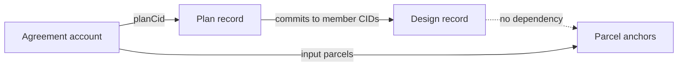

<!-- Open plan: reading designs, plans and agreements from the connected chain and minting them there, with the server as a courier and mirror rather than a requirement. -->
# Blockchain flows: read and mint without our server

The chain plus IPFS is an independent source of published records. Our server is a courier for IPFS
uploads and a searchable mirror of what is published; nothing a person can do with a connected wallet
may require it. This document is the plan for restoring that property after the plan/design/agreement
rework ([plan-design-agreement.md](plan-design-agreement.md)), which kept the principle in writing and
lost it in code: publication pins only through `POST /pins`, reading comes only from the index, and the
chain reader (`chain-proposal-loader.js`) was removed with the proposal-era readers.

Decisions taken 2026-10-29 are stated as rules; what is still open is listed at the end. Terms here
are proposed; [vocabulary.md](vocabulary.md) changes when a milestone lands, not before.

## The objects on chain

| Object | Identity | On chain | Needs first | Who mints | Chains |
|---|---|---|---|---|---|
| **Parcel anchor** | cadastral parcel id | an ownerless account per parcel: id, fixed metadata URI. Created once, never transferred, never closed. The parcel's public address and inbox. | nothing | anyone (pays rent only) | Solana (`parcel_nft` v2, built); EVM (to build: `ParcelNFT.sol` is a transferable ERC-721 minted to an address, which contradicts this row) |
| **Design record** | design CID | the CID, the minter, the chain time | the content retrievable from IPFS | anyone | both, to build |
| **Plan record** | plan CID | the CID, the minter, the chain time | the plan and every member design retrievable from IPFS. Member designs need no record of their own: the plan's CID commits to their CIDs. | anyone | both, to build |
| **Agreement** | agreement CID + sponsor | the account the agreement program keeps: escrow, lens, deadline, decision, status ([program README](../blockchain/solana/programs/agreement/README.md)) | the content retrievable; **every input parcel anchored**; the plan it names retrievable | the sponsor's wallet | Solana (built, devnet); EVM (to build) |

Rules behind the table:

- **Identity is the CID.** A chain record says "this content exists, since this time, minted by this
  key". Holding a design or plan record confers nothing; it is not ownership of land or of the design.
  Readers verify content by hashing the bytes they fetch (`frontend/js/cid.js`), never by trusting the
  record, the gateway or our index.
- **Designs are geometry, not parcels.** A design references no cadastral parcel, so neither a design
  nor a plan record needs parcel anchors. Only an agreement names parcels, and it needs their anchors
  because the anchors are where its parties, decisions and execution history attach.
- **First-create-wins is harmless for designs and plans.** The record carries no rights, so a second
  minter of the same CID is refused and nothing is lost. The agreement keeps its `PDA(sponsor, cid)`
  address because the sponsor funds and may cancel it.
- **The index is a mirror.** The server's `consensus.design` / `.plan` / `.agreement` tables index what
  is published; a chain watcher on the server imports records it finds on chain whose content it can
  fetch from IPFS (chain → server), so content published without our server still reaches the index.
  The browser mirrors a mint it performed (`POST /agreements/:cid/onchain` today) as a courtesy; a
  failure to mirror never fails the mint.

## Flow 1: read from the connected chain

Lists gets a **From chain** source beside Browser and Published. It needs the wallet's chain and an
RPC, not our server.

1. **Enumerate.** Solana: `getProgramAccounts` on the record and agreement programs with a memcmp on
   the kind or status (the method-capable RPC routing in `solana/rpc-routing.js` already exists).
   EVM: the registry and agreement contracts keep enumerable ids (`count()` / `at(i)`); event-log
   scans are not used because public RPCs cap them.
2. **Fetch content** by CID from public IPFS gateways (two configured, tried in order; the
   `IPFS_READ_GATEWAY` of the server is one candidate, never the only one).
3. **Verify**: hash the bytes, compare with the CID; refuse a mismatch and show it.
4. **Import** as local records through the same importers the index path uses
   (`DesignSync.importDesign`, the plan workspace, `AgreementSync`), marked with their chain reference.
   An agreement imports its plan and designs the same way, transitively.
5. **Show** the chain state on the record: minted at, minter, explorer link; for an agreement the
   status, escrow and decision the account holds.

Agreements are also found by a design or a parcel: a design's agreements are the agreement accounts
whose plan commits to its CID, which the reader resolves from the plans it has fetched; a parcel's
agreements are the ones whose content names it. Both are reads over fetched content, not chain
filters.

## Flow 2: get the content onto IPFS

Content must be retrievable before anything references it on chain. The courier order, each step
used only when the one before is unavailable:

1. **Our server**: `POST /pins` as today (Filebase, [ipfs-storage.md](ipfs-storage.md)).
2. **The person's own provider key**, kept in their browser only: a pin-scoped Pinata JWT
   (Pinata's API accepts browser requests; Filebase needs S3 request signing and is unsuitable here).
   The dialog that asks for it says that the key stays in this browser and should be scoped to
   pinning.
3. **Self-pinned**: the dialog offers the canonical bytes as a file download and names the CID; the
   person pins it wherever they like and continues when it is retrievable.

Whatever the courier, the **retrievability gate** is the same: at least one public gateway that is
not our backend returns bytes hashing to the CID. The checklist retries with a visible count while
propagation takes its time; it does not offer "mint anyway", because a chain record pointing at
content nobody can fetch cannot be undone.

The wallet-facing token metadata (name, description, image URL) is a separate small object and goes
through the same courier. It is cosmetic: nothing verifies it, and readers never take content from it.

## Flow 3: mint on the connected chain

One **mint checklist** dialog for every object, built on one adapter interface each chain implements
(`listRecords(kind)`, `recordOf(cid)`, `anchorsMissing(parcelIds)`, `mintAnchors(parcelIds)`,
`mintRecord(kind, cid, tokenUri)`, `mintAgreement(...)`, plus the agreement actions the panel has).
The checklist shows each step with its state, a spinner while it runs, and an explorer link when it
is done:

| Step | Design | Plan | Agreement |
|---|---|---|---|
| Content retrievable (Flow 2) | the design | the plan and each member | the agreement, its plan, each member |
| Parcels anchored | — | — | every input parcel; "12 of 40 not anchored → Anchor them (4 transactions)" |
| Record minted | design record | plan record | agreement account |
| Funded | — | — | the sponsor's escrow, as today |

The parcel step is the browser's guard, not the program's: a Solana transaction cannot carry a
hundred anchor accounts for the program to check, so the agreement commits to its parcel list through
its CID and a reader shows any input parcel that has no anchor. EVM could check anchors in a loop; it
keeps the same rule so both chains read alike.

Anchoring is batched (Solana: several `create_parcel` instructions per transaction, as the parcel
claim UI's `parcel-mint.js` does one at a time; EVM: `anchorBatch`). Each batch is one wallet
approval; the checklist reports `k/N` anchored and resumes where it stopped after a refused
signature.

After a successful mint the browser mirrors the chain reference to the index when the server answers;
otherwise the server's chain watcher will find it.

## Flow 4: a connected wallet makes the chain the primary path

Share (the design panel, the plan dialog, the agreement panel) publishes through the server and copies
the link today. With a wallet connected to a chain this app has programs on:

- the Share dialog's publish step offers **Publish on &lt;chain&gt;** as the primary action, which runs
  the mint checklist (Flow 2, then Flow 3), and **Publish through the server** as the alternative;
- with no wallet connected, publishing goes to the server without a choice, as today;
- the share link is the same `/designs/<cid>`, `/plans/<cid>`, `/agreements/<cid>` link either way,
  because the link names content, not where it was published. A reader that arrives at the link with
  our server down falls back to Flow 1 for the content when a wallet or a public RPC is available.

## Chain contracts

**Solana** (`blockchain/solana/programs/`):

- `parcel_nft` v2: unchanged; it is the anchor.
- `agreement`: unchanged for the sponsor's account. (Open: whether `create` should also take the
  plan CID so a reader can find agreements of a plan by memcmp instead of fetching every agreement.)
- **`record`** (new): `Record` at `PDA(["design" | "plan", sha256(cid)])` with `kind u8`, `cid
  string`, `minter Pubkey`, `created_at i64`, `bump u8`. One instruction, `create(kind, cid)`, refused
  when the account exists. Fixed fields first so memcmp on `kind` works.
- `proposal_nft` is retired by this plan (its consent machinery moved to `agreement`); `proposal_market`
  and `proposal_pledge` stay as they are, reading agreement accounts.

**EVM** (`blockchain/contracts/`, Foundry):

- **`ParcelAnchor`** (new) replaces `ParcelNFT.sol`: `anchor(parcelId, metadataURI)` and
  `anchorBatch(...)`, a mapping from `keccak256(parcelId)` to `{ metadataURI, anchoredAt, anchoredBy }`,
  no owner, no transfer, `count()` / `at(i)` for readers. The ENS offchain resolver keeps resolving
  parcel names (`contracts/ens/`), reading this contract instead.
- **`RecordRegistry`** (new): a non-transferable ERC-721 (`_update` reverts on transfer) with
  `tokenId = uint256(sha256(cid))`, `mint(kind, cid, tokenURI)` to the minter so wallets show it,
  `ERC721Enumerable` for readers. (Open question 1 decides whether it is a token at all.)
- **`Agreement`** (new): the Solana program's lifecycle in Solidity: `create(cid, lens, payout,
  deadline, required)` keyed by `keccak256(sponsor, cid)`, `fund` by the sponsor, `attest(uid)`
  checking an EAS `AgreementDecision` attestation by the named lens (the `IEAS` interface and
  `MockEAS` that `ProposalNFT.sol` used already exist), `execute`, `cancel`, `expire`; escrow in the
  native token. `ProposalNFT.sol` is retired.
- Deployments: Base Sepolia (84532) and Sepolia (11155111) as `frontend/contracts/addresses.json`
  lists today; the local Hardhat chain (31337) for tests. Mainnet choice is open.

Programs and contracts that reach a mainnet are immutable and open source (decision of 2026-10-09),
so every account layout above is final at that deploy; devnet and testnet carry the iteration.

## Browser and server pieces

- `frontend/js/chain/` (new): the adapter interface, `solana-adapter.js` over `AgreementClient`,
  `AgreementBridge`, `SolanaParcelClient` and a new `record-client.js`; `evm-adapter.js` over
  `ChainDataLoader`'s provider and `contracts-loader.js`. UMD, so the agents use the same code in
  node (the pattern of `agreement-client.js`).
- The mint checklist dialog on the shared dialog chrome (`js/ui/dialogs.js`), with busy controls on
  every step that signs or waits.
- The Share dialog (its own plan) hosts Flow 4.
- Lists: the From chain source, with the chain and cluster named in the source picker.
- Server: a chain watcher in `backend/oracle/` importing records and agreements from both chains
  into the index after fetching and verifying their content; the lifecycle oracle already observes
  agreement status and is extended rather than duplicated.
- MCP parity: agents mint through the same adapters with the agent keypair. `ugt_mint_agreement`
  exists; `ugt_mint_design`, `ugt_mint_plan`, `ugt_anchor_parcels` and `ugt_chain_records` are added
  in the same milestone as the browser flow they mirror, and the discovery catalogue
  (`backend/agents/mcp-catalog.js`) lists them.

## Milestones

Each milestone is code first, then its tests in one pass (unit tests for the pure adapter and codec
parts in `backend/test/`, Anchor or Forge tests for programs, Playwright for the dialogs against the
mock API and a local validator), then docs and the vocabulary entries it changes.

1. **R1, Solana reader.** From chain in Lists for agreements, their plans and designs, on devnet,
   with the verify step and chain state on the records. No server involved. Done when a devnet
   agreement opens from a browser whose `backend` is unreachable.
2. **R2, Solana records and the checklist.** The `record` program on devnet; Flow 2's courier
   order and gate; the mint checklist for designs, plans and agreements including parcel anchoring;
   Flow 4 in the Share dialog; the server chain watcher; the MCP tools. Done when a design drawn in
   a browser with no `backend` is minted and later listed by the index.
3. **R3, EVM anchors, registry and reader.** `ParcelAnchor`, `RecordRegistry`, the EVM adapter and
   From chain on Base Sepolia; the ENS resolver repointed. Done when R1 and R2's checks pass with an
   EVM wallet for designs and plans.
4. **R4, EVM agreements.** The `Agreement` contract, EAS attestation by the lens, escrow, the
   agreement panel's actions on EVM. Done when an agreement proposed with an EVM wallet executes on
   Base Sepolia from a lens attestation.

Sizes, as estimates to be revised when each starts: R1 about two days, R2 about a week, R3 three to
four days, R4 about a week; R4 is the only new money-holding contract.

## Open questions

1. **Wallet-visible NFTs or plain records?** A design or plan record as a plain program account /
   registry entry is cheapest and simplest; as a token (Metaplex Core on Solana, the soulbound
   ERC-721 above on EVM) it shows in wallets with its image, for a little more rent and gas and a
   metadata object per mint. The record's meaning is the same either way.
2. **Which EVM mainnet**, when the time comes; Base is the working assumption because the testnet
   deployments are there.
3. **The lens on EVM.** Lens members attest with Solana keys today (SAS). R4 needs each member to
   hold an EVM key and attest through EAS, or a cross-chain attestation; this is a lens-model change.
4. **Plan records at all?** A plan is addressable by CID without a record. The record adds a
   timestamp and a place to find plans on chain; if that is not wanted, plans are read through the
   agreements that name them and R2 shrinks.
5. **Agreement `create` carrying the plan CID**, for the reader's benefit (see Chain contracts).
6. **Anchors for input parcels of a non-binding agreement.** A community vote names parcels but
   moves nothing and is never minted today; it stays off chain unless a reason to mint it appears.

## Vocabulary entries this changes when implemented

Index (becomes a mirror fed from the chain as well as from publication), Publication (retrievability
rather than our pin), Mint (a design or plan record as well as an agreement account), Parcel anchor
(new entry; the EVM form stops being a transferable token), Lists (the From chain source), Share (the
chain-first publish step with a wallet connected).
