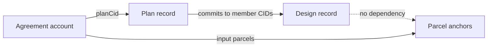

<!-- Open plan: reading designs, plans and agreements from the connected chain and minting them there, with the server as a courier and mirror rather than a requirement. -->
# Blockchain flows: read and mint without our server

The chain plus IPFS is an independent source of published records. Our server is a courier for IPFS
uploads and a searchable mirror of what is published; nothing a person can do with a connected wallet
may require it. This document is the plan for restoring that property after the plan/design/agreement
rework ([plan-design-agreement.md](plan-design-agreement.md)), which kept the principle in writing and
lost it in code: publishing a design, plan or agreement only indexes it and pins nothing, reading
comes only from the index, and the chain reader (`chain-proposal-loader.js`) was removed with the
proposal-era readers. An agreement minted on Solana therefore points at agreement, plan and design
CIDs that only our index holds, until Flow 2 puts what chain records reference on IPFS.

Decisions taken 2026-10-29 are stated as rules; what is still open is listed at the end. Every
program and contract may be changed, rewritten or replaced to fit this plan (user, 2026-10-29):
existing devnet accounts and testnet deployments are not kept for compatibility, and records on them
are re-created where needed, as the experimental-records rule in `AGENTS.md` already says. Terms here
are proposed; [vocabulary.md](vocabulary.md) changes when a milestone lands, not before.

## The objects on chain

| Object | Identity | On chain | Needs first | Who mints | Chains |
|---|---|---|---|---|---|
| **Parcel anchor** | cadastral parcel id | an ownerless account per parcel: id, fixed metadata URI. Created once, never transferred, never closed. The parcel's public address and inbox. | nothing | anyone (pays rent only) | Solana (`ugt`, devnet); EVM (`ParcelAnchor`, Base Sepolia and Sepolia) |
| **Design record** | design CID | the CID, the minter, the chain time | the content retrievable from IPFS | anyone | Solana (`ugt`, a Metaplex Core asset); EVM (`RecordRegistry`) |
| **Plan record** | plan CID | the CID, the minter, the chain time | the plan and every member design retrievable from IPFS. Member designs need no record of their own: the plan's CID commits to their CIDs. | anyone | Solana and EVM, as design records |
| **Agreement** | agreement CID + sponsor | the agreement account: escrow, lens, deadline, decision, status, the plan's CID hash ([program README](../blockchain/solana/programs/ugt/README.md)) | the content retrievable; **every input parcel anchored**; the plan it names retrievable | the sponsor's wallet | Solana (`ugt`, devnet); EVM (`Agreement`) |

Rules behind the table:

- **Identity is the CID.** A chain record says "this content exists, since this time, minted by this
  key". Holding a design or plan record confers nothing; it is not ownership of land or of the design.
  Readers verify content by hashing the bytes they fetch (`frontend/js/cid.js`), never by trusting the
  record, the gateway or our index.
- **Designs are geometry, not parcels.** A design references no cadastral parcel, so neither a design
  nor a plan record needs parcel anchors. Only an agreement names parcels, and it needs their anchors
  because the anchors are where its parties, decisions and execution history attach.
- **First-create-wins is harmless for designs and plans.** The record carries no rights, so a second
  minter of the same CID is refused and nothing is lost. The agreement keeps its `PDA(sponsor, cid)`
  address because the sponsor funds and may cancel it.
- **The index is a mirror.** The server's `consensus.design` / `.plan` / `.agreement` tables index what
  is published; a chain watcher on the server imports records it finds on chain whose content it can
  fetch from IPFS (chain → server), so content published without our server still reaches the index.
  The browser mirrors a mint it performed (`POST /agreements/:cid/onchain` today) as a courtesy; a
  failure to mirror never fails the mint.

## Flow 1: read from the connected chain

Lists gets a **From chain** source beside Browser and Published. It needs the wallet's chain and an
RPC, not our server.

1. **Enumerate.** Solana: `getProgramAccounts` on the ugt program with a memcmp on the record kind,
   the account discriminator or the agreement status (the method-capable RPC routing in `solana/rpc-routing.js` already exists).
   EVM: the registry and agreement contracts keep enumerable ids (`count()` / `at(i)`); event-log
   scans are not used because public RPCs cap them.
2. **Fetch content** by CID from public IPFS gateways (two configured, tried in order; the
   `IPFS_READ_GATEWAY` of the server is one candidate, never the only one).
3. **Verify**: hash the bytes, compare with the CID; refuse a mismatch and show it.
4. **Import** as local records through the same importers the index path uses
   (`DesignSync.importDesign`, the plan workspace, `AgreementSync`), marked with their chain reference.
   An agreement imports its plan and designs the same way, transitively.
5. **Show** the chain state on the record: minted at, minter, explorer link; for an agreement the
   status, escrow and decision the account holds.

Agreements are also found by a design or a parcel: a design's agreements are the agreement accounts
whose plan commits to its CID, which the reader resolves from the plans it has fetched; a parcel's
agreements are the ones whose content names it. Both are reads over fetched content, not chain
filters.

## Flow 2: get the content onto IPFS

Content must be retrievable before anything references it on chain. The courier order, each step
used only when the one before is unavailable:

1. **Our server**: `POST /pins` (Filebase, [ipfs-storage.md](ipfs-storage.md)), which is kept for
   this and which no publication path calls.
2. **The person's own provider key**, kept in their browser only: a pin-scoped Pinata JWT
   (Pinata's API accepts browser requests; Filebase needs S3 request signing and is unsuitable here).
   The dialog that asks for it says that the key stays in this browser and should be scoped to
   pinning.
3. **Self-pinned**: the dialog offers the canonical bytes as a file download and names the CID; the
   person pins it wherever they like and continues when it is retrievable.

Whatever the courier, the **retrievability gate** is the same: at least one public gateway that is
not our backend returns bytes hashing to the CID. The checklist retries with a visible count while
propagation takes its time; it does not offer "mint anyway", because a chain record pointing at
content nobody can fetch cannot be undone.

The wallet-facing token metadata (name, description, image URL) is a separate small object and goes
through the same courier. It is cosmetic: nothing verifies it, and readers never take content from it.

## Flow 3: mint on the connected chain

One **mint checklist** dialog for every object, built on one adapter interface each chain implements
(`listRecords(kind)`, `recordOf(cid)`, `anchorsMissing(parcelIds)`, `mintAnchors(parcelIds)`,
`mintRecord(kind, cid, tokenUri)`, `mintAgreement(...)`, plus the agreement actions the panel has).
The checklist shows each step with its state, a spinner while it runs, and an explorer link when it
is done:

| Step | Design | Plan | Agreement |
|---|---|---|---|
| Content retrievable (Flow 2) | the design | the plan and each member | the agreement, its plan, each member |
| Parcels anchored | — | — | every input parcel; "12 of 40 not anchored → Anchor them (4 transactions)" |
| Record minted | design record | plan record | agreement account |
| Funded | — | — | the sponsor's escrow, as today |

The parcel step is the browser's guard, not the program's: a Solana transaction cannot carry a
hundred anchor accounts for the program to check, so the agreement commits to its parcel list through
its CID and a reader shows any input parcel that has no anchor. EVM could check anchors in a loop; it
keeps the same rule so both chains read alike.

Anchoring is batched (Solana: several `create_parcel` instructions per transaction, as the parcel
claim UI's `parcel-mint.js` does one at a time; EVM: `anchorBatch`). Each batch is one wallet
approval; the checklist reports `k/N` anchored and resumes where it stopped after a refused
signature.

After a successful mint the browser mirrors the chain reference to the index when the server answers;
otherwise the server's chain watcher will find it.

## Flow 4: a connected wallet makes the chain the primary path

Share (the design panel, the plan dialog, the agreement panel) publishes through the server and copies
the link today. With a wallet connected to a chain this app has programs on:

- the Share dialog's publish step offers **Publish on &lt;chain&gt;** as the primary action, which runs
  the mint checklist (Flow 2, then Flow 3), and **Publish through the server** as the alternative;
- with no wallet connected, publishing goes to the server without a choice, as today;
- the share link is the same `/designs/<cid>`, `/plans/<cid>`, `/agreements/<cid>` link either way,
  because the link names content, not where it was published. A reader that arrives at the link with
  our server down falls back to Flow 1 for the content when a wallet or a public RPC is available.

## Chain contracts

**Solana** (`blockchain/solana/programs/`):

Since the programs may be rewritten, the anchors, records and agreements are **one program**,
`ugt` ([README](../blockchain/solana/programs/ugt/README.md)): one deploy and one rent instead of three, one IDL and one client for the
adapter, and the agreement can check anchors and records it owns without cross-program reads.

- **`ParcelAnchor`** at `PDA(["parcel", parcelId])`: ownerless, fixed metadata URI, never closed; it
  records who paid (`anchored_by`, not an owner) and when. `anchor_parcels(ids[])` creates several per
  transaction and skips ones that exist, so a resumed batch never fails on its own earlier work.
- **`Record`** at `PDA(["record", kind, sha256(cid)])` for `kind` design or plan: `kind u8`, `minter`,
  `created_at`, `asset`, then `cid`, fixed fields first so memcmp on `kind` works.
  `create_record(kind, cid, name, uri)` is refused when the account exists, and mints the record's
  Metaplex Core asset at `PDA(["asset", kind, sha256(cid)])` to the publisher, permanently frozen.
- **`Agreement`**: the current program's account and lifecycle, plus `plan_cid` stored at a fixed
  offset (as its sha256, so memcmp finds the agreements of a plan without fetching every agreement).
  Anchoring stays the browser's guard, as in Flow 3; the account records `input_count` from the
  content for readers.
- `proposal_nft`, the separate `parcel_nft` and the separate `agreement` program are retired.
  `proposal_market` and `proposal_pledge` are repointed at the new agreement account layout (in
  source; their devnet deployments are upgraded in place when this branch is deployed, see R2); they
  may be merged into the same program later if their deploy cost argues for it.

**EVM** (`blockchain/contracts/`, Foundry):

- **`ParcelAnchor`** (new) replaces `ParcelNFT.sol`: `anchor(parcelId, metadataURI)` and
  `anchorBatch(...)`, a mapping from `keccak256(parcelId)` to `{ metadataURI, anchoredAt, anchoredBy }`,
  no owner, no transfer, `count()` / `at(i)` for readers. The ENS offchain resolver keeps resolving
  parcel names (`contracts/ens/`), reading this contract instead.
- **`RecordRegistry`** (new): a non-transferable ERC-721 (`_update` reverts on transfer) with
  `tokenId = uint256(sha256(cid))`, `mint(kind, cid, tokenURI)` to the minter so wallets show it,
  `ERC721Enumerable` for readers.
- **`Agreement`** (new): the Solana program's lifecycle in Solidity: `create(cid, lens, payout,
  deadline, required)` keyed by `keccak256(sponsor, cid)`, `fund` by the sponsor, `attest(uid)`
  checking an EAS `AgreementDecision` attestation by the named lens (the `IEAS` interface and
  `MockEAS` that `ProposalNFT.sol` used already exist), `execute`, `cancel`, `expire`; escrow in the
  native token. `ProposalNFT.sol` is retired.
- Deployments: Base Sepolia (84532) and Sepolia (11155111) as `frontend/contracts/addresses.json`
  lists today; the local Hardhat chain (31337) for tests. Mainnet choice is open.

Programs and contracts that reach a mainnet are immutable and open source (decision of 2026-10-09),
so every account layout above is final at that deploy; devnet and testnet carry the iteration.

## Browser and server pieces

- `frontend/js/chain/` (new): the adapter interface, `solana-adapter.js` over `AgreementClient`,
  `AgreementBridge` and `SolanaParcelClient` (rewritten as one codec for the one program); `evm-adapter.js` over
  `ChainDataLoader`'s provider and `contracts-loader.js`. UMD, so the agents use the same code in
  node (the pattern of `agreement-client.js`).
- The mint checklist dialog on the shared dialog chrome (`js/ui/dialogs.js`), with busy controls on
  every step that signs or waits.
- The Share dialog (its own plan) hosts Flow 4.
- Lists: the From chain source, with the chain and cluster named in the source picker.
- Server: a chain watcher in `backend/oracle/` importing records and agreements from both chains
  into the index after fetching and verifying their content; the lifecycle indexer already observes
  agreement status and is extended rather than duplicated.
- MCP parity: agents mint through the same adapters with the agent keypair. `ugt_mint_agreement`
  exists; `ugt_mint_design`, `ugt_mint_plan`, `ugt_anchor_parcels` and `ugt_chain_records` are added
  in the same milestone as the browser flow they mirror, and the discovery catalogue
  (`backend/agents/mcp-catalog.js`) lists them.

## Milestones

Each milestone is code first, then its tests in one pass (unit tests for the pure adapter and codec
parts in `backend/test/`, Anchor or Forge tests for programs, Playwright for the dialogs against the
mock API and a local validator), then docs and the vocabulary entries it changes.

1. **R1, Solana reader.** From chain in Lists for agreements, their plans and designs, on devnet,
   with the verify step and chain state on the records. No server involved. Done when a devnet
   agreement opens from a browser whose `backend` is unreachable.
   *Built:* `frontend/js/chain/ipfs-read.js` (gateways in order, `IPFS_READ_GATEWAYS` in
   `rpc-config.js` overrides them, bytes hashed against the CID), `chain/chain-reader.js` (agreement
   accounts listed through `AgreementClient.listAgreements`, `onchain` spelled by
   `AgreementClient.onchainOf` for the browser and the server alike), and the Lists agreements tab's
   **Source** filter (Server index / On chain). The agreement, plan and design loaders ask the index
   first and read IPFS for what it cannot give; a design read from IPFS gets its binding derived in
   the browser (`DesignSync.withDerivedBinding`, the server's own `bindingFromParcels`) and is marked
   published at its gateway, not at the server. Still open: the Plans and Designs tabs list from the
   chain once they have records (R2), and today's devnet agreements open only where their content is
   retrievable — none of it is on public IPFS until Flow 2 pins what the chain references. The
   program-accounts RPC (`SOLANA_PROGRAM_ACCOUNTS_RPC_URLS`) must accept the page's origin.
2. **R2, Solana records and the checklist.** The one program on devnet, replacing `parcel_nft` and
   `agreement` (R1's reader moves to its layout; devnet agreements are re-created); Flow 2's courier
   order and gate; the mint checklist for designs, plans and agreements including parcel anchoring;
   Flow 4 in the Share dialog; the server chain watcher; the MCP tools. Done when a design drawn in
   a browser with no `backend` is minted and later listed by the index.
   *Built (after R3 and R4, user 2026-11-13):* `blockchain/solana/programs/ugt` (anchors, records with a
   frozen Metaplex Core asset by a hand-encoded `CreateV2` CPI, agreements with `plan_cid_hash` and
   `input_count`), Anchor suites for it and for the market and pledge programs rebuilt against it,
   deployed on devnet as `95sjeTXUYG721iZK29s3kr7Dq4eFqv6PFoEmPYJDtkp9`. Browser:
   `frontend/js/solana/ugt-client.js` (codec), `frontend/js/chain/solana-adapter.js` (the adapter
   interface of `evm-adapter.js`, anchors packed by transaction size), Share offers every connected
   wallet's chain, Lists reads design and plan records from the Solana cluster unless an EVM wallet is
   connected, and the parcel claim and agent profile read ugt anchors. Server:
   `backend/chain/adapters.js` dispatches by chain key (`solana-devnet` or an EVM chain id) for the
   watcher (`CHAIN_WATCH_KEYS`, default `solana-devnet,84532`) and the MCP record tools (Solana by
   default, signing with `UGT_AGENT_KEYPAIR`). The devnet accounts of the retired `agreement` program
   are not migrated: they and the index rows that name them stay as last observed (the lifecycle
   indexer refreshes only rows of the program it watches) and parcel history keeps the land events that
   program attested. Still open: the devnet `proposal_market` and `proposal_pledge` still read the
   retired program, so markets and pledges on ugt agreements wait for their in-place upgrade at this
   branch's deploy; at that point the retired program's open agreements and markets are closed first
   (user, 2026-11-13); Share and the mint checklist with a Solana wallet are verified in the browser
   with an injected wallet on a local validator, not yet with Phantom on devnet. The London test design
   and plan are pinned to public IPFS (Filebase), so the watcher imports them.
3. **R3, EVM anchors, registry and reader.** `ParcelAnchor`, `RecordRegistry`, the EVM adapter and
   From chain on Base Sepolia; the ENS resolver repointed. Done when R1 and R2's checks pass with an
   EVM wallet for designs and plans.
   *Built (before R2, by the user's choice of 2026-11-10):* `blockchain/contracts/ParcelAnchor.sol`
   (ownerless anchors keyed by `keccak256(parcelId)`, `anchorBatch` skipping what exists, paged
   readers and a per-creator listing) and `RecordRegistry.sol` (soulbound ERC-721, token id
   `uint256(sha256(cid))`, `records(offset, limit, kind)` for readers), with Forge tests; deployed on
   Base Sepolia, Sepolia and local 31337 by `blockchain/scripts/deploy-anchors-registry.sh` (forge,
   addresses merged into `frontend/contracts/addresses.json`). `ParcelNFT.sol`, `ProposalNFT.sol`,
   their deploy scripts, hardhat-era mint/accept scripts and tests are retired; `IEAS` is its own
   file for R4. The browser pieces, all chain-agnostic except the adapter: `frontend/js/chain/evm-adapter.js`
   (the adapter interface over ethers), `ipfs-courier.js` (Flow 2: server `POST /pins`, own Pinata
   key kept in the browser, self-pinned download; the gate polls the public gateways with a visible
   count), `mint-checklist.js` (Flow 3, resumable steps; the agreement's parcel step is built and
   waits for an agreement adapter), `chain-publish.js` (Flow 4: Share offers "Publish on <chain>"
   first with an EVM wallet connected, mirrors to the index as a courtesy; a design minted on a chain
   counts as published wherever it is read). Token metadata is a `data:` URI, so a mint needs one
   pin, not two. Lists' Source filter now covers every tab (designs and plans from the EVM chain,
   agreements from the Solana cluster). The parcel claim UI anchors instead of minting to a wallet,
   the minted-parcels layer and the agent profile read anchors, and the ENS gateway answers a parcel
   name's `addr` with zero (an anchor has no owner; apex from `ENS_PARCEL_ANCHOR_ADDRESS`).
   *Server side:* `backend/chain/evm.js` binds the browser's EVM adapter to a JSON-RPC provider
   (`EVM_RPC_URL_<chainId>`, public defaults) and, for agents, to `UGT_AGENT_EVM_PRIVATE_KEY` (the
   project's own deployer key; `DEPLOYER_PRIVATE_KEY` in `backend/.env` is a public dev key).
   `backend/chain/courier.js` is Flow 2 for the server: the public-gateway gate, pinning through
   `storage/pinning.js` only when no public gateway serves the object. MCP, local mode only:
   `ugt_chain_records`, `ugt_mint_design`, `ugt_mint_plan` (members retrievable, then the plan, then
   its record) and `ugt_anchor_parcels` (metadata URI = the parcel's app page). The chain watcher
   `backend/oracle/chain-records-job.mjs` (PM2 `consensus-builder-chain-records`, every 15 min,
   `CHAIN_WATCH_KEYS`) imports retrievable, CID-verified records into the index, designs before
   plans, binding a design with its city's configured parcel source; plans wait for their members.
   `ParcelAnchor`, `RecordRegistry` and `Agreement` are source-verified on Basescan (Base Sepolia) and
   Etherscan (Sepolia). Still open from R3: the live ENS records (the scripts are repointed, not run;
   they change mainnet ENS names the deployed site uses, so they run at this branch's deploy), and an
   outcome check for the watcher in the alerts repo (once the watcher runs on prod).
4. **R4, EVM agreements.** The `Agreement` contract, EAS attestation by the lens, escrow, the
   agreement panel's actions on EVM. Done when an agreement proposed with an EVM wallet executes on
   Base Sepolia from a lens attestation.
   *Built:* `blockchain/contracts/Agreement.sol` (one entry per `keccak256(sponsor, cid)`, escrow in
   the native token, `attest(key, uid)` checking the lens's EAS AgreementDecision field by field;
   deployed on Base Sepolia and Sepolia by `scripts/deploy-agreement.sh`, which also registers the
   schema `string agreementCid, address sponsor, string decision, string evidenceRef, uint64
   sourceObservedAt`). Browser: `frontend/js/chain/evm-agreement.js` is the EVM counterpart of the
   Solana `AgreementBridge`; the agreement panel picks its bridge from the sponsor's key (a 0x
   sponsor mints on EVM, a minted agreement stays on its chain), an EVM mint runs the mint checklist
   first (members, plan and agreement retrievable; every input parcel anchored, metadata URI = the
   parcel's page), then `POST /agreements/:cid/onchain { chain: 'evm', chainId, account, signature }`
   mirrors it. Server: the index verifies an EVM mint against the contract (`agreements/onchain-evm.js`),
   the lifecycle indexer refreshes EVM rows (`--evm-chain 84532`, PM2 `consensus-builder-land-oracle-evm`),
   and the lens member attests EVM agreements through EAS with `LENS_EVM_PRIVATE_KEY` (else
   `UGT_AGENT_EVM_PRIVATE_KEY`): the sponsor's key family decides the chain, an EVM agreement's
   `rule.lens` names the member's EVM address, and the member's approval attester accepts either of
   its keys there. Verified: the whole lifecycle through the browser bridge against a local chain
   (mint, fund, attest from a seeded EAS decision, execute, cancel refused); the agreement panel's
   EVM path and the lens's live EAS issuing are not yet exercised against Base Sepolia. The lifecycle
   indexer writes land events for terminal EVM agreements too (the terminal log found by a paged
   `queryFilter`, event times from its block, ids scoped `eip155:<chainId>:<contract>`), so parcel
   history shows them. The lens directory serves each member's addresses per chain family
   (`addresses { solana, evm }`, `lens_member.evm_address`); the agreement dialog, the lens picker and
   the agent tools offer only members on the sponsor's chain. EVM agreement markets
   (`AgreementOutcomeReporter`, `AgreementMarkets` over Gnosis Conditional Tokens and its LMSR market
   maker, [`README-agreement-markets.md`](../blockchain/contracts/README-agreement-markets.md)) are
   built and tested on a local chain, not deployed, with no browser or bettor adapter yet. Still open:
   the `lens_attestation` DDL change (`chain`, `chain_id`) and `lens_member.evm_address` to apply at
   deploy; the land events' unique index on an agreement's lifecycle ignores the chain, so one
   sponsor's same CID minted on two EVM chains fails on the second (reported, not lost). `ugt_mint_agreement` mints on EVM too (`chainId`, escrow in `wei`),
   the agent being the sponsor and naming the lens by the EVM address in the agreement's `rule.lens`.

Sizes, as estimates to be revised when each starts: R1 about two days, R2 about a week, R3 three to
four days, R4 about a week; R4 is the only new money-holding contract.

## Decided 2026-11-13

- **Settlement reads the chain, never our server.** A market settles by reading the agreement on its
  own chain (Solana `proposal_market.resolve`; on EVM a permissionless reporter reading `Agreement`).
  The agreement lifecycle job (`backend/oracle/agreement-lifecycle.js`, PM2 `*-land-oracle*`) is an
  indexer: it mirrors terminal states into the index for parcel history, the market pages and the
  verified-fact API, and nothing on chain depends on it. Only a market on another chain than its
  agreement would need an attested outcome.
- **A lens member is one identity with an address per chain.** It publishes a Solana key, an EVM
  address or both, each proven by a signature from that key, and is available only on the chains it
  published an address for. An agreement's `rule.lens` holds addresses of its own chain only.
- **EVM agreement markets reuse Gnosis Conditional Tokens and its LMSR market maker** (the contracts
  Polymarket and Omen run on) rather than a port of `proposal_market`; LMSR keeps the Solana market's
  pricing. Built and tested; whether to deploy it is not decided.

## Decided 2026-11-09

- **Design and plan records are wallet-visible tokens**: a Metaplex Core asset on Solana, the
  soulbound ERC-721 above on EVM, each with a token metadata object (Flow 2). The record's meaning is
  unchanged: it confers nothing.
- **Plans get records**, the same mechanism as designs.
- **Parcel anchors are ownerless on both chains.** EVM's transferable `ParcelNFT.sol` is replaced by
  `ParcelAnchor`; ownership reaches the chain only as a lens attestation.
- **Anchoring stays the browser's guard** (Flow 3); the program does not bind parcels.
- **Work runs in milestone order** R1 → R4.

## Open questions

1. **Which EVM mainnet**: Base (decided 2026-11-13; the testnet deployments are on Base Sepolia).
2. **The lens on EVM** (decided 2026-11-13, "use one of our existing EVM keys"): a lens member holds
   an EVM key beside its Solana keypair (`LENS_EVM_PRIVATE_KEY`, the project's deployer key for the
   testnets) and attests EVM agreements through EAS; a member's EVM address must still reach the lens
   directory so a browser can name it in `rule.lens` and find its decisions.
3. **Non-binding agreements are never minted** (decided 2026-11-13): a community or owner vote names
   parcels but moves nothing, stays a poll in the index, and its parcels are not anchored for it.

## Vocabulary entries this changes when implemented

Index (becomes a mirror fed from the chain as well as from publication), Publication (retrievability
rather than our pin), Mint (a design or plan record as well as an agreement account), Parcel anchor
(new entry; the EVM form stops being a transferable token), Lists (the From chain source), Share (the
chain-first publish step with a wallet connected).
