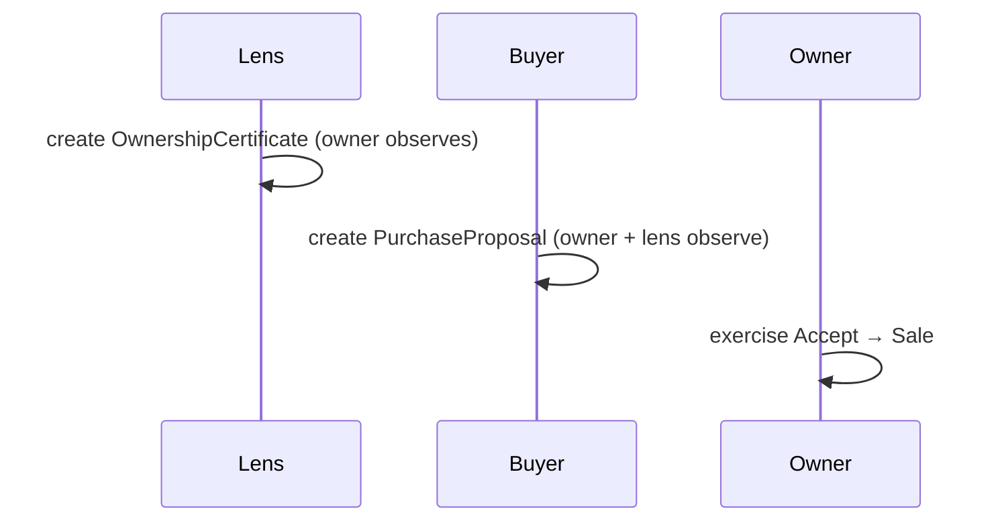

# Canton and DAML contracts

> Integration reference: deployment statements below describe the implementation at the time of writing. For current app workflows, videos and setup, use the [documentation index](README.md). Verify the active network and contracts before running these procedures.

The DAML contracts in `blockchain/daml/` model a single-parcel purchase on Canton, and the
decisions below still shape them. Build, test and deploy steps are in
[blockchain/daml/README.md](../blockchain/daml/README.md); endpoints, auth and Canton Coin findings
are in [DEVNET-ACCESS.md](../blockchain/daml/DEVNET-ACCESS.md).

The map app's Canton integration (`backend/canton/`, `backend/routes/canton.js`, `frontend/canton.html`
and `frontend/js/canton/`) was removed on 2026-10-22 in commit 8a9b09ccd; only the contracts remain.

## The DAML model

SDK 3.4.11, package `consensus-builder-daml` 0.3.0. Templates in `daml/Proposal.daml`:

- `OwnershipCertificate`: signatory `lens`, observer `owner`. The buyer-chosen lens attests that
  `owner` owns `parcelId`.
- `PurchaseProposal`: signatory `buyer`, observers `owner` and `lens`. `Accept` (controller `owner`)
  archives the proposal and creates a `Sale`; `Withdraw` (controller `buyer`) cancels it.
- `Sale`: signatories `buyer` and `owner`, plus an `Optional lens` observer carried through
  `Accept`, so the lens still sees the completed sale.
- `ProposalMarker`: a public existence signal (signatory `buyer`, observer a public registry party)
  that carries only the parcel and an opaque proposal cid. It is created with each proposal and
  archived on accept or withdraw, so a public count of proposals per parcel exists without terms.

`daml test` (`daml/Test.daml`) covers the happy path, owner-only Accept and Withdraw.

## Visibility

Canton enforces visibility. Before Accept the buyer, owner and lens see the proposal and a stranger
sees nothing; after Accept the same three see the `Sale` and a stranger still sees nothing. The
archived marker drops the parcel's public count to zero.

## Decisions

- **One lens, chosen by the buyer.** The lens answers "who is the owner?" and is the buyer's own
  trust anchor (a notary, a lawyer, or the buyer); there is no central registry. Whether the owner
  agrees to sell is answered only by the owner's own Accept, which the lens cannot fake. The
  contracts take a single `lens : Party`; several lenses with "any one of them" semantics are not
  built.
- **Owners see proposals as observers.** Canton has no global state or broadcast, so the buyer names
  the owner as an observer on `PurchaseProposal`. The owner must already be a party, which the lens
  establishes off-ledger; finding who owns a parcel is the lens's job, not a protocol feature.
- **Existence public, terms private.** `ProposalMarker` stands in for the public NFT state Canton
  lacks: it says that a parcel has proposals while price and parties stay with the stakeholders.
- **Custodial parties.** All parties are hosted on one validator and driven by a backend user. A
  party on another participant, such as a Loop wallet, cannot be a stakeholder: its participant has
  not vetted this DAR (`PACKAGE_SELECTION_FAILED`), and Loop supports only the Splice and Utility
  DARs. Owner self-custody is out of scope.
- **No money moves.** `price` is a number denominated in Canton Coin. A real transfer needs the
  validator app's Amulet registry (scan) URL, or a Loop wallet `provider.transfer` payment linked to
  the proposal off-ledger; neither is built.
- **Shared DevNet, upgrade-compatible packages.** The target is the shared Canton DevNet "5n sandbox"
  validator through the JSON Ledger API v2, never a node of our own. Bump `version` in `daml.yaml` on
  every contract change and keep changes additive, with new fields `Optional` (as `Sale.lens` is).
