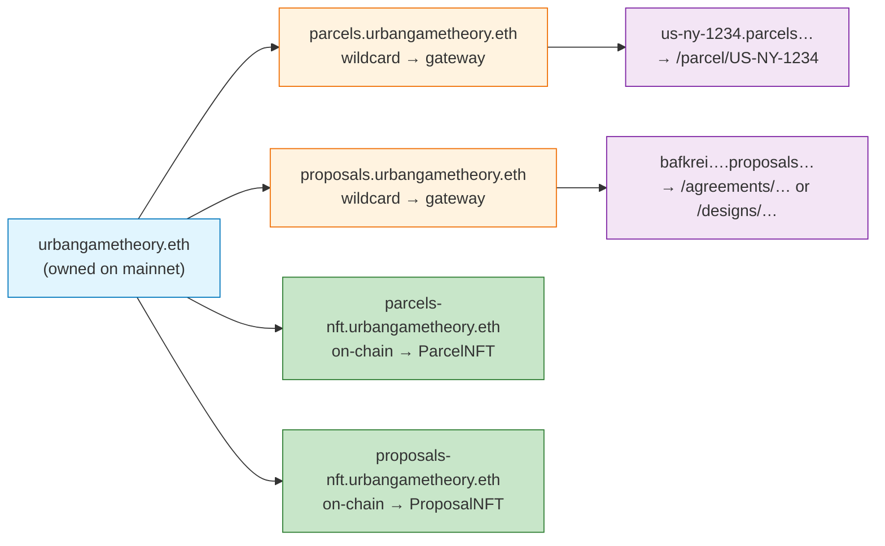
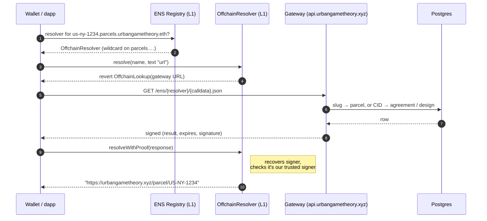
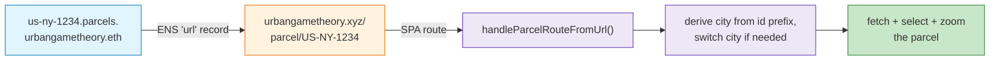
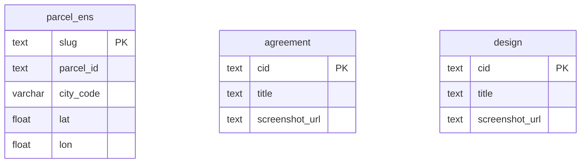

# ENS for Urban Game Theory

> Integration reference: deployment statements below describe the implementation at the time of writing. For current app workflows, videos and setup, use the [documentation index](README.md). Verify the active network and contracts before running these procedures.

ENS names for parcels and published records are live: the CCIP-Read gateway is
`backend/routes/ens.js` with `backend/ens/` (slug, signing, the `parcel_ens` table and its
populate script), the deep-link route is `frontend/js/parcels/route.js`, the in-app name line is
`frontend/js/ens/ens-name.js`, and the resolver contract is `blockchain/contracts/ens/OffchainResolver.sol`.

## Overview

Every parcel, every published agreement and design, and the NFT contracts have human-readable ENS
names under `urbangametheory.eth`. A name like `us-ny-1234.parcels.urbangametheory.eth` is a real
mainnet ENS name that any wallet or explorer resolves, and its `url` record deep-links into the app
and selects that parcel on the map. The parcel info panel shows the parcel's name on a compact ENS
line: the "ENS ↗" chip opens the name on `app.ens.domains`, and clicking the name copies it.

None of the 40,000+ parcels or the published records is registered on-chain one by one. One
wildcard name per namespace resolves all of them through an off-chain gateway, using ENS's
CCIP-Read standard, so a new parcel or record is nameable as soon as it exists.



## What you can resolve

| ENS name | Resolves to | How |
|---|---|---|
| `<slug>.parcels.urbangametheory.eth` | `/parcel/<parcelId>`, which opens and zooms the parcel | wildcard gateway |
| `<cid>.proposals.urbangametheory.eth` | `/agreements/<cid>` for a published agreement, else `/designs/<cid>` | wildcard gateway |
| `parcels.urbangametheory.eth` | the ParcelNFT contract address and a description | on-chain apex record |
| `proposals.urbangametheory.eth` | the ProposalNFT contract address and a description | on-chain apex record |
| `parcels-nft.urbangametheory.eth` | the ParcelNFT contract address | ENS public resolver |
| `proposals-nft.urbangametheory.eth` | the ProposalNFT contract address | ENS public resolver |

A parcel name also carries `text` records `url` (the deep link), `description` (for example
"Parcel US-NY-1234 in New York") and, where available, `geo` and `avatar`. A CID name carries
`url`, `description` (the record's title) and `avatar` (its screenshot). Any other proposals label,
such as a numeric id or a local draft, names nothing. `addr` records are optional and parcel-only
(see Open work).

## Key concepts

- **ENS name and subname.** `urbangametheory.eth` is the name we own. `parcels.…` is a subname;
  `us-ny-1234.parcels.…` is a subname of that.
- **Apex and children.** The apex is a name itself (`parcels.urbangametheory.eth`); its children
  are everything below it (`*.parcels.urbangametheory.eth`).
- **Wildcard resolution (ENSIP-10).** A resolver set on `parcels.…` answers for all children, so
  no parcel is registered on its own.
- **CCIP-Read (ERC-3668).** The on-chain resolver says "ask this HTTPS gateway" and then verifies
  the gateway's signed answer, so 40k names resolve without 40k registrations.
- **Slug.** An ENS-safe label derived from a parcelId (`HR-335258-4341/2` → `hr-335258-4341-2`,
  since `/` is not allowed in ENS labels). Slugs are not reversible, so `parcel_ens` stores the
  mapping.

## How a name resolves (the CCIP-Read flow)

When a wallet resolves `us-ny-1234.parcels.urbangametheory.eth`, ENS finds no resolver on
that exact node and walks **up** to `parcels.urbangametheory.eth`, whose resolver is our
**OffchainResolver**. That resolver doesn't store records: it bounces the query to our
gateway and verifies the signed reply.



The gateway signs every answer with a private key whose address is registered as the
resolver's **trusted signer**, so a tampered or spoofed response is rejected on-chain.

## From a name to the map (deep links)

The `url` text record points at a normal app URL. A small SPA route turns that into a
selected, zoomed parcel.



A CID name's `url` opens the app's `/agreements/<cid>` or `/designs/<cid>` route.

## Data the gateway reads



- `parcel_ens` (`backend/ens/parcel-ens-ddl.sql`): slug → parcelId for every parcel of a populated
  city. Only New York is populated (42,120 rows).
- `consensus.agreement` and `consensus.design`: the published records a CID label resolves to,
  agreement first.

## On-chain pieces

| Thing | Address (mainnet) | Role |
|---|---|---|
| `urbangametheory.eth` owner | `0x15731543…8C06` | owns the name; sets resolvers and subnames |
| Hybrid OffchainResolver | `0x72684C772d8Db1D8A6Db00B511ab9dA02bfB1a4B` | apex records on-chain, children through the gateway; owner `0xfCF94DD4…1A45` |
| Gateway signer | `0x870e9b35D48702E2B20E3ebF604763e2F4E4ff57` | signs gateway answers; the resolver's trusted signer |

The resolver's `url()` is the gateway, `https://api.urbangametheory.xyz/ens/{sender}/{data}.json`.
`parcels.urbangametheory.eth` and `proposals.urbangametheory.eth` both point at this one resolver
(`blockchain/scripts/ens-set-subname-resolvers.mjs`, signed by the name owner), so one contract and
one gateway serve both namespaces. For the apex names the resolver returns records stored on-chain
(`blockchain/scripts/ens-set-apex-records.mjs`, signed by the resolver owner):
`parcels.urbangametheory.eth` → ParcelNFT `0x191Bb541…35d` and `proposals.urbangametheory.eth` →
ProposalNFT `0x6c3AdE19…3709`, each with a description. The apex `addr` records are set under both
the ETH coinType (60) and the ENSIP-11 coinType for Base Sepolia (`0x80014A34`), where the contracts
live. Children with no on-chain record fall through to the gateway.

`parcels-nft.urbangametheory.eth` and `proposals-nft.urbangametheory.eth` are plain names on the
ENS public resolver (`blockchain/scripts/ens-set-contract-names.mjs`, coinType 60 only); the apex
records make them redundant. The superseded gateway-only resolver `0x874a520C…572F` is unused.

The resolver is deployed with `npm run deploy -- --network mainnet --tags OffchainResolver` from
`blockchain/` (`deploy/05-deploy-offchain-resolver.ts`). hardhat-deploy's ethers v5 internals fail
to format contract-creation responses from RPCs that return `to:""` (for example publicnode); the
transaction still mines, so verify the created address on-chain. The mainnet `url` in
`hardhat.config.ts` honours `MAINNET_RPC_URL`.

## Configuration

The gateway reads these from `backend/.env` (gitignored; set per environment):

```
ENS_GATEWAY_SIGNER_KEY=0x...      # signs CCIP-Read responses; must match the resolver's trusted signer. The gateway answers 503 without it.
ENS_PARENT_NAME=parcels.urbangametheory.eth            # default
ENS_PROPOSALS_PARENT_NAME=proposals.urbangametheory.eth # default
ENS_PUBLIC_BASE_URL=https://urbangametheory.xyz        # default; http://localhost:8080 in local dev. Builds the url records.
# ENS_TTL_SECONDS=300
# Optional parcel addr (ownerOf); leave unset until the ParcelNFT chain is confirmed:
# ENS_ADDR_RPC_URL=...
# ENS_PARCEL_NFT_ADDRESS=0x...
```

The resolver deploy reads `ENS_GATEWAY_URL` and `ENS_SIGNER_ADDRESS` from `blockchain/.env`; the
name scripts read `ENS_OWNER_PRIVATE_KEY`, `ENS_RESOLVER_ADDRESS`, `ENS_SUBNAME_LABELS`,
`ENS_PUBLIC_RESOLVER` and `MAINNET_RPC_URL`.

`parcel_ens` is applied by hand with psql, like the other `*-ddl.sql` files; there is no
auto-apply step. Locally the host's port 5432 may tunnel to prod, so go through the container:

```bash
docker exec -i consensus-builder-db-1 psql -U zagreb_user -d geodata < backend/ens/parcel-ens-ddl.sql
docker compose exec backend node ens/populate-parcel-ens.js --city=ny --dry-run --limit=20
docker compose exec backend node ens/populate-parcel-ens.js --city=ny
```

In production the same steps run against the prod database, the gateway must be publicly
reachable, and `ENS_PARENT_NAME` must match the on-chain parent.

## Why this design

- **No per-item registration.** Wildcard resolution and CCIP-Read make every parcel and record
  nameable at once, including future ones.
- **Trust-minimised.** Answers are signed and verified on-chain; the gateway can serve records but
  cannot forge them.
- **Cheap to evolve.** Names and records live in Postgres and code, not in thousands of
  transactions. The only on-chain actions were deploying one resolver and pointing a few names at it.

## Open work

- `addr` (ownerOf) records on parcel names: set `ENS_ADDR_RPC_URL` and `ENS_PARCEL_NFT_ADDRESS` once
  the ParcelNFT chain is confirmed. Records have no token, so CID names never get one.
- `parcel_ens` for cities other than New York: add an entry to `CITY_SOURCES` in
  `backend/ens/populate-parcel-ens.js` (Zagreb and the other prefixes are listed there as to do).
- Optional Durin L2 subname NFTs, only if claimable or tradeable parcel names become a product goal.
