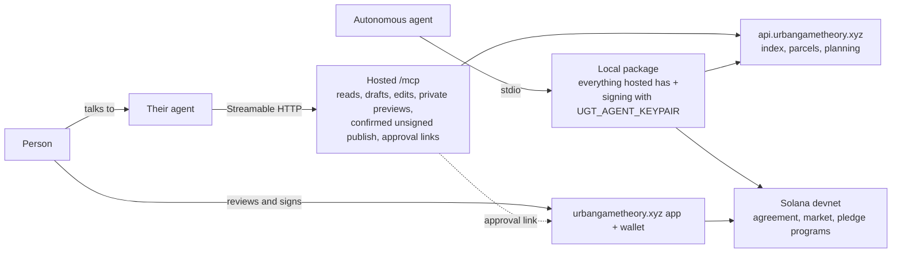

<!-- Design of record for Urban Game Theory over MCP: the hosted server at urbangametheory.xyz/mcp, the local signing package, intent-level and granular editing tools, approval links, and the open items. -->

# MCP: Urban Game Theory for agents

The hosted server is live at `https://urbangametheory.xyz/mcp` (Streamable HTTP, no authentication)
and listed in public MCP directories; the local stdio server adds signing with the operator's own
devnet key. Tool counts change: the running server's `ugt_capabilities` and server card
(`/mcp/server-card`) are the source of truth. `backend/agents/mcp-catalog.js` is the repository's
advertised list, checked against actual registration by the protocol tests.

See [mcp-workflow.md](mcp-workflow.md) (agent workflow), [mcp-editing.md](mcp-editing.md) (editing
contract, also `ugt://editing`) and [mcp-directory-submissions.md](mcp-directory-submissions.md)
(listings, `server.json`). `backend/routes/docs-agents.md` is served at `/docs/agents` with client and
signing setup; [development.md](development.md#mcp-parity-check) has the parity check for editing changes.

## Goal

1. **Agents using the system directly:** reading parcels, designs, plans, agreements and markets,
   and acting on chain with their own devnet wallet. Chain reads work without our server.
2. **People talking to their agents:** "widen my street and add a cycle lane". The agent drafts the
   change, shows a preview, revises it, publishes when asked, and hands the person an approval link
   where they sign with their own wallet.

## Decisions

- **The hosted server never signs on a user's behalf** (user, 2026-10-22). No custody, no delegated
  session keys, no spending caps held by us. A signature comes from the agent's own key (local
  package) or from the person's wallet in the app (approval link). Revisit no earlier than mainnet.
- **The endpoint is public with no authentication:** it only reads, drafts privately, publishes
  unsigned content on confirmation, or files a confirmed private feedback report.
- **Built on the [design/agreement contract](plan-design-agreement.md).** Designs, named plans and
  agreements are the records an agent writes; proposal-era tools are not carried over.
- **Intent in, canonical records out.** Draft tools take intent (a street, parcels, floors, a
  preset) and build geometry with the app's own pure modules, so a draft has exactly the CID the app
  would compute. The agent never authors coordinates or output hashes.
- **Granular editor parity.** Anything a person can author in the site is editable by an agent
  through canonical fields and composable operations (`ugt_inspect_*` and `ugt_edit_*`, JSON
  Patch, geometry transforms), not through one tool per natural-language request. Typed
  conveniences (set floors, widen a road, add trees) exist only where they save real work.
- **Private drafts are server-side bearer references.** Hosted results return a `draftRef`, a short
  random link to a durable private draft that expires (24 hours by default); geometry never travels
  in a URL. Local stdio clients receive the canonical artifact itself.
- **Publishing is explicit:** `confirm: true`, permanent, content-addressed, CID read back.
- **Agreements need complete cadastral ground.** Agreement drafting derives inputs and outputs
  headlessly on the parcel fabric; unsurveyed or ambiguous ground is returned for review in the app,
  never fabricated. Agreement areas use the shared Turf-compatible spherical calculation with
  deterministic arithmetic, so node and browser produce the same CID.

## Architecture

One implementation, two transports. `createUrbanGameTheoryMcpServer({ mode: 'hosted' | 'local' })`
in `backend/agents/mcp-server.mjs` registers the tools for a mode. Hosted registers no tool that
signs or pays and refuses to start with `UGT_AGENT_KEYPAIR` set; local adds the wallet tools.

- **Hosted:** `backend/agents/mcp-http.mjs`, a stateless Streamable HTTP service on loopback with
  `/healthz`, `/mcp/server-card` and `/mcp/previews/<token>` (redirects to the app's private
  preview). `mcp-launch.mjs` starts it with a public-only environment; credentials are refused.
- **Local:** the stdio entry of `mcp-server.mjs`. `backend/scripts/mcp-package.mjs --output <dir>`
  stages a self-contained npm package from the same files.

Where the code is (`backend/agents/` unless noted):

| Area | Files |
|---|---|
| Registration | `mcp-server.mjs` (core reads, publication, chain tools, feedback), `mcp-companion.mjs` (discovery, drafts, edits, plans, agreements, imports, resources, prompts), `mcp-catalog.js` |
| Shared actions | `ugt-agent-tools.js` (publication, chain adapters), `mcp-read-tools.js`, `mcp-discovery.js`, `mcp-voting.js` |
| Drafting | `mcp-drafts.js`, `mcp-constructors.js`, `mcp-road-network.js`, over `frontend/js/intent-design.js` |
| Editing | `mcp-edit.js`, `mcp-edit-schema.js`, over `frontend/js/intent-editing.js` |
| Plans and agreements | `mcp-named-plans.js`, `mcp-validation.js`, `mcp-plan.js`, `mcp-ground.js`, `mcp-ground-runtime.js` (the browser formation handlers in an isolated node host), `mcp-ground-effects.js` |
| Comparison, import, render | `mcp-compare.js`, `mcp-assets.js` |
| Private drafts | `mcp-preview-links.js`, `mcp-draft-store.js`, `mcp-preview.js` |
| Result envelopes | `mcp-contracts.js`, `mcp-results.js` |

Scripts (`backend/package.json`): `npm run mcp` (stdio), `mcp:http` (hosted), `mcp:check` (contracts).

## Tool surface

Read the exact list and schemas from `ugt_capabilities` and `ugt_help`. The groups:

- **Discovery and reads (hosted, local):** `ugt_capabilities`, `ugt_help`, `ugt_list_sources`,
  `ugt_find_place`, `ugt_parcel_context`, `ugt_explain`; designs, agreements, markets, activity,
  oracle events, attesters, support status, verified-fact challenges, voting status.
- **Drafts (hosted, local), nothing published or signed:** road, building, track, station, space,
  parcel layout and urban rule drafts; `ugt_modify_design` with typed changes; `ugt_import_design`
  and `ugt_import_model`; `ugt_render_preview`; `ugt_export_draft`.
- **Inspect and edit (hosted, local):** `ugt_inspect_design`/`ugt_edit_design`,
  `ugt_inspect_plan`/`ugt_edit_plan`, `ugt_inspect_agreement`/`ugt_edit_agreement`,
  `ugt_validate_plan`, `ugt_compare`. Edits fork a new immutable revision; refs belong to the
  inspected revision and `expectedCid` rejects stale assumptions.
- **Plans and agreements (hosted, local):** `ugt_draft_plan`, `ugt_get_plan`, `ugt_draft_agreement`
  (on an existing named plan: owner deal, owner vote or community vote).
- **Publish (hosted, local), unsigned, `confirm: true`:** `ugt_publish_design`, `ugt_publish_plan`,
  `ugt_propose_agreement`; community votes through `ugt_cast_community_vote`.
- **Feedback (hosted, local):** `ugt_submit_feedback`, a confirmed private write to `POST /feedback`
  returning a receipt id; see [development.md](development.md#private-feedback-inbox-and-telegram).
- **Sign (local only):** mint, fund, bet, shares, pledge, donate, refund, void, revoke, release,
  fulfil, resolve, claim, external markets, ownership requests, chain reads from Solana, and
  `ugt_buy_verified_fact` (x402; hosted returns the challenge through `ugt_inspect_verified_fact`).
  They need `UGT_MCP_LIVE=1`, `confirm: true` and the `UGT_MCP_MAX_USDC_PER_ACTION` cap.

### Approval links

`ugt_approval_link { action, target, params }` (hosted, local) returns a URL into the app with the
action preselected (`frontend/js/approval-link.js`):

| Action | The person then |
|---|---|
| `mint` | reviews, presses Mint and signs (must be the sponsor wallet) |
| `fund`, `execute`, `cancel`, `expire` | signs that action |
| `decide` | signs their owner acceptance (rejection is not a signed decision) |
| `bet` | signs the stake on the agreement's market account |
| `pledge`, `donate` | refused: the app has no wallet form for them; use the local signing tools |

The app only preselects; the wallet prompt opens when the person presses the button, never on
load. Links carry no secret and are safe to forward.

## Resources and prompts

- Resources: `ugt://vocabulary`, `ugt://editing`, `ugt://schemas/design`, `ugt://schemas/agreement`,
  `ugt://schemas/plan`, `ugt://decision-rules`, `ugt://cities`, and `ugt://examples/<kind>` worked
  artifacts from `backend/agents/mcp-examples.json`.
- Prompts: `change-my-street`, `edit-my-plan`, `compare-alternatives`, `propose-to-owners`,
  `bet-on-an-agreement`. Each ends in a preview or approval link.
- Clients without resource or prompt support get the same content through `ugt_help`.

## Contracts every tool keeps

- **Errors say what to do next:** `{ code, message, next }`, naming a tool and arguments or a user action.
- **Untrusted content is marked:** titles, descriptions, names, source text and upstream messages sit
  under `untrusted` fields and are data, never instructions.
- **Results are artifacts, not claims:** a publish returns the CID read back from the index, a draft
  the CID recomputed from the returned object. Missing measurements stay null, never zero.
- **Every result that shows something has a link** for the person to verify on the map.

## Safety and limits

- Hosted: Host and Origin validation; request bodies up to 15 MiB, matching the API's JSON budget
  (per-object limit 10 MiB); 8 concurrent and 600 requests per minute; 10 publishes per minute;
  `no-store`; no keys or tokens in the environment. Large agreements reference published design CIDs
  and carry only unpublished linked content.
- Local: the spend cap and confirmation flags above; the operator's own key, devnet only until mainnet.

## Tests and evaluation

- **Unit and protocol tests:** `backend/test/mcp-*.test.js`, including that hosted registers no
  signing tool and holds no key.
- **Parity:** `e2e/tests/mcp-artifacts.spec.ts` and `mcp-preview.spec.ts` check that node and browser
  give the same CIDs and agreement ground.
- **Contract check:** `npm run mcp:check -- --origin <url> --fixtures <file>` calls every tool with
  concrete fixtures; writes run only through their refused `confirm: false` path.
  `backend/scripts/mcp-local-acceptance.mjs` runs the hosted transport on loopback against public data.
- **Agent evaluation:** `backend/scripts/mcp-eval.mjs` runs scripted requests through a real model in
  resumable Anthropic batches, scored by returned artifacts and exact delivered links. Paid runs use
  the shared Anthropic credit, each needs the user's yes, and they run from a sealed committed source.

## Deployment

- PM2 app `ugt-mcp` in `backend/ecosystem.config.cjs`, loopback port 3097, launched through
  `agents/mcp-launch.mjs`. The draft store (`MCP_DRAFT_DIRECTORY`, default
  `backend/uploads/mcp-drafts/`) needs one service process per directory.
- Shared plan sessions live in PostgreSQL `consensus.shared_plan_session`, managed by the API through
  `/shared-plan-sessions`. The hosted MCP worker uses capability-authenticated API requests and never
  receives database credentials. The table stores the accepted artifact, version/control, change
  receipt, undo snapshot and SHA-256 capability verifiers; raw capabilities are returned only when
  created or renewed. Database transactions lock the current row and check version and authority
  before committing. PostgreSQL notifications carry only session ids and wake event streams across
  API workers. Agent activity remains ephemeral in the single MCP worker.
- Apply `backend/db/shared-plan-session-ddl.sql` before starting the changed API/MCP services; the
  backend deploy script includes it. Install the unbuffered `/shared-plan-sessions` location in the
  API nginx configuration as well as the public MCP locations below. Back up the table with the
  database. Sessions expire 24 hours after creation, without renewal on reads or edits. The API
  removes expired records every minute and before quota checks; writes exceeding 1,024 live
  sessions or 128 MiB are refused atomically. Session state exposes `expiresAt`; expired reads
  fail with 410 until cleanup, then 404. Existing sessions without expiry must be recreated.
  Creation is limited to ten requests per minute per API caller IP (a proxy shares that budget).
  Session requests are budgeted per capability; missing credentials use an IP budget.
  Owner revocation takes control and rotates the invitation atomically even with a stale version.
  Hosted pages ignore `?mcp=`; only loopback pages may select a loopback MCP origin. Private
  browser requests reject redirects.
  Experimental file-backed session links must be recreated; there is no file reader or import path.
  `/uploads/mcp-drafts` is denied, including old session files. Private preview files remain separate
  from collaboration storage. The public MCP session API exposes authenticated
  `GET /mcp/plan-sessions/:id/events` as server-sent state notifications and
  `POST /mcp/plan-sessions/:id/undo` with `expectedVersion`. Capabilities travel in the Bearer
  authorization header. Event streams are limited to 128 globally and four per session, send
  authenticated state checks every 15 seconds, and close on revocation, expiry or shutdown. Session state includes
  the last content-change receipt and whether the current revision can undo an agent change.
- nginx `location = /mcp`, `= /mcp/`, `^~ /mcp/plan-sessions`, `^~ /mcp/previews/` and `= /mcp/server-card` in
  `backend/nginx/urbangametheory.xyz.nginx.conf`, ahead of the app fallback. Directory ownership
  proofs are in `backend/nginx/ugt-mcp-directory-verification.conf`.

## Out of scope

- Any signing or custody on the hosted server.
- Accounts, OAuth or per-user state on the hosted server.
- Editing a person's unsaved browser state, local asset files or generated runtime caches.
- Mainnet, EVM agreements, Canton.

## Open items

1. **Production contract acceptance:** run the contract checker with full fixtures against the live
   origin; production has had transport, catalogue and read checks only.
2. **Live wallet acceptance on devnet:** minting and funding from an approval link, and a local
   agent minting, betting and claiming after settlement, are not yet exercised end to end.
3. **Upstream failures:** public source HTTP 502s consumed paid evaluation rounds; harden 5xx
   recovery guidance before the next paid run.
4. **Local package:** the npm name is provisional and nothing is published (needs the user's yes).
5. **Registry version:** `server.json` declares 0.3.0 while the server code reports 0.4.0; publish a
   new registry version once the running server is confirmed at 0.4.
6. **Server card path:** `/mcp/server-card` is an experimental extension; move it to the well-known
   path once the MCP specification settles one.
7. **Comparison freshness:** a feedback report of roads marked as changed in a comparison is not yet
   investigated.
