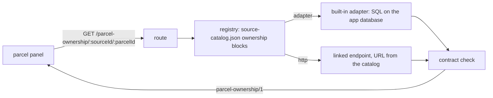

# Parcel ownership adapters

How a city's parcel ownership reaches the parcel panel, and how to add one: write an adapter, or
link your own endpoint. One route serves every city; the parcel's source decides who answers.

**Display data only.** What this layer returns is what a public register says, shown to help people
read a parcel. It is not a claim the app trusts. Signed, trusted ownership is a separate channel: a
lens member's `ParcelOwnership` attestation, issued to an owner's wallet after an identity check
([backend/lens/README.md](../backend/lens/README.md)). Nothing here can make a wallet an owner.



## The route

`GET /parcel-ownership/:sourceId/:parcelId` (backend/routes/parcel-ownership.js). The parcel id may
contain slashes (`HR-335258-4341/2`); send it URL-encoded.

| Status | Meaning |
|---|---|
| 200 | a `parcel-ownership/1` record |
| 400 | the id is malformed for that source |
| 404 `no-ownership-adapter` | the source declares no ownership |
| 404 `ownership-not-found` | the source knows no such parcel |
| 502 `ownership-contract-violation` | the answer broke the contract; nothing is shown |
| 502 / 504 | a linked endpoint failed or timed out |

The frontend (frontend/js/parcels/ownership.js, `parcelSourceIdFor`) takes the source id from the
city config: `parcels.source` for a city served from the app database (`oss-wfs`, `parcel-ba`, ...),
`parcels.sourceId` for a catalog source, or the `historicalSources` entry whose `idPrefix` matches.
A city whose config says `parcels.ownership: false` asks nothing and shows "Unknown owner": remove
that flag from the city in frontend/js/city-config.js when you add ownership for it.

## The contract: `parcel-ownership/1`

```json
{
  "contract": "parcel-ownership/1",
  "sourceId": "oss-wfs",
  "parcelId": "HR-335258-4341/2",
  "owners": [
    { "name": "GRAD ZAGREB", "shareText": "1/2", "sharePercent": 50, "ownerType": "government" }
  ],
  "ownershipType": "government",
  "observedAt": null,
  "retrievedAt": "2026-02-28T12:21:16.412Z",
  "attribution": "Državna geodetska uprava, OSS ...",
  "licence": null
}
```

| Field | Rule |
|---|---|
| `owners[].name` | non-empty; as the register writes it |
| `owners[].shareText` | the share as the register writes it (`1/2`, `3.16%`), or `null` when it states none |
| `owners[].sharePercent` | 0–100, or `null`. Never invent one: equal splits are not shares |
| `owners[].ownerType` | `private individual`, `company`, `government` or `institution`; classified from the name when omitted (frontend/js/parcels/ownership-type.js) |
| `ownershipType` | the owners' common type, `mixed`, or `null` for no owners |
| `observedAt` | **the source's own time** for this ownership state (ISO 8601; a bare year like `"2024"` is allowed), or `null` when the source states none. Never your fetch time |
| `retrievedAt` | when the data was read from the source (your fetch or import time), or `null` |
| `attribution`, `licence` | taken from the catalog registration, not from the answer |

`owners: []` means the source knows the parcel and publishes no owner for it. Unknown fields are
rejected, so the record cannot quietly carry wallets, addresses or other personal data.

An adapter or linked endpoint answers only `{ parcelId, owners, observedAt, retrievedAt? }`; the
registry adds the rest and validates everything (backend/ownership/contract.js).

## Registering ownership for a source

Ownership is declared on the parcel source in backend/parcels/source-catalog.json, in `sources`
(catalog providers) or `databaseSources` (providers served from the app database). A declaration
names exactly one of `adapter` or `http`, plus `attribution` and optionally `licence`. A bad
declaration stops the backend at startup.

### Link your own endpoint

```json
{
  "id": "xx-example-parcels",
  "...": "the existing source fields",
  "ownership": {
    "http": { "urlTemplate": "https://owners.example.org/parcels/{parcelId}", "timeoutMs": 8000 },
    "attribution": "Example Land Registry, public owner extract.",
    "licence": "CC-BY-4.0"
  }
}
```

- `urlTemplate` must be `https` and contain `{parcelId}`, which is replaced by the URL-encoded parcel
  id. Only this registered URL is ever fetched; a client cannot supply one. Redirects are refused.
- `timeoutMs` defaults to 8000, at most 20000.
- Answer `200` with `{ "parcelId": "<the id asked for>", "owners": [...], "observedAt": ... }`,
  or `404` when you do not know the parcel.

### Write an adapter

An adapter is a module in backend/ownership/adapters/ exporting `{ name, lookup }`:

```js
// backend/ownership/adapters/xx-example.js
import { HttpError } from '../../utils/helpers.js';
import { isoOrNull, sharePercentFromText } from '../contract.js';

export const xxExampleAdapter = {
    name: 'xx-example',
    async lookup({ parcelId, pool }) {
        const match = /^XX-([0-9]+)$/.exec(parcelId);
        if (!match) throw new HttpError(400, 'Expected a parcel id XX-<number>.');
        const { rows } = await pool.query('SELECT owner, share, as_of, fetched_at FROM xx_owner WHERE parcel = $1', [match[1]]);
        if (!rows.length) return null;
        return {
            parcelId,
            owners: rows.map(row => ({ name: row.owner, shareText: row.share, sharePercent: sharePercentFromText(row.share) })),
            observedAt: isoOrNull(rows[0].as_of),
            retrievedAt: isoOrNull(rows[0].fetched_at)
        };
    }
};
```

Add it to `BUILTIN_OWNERSHIP_ADAPTERS` in backend/ownership/registry.js, declare
`"ownership": { "adapter": "xx-example", "attribution": "..." }` on its source, and add a test to
backend/test/parcel-ownership.test.js with a stub pool.

## Built-in adapters

| Source id | Cities | Adapter | Data | `observedAt` |
|---|---|---|---|---|
| `oss-wfs` | Zagreb, Split, Šibenik | `hr-oss` | latest OSS parcel-info snapshot in `parcel_info` | `null` (OSS states none) |
| `parcel-ba` | Buenos Aires | `ar-caba` | horizontal-property units and percentages in `parcel_ba` (units, not people) | `null` |
| `parcel-bg` | Belgrade | `rs-bg` | `parcel_bg`; the RGZ layer has no owners, so a known parcel answers `owners: []` | `null` |
| `parcel-lj` | Ljubljana | `si-gurs` | current GURS rights in `parcel_lj_owner` (anonymous holders, "Owner <id>") | when the newest current right took effect |
| `parcel-nyc` | New York | `us-nyc` | NYS roll owners in `parcel_nyc_unit`; condo unit owners live from NYC DOF | the roll year, or the DOF roll year |
