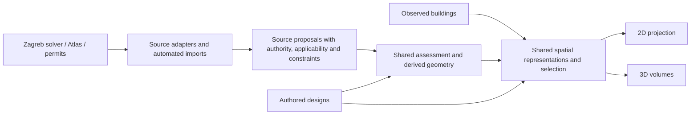

<!-- Evidence-based audit of Atlas rule coverage, the GUP restatement and the shared proposal model. -->
# Planning rules as proposals: Atlas and Zagreb audit

Checked 2026-10-19 against this branch's native code at `443790bf`, Colosseum's committed vocabulary at `cf425a18`, and the separate `gup-2025-proposals` branch at `78e25291`. This change adds an audit, reproducible source checks and vocabulary decisions. It does not add a live Atlas adapter, a universal rules engine or a new 2D/3D interface.

## Finding

We can already represent and render useful massing. We cannot yet express and enforce all the Atlas's published rule families. Retaining a rule in source notes, displaying one compatible shape, and validating every later design against the rule are three different capabilities. The largest gaps are conditional applicability and independently enforced constraints, rather than polygon extrusion.

The project is the **National Zoning Atlas**, founded by **Sara Bronin**. Its current data distribution includes Land Use Labs' zoning products and API. The Atlas already has a map: the useful collaboration pitch is a shared 2D/3D representation of constraints, massing and design alternatives, with traceable source evidence. [NZA team](https://www.zoningatlas.org/staff-bios), [NZA FAQ](https://www.zoningatlas.org/faqs), [zoning API](https://www.landuselabs.com/zoningapi).

No outreach has been sent. First demonstrate the supported subset and make unsupported or estimated rules visible. A complete-code or legal-compliance claim is not supported by this audit.

## Scope and reproducibility

The current public [Districts dictionary](https://docs.landuselabs.com/guides/data-dictionaries/districts/) has **126 fields**; the [Slices dictionary](https://docs.landuselabs.com/guides/data-dictionaries/slices/) has **185**. The [inventory](../backend/planning/atlas-field-inventory.json) records all **311 product-field entries**, their published types, 25 audit families and the source HTML hashes. These counts include identifiers, metadata, repeated housing categories and method fields: they are **not 311 distinct laws**.

The dictionaries cover housing-related zoning attributes across one-, two-, three-, four-or-more-family, affordable, accessory and planned residential categories. They are not a complete machine-readable account of every ordinance, permit, building code, fire rule, environmental restriction or property right. The public API example and documentation were read, but no authenticated API request was made. The older public 2024 methodology is historical; this inventory uses the current product dictionaries. [Current dictionaries](https://www.landuselabs.com/dictionaries), [methodology](https://www.zoningatlas.org/how), [API documentation](https://docs.landuselabs.com/api/).

Reproduce the sample inspection with a locally downloaded copy of the publicly linked [Lafayette, Colorado slice sample](https://www.landuselabs.com/s/lafayette_co_slices_sample.geojson):

```sh
node backend/scripts/audit-atlas.mjs /tmp/lafayette_co_slices_sample.geojson slices > /tmp/atlas-audit.json
cd backend
./node_modules/.bin/vitest run test/atlas-audit.test.js --pool=threads --maxWorkers=1
```

The script does not download, publish or import data. Its output contains counts and evidence states, without district geometry or row-level numeric constraints. The checked [sample audit](../backend/planning/atlas-sample-audit.json) includes the input SHA-256. Replacing the input is a new observation, not a silently equivalent dataset.

## What the sample actually establishes

The sample contains **31 zoning slices**, not 31 cadastral parcels. It has 184 of the 185 documented slice fields; `affordable_treatment` is absent, not a recorded prohibition. No unexpected fields were found.

Across 68 method-bearing numeric fields per slice, the sample contains 397 direct-number values, 171 estimates, 145 indeterminate values and 1,395 not-applicable values. For one-family use, 22 slices are allowed, seven require a hearing, and two prohibit it. **Zero** combine allowed one-family use with directly stated front, side and rear setbacks and maximum height. This is a deliberately narrow evidence screen, not a finding of zero development potential or a citywide coverage estimate. The [audit output](../backend/planning/atlas-sample-audit.json) records the full field-by-field counts.

The source has two materially different representations:

- **District records:** many constraints are text, potentially containing conditions or formulas. The API examples include street-class-dependent setbacks and a higher height subject to a public hearing. Taking the first number would discard the operative condition.
- **Slice records:** normalized numeric values have a companion method. `estimation` must remain an estimate; `indeterminate` uses `-1`, which must not become a negative distance or zero; `not_applicable` is not an unrestricted permission. Unknown method values require review. `overlay` use treatment is not equivalent to allowed use, and `nomention` must remain distinct from permission or prohibition.

The inspector preserves these distinctions and detects schema additions/absences. A direct number still needs its source context; it does not prove that a complete rule set applies to a parcel. Slice boundaries also cannot supply parcel boundaries, front/side/rear classification, party-wall rights or a vertical datum. [District and slice product descriptions](https://www.landuselabs.com/dictionaries), [point-query documentation](https://docs.landuselabs.com/api/point-query/).

Verification in this branch: one targeted headless unit test file, `test/atlas-audit.test.js`, **23 passed**, none stopped. Independent checks matched every inventory field/type to the downloaded dictionary tables, checked the source/sample hashes, recomputed sample counts and checked all 25 crosswalk totals. No browser run was performed for this audit-only change; it adds no UI behavior.

## Complete published-field crosswalk

Every inventory field maps to exactly one row below. D/S are counts in the Districts/Slices dictionaries, including companion methods and repeated use categories. “Native” means the reviewed Consensus Builder implementation; the adjacent Zagreb solver and its imported candidates are considered separately. Arbitrary JSON/source notes can retain additional evidence, but that alone does not give the application an operational rule.

| Family / D–S counts | Native expression and visualization today | Gap before faithful evaluation; Zagreb overlap |
| --- | --- | --- |
| `source_identity` / 13–11 | Proposal IDs, geometry and source metadata have existing containers. | Need an Atlas adapter, stable source/version IDs and attribution. Z08; V01/V05. |
| `applicability` / 2–0 | Can retain overlay/extinct flags as evidence. | No general composition, precedence or validity evaluator. An overlay cannot simply be added as a second maximum. Z07; V19. |
| `uses` / 2–2 | Building typologies and labels can illustrate a use. | No common jurisdiction-neutral use taxonomy with executable exclusions/mixed-use conditions. Z07. |
| `affordability_formula` / 1–1 | Text/notes can retain a definition. | Income/rent bases, qualifying unit shares and formula-dependent bonuses lack typed constraints and evaluation. Z01/Z07; additional Atlas detail. |
| `occupancy` / 13–12 | Notes can describe affordability, age, family, renter and owner conditions. | Geometry cannot enforce who occupies or owns a unit, or duration/eligibility conditions. Z07; additional Atlas detail. |
| `use_procedure` / 7–7 | Proposal approval machinery exists for its own deal/vote decisions. | Allowed/hearing/prohibited/overlay/no-mention need independent source semantics. A hearing condition is not an app vote. Z07; V08/V19. |
| `lot_area` / 6–12 | A scalar `minPlotAreaM2` excludes undersized parcels in the simple generator. | Partial only: legal lot/site may differ from cadastral parcel; resolve use/conditional thresholds and convert acres explicitly. Z02/Z07. |
| `lot_range` / 12–8 | Can retain range endpoints. | Source summaries of conditional minimum-lot-size ranges are not unconditional min/max legal bounds. Preserve branches and context. Z07. |
| `development_area` / 1–2 | Sites can span multiple parcels. | No separately enforced minimum development-area constraint and grouping semantics. Z02/Z05. |
| `setbacks` / 12–24 | Uniform inset and existing block/row forms are renderable. | Need classified front/side/rear/street/neighbour edges and conditional distances; one `minDistance` is insufficient. Z03/Z04. |
| `impervious_coverage` / 4–8 | Can visualize ground/building geometry. | No surface accounting that distinguishes building, paving, pervious ground and qualifying natural terrain. Z02; V13. |
| `building_coverage` / 4–8 | Footprint area can be measured and displayed. | Coverage is not an independent invariant of native variations; planner caps a statistic without changing the shape. Z02; V12. |
| `parking` / 10–20 | Authored parking layouts can be drawn. | No zoning parking requirement by dwelling/bedroom/use, exemptions or assessed stall supply. A drawn car or parking area is not a compliance count. Z07; additional Atlas detail. |
| `storeys` / 4–8 | Simple rules have min/max floors; designs can be extruded. | Parcel rules round max floors to an integer. Partial storeys, basements and source counting conventions cannot be silently rounded; retain exact floor levels. Z06. |
| `height` / 4–8 | Direct heights and stacked volumes can be rendered. | Need independent height limits, terrain/reference definition, roof exceptions and conditional increases; do not convert every cap into assumed floors. Z06/Z07; V11. |
| `floor_area_ratio` / 4–8 | Geometry can yield model GFA and a displayed ratio. | No persistent independent FAR constraint through edits/variation; legal floor-area and lot-area bases may differ from model measurements. Z02; V12. |
| `unit_area` / 5–10 | Floors and unit layouts exist. | No general minimum dwelling-area rule evaluated over actual units and the source's measurement convention. Z01/Z06. |
| `unit_density` / 5–10 | Apartment estimates can be displayed. | Dwellings per acre and rounding/subdivision rules need actual unit counts and a defined denominator. Estimated apartments are not entitlement. Z01. |
| `units_per_building` / 2–4 | A design can group floor volumes. | Enforce actual dwellings per physical building; adjoining volume components must not count as separate buildings. Z01/Z06. |
| `units_per_development` / 1–2 | Proposals/sites can hold several buildings. | A project-wide dwelling budget must survive splitting, merging and editing buildings. Z01/Z05. |
| `infrastructure` / 6–6 | Water/transit requirements can be retained as flags. | No evidence-backed evaluator for qualifying service or accessibility thresholds and source exceptions. Z07; additional Atlas detail. |
| `bedrooms` / 4–8 | Room/floor layouts exist. | Need the source's bedroom classification, counts and unit/project scope; layouts alone do not enforce caps. Z01/Z06. |
| `accessory_location` / 1–1 | A design can depict attached or detached space. | No enforceable primary/accessory relationship for a primary-structure-only rule. Z07; additional Atlas detail. |
| `accessory_size` / 2–4 | An accessory shape can be drawn/measured. | Need maximum area and percent-of-primary limits with the correct denominator, use and unit-count relationship. Z01/Z02. |
| `mobile_home` / 1–1 | A typology/label can illustrate a manufactured/mobile home. | No standardized use eligibility within planned residential developments; a visual object type is insufficient. Z07. |

Code evidence: [parcel/block rule normalization, evaluation and variation](../frontend/js/urban-rule-variation.js), [agent planner and scalar capping](../backend/agents/planner.js), [source rule reduction](../backend/agents/parcel-source.js), [proposal decision kinds](../frontend/js/proposals/proposal-kind.js), [building/floor geometry](../frontend/js/building-extrusion.js), [floor model vocabulary](../vocabulary.md), [source geometry collection](../frontend/js/proposals/geometry.js). V references are the existing [vocabulary audit findings](../vocabulary.md#audit-register--open-questions-not-fixes).

## Comparison with the requested Zagreb session

Recovered Codex session `01a1368f-8109-7a32-9195-cfc9d66d6616` and checked its findings against committed artifacts in branch `gup-2025-proposals`, HEAD `78e25291`: `backend/gup-restatement/README.md`, `translate.js`, and `coverage-2026-10-19.json`. The report below is evidence from that branch, not an import performed by this audit.

That work already follows the requested **automated restatement** approach. It produced **10,622 native massing proposals in 71 local draft plans**, including 10,505 stepped forms, from a cohort of 194,676 current parcels intersecting Zagreb's 2025 GUP scope. It skipped 184,054 with reasons; separate Sesvete rules and uncadastrated ground are not included as represented parcels. Independent cached new-build quantities survived for 12,894 parcels. Skip reasons overlap, so they must not be summed as exclusive bins.

The reported translation differences (at most 0.092% floor area and 0.967% volume against cached geometry) measure **geometry fidelity**, not legal certainty. The separate session reported all records read back and a repeated import inserting zero duplicates. Those database and visual checks were not rerun here.

| ID | Zagreb finding | Atlas implication and shared fix |
| --- | --- | --- |
| Z01 | Dwelling caps and minimum plot area per dwelling remain notes; apartment estimates do not enforce them. | Add actual dwelling identities/counts and independently scoped density, per-building and per-development constraints. Extend with unit area, bedrooms, occupancy and accessory relationships. |
| Z02 | KISN min/max, maximum GBP and minimum natural terrain remain notes; editing a matched candidate does not revalidate them. | Couple FAR, building/impervious coverage, minimum site area and area budgets to measured geometry. Keep legal measurement definitions explicit. |
| Z03 | Preservation and mandatory frontage are skipped where a maximum cannot express the mandate. | Add required/retained geometry and build-to constraints. An optional maximum does not express an obligatory minimum or retained wall. |
| Z04 | Boundary-touching geometry does not prove party-wall entitlement or neighbour conditions. | Classify edges and retain evidence-backed neighbour relations; reevaluate when context changes. |
| Z05 | One cached option does not represent all placements; adjacent maxima are not proven jointly achievable. | Distinguish outer bound, candidate and full constraint set; preserve project-wide dependencies and budgets. |
| Z06 | Nested stepped floors can be decomposed, but exact floor elevations remain notes; overhangs/underground/unsupported topology are skipped. | Shared geometry needs floor/volume identity and vertical references without turning one building's components into several buildings. |
| Z07 | Exceptions, detailed-plan procedures, reconstruction/additions and proxy contexts remain unresolved. | Share applicability, authority, conditional procedure and evidence statuses. Atlas adds explicit affordable/ADU/occupancy/infrastructure conditions. |
| Z08 | Missing cache, failed search and inconsistent geometry are not zero capacity. | Share per-source/per-rule coverage and reason codes. Atlas also needs missing field, estimate and indeterminate states. |

The GUP work is a useful first geometry adapter and automated importer, not an already complete universal rules engine. Reuse its serializer and idempotent import approach; do not duplicate it in a new Atlas-specific editor.

## Shared model and first implementation

Accepted vocabulary: existing regulations, permitted massing and permits are **obligatory proposals** in the system. “Obligatory” means the supported applicable rule binds; it does not mean every maximum must be built. Permission, requirement and prohibition remain distinct, and a permit's authorized design is not evidence that construction occurred. [Vocabulary decision](../vocabulary.md#accepted-direction-obligatory-proposals-and-their-representations).

Use the existing proposal and spatial infrastructure with the following independent information. These are proposed contract requirements, not fields secretly added to the current serializer:

| Information | Required meaning |
| --- | --- |
| Source and authority | Stable source ID/version, instrument/issuer, evidence reference, provenance and assertion quality. Dataset publisher, interpreter and issuing authority are different roles. |
| Applicability | Geographic scope, effective period, uses/projects, exceptions, overlay relationships and required contextual facts. Source update date is not enactment/effective date. |
| Constraints | Permission/requirement/prohibition; quantity or spatial relation; minimum/maximum; units and measurement basis; conditions/dependencies. Retain unsupported expressions with explicit evaluator status. |
| Representations | Role and fidelity: observed building, permitted massing, example build-out or proposed design; source proposal and geometry revision; ground footprint and optional volumes/floors. A candidate is not the entire feasible set. |
| Spatial reference | Geographic placement, local operation frame, length/area units, vertical datum or explicit relative-height reference. Convert feet/acres at adapter boundaries while retaining source quantities. |
| Assessment | Per-constraint supported/unsupported, evidence quality, pass/fail/unknown/not-applicable and reasons. A complete claim is possible only for an explicit supported scope. |



The map and model share representation IDs, source references, selection and revision invalidation. A 2D footprint projects the same geometry used by 3D; separate city-specific rendering paths would reintroduce divergence. Selecting an obligatory source proposal shows its rule evidence and applicable limits; unsupported non-geometric rules remain visible in the inspector. Switching views preserves selection.

Viewing source constraints must not mutate `CadastralParcelRepository`, create a live-fabric land change, mark a proposal executed, or invent owner consent. The current `ProposalKind` enum cannot simply receive `obligatory` without updating its validation and consumers: legal authority is a separate axis from deal/vote kind and browser application. [Ground model](../frontend/js/parcels/ground-service.js), [kind validation](../frontend/js/proposals/proposal-kind.js).

Implementation order:

1. **Import and compare a bounded Zagreb cohort.** Adapt existing cached results and the automated GUP translator into this source contract; retain original rules and unresolved conditions. Reuse existing native massing and 2D/3D renderers, with explicit geometry roles and source labels. Repeat imports must be no-ops for unchanged source versions. No manual conversion step.
2. **Close the shared numeric gaps.** Evaluate independent dwelling, floor-area, coverage and natural-ground constraints against the actual edited geometry. A changed design must become failed/unknown when appropriate; changing only its displayed statistic is insufficient. Separate actual building/unit counts from rendering components.
3. **Add the Atlas adapter using the same path.** Preserve all dictionary fields and methods; compose districts/overlays against real parcel and street context. Draw sourced zoning areas and supported geometric effects with evidence labels. Retain conditional expressions as unresolved until their evaluator exists.
4. **Extend by rule family.** Add contextual setbacks, frontage/retention, party-wall rules, use/procedure and accessory/affordability conditions with explicit capabilities. Select supported cases by their evidence, not by promising an entire city or district is simple.

## First implemented view slice

Implemented locally on 2026-10-19; not a deployment or complete rules-engine claim.

- **Independent layers:** Built, Permitted and Proposed each have Solid / Transparent / Off controls shared by the map and model. Built also offers All / Surviving / Removed; Proposed offers Massing / Build-out / Both and a shared variation control. Appearance and content choices are independent. Public labels use Proposed rather than Planned. Source-survey choices remain in Layers; alternate surveys without working-building carve identities appear only with Built: All.
- **Direct inspection:** click a map shape or model volume, or focus a map shape and press Enter/Space. The arbitrary viewport-item dropdown has been removed. Selection survives 2D/model and appearance changes. The inspector shows calculated area/height, component heights, independent dwelling/floor-area/natural-ground limits, source evidence and unresolved applicability. No manual conversion or application step is involved.
- **City adapters:** `backend/planning/sources.js` selects providers by city. Zagreb reads current 2025 rows directly from the existing `public.parcel_build_envelope` cache, using its spatial index. No live solve, proposal import, copied dataset or additional cache is involved. The native-proposal restatement is a separate authoring workflow and no longer gates this display. No client renderer branches on Zagreb. New cities without a provider report unavailable coverage rather than zero capacity.
- **Bounded reads:** `GET /planning/representations?city=…&bbox=west,south,east,north` is read-only, accepts at most 4 km² and returns at most 200 cached geometry profiles per provider per page. An opaque `nextCursor` bound to the city, viewport and providers advances by the source cache’s unique key; both views load every page before publishing the complete viewport. Panning cancels obsolete reads, and a failed page cannot be presented as complete coverage. Each query also counts all cached results in the viewport by status; summaries are retained once per source, and rows without geometry do not consume the page limit. Invalid profiles are counted and advance the cursor, including an entirely invalid page. These reads reflect the current source table, not a historical snapshot. Invalid height/ring/frame data is not invented. Cache record identities, content fingerprints, solver versions and calculation timestamps remain attached to geometry; no proposal row ID is invented.
- **Shared projection:** both clients consume `PlanningScene.volumeFeatures`, including adjoining volumes, polygon holes, base and top heights. The map defaults to their joined footprint; Height steps exposes the component boundaries. A thicker line marks selection; dashing no longer ambiguously distinguishes selected/unselected sources. The map uses Leaflet; the model reuses native polygon extrusion and resource disposal. Source volumes never enter cadastral slicing or mutate proposal application. The model uses the map's entry viewport snapshot, as the existing 3D scene does; orbiting does not expand the loaded cohort. Authored build-out generation uses the same rule, form choice and variation salt in both renderers.
- **Presentation:** desktop floating controls, a phone grid and source sheet, light/dark tokens, translated labels and count forms. Aerial imagery directs users to model 3D for source massing because its terrain alignment is a different contract.

Cached floor polygons render at their stored base/top elevations. Adjacent equal floor outlines merge into one display prism; overhangs and below-ground forms do not need conversion into native editable proposals. Existing-stock estimates carry an explicit label and description, separate from calculated new-build options. Cached result statuses and independent quantities remain inspectable; the adapter does not attach current rule variables to an older calculation. This slice adds no import job, extra cache or persistent normative schema. Existing-building and authored-design stores and renderers remain in place under the common view policy. Independent rule evaluation, full historical/version selection, authored-record normalization, a unified inspector for every entity type, and Atlas ingestion remain open.

Historical native-import coverage (`backend/gup-restatement/coverage-2026-10-19.json`, branch `gup-2025-proposals`): 10,622 of 194,676 audited parcels were represented (about 5.5%). This measures the filtered translation into native proposals, **not solver/cache coverage**. It is no longer the source of the Permitted layer. Local cache read-back during this change found 169,803 current 2025 results: 12,894 geometry-validated results and 9,925 existing-stock estimates, with other statuses retained separately. A bounded test viewport contained 708 cached results and 173 profiles; all 173 profiles translated directly without omissions. These are dated observations of the local cache, not a claim that every parcel has a positive envelope or that this cache matches a newer deployed calculation.

## Infra and inspection follow-up

Implemented 2026-10-19 after the first slice above. The comparison inspector now accepts observed buildings, authored designs and source results through the same representation contract. It preserves selection across map/model changes and restores it from the URL. Proposal actions open the existing authored action surface. Source edition selection reads the 2016 or 2025 cache directly; parcel panels show saved cache status/reason, including withdrawn records without reviving their geometry. An absent row adds no inferred diagnosis. Refresh synchronization remains postponed by user decision.

Source-backed obligatory proposals are on-read projections of their durable provider records (`source-proposal.v1`), rather than a second copy of the envelope cache in the authored proposal table. Stable identities, calculation revisions, authority, unresolved applicability and availability are explicit. Authored designs may retain pinned `sourceReferences`; server serialization and portable metadata preserve them. Opening a changed reference shows the current record with an explicit notice, without rewriting the design. The provider cache still cannot reconstruct unavailable historical versions. No new database table or citywide import is part of this change.

Read-only automation uses `/planning/sources?city=…`, `/planning/representations?city=…&source=…&bbox=…`, `/planning/parcel?city=…&source=…&parcel=…` and `/planning/record?city=…&source=…&recordId=…`. Responses carry source proposals, constraints, evidence and capability metadata. Consumers can retain the source reference when authoring a design; no manual massing-to-proposal conversion is required.

The NYC adapter exposes the existing dated pilot audit as evidence with no accepted volumes. The Atlas adapter reads a supplied slices dataset, preserves all source fields and numeric evidence methods, and renders zoning areas in 2D and on the 3D ground plane. Its housing-type selector chooses among one/two/three/four-or-more-family, accessory and planned residential fields. A source area is never extruded into a building from a height scalar. Conditional applicability and unsupported expressions remain unevaluated.

For a local sample demonstration, download the public sample linked above outside the repository and launch the backend with `PLANNING_ATLAS_SAMPLE=/tmp/planning-atlas-sample.geojson`. The source then appears in the Colorado view around Lafayette through the same controls and inspector. Its descriptor bounds identify the actual sample coverage. The sample data is not bundled, enabled by default, or published by this change. The adapter is reusable through `createAtlasProvider(collection, metadata)`; authenticated API ingestion and a production data agreement are separate work.

## Demonstration and outreach readiness

A useful demonstration must show the same selected source proposal in 2D and 3D, source constraints alongside observed buildings and a design, explicit estimated/unsupported rules, and a design edit that either revalidates or reports what cannot be checked. It must survive save/reload and a second import without duplicate proposals or source-to-design identity confusion.

The local follow-up demonstrates the Atlas public Lafayette sample through the shared adapter and inspector: housing-type changes, source estimates, URL selection/reload, 2D areas and ground-plane areas alongside observed buildings in 3D. This establishes source-data visualization; the broader design-edit/revalidation demonstration above remains incomplete. Do not pitch complete interpretation of all zoning rules. A bounded current claim is: **“We can visualize source zoning areas and recorded constraints in linked 2D and 3D views, with supported massing from other providers and explicit unresolved conditions.”**

There is also a concrete distribution question for a partnership: the published Land Use Labs standard purchase license limits use to internal purposes and restricts public display/redistribution, including reconstructable derivatives. A public product integration needs appropriate display/reuse terms rather than assuming the map's public visibility grants them. This audit used public documentation and the public sample; no purchase/license acceptance was made. [License, updated September 10, 2026](https://www.landuselabs.com/license).

Contact routes for the later conversation: [National Zoning Atlas](https://www.zoningatlas.org/contact) for the visualization collaboration; [Land Use Labs](https://www.landuselabs.com/contact) for current data/API and display rights. No form was submitted.

Viewport pagination verification (2026-10-19): a reproduced neighborhood view at 45.79884, 15.93650, zoom 17 contained 1,073 current cache results: 432 geometry profiles and 641 results without geometry. The former single-page display showed only 200. The corrected feed read pages of 200, 200 and 32 with zero adapter omissions; the map rendered 432 footprints and the model contained the same 432 representation identities. The 432 comprise 203 geometry-validated calculations and 229 existing-stock estimates. These local observations describe this viewport and cache revision, not all-city legal coverage.
