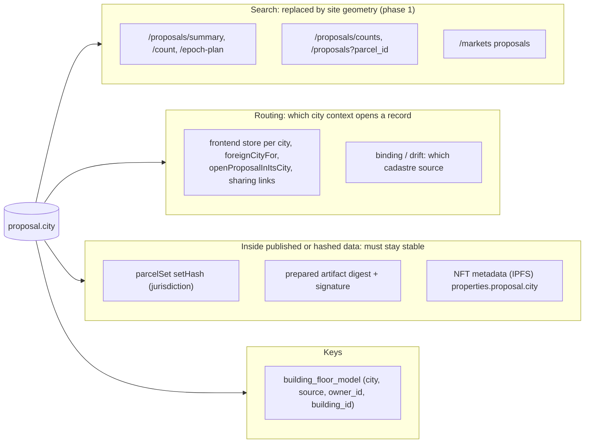
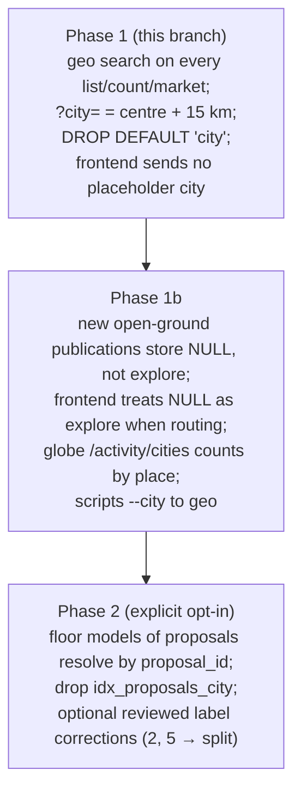

# Proposal geographic search, and an optional city

Which proposals a list shows is decided by where their site is, not by a stored city label. This
file is the plan, the usage map behind it, and what phase 1 changes. Branch `proposal-geo-search`,
cut from `colosseum-worlds-fair` on 2026-10-16.

Status (2026-10-22): not implemented. The branch (one commit, `ecc682147`) was never merged and was
deleted; only this plan is kept. Redo it on top of the design/agreement rework rather than porting it.

The user's decision (verbatim): "let's do the proper (big) fix. Searching by city should be some sort
of geographic search, proposals inside some raidus. But cities in the middle of nowhere should not
have a city, so, it should be either an optional column or completely removed".

## Why

`consensus.proposal.city VARCHAR(100) DEFAULT 'city'` started as "multi-city support" and became the
key every list filtered on. Its problems:

- **A placeholder hides records.** An insert that names no city stores `'city'`, and no list asks for
  `city=city`. That is how proposal 701 dropped out of every list.
- **The label can be wrong.** On production, proposals `2` and `5` are roads in Split (43.54 N,
  16.31 E), 252 km from Zagreb, and they are filed under `zagreb`. They appear in Zagreb's list and
  not in Split's.
- **Open ground has no city.** A site in the middle of nowhere gets `explore` (the app's city-less
  world view) or the city the author happened to have open.

## Production facts (read-only, 2026-10-16)

| fact | value |
|---|---|
| proposals | 641; `proposal_id` is unique (641 distinct, `proposals_proposal_id_key`) |
| with `site` (MultiPolygon, EPSG:4326) | 639; GiST `idx_proposal_site` exists and the planner uses it |
| without `site` | 2 parcel acts: `1` (buenos_aires, AR parcel) and `6` (belgrade, 7 SR parcels) |
| with `bounds` but no `site` | 0, so the old `bounds`-JSONB fallback in the bbox filter matched nothing |
| city values | 19; none is NULL, `'city'` or `explore`; `proposal_data.city` always equals the column |
| parcel ids declared under two cities | 0 (ids are country-prefixed: `HR-`, `SR-`, `US-`…) |
| `building_floor_model` rows with `source='proposal'` | 9, all `zagreb`, 4 proposals, all matching their proposal's city |

### The geographic search against the labels

Searched around each city's centre from `frontend/data/world-coverage.json` (the same centres as
`city-config.js` `map.defaultCenter`), with the exact SQL `proposals/geo-search.js` builds:

| search | proposals | labelled with that city | labelled otherwise |
|---|---|---|---|
| `city=zagreb` (15 km) | 239 | 239 of 241 | none |
| `lat=45.8150&lon=15.9819&radius_km=15` | 239 | 239 | none |
| `bbox=15.75,45.70,16.25,45.95` | 239 | 239 | none |
| `city=sibenik` | 275 | 275 of 275 | none |
| `city=split` | 2 | 0 | `2`, `5` (filed under zagreb) |
| `city=san_francisco` | 12 | 12 of 12 | none |

Every one of the 19 cities returns exactly its labelled set within 15 km, and the same holds at
25 km. The labelled proposals lie at most 7.9 km from their centre (San Francisco), apart from the two
Split roads. The only differences are:

- the two Split roads, which move from Zagreb's list to Split's, as they should;
- the two site-less parcel acts, which no geographic search can place (see the decisions).

Placed by the publication rule (`world-coverage.js` `liveCitiesAt`), 637 of the 639 sited proposals
lie inside a configured city's area. The other 2 (`sf-candlestick-*`, 8.6 km from the centre of San
Francisco, whose area radius is 8 km) are outside every area. A label derived from the cadastre
areas would make them city-less, although they are plainly in San Francisco. A derived label
therefore needs a naming radius, not the cadastre area.

## Where the city is used

### Search and filter (moved to geometry in phase 1)

- `backend/routes/proposals.js`: `/proposals/summary`, `/proposals/count` and `/proposals/epoch-plan`
  used `city = $n`, and `/proposals/counts` and `GET /proposals?parcel_id=` used `p.city`.
- `backend/routes/markets.js`: `/markets?city=` listed `WHERE city = $1`. The plans half reads
  `ens_plan.city`, which is the plan's own city and not the proposal's, so it stays.
- Frontend: `proposals/server-sync.js` (count and summary), `proposals/dialog-share.js` (the share
  panel's server index), `parcels/parcel-set-proposals.js`, `parcels/ui/proposal-counts.js`,
  `world/arrival.js`, `bets/bets-sheet.js` (`/markets`), and the `'city'` placeholder in
  `normalizeCityCodeForApi` and `resolveCurrentCityCode`.
- Agents and MCP: `backend/agents/society-run.mjs`, `support-run.mjs`, `ugt-agent-tools.js`, and
  `mcp-server.mjs` `ugt_list_proposals` (default `zagreb`).
- Published agent docs, `backend/routes/docs-agents.md`: `GET /proposals/summary?city=zagreb` and
  `GET /markets?city=`. **External agents, including hackathon judging, may follow these.** That is why
  `?city=` stays as a place shorthand (see below).
- Scripts: `scripts/expire-proposals.mjs` and `scripts/plan-yield.js` take an optional `--city` filter.
  These are not changed yet.
- Globe: `routes/agent-activity.js` `/activity/cities` (`GROUP BY city`) and `cityId` on activity
  events.

### Routing (still needs a city, or an equivalent)

- Frontend stores are per city: each city is its own IndexedDB store and a page reload. The routing
  functions are `proposals/data.js` `proposalCityOf` and `refuseForeignProposal`,
  `city-config.js` `foreignCityFor`, `city-switch-prompt.js` `openProposalInItsCity`,
  `proposals/sharing-routes.js` `sharedRecordCityOf`, `proposal-manager.js` `_recordInCity`,
  `proposals/copy.js`, `proposals/maintenance.js`, drafts, and the editor shell.
- The cadastre a record binds against: `proposals/binding.js` (`parcelSourceForCity`),
  `proposals/binding-drift.js`, `scripts/migrate-proposal-sites.mjs`, `backfill-ownership-flow.js`,
  thumbnails (`thumbnails/proposal-thumbnail.js`), and `agents/chain-publication.js`.
- Writes: `proposals/publication-city.js` places a new publication by its site, which is the right
  rule. Callers are `routes/proposals.js` create, `routes/proposal-prepare.js`,
  `routes/proposal-binding.js`, and `scripts/fill-proposal-cities.mjs`.

### Inside published, hashed or signed data (do not change for existing records)

- **Parcel-set identity.** `proposals/serializer.js` and `hackathon/case-model.js` build
  `buildParcelSet({ jurisdiction: proposal.city || 'unknown' })`, and `proposals/parcel-set.js` hashes
  it into `setHash`. The hackathon cases expose this parcelSet, so **changing a stored city or the
  jurisdiction rule changes every published `setHash`.** Colosseum judging may still read it.
- **Prepared artifacts.** `proposals/prepare.js` puts `city`/`requestedCity` into the artifact digest
  and the server signature. Publication re-checks the city. Existing artifacts are self-contained.
  Any change to the artifact's city needs a `PREPARE_PROTOCOL` bump.
- **Minted NFT metadata.** `proposals/chain-record.js` `FIELDS` includes `city`. The agents pin it
  (`agents/chain-publication.js`), and the browser adds a `City` trait (`proposals/create.js`).
  `proposals/chain-mirror.js` reads `city` back, and `fromMetadata` rejects unknown keys. **Pinned
  metadata cannot change, so reading `city` from metadata must stay allowed.** The on-chain
  commitment (`siteHash`, parcels) holds no city. Solidity, Solana and DAML have no proposal city.
- **Not affected:** the case id is `proposalId`, named-plan hashes (`plans/plan-hash.js`) omit the
  city, ENS names use the parcel-id prefix, and owner decisions and `siteHash` hold no city.

### Keys

- `building_floor_model` is unique on `(city, source, owner_id, building_id[, version])`.
  - `buildings/floor-models.js` uses `IDENTITY_WHERE` and `attachProposalFloorModels`, which skips a
    proposal with no city.
  - `floor-plans/publish-plans.js` runs `WHERE city=$1 AND proposal_id=$2`.
  - `floor-plan-archive/processed-catalogue.js` and `scripts/import-building-floor-plans.mjs` also
    match on city.
- For `source='proposal'`, `owner_id` is the proposal's `proposal_id`, which is globally unique, so
  the city adds nothing there. For native sources (`zagreb-3d`, landmarks) the city is a real
  namespace and stays.
- **Rekeying:** for `source='proposal'`, store the row's city at registration and resolve by
  `(source, owner_id, building_id)`. A later correction of a proposal's label then does not orphan
  its models. This is done in phase 2, together with any label correction. The 9 production rows
  need no data change.

## Recommendation: keep `city` as an optional label, do not remove it

1. **Published identifiers depend on it.** `setHash`, prepared-artifact signatures and pinned NFT
   metadata include the city. Removing the column would force a jurisdiction rewrite, changing every
   `setHash` mid-judging, or recomputing it from somewhere else that has to give the same answer
   forever.
2. **Routing still needs "which configured city opens this".** Every city is its own frontend store
   and parcel source. Deriving that at read time from the site works for most records. But the
   coverage areas move: a new city configured nearby would silently re-route records bound against
   another city's cadastre. Writing the placement once, at publish, and never searching by it is the
   stable form.
3. **"Optional" covers the middle of nowhere.** A record outside every city gets NULL instead of
   `explore` or the view's city. NULL never hides it, because no list filters by the label.

So: `city` becomes nullable with no default, set only by `publication-city.js` from the site, never
used to search, and NULL where no city is near.

## The search

`backend/proposals/geo-search.js` is pure and unit-tested. It works on `proposal.site`, which already
has a GiST index:

| parameter | matches | SQL |
|---|---|---|
| `bbox=west,south,east,north` | the site intersects the box | `site && env AND ST_Intersects(site, env)` |
| `lat`, `lon`, `radius_km` (0 < r ≤ 200) | the site comes within r of the point (geodesic, edge distance) | `(site && box[, OR site && box2]) AND ST_DWithin(site::geography, point::geography, r_m)` |
| `city=<id or code>` | shorthand for that city's centre (world-coverage.json) and `CITY_SEARCH_RADIUS_KM = 15` | as the radius search |

- The radius pre-filter box is the circle's lon/lat bounds, so the GiST index is used (checked with
  EXPLAIN on production). It is two boxes across the antimeridian and spans all longitudes when the
  circle reaches a pole.
- Only one place may be given per request, else 400.
- An unknown city is 400. Before, an unknown city silently matched nothing.
- `city=explore` names no place. It is ignored, so the explore view's `bbox` is the only filter.
- Site-less records never match a place. They are still found by `parcel_ids`, by id, or with no
  place filter at all.
- Parcel queries (`/proposals/counts`, `GET /proposals?parcel_id=`, `summary?parcel_ids=`) take no
  place: parcel ids are globally unique.
- Responses echo the search as `bbox: [...]` or `near: { lat, lon, radiusKm, city? }`. This replaces
  `city`.

### What the city switcher becomes

It chooses a place: a centre (the city's `map.defaultCenter`, identical to world-coverage) and the
city radius. It is no longer a proposal attribute.

- In phase 1 the frontend keeps sending `?city=<code>`. The server now reads it as that place, so the
  centre list exists only once, in `world-coverage.json`.
- The explore view keeps sending its viewport `bbox`.
- Each city is still a separate store and reload. That is about parcel sources, not search, and is
  out of scope.

## Migration

**Phase 1** (done here, backward compatible, no data change):

- `proposals/geo-search.js`, plus the routes switched to it: summary, count, epoch-plan, counts,
  parcel_id and markets.
- `routes/proposal-city-ddl.sql` runs `ALTER COLUMN city DROP DEFAULT` and is in the deploy DDL list.
  Old code always passes `city` explicitly, so it is unaffected. Nothing writes `'city'` any more.
- The frontend sends no `city=city` placeholder, and no city on parcel-id queries.
- `docs-agents.md` documents `lat`/`lon`/`radius_km` and `bbox`, and keeps `city=` as the shorthand.

**Phase 1b** (frontend routing, not started):

- `resolvePublicationCity` returns NULL instead of `explore` when no city covers a site.
- `proposalCityOf`, `foreignCityFor` and `sharedRecordCityOf` open a NULL-city record in explore.
- `/activity/cities` counts by place.
- `expire-proposals --city` and `plan-yield --city` take a place.

New records only, with no change to existing hashes. A NULL city already yields jurisdiction
`'unknown'` in `setHash`. Decide whether new open-ground records should get a geographic jurisdiction
instead.

**Phase 2** (destructive or identity-touching, explicit flags only, after Colosseum judging):

- Rekey proposal floor models to `(source, owner_id, building_id)`, then drop `idx_proposals_city`.
- Any correction of a wrong label goes through a reviewed fork and never rewrites a published record.
  The known cases are `2` and `5`, which should be `split`. A correction changes their `setHash`.
- The column itself stays (see the recommendation). Removing it would need a migration script with
  `--drop-city`, run only after every deployed API version stops reading it, with
  `chain-record`/`chain-mirror` still accepting `city` in old metadata.

## Decisions for the user

1. **Optional or removed:** the recommendation is optional (reasons above).
2. **City radius:** 15 km. It is verified for all 19 production cities at 15 km and at 25 km. Should
   a city set its own radius instead?
3. **Site-less parcel acts `1` and `6`:** neither has a site, so no place search finds them. Backfill
   a site from their parcel sources (AR, SR; not in the server's parcel table), or accept that they
   are reachable only by parcel or id?
4. **Proposals `2` and `5`** (Split roads labelled zagreb): they now list under Split. Correct the
   label too (this changes their `setHash`; after judging), or leave it?
5. **Open ground:** new publications outside every city get NULL (phase 1b) rather than `explore`.
   Confirm.
