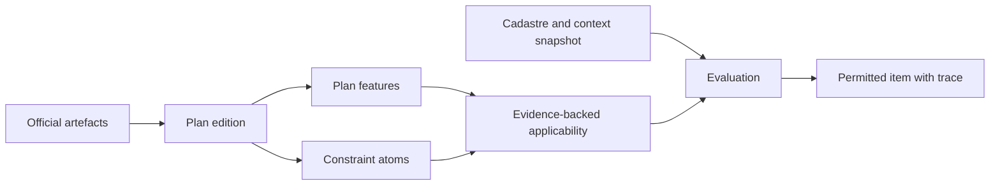

<!-- Proposed source-to-permitted-layer design for Croatian UPU material, grounded in the Staro Trnje–Savica case. -->
# Turn a Zagreb UPU into permitted evidence

A Croatian UPU can become a useful Permitted-layer source, but only if the system treats it as a versioned, multi-part rule system rather than as a zoning polygon pasted over cadastral parcels. The Staro Trnje–Savica UPU shows why: its adopted package combines provisions with eight 1:1,000 drawings; it regulates named planning cells, future building plots, building and regulation lines, public land and procedural gates, while today’s cadastre has changed beneath it. The existing Permitted layer already separates source-derived results from authored rules, but its Zagreb adapter is a cached, cadastral-parcel result that normalizes only an optional dwelling cap. The practical next step is therefore a small, reviewable compiler: preserve the official edition and every source reference, extract plan features and typed rule atoms, resolve applicability per rule rather than selecting a single winning layer, and make incomplete interpretation visible. That lets the system calculate a bounded set of UPU constraints while honestly returning `unknown`, `conditional`, or `requires-land-assembly` when a source or a lawful construction plot is missing. It also gives later UPU variants a shared vocabulary without claiming that automated analysis decides permits.

## The Savica package is a better source than one map

The City identifies *UPU Staro Trnje–Savica* as an adopted plan under **SGGZ 6/12**, and its current plan registers still list it as adopted/valid. The adopted package links an adoption decision and an eight-sheet 1:1,000 cartographic PDF; the decision itself says that provisions, drawings, explanation, GUP extract and adoption record form one plan elaborat. The current register supports use of that edition as the selected published source, but it is not proof that no later amendment, repeal, detailed plan or other act affects a particular conclusion. An import must therefore record “observed in register on [date]”, never an eternal `current=true`, and must preserve the original sources and checksums. ([City plan page](https://zagreb.hr/urbanisticki-plan-ure%C4%91enja-staro-trnje-savica-za-z/89119), [adopted-plan index](https://zagreb.hr/urbanisticki-planovi-ure%C4%91enja-upu-doneseni/89072), [valid-plan register](https://zagreb.hr/vazeci-prostorni-planovi/60656), [official drawings](https://www.zagreb.hr/userdocsimages/arhiva/prostorni_planovi/upu%20staro%20trnje/UPU%20Staro%20Trnje_svi%20listovi.pdf))

This distinction is not paperwork. Article 46’s new-construction table is keyed to named *kazete* rather than cadastral IDs. It gives C-15 an M1 use, 5,647 m², 11,294 m² gross floor area, `kig` 0.5, `kisn` 2.0 and `4E`; other cells deduct planned parks or public/social land before defining development area. The same provisions distinguish total `kis` from `kisn`: underground storeys leave total `kis` unset, whereas `kisn` concerns above-ground gross floor area. C-16 combines a 600 m² minimum building plot, a source height limit of basement plus four storeys, coverage and above-ground FAR limits, building type and boundary-distance alternatives, required natural terrain and an open-building-parts rule. `4E`, basement-plus-four-storeys and a permit’s four above-ground storeys are distinct source facts; the compiler must retain their stated vertical reference rather than recode them generically as P+4. These are machine-relevant facts, but only with their subject and denominator intact. The article-level text used here is an accessible legal-text mirror because the City’s decision deep link currently redirects; the City page and official drawings remain the primary package. ([decision, Articles 4, 26, 36, 39, 44 and 46](https://informator.hr/zakoni/559891-odluka-o-donosenju-urbanistickog-plana-uredenja-staro-trnje-savica-za-zonu-prisavlje-ulica-v-ruzdjaka-planirana-strojarska?v=572009), [City permit applying C-16](https://www.zagreb.hr/userdocsimages/arhiva/prostorno_uredjenje/GD%2019%20-%202377.pdf))

The import should retain the full source bundle, not extract a false single “zoning layer”. Its minimum feature families are plan extent, *kazeta*, land use, public dedication, street/corridor, regulation line, building line, procedure area and named planned construction lot. Each feature carries the originating sheet, locator, raw or digitised geometry, extraction method and geometric confidence. A derived vector from this legacy PDF is valuable, but it is evidence derived from a drawing rather than official vector geometry. That distinction matters wherever a fine line crosses a cadastral boundary.

| UPU source material | Typed record | What the Permitted layer can do |
| --- | --- | --- |
| Article/table cell | `constraint_atom` with source locator | Apply a numeric or categorical rule only to its named subject |
| *Kazeta* or land-use area | `planning_feature` / `plan_unit` | Determine candidate rules and preserve area-specific deductions |
| Building or regulation line | `geometry_effect` | Make a placement mask, maximum line or required alignment; never silently convert it into a setback |
| Park, road, social-use area | `dedication` / `reservation` | Exclude or reserve space only where the source defines that effect |
| Competition, DPU or phasing clause | `precondition` | Return `pending-required-procedure`, not an unconditional build-out |

## Implemented B-1 warnings and conditional massing

`zagreb-upu-staro-trnje-b1` is a deliberately narrow, read-only pilot within this UPU. It evaluates a source cadastral parcel only when its interior intersects the traced B-1 *kazeta*; a boundary touch remains of unknown applicability. The trace is derived from the plan drawing in EPSG:3765 and registered with 3 m uncertainty. Its `site` geometry is therefore inspection evidence, not a new plot, an exact legal boundary, or a building envelope.

Article 27 records a 2,000 m² minimum for an ordinary individual B-1 building plot, with a separate infrastructure plot as the stated exception. The API and MCP parcel context return `parcel-too-small` when the explicit candidate plot inside B-1 is below that area and overlaps the reliable interior of the traced boundary. The candidate is the cadastral parcel intersected with B-1, including for crossing parcels; it has a source-scoped identity, geometry and area linked to its cadastral parent. The warning carries both areas, the 2,000 m² threshold, article citation and geometry uncertainty. Its fill, hit region and selection outline cover only the candidate plot. It identifies an undersized candidate for an individual B-1 building plot without creating a cadastral record.

Articles 27 and 76 also retain the B-1 competition and mandatory preparcelation requirements as preconditions. In this pilot, an undersized candidate plot therefore identifies a need for land assembly before an individual building plot can meet the area minimum. Other sources must state their own conditions: `parcel-too-small` is a source warning, not a universal assertion that land readjustment is required. Crossing parcels use the area inside B-1 for the minimum-area check; land outside B-1 contributes no area and receives no B-1 warning fill. A boundary-only contact remains boundary-uncertain and never red. Missing candidate geometry or area leaves the area assessment unresolved. The representation preserves minimum area, coverage, above-ground FAR, storeys and natural terrain as cited source terms. The selected source also supplies its B-1 outline independently of parcel results, visible in map and model views.

Where the candidate B-1 plot reaches 2,000 m², the provider can calculate one conditional detached configuration on an explicitly proposed building plot equal to that intersection. The cadastral `site` remains unchanged. The proposed plot geometry and full intersection area are separate source-evidence fields; the 3 m uncertainty core is not its area denominator. This is an explicit plot-formation assumption, with preparcelation and competition still unresolved.

The configuration uses five above-ground storeys, coverage at most 0.5 and above-ground FAR at most 2.5 (Article 27). Construction sheet 4.1 supplies a 4 m B-1 building line. A separate half-height inset from the proposed plot edges implements a conservative detached configuration under Article 25: the model does not exploit the public-space or attached-edge exceptions. The placement mask intersects these independent insets; it does not add their distances. A 3 m storey height produces 15 m model height and is explicitly an assumption, not a source height limit. The shared compact-massing generator clips the footprint to this mask and measures the resulting footprint and floor area. This is one configuration, not the maximum envelope across every permitted building type. Natural terrain, access, parking, use mix and open building parts remain unevaluated, and the assessment remains unresolved.

The shared representation contract is used by `GET /planning/parcel` and by selected planning evidence in `ugt_parcel_context`; both expose the source item and its `sourceEvidence`, rather than an MCP-only interpretation. That evidence includes the cited source and the limited implemented dimensions, so clients can render the warning without inferring omitted rules.

## Three spatial identities prevent cut-parcel mistakes

The system must keep **cadastral parcel**, **plan unit** and **lawful building plot** separate. A cadastral parcel is a dated observed land record. A *kazeta* is an immutable spatial object in a particular UPU edition. A *građevna čestica* is the source-defined building plot on which many UPU limits are measured; it can be the entire cell, a named planned lot, a later formed parcel, or a subject that cannot yet be identified. Their intersection proves only that they overlap.

The case provides direct evidence. A 2019 City permit describes C-16 development on a newly formed parcel assembled from parts of two older cadastral parcels, and confirms that the UPU drawing supplies its regulation line, building line, separation and four-storey limit. A 2021 City attachment overlays UPU features on later cadastral and land-register parcels; it evaluates part of a parcel through C-15, use, infrastructure surfaces and procedure areas together. It does not turn the part of the parcel into an independent UPU plot. ([2019 permit](https://www.zagreb.hr/userdocsimages/arhiva/prostorno_uredjenje/GD%2019%20-%202377.pdf), [2021 City attachment](https://web.zagreb.hr/Sjednice/2021/sjednice_skupstine_2021.nsf/0/C12586DF003A998EC125878D00664FF7/%24FILE/04%2BPrilog%2B-.pdf))

For every evaluation, store `intersection_evidence`: a frozen cadastral snapshot, plan-feature ID, actual intersection geometry and area, coverage share, the two source geometries and registration/precision metadata. The evaluation can then split the *explanation* into buildable candidate area, reservation, maintenance-only area, procedural gate and line-accuracy uncertainty without creating fictional parcels. The current source design already says that an intersection fragment is not a new solver parcel or an independent `KIS`/`KIG` denominator. ([`docs/gup-scenario-integration.md`](gup-scenario-integration.md#L176-L182))

The distinction changes results. A 900 m² cadastral parcel that loses 80 m² to a corridor and has 120 m² on the wrong side of a building line has a smaller placement mask. It does **not** automatically have a 700 m² `kig` denominator. The layer should show the masks and return `denominator-unresolved` until a cited provision defines the lawful construction plot or authorizes that remainder as the denominator. The same rule protects minimum lot size, frontage, dwelling cap, parking and green-area calculations. A plan-defined named lot can be a valid subject after its identity and cadastral relation are recorded; a visually convenient union of fragments cannot.

A boundary can also invoke a textual assignment rule instead of separate dimensional rules on every fragment. GUP 2025 Article 23(11), for example, provides a majority-area rule for a building plot covered by more than one urban rule. Implement that as a cited, scoped operation over the specified building plot, not as a universal dominant-zone algorithm for UPU land use, corridors or reservations. An exact tie or an unverified applicable provision remains unresolved. Record georeferencing uncertainty separately from genuine boundary crossings; do not silently snap the drawing to today's cadastre or erase narrow fragments through a universal area threshold. ([GUP 2025, Article 23](https://www.zagreb.hr/userdocsimages/arhiva/prostorni_planovi/izid%20gup%20grada%20zagreba_2023-/gup_2025_donesen%20plan/GUP%20GZ%20-%20pro%C4%8Di%C5%A1%C4%87eni%20tekst%202025%20%281%29.pdf#page=31))

## Versioning selects evidence per rule, not a winner

Croatian law requires lower-level plans to conform to higher-level plans and treats provisions and cartography as parts of a planning document, but overlap alone does not provide a universal “UPU wins” algorithm. A UPU building line can control placement while a GUP condition remains relevant where the UPU does not replace it. Nor does the newest date, smallest polygon, strictest number or last imported record reliably decide a conflict. ([Spatial Planning Act, Articles 77–85](https://narodne-novine.nn.hr/clanci/sluzbeni/full/2025_12_155_2315.html))

The model should therefore have four immutable layers of record:

`plan_edition` pins legal identity, adoption/publication/observed-register facts and every artefact hash. `planning_feature` preserves verbatim plan geometry and provenance. `constraint_atom` gives one assertion its quantity, comparator, value/unit, subject, denominator, vertical reference, condition, source locator, extraction confidence and support state. `evaluation` freezes the selected editions, explicit composition policy, cadastral/context snapshot and evaluator version. The existing open scenario design calls for pinned base revisions plus amendments, separate rule definitions and assignment polygons, exceptions/deferrals and an effective definition before solving; the proposed UPU records should extend that direction rather than add a second Permitted database. ([`docs/gup-scenario-integration.md`](gup-scenario-integration.md#L88-L98), [`docs/gup-scenario-integration.md`](gup-scenario-integration.md#L125-L155))

Applicability relations—`applies_within`, `narrows`, `excepts`, `supersedes`, `requires_joint_reading` and `conflicts_with`—need a source citation. The resolver selects constraints per quantity using named, deterministic relations: legal effective interval, documented amendment/supersession, scope and then the rule-specific composition operation. If an overlay’s relationship has not been established, it returns both candidates and `conflict` or `unknown`; it must not choose based on ingest order. Every output carries selected and rejected candidates, the relation used, source locators and the evaluation ID. That makes a later correction an auditable new evaluation rather than a silent mutation of the current layer.

Keep legal editions separate from extraction and interpretation revisions. Correcting OCR, georeferencing or a translated rule changes the compiled definition and evaluation, not the adopted plan. A replacement download with different bytes first triggers source review; it does not itself establish a new legal edition. The viewer selects one effective evaluation for a given scope, with historical or alternative evaluations available for comparison rather than additive volumes. An unresolved, failed or restrictive replacement result must shadow its previous result; absence of new geometry must never revive an old envelope. A project-specific permit is useful interpretation evidence but does not by itself amend the UPU for other sites.

## A typed constraint registry makes variations manageable

The system should translate a small, evidenced UPU subset into a versioned registry, while retaining unsupported Croatian text as source evidence. Good initial entries are allowed/prohibited/conditional use; maximum storeys, height, `kig`, above-ground `kisn` and GFA; minimum lot area and frontage; setbacks; building lines; buildable area; access and parking; natural/green terrain; heritage/protection; infrastructure reservation; phasing; and design competition. The national rulebook explicitly expects plan content such as coverage, floor-area ratio, GFA, heights and storeys, while spatial plans also regulate land use, infrastructure and protection. ([Pravilnik o prostornim planovima](https://narodne-novine.nn.hr/clanci/sluzbeni/2023_12_152_2228.html), [Spatial Planning Act, Article 78](https://narodne-novine.nn.hr/clanci/sluzbeni/full/2025_12_155_2315.html))

Each registry entry declares valid subjects, units, denominator, geometry effect, evaluator version and one of `implemented`, `evidence_only` or `unsupported`. A rule parser—whether manual, assisted or LLM-based—only proposes atoms for review. It never turns prose into executable capacity simply because it found a number. Alternatives produce mutually exclusive named configurations with their conditions; their maxima must never be added. C-15’s above-ground capacity and C-16’s typology-dependent boundary distances are good pilot cases because they exercise numeric, geometry and conditional rules without requiring a citywide ontology.

This responds to the present system’s actual limit. The Permitted layer draws source-derived items per cadastral ID, and its Zagreb provider reads cached `parcel_build_envelope` records; it labels the result as a calculated option with unresolved applicability and normalizes only `max_units`. It does not itself interpret `kig`, `kisn`, frontage, natural-terrain, parking or UPU rules. ([`docs/permitted-plan-parcels.md`](permitted-plan-parcels.md#L6-L19), [`backend/planning/providers/zagreb-gup.js`](../backend/planning/providers/zagreb-gup.js#L71-L86)) The proposed compiler should emit the existing `planning-representations.v1` shape, with a richer `sourceEvidence` and result status, rather than fork the rendering or proposal systems.

## Start with one frozen UPU and preserve uncertainty

The B-1 pilot combines a cited minimum-area warning, one stated exception, named preconditions, conservative cadastral/trace intersection evidence and one conditional detached massing configuration. It retains the Savica edition and B-1 trace without selecting a GUP winner. Its proposed plot is an explicit calculation assumption rather than an established lawful construction plot. The next bounded extension should ingest a checked source manifest, add only the feature and rule types it needs, and reject a second UPU, amendment or special overlay until an editor records the cited composition decision. This scope catches cut parcels and conditional procedure before scale hides them.

Its acceptance checks are concrete: every displayed rule links to an article/table cell and map sheet; every result exposes its intersection evidence and rule-resolution trace; changed source bytes invalidate the compiled source revision; a clipped fragment is never a numeric denominator without a cited rule; unsupported or conditional rules block a `compliant` verdict; and identical frozen inputs reproduce the same evaluation. Cells B-4, C-17 and C-19 require operation-specific results: the cited limits preserve existing parameters during replacement/reconstruction, rather than granting additional capacity or implying that no work is allowed. ([decision, Article 45](https://informator.hr/zakoni/559891-odluka-o-donosenju-urbanistickog-plana-uredenja-staro-trnje-savica-za-zonu-prisavlje-ulica-v-ruzdjaka-planirana-strojarska?v=572009))

Human and MCP editing should use the same primitives: inspect an edition; inspect effective rules for a selected cadastral parcel or verified plan unit; view intersection and resolution evidence; attach a source citation; edit a reviewed typed atom or relation; and request a bounded evaluation. Existing MCP building operations assume exactly one envelope for one cadastral site, so they need these shared inspection/evaluation paths before they can reliably consume a UPU plan unit. ([`docs/permitted-plan-parcels.md`](permitted-plan-parcels.md#L74-L78))

The first implementation should deliver the source manifest, spatial identities and rule-resolution trace before attempting complete massing. Then add the C-15/C-16 dimensional subset and test a split parcel, a cell with public deductions, a procedure-gated cell, a replacement-only case and a conflicting overlay. Each additional rule type needs a schema, an evaluator, a source-backed example and shared UI/MCP coverage before it contributes to the displayed capacity.
