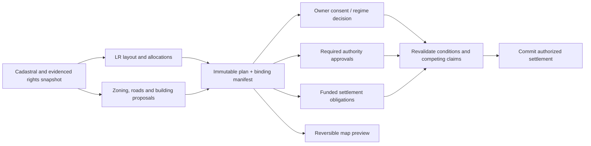

<!-- Consolidated land-readjustment audit, research, product model and implementation roadmap. Keep current LR status here; older design notes remain historical evidence. -->

# Land readjustment: audit and next steps

Audit and follow-up review dates: **2026-10-11–12**. Filename follows the requested `land-readjustmend.md` spelling.
The old implementation was selectively integrated and its local branch/worktree deleted.
**§17 records shared validation, custom allocations and owner review; §16 records the implemented pluggable rights and approval setup; §15 records the agreed ownership
abstraction; §14 the earlier consent/review increment; §13 the integration and §12 the review.**

This is the working reference for land readjustment (LR): what exists, what is broken, prior
decisions, international schemes, and the proposed path forward. Recommendations below are
**proposed changes** unless explicitly marked implemented. The October 11–12 work in §§13–17 is
implemented locally within the limits stated in each section.
Broader settlement and jurisdiction recommendations remain proposals.

## 1. Findings that determine the next work

The drawing foundation is already substantial. Manual plot drawing, splitting, merging by erasing
a shared boundary, moving vertices, undo, GeoJSON geometry import, owner assignment, a cash ledger,
and a draggable before/after divider exist in the current editor. The priority is making the
authored deal survive validation, application, consent and payment correctly.

The first audit found two application defects, now **fixed and regression-tested**: co-owners were
collapsed into one owner on apply, and plot area percentages were incorrectly used as title shares.
The current apply path preserves the complete owner vector, assigns a sole recipient 100% of their
plot, and uses a deterministic joint agent for the local custody index.

The remaining priorities are:

1. **The LR ledger is not yet a payment contract.** Local proposal and per-parcel agreement cash
   totals now match each owner's EUR cents exactly. Existing chain payout formulas still do not
   execute that owner-specific schedule.
2. **Production authority adapters and chain binding remain open.** The shared approval model now
   consumes abstract rights, exact shares, a selected lens and signed owner decisions (§16).
   Uploading rights grants no signer authority. A trusted runtime provider must independently
   verify rights and the actor's authority; no production provider is installed by this increment.
   Ownership is required for owner acceptance and voting, never for geometric creation.
3. **There is no statutory LR policy or binding LR-plus-zoning package.** Default consent, lenses,
   plans and counterproposals are foundations, not implementations of those capabilities.

The current editor now includes **Keep existing parcels**, courtyard drawing/derivation from a
building footprint, pro-rata joint ownership and separate original-parcel agreements. The reusable
comparison controller supports pointer/touch, keyboard and resize. Small-screen owner cards expose
cash fields without horizontal scrolling. Source-building geometry is saved as derivation
provenance; it does not confer building permission. Custom percentage shares, owner-specific
before/after review and one validation result across design/publication/apply/consent are now
implemented (§17). See §13 for the earlier integration scope and verification.

### Audit scope and confidence

- Repository/worktree: `consensus-builder-colosseum-worlds-fair`, branch
  `colosseum-worlds-fair`, HEAD `2e1005b5` at inspection. The cached remote-tracking branch was three
  commits ahead; its relevant LR/proposal/contract files did not differ. This is a source audit,
  not a fresh deployment or live-database inventory.
- Existing uncommitted floor-plan, parcel-provider, locale and memory edits were present. This
  pass initially added documentation and regressions. The later authorized integration changes
  application code and tests selectively, preserving unrelated edits. No commit, deployment,
  contract change or data migration was performed.
- Evidence includes current source, focused headless tests, behavioral reproductions, Git history,
  root Markdown notes, a bounded local prompt-history search, and primary legal/government sources.
  The follow-ups add headed desktop/390px Chrome tests of this checkout and the then-unmerged branch,
  including screenshot inspection and actual fabric/ownership reads after reload. No live-wallet
  transaction, legal registration or production deployment was tested.
- “Present” below means code in this checkout. The sibling implementation is now integrated
  selectively; its pre-integration evidence is historical in §12. “Proposed” means work still to do.
  Browser checks use synthetic cadastral/ownership data and a neutral basemap fixture; they are not live cadastral verification.

## 2. Capability inventory

| Requirement | Current status | Evidence and limitation |
|---|---|---|
| LR as an ordinary proposal | **Present, with gaps** | Goal `reparcellization`, specialist designer, shared draft adapter, persistence, apply/unapply, counterproposal and lifecycle paths. See [launcher](frontend/js/proposals/reparcel.js), [adapter](frontend/js/proposal-editor-adapters.js), [apply](frontend/js/proposals/apply/parcels.js). |
| Draw new boundaries manually | **Present** | [Designer](frontend/js/reparcellization.js), toolbar around line 481: draw a plot, line cut, erase boundary, edit nodes, undo, shuffle. Automatic layouts also exist. |
| Import a recognized geometry format | **Present, geometry only** | GeoJSON FeatureCollection, Feature, Polygon and MultiPolygon accepted around lines 2150–2226. The import replaces the working arrangement, clips to the pool and resolves overlap by subtraction. Imported owner attributes are ignored; assignment currently follows feature order modulo the owner list. This is not a faithful ownership round trip. |
| Before/after vertical divider moving horizontally | **Present inside LR, accessible controller extracted** | [MapCompareControl](frontend/js/ui/map-compare-control.js) handles pointer/touch, arrows, Home/End, PageUp/PageDown, percentage-preserving resize and listener disposal. Headed desktop/390px/touch/keyboard checks pass. The map renderer remains LR-specific. |
| General proposal comparison | **Reusable control available; other types not wired** | The shared editor still has source/draft/overlay buttons. Other proposal types can reuse the new divider controller, but need their own before/after rendering adapters. |
| Pool contributions and allocation ledger | **Present, with per-owner review; approximate economics** | Owner review lists contributed area, area assigned by title share, land change, output plots and exact cash offer, and highlights input/output geometry. Unknown contribution stays unknown. Output valuation still uses a uniform pool unit value. |
| Several recipients on one new parcel | **Preserved through apply/reload** | Exact `owners[]` values survive locally with normalized parcel title percentages; multiple recipients use a deterministic joint custody agent. Identity/signature semantics remain separate. |
| Unequal joint shares | **Custom and pro-rata shares present** | Edit positive percentages totalling 100%. Custom courtyard shares remain fixed through geometry changes, undo and reopening. “Use private-land proportions” explicitly restores automatic shares. Adding/removing recipients with checkboxes deliberately gives the selected recipients equal shares; percentages can then be edited. |
| Shared LR validation | **Implemented for design and local admission** | One pure validator checks geometry, pool coverage, overlap, output ownership and cash terms in the editor, publication, apply and consent paths. Missing input rights is a separate approval warning. Funding remains a local simulation flag; solvency and authoritative title/provenance verification are not implemented (§17). |
| Some owners receive land, others cash, others both | **Can describe part of the deal** | Allocation plus positive per-owner cash offers can be entered. Owner payments into the pool, funded settlement, arbitrary payees and chain reconciliation are not implemented as an LR settlement. |
| Counterproposals / forks | **Present** | Shared drafts produce a new proposal without prior acceptances. The saved pool is checked through the newer site flow; zero-cash exchanges and exact cash cents are supported. |
| Approval of the exact LR deal | **Local/server commitment implemented; chain signing pending** | Versioned SHA-256 covers internal plots, full ownership vectors, ledger and terms. Changed or unbound local approvals stop counting and can be renewed. Server publication recomputes the hash and rejects malformed ownership/cash declarations. The approval panel shows the explicit per-owner EUR offers. See §14. |
| Named plan containing LR and buildings/zoning | **Present as a collection** | [Plans](plans.md) are immutable named member sets with hashes and optional plan markets. A plan market's execution verdict is not member-by-member owner consent or atomic settlement. |
| Binding “LR only if this zoning/building plan accompanies it” | **Missing** | No package manifest requiring all member conditions and the LR settlement to succeed together. |
| Work backwards from built form | **Present, bounded courtyard derivation** | Preserve input parcels and carve closed footprint holes from stored building proposals, including unapplied ones. Source ID/title/exact footprint snapshot are saved. Party-wall, access and general zoning-to-parcels solvers remain future work. |
| Country / jurisdiction schemes and custom thresholds | **Custom owner/area thresholds implemented locally; jurisdiction templates missing** | Approval tab supports unanimity or conjunctive owner-count/whole-parcel-area fractions, including strict versus inclusive comparisons. Rights snapshot and policy survive server publication. No country-specific or chain policy is claimed. See §16. |
| Choose between land/cash packages when accepting | **Missing** | Existing acceptance is binary for an owner slot. No option reservations, feasibility resolver, ranked allocation or final selection proof. |
| Gradual, independently executable participation | **Local separate-agreement construction present** | One agreement per original input parcel, with private ownership retained and authored joint shares fixed. Save/apply recovery and reload are tested. No assertion of legal severability, partial-participation rebalancing or atomic multi-contract execution. |

### Authoritative entry points

- Authoring and accounting: [reparcellization.js](frontend/js/reparcellization.js),
  [slice helpers](frontend/js/reparcellization-slice.js),
  [input shares](frontend/js/reparcellization-shares.js),
  [UI state](frontend/js/reparcellization-ui-state.js),
  [shared validation](frontend/js/reparcellization-validation.js),
  [allocation arithmetic](frontend/js/reparcellization-allocation.js),
  [contribution arithmetic](frontend/js/proposals/readjustment-contributions.js).
- Server normalization: [reparcellization route](backend/routes/reparcellization.js),
  called by [proposal creation](backend/routes/proposals.js), around lines 798–807.
- Ground: [apply/parcels.js](frontend/js/proposals/apply/parcels.js),
  [mutation boundary](frontend/js/proposals/apply/transaction.js),
  [ground service](frontend/js/parcels/ground-service.js).
- Consent and identity: [execution.js](frontend/js/proposals/execution.js),
  [ownership-flow.js](frontend/js/proposals/ownership-flow.js),
  [proposal contracts](frontend/js/proposal-contracts.js), [lens model](lens-model.md).
- Composition: [supersession](frontend/js/proposal-supersession.js),
  [plan hashes](backend/plans/plan-hash.js), [plans](plans.md).

## 3. Correctness findings and acceptance criteria

### Resolved locally — Preserve the exact ownership of every output parcel

**Initial defect, fixed in §13:** `persistResult` saved every plot's `owners[]`, but the apply path
formed child ownership from singular fields and resolved only one recipient agent.

**Observed reproduction:** input owners A=0.5 and B=0.5; apply returns success; output
`ownershipDetails.owners` contains one “A + B” entry at 100%; transfer destination is A.
The authored object itself remains intact, making the materialized ownership error easy to miss.

**Required invariant:** a plot has an explicit allocation vector whose shares sum exactly to one.
The same vector must survive draft → save → server normalization → reload → apply → export →
consent/settlement. A single-agent custody/index key must not erase beneficial co-ownership or
replace the individual owners' consent. The integrated implementation preserves the vector and assigns a
deterministic joint-pool custody agent; both survive headed apply/reload in this checkout (§13). It remains a local
ownership index, not a shared-wallet or legal-entity consent implementation.

### Resolved locally — Separate area percentages from title shares

`validateReparcellizationShares` sets `polygon.percent = polygonArea / sumOfPolygonAreas * 100`.
Before integration, apply interpreted `slice.percent` as title percentage. It now derives title
exclusively from the normalized owner vector. A sole recipient receives 100%, independently of
plot area or the plan's `isSingleOwner` flag.

**Observed reproductions:** the new apply regression uses two server-normalized 35%/65% plots and
gets title percentages 35/65 rather than 100/100. The headed geometry-import/assignment path gives
the sole recipient **0%**, also retained after reload, because its local manual plot carries zero
in the same misused field. These are two inputs exposing the same area/title mapping defect.

Use unambiguous fields such as `poolAreaFraction` for geometric statistics and
`allocations[].share` for title shares. A sole recipient owns 100% of their output parcel,
regardless of its fraction of the pool. Define a deliberate migration for stored plans and their
materialized ownership; changing the display alone cannot fix the underlying semantics.

### Resolved locally — Shared plan validation; settlement verification remains open

The initial audit found a percentage-only server check and inconsistent editor/apply gates. The
October 12 increment replaces them with one explicit result across editor, ordinary publication,
apply and consent. Invalid geometry, overlaps, incomplete declared pools, malformed output shares
and cash-ledger inconsistencies are rejected before publication payment or map mutation. Area
percentages are derived display values and no longer determine validity. See §17.

Missing **source** ownership remains an approval warning; abstract output recipients can still be
assigned and saved. Unassigned outputs block Done/publication. Source verification, real funding,
economic fairness, legal validity and contract settlement remain separate unresolved boundaries.

**Coverage nuance:** current LR can take only part of a cadastral parcel and leave the rest with
its owner. Validate coverage of the **declared pool/site**, then conserve untouched remainders
across the enclosing cadastral scope. Do not reinstate the obsolete “LR must tile every whole
source cadastral parcel” rule. The live fabric's closed-scope guard is stricter than the editor's
older tolerances; the shared validator now uses the fabric's absolute-plus-relative conservation
budget rather than a percentage gate.

### P1 — Make compensation a settlement schedule

The designer stores `ownerShares[].cashOffer` and `totalCashOffer`. Proposal serialization and terms
now derive their EUR offer from the ledger, rounded per owner to cents; separate agreements allocate
each owner's cents by their contribution to the input parcels, conserving every owner's total. The local payout view uses input-parcel area and input
owner shares ([execution.js](frontend/js/proposals/execution.js), lines 88–111). EVM and Solana
also distribute by their generic input-acceptance models, not this LR ledger; see §10.

Consequently, an owner offered cash because they receive less land may not be the person paid that
amount by the current contract. Owner top-ups are also needed when someone receives more value.
Store signed obligations with explicit payer, payee, asset/currency and integer amount; display
who receives and who pays, and gate settlement on the required funds and approvals.

### P1 — Bind consent to the entire deal (local/server gap fixed in §14)

The initial audit found that local `currentConsentBindingHash` preferred a fingerprint of the
union footprint and cession flow, omitting LR internal borders, full owners/shares, valuation,
cash and policy. §14 replaces that LR path with the shared `land-readjustment-deal/v1` commitment.

**Observed reproduction:** changing a 50/50 internal split to 25/75, swapping recipients and changing
cash from 100 to 900 while keeping the exterior/flow yielded the same effect fingerprint.

**Qualification:** normal shared-editor edits create a fresh proposal and strip prior acceptances
([adapter](frontend/js/proposal-editor-adapters.js), `stripImmutableProposalIdentity`, lines
403–409; [shell](frontend/js/proposal-editor-shell.js), publish path around 1765–1812). The audit
did not demonstrate stale execution through that normal UI. This is a structural binding gap for
in-place mutations or reuse of acceptance records, not proof of an ordinary edit-flow exploit.

Named-plan LR member hashes now use that same commitment instead of the former singular-owner
projection. Non-LR member hashes remain unchanged. Existing LR plan hashes are not silently
rewritten: a previous weaker member hash no longer matches. Contract signatures, authenticated
rights, funded payer/payee obligations and conditional package hashes still require implementation.

### P1 — Use an evidenced electorate, not names or parcel counts

The editor aggregates contributions by normalized display name; this can conflate two people
with the same name and cannot prove that two different names denote one owner. Missing ownership
can produce isolated placeholder owners and estimated/equal input shares. Those are useful for
sketching but not for counting statutory votes or distributing funds.

Separate participant identity, wallet/signer, ownership interest, input parcel, output allocation
and custody agent. Preserve evidence source, effective date and disputed/unknown status. The user
confirmed in §15 that one abstract owner across three parcels is one headcount participant; each
parcel contributes to area support only after all its co-owners approve. Do not infer identity from
names or introduce that evidentiary work into LR. Additional rights classes and jurisdiction-specific
counting require an explicit policy.

## 4. Terminology and the earlier stacking decision

Use **Land readjustment** as the primary user-facing term. Keep `reparcellization` as the existing
internal identifier until an intentional migration. “Reparcelation” and “reparcellization” can be
search/help synonyms. “Formation” is useful in implementation documentation, not as a necessary
new term for users.

| User concept | What it changes | Example |
|---|---|---|
| Boundary change | Parcel geometry | Split one lot or adjust a boundary; owners can remain the same. |
| Land acquisition / land contribution | A defined piece of land and its ownership | A road takes strips from three owners; each keeps their remainder and may receive compensation. |
| Land readjustment | A pool's parcel layout and distribution of rights/value | Several input parcels become different output parcels, shared/public/reserve plots and cash obligations. |
| Zoning / urban-rule proposal | Permitted use or built form | A height/use/density rule; it need not transfer or reshape land. |
| Development plan/package | Related proposals and their conditions | LR plus zoning, access roads and specified building plans. |

A road's cut and an LR plot use related geometry mechanics. The distinction for users is the
**deal**: an acquisition identifies land taken and retained; LR explicitly redistributes a pool
among participants. Show a common “Land changes and compensation” section on any proposal that
changes land, with an LR allocation table when redistribution is present. Do not require a second
standalone LR proposal just because a road leaves remainders.

“One parcel fabric” means one non-overlapping partition of horizontal ground in a particular
preview. It does **not** mean one human owner per parcel: a parcel can have co-owners whose shares
sum to one. Nor does it mean that no building, rule or alternative proposal may reference that land.

### Recovered decisions, with their limits

| Evidence | Meaning and current status |
|---|---|
| [rethink-proposals.md](rethink-proposals.md) §§9–10 and §15a, July/August 2026 | Formation plus content; cadastral base → one flattened formation/readjustment → content on top. LR is a bundle of formations with explicit mapping and value balance. Preserve this distinction. |
| §10: owner dossiers and jurisdiction seam | Intended consent unit is the owner's affected slice; default unanimity and future jurisdiction policies were discussed. Current code primarily counts all required owners of every bound input parcel; component-by-component execution is not generally implemented. |
| August 6 prompt, session `019fd6cb-5e12-7ac2-b5ba-e8a8cafeb7e7`; §§15b–15c | The user directly described latest-wins partition edits and no restoration. This is historical evidence, not a reliable description of current unapply behavior. |
| §15d, August 7 | Notes record a later whole-cadastral-parcel/tessellation restriction. **Superseded in current LR apply.** |
| [apply/parcels.js](frontend/js/proposals/apply/parcels.js), lines 48–76 and 111–175 | Current code permits untaken partial parcels/road remainders, citing an August 10 ruling. Later roads carve a private copy of the LR layout; removing those roads can restore the authored plots. The direct August 10 transcript was not found locally. |
| `rethink-proposals.md` §0, August 27/September 3 | Current authority boundary: immutable cadastral repository + authored flat records; mutable derived fabric; one `ParcelMutation` transaction boundary. Older experimental sections must be read through this current contract. |
| [advanced-readjustment.md](advanced-readjustment.md) and `dacbf94e`, September 9 | Plan and separate implementation for courtyard/joint ownership/individual agreements. Selectively integrated on October 11, not cherry-picked wholesale. Retired sibling HEAD: `1550d96f`; its local branch/worktree are deleted and archived. §13 records current verification and remaining settlement/consent limits. |
| September 28 prompt, session `01a0e7bd-91ab-7911-a99e-ca424b0a6fc2` | Prior request for worldwide LR schemes found. No completed legal comparison was found in the bounded local notes/history search. |
| [plans.md](plans.md), October 10 | Immutable named plans now have member/content hashes and a market identity. This is newer infrastructure to reuse for composition. |

The old §10 suggestion that German Umlegung is simply a qualified-majority example is inaccurate
for statutory Umlegung; §7 below corrects it using the legislation.

### What flattening should and should not do

Persist original cadastral anchors and authored result geometry. Generated parcel IDs remain
runtime identities. Flattening avoids a brittle ancestry chain such as “parcel created by B,
which depended on parcel created by A, which is absent on another machine.”

Flattening must **not erase contractual dependency**. “This allocation is acceptable only with
that zoning approval” is a condition of the deal, even when both records have flat cadastral
anchors. Store that condition explicitly using immutable member/version hashes.

## 5. Sequencing, coexistence and binding packages

| Situation | Present behavior / recommended treatment |
|---|---|
| LR preview, then building or zoning preview on its plots | Composition is supported in the model. Content can stand over formed ground; actual apply gates depend on type, geometry and ownership. A new freeform building can itself form/take ground, so it is not always harmless content. |
| Two disjoint proposals share one original cadastral parcel | Shared base ID alone must not imply conflict. Current [supersession](frontend/js/proposal-supersession.js) uses geometry for relevant alternatives. |
| Two competing allocations of the same land | Keep both as alternatives/counterproposals. A preview has one consistent chosen partition. Neither competing proposal should silently acquire an execution right from merely being displayed. |
| A road precedes LR | LR may use remaining untaken ground. It cannot form plots over the road corridor. |
| A road follows LR | Current replay carves the later road from the LR's private materialization. This is preview composition, not renewed owner consent to the changed settlement. |
| LR and zoning in one named plan | They can be presented/applied together today. The named plan does not guarantee that owner consent, funding and authority approvals all occur together. |
| LR has legally taken effect, then a new development proposal | Conceptually valid, but requires a verified new effective rights/parcel state. Current local `Executed`/applied fabric is not a cadastral registry update. Formal executed-state rebasing remains distinct work. |

### Recommended package extension

Reuse named plans as the presentation and versioning container. Add an optional **binding package
manifest**, rather than inventing a parallel editor and proposal lifecycle. For a standalone LR,
the LR proposal itself carries its geometry, allocation, policy and settlement terms.

A binding manifest commits to the exact LR member, zoning/building/road members, required
authority decisions, funding conditions, execution conflict scope and a declared severability
rule. One owner action can approve the package, while their review shows both their individual
allocation and the conditions they rely on.



The statement “agree to this LR and this zoning comes with it” needs two possible meanings in the
UI: **the package includes a zoning proposal**, or **LR settlement is conditional on the zoning
decision being approved**. Owners cannot themselves grant a public-law zoning approval merely by
accepting an app proposal. Record the relevant authority evidence as a separate condition.

At execution, prevent a second incompatible package from consuming the same current rights.
Use a canonical conflict/rights reference plus revision and an atomic check, not generated browser
parcel IDs or a blanket ban on shared cadastral IDs. Conditions and promises must survive flattening.

Default a genuinely interdependent pool to one agreement. Allow separate agreements only when
each has a complete allocation, access, obligations and funding without relying on uncommitted
neighbors. The sibling courtyard carve is a candidate for that narrower mode; its changing joint
membership/shares and building-right conditions still require review.

## 6. UX and allocation design

### One proposal flow with a specialized geometry editor

Keep the existing shared draft/review/publish/fork flow. A proposed LR flow is:

1. **Scope:** select/draw the pool; show source parcels, owners, unknown rights, public/open ground
   and existing proposal conflicts. Choose the jurisdiction/process early enough to guide the work.
2. **Layout:** draw freely, preserve existing boundaries, use an automatic suggestion, or import
   GeoJSON. “From a proposal” can enter here later. Use the same visible plot list and undo model.
3. **Allocation:** assign new plots, joint shares, public/reserve roles and cash amounts. Clicking
   an owner highlights both their contributed land and all proposed outputs.
4. **Agreement:** confirm the policy, relevant conditions, funding and one agreement versus
   validated separate agreements. This agrees with the integrated courtyard terms flow (§13).
5. **Review:** before/after swipe, owner impact cards, the complete ledger, policy requirements,
   approval/funding status and any remaining draft errors.
6. **Publish:** normal immutable proposal / counterproposal mechanics; shared lenses, funding,
   comments and lifecycle surfaces. Changes to terms create a new version and fresh acceptance.

Use short stable names in the UI: **Pool**, **New parcels**, **Owners and compensation**,
**Agreement rules**, **Before/after**, **Your allocation**. Localize new strings in all supported
languages. On narrow screens, owner cards can replace the wide table without hiding obligations.

### Improve import rather than add another importer

Define a documented GeoJSON profile with WGS84 longitude/latitude, stable plan-local `plotId`,
polygon geometry, role and optional allocation references. Plain GeoJSON can remain geometry-only;
show imported plots as **unassigned** until reviewed instead of assigning owners by file order.

Before committing import, show coordinate/CRS failures, repaired/invalid rings, out-of-pool area,
overlap, uncovered pool area and changes from clipping. Require an explicit choice for replace
versus append and preserve undo. Arbitrary incoming `ownerKey` is a reference to reconcile, not
ownership evidence. Export must round-trip geometry and allocation metadata without inventing
official parcel numbers. Later formats such as GeoPackage/DXF can be separate converters.

### Generalize the existing before/after divider

Extract a reusable comparison controller taking before/after render layers or snapshots, labels
and camera state. LR supplies original-versus-proposed parcel boundaries; a counterproposal can
supply source-versus-draft; buildings and roads can supply their relevant layers.

Preserve ownership colors and let users emphasize boundaries separately from buildings and rules.
Both sides should use the same selected basemap; the current before view hardcodes OSM. Label
whether “before” means official cadastre, the current preview, or the source proposal. Cache the
chosen snapshot so comparison cannot drift while editing.

The current handle uses mouse/touch events on a plain `div`; add keyboard movement, accessible
name/value and a visible focus state. Support touch at 300–400px widths and keep overlay/toggle
comparison as an accessible alternative. Preserve the map's previous interaction state on exit.
Current close/resize cleanup exists; test extraction against that lifecycle.

### Allocation and money

Represent separately:

- **Input interests:** parcel/part, area, evidenced owner share, contributed value and valuation date.
- **Entitlements:** the chosen rule for distributing net land/value after costs and contributions.
- **Output parcels:** geometry, use/role, valuation and a complete recipient-share vector.
- **Cash obligations:** receipts and payments, payer/payee, currency/asset, due condition and funding.
- **Other rights/costs:** access, easements, leases, mortgages, relocation, taxes, construction and
  maintenance obligations where the scheme needs them.

Public infrastructure land, saleable reserve land and a privately shared courtyard are different
output roles. A shared courtyard has real co-owners or a clearly defined legal entity; “Public
land” must not be an interchangeable label for it. Unknown/open ground has no fabricated owner vote.

Show market valuation, area-based sketching and custom negotiated entitlements as different bases.
An average pool price is useful for a sketch; it does not establish that a narrow inaccessible plot
and a serviced street-front plot have equal value per square metre. Preserve each valuation's
evidence, date, assumptions and dispute state.

Illustrative accounting, **not a rule of any country**: 1,000 m² enters, 200 m² is explicitly
reserved for public space, and the remaining 800 m² is valued at EUR 120,000. Participants agree
to distribute that net value 50/30/20. Ignore infrastructure costs for this example.

| Owner | Net entitlement | New private land | Assumed output value | Cash received (+) / paid (−) |
|---|---:|---:|---:|---:|
| A | EUR 60,000 | 300 m² | EUR 45,000 | +EUR 15,000 |
| B | EUR 36,000 | 400 m² | EUR 60,000 | −EUR 24,000 |
| C | EUR 24,000 | 100 m² | EUR 15,000 | +EUR 9,000 |
| Total | EUR 120,000 | 800 m² | EUR 120,000 | EUR 0 |

This demonstrates why “cash offer” cannot mean only a positive payout. B must fund EUR 24,000
before A and C can receive their equalization payments. Infrastructure expenses or an outside
funder require additional ledger lines, not an unexplained balancing number. A cash-only exit is
also possible if the agreed policy permits it and another participant/funder finances the exit.

### Choices, counterproposals and ranked preferences

Start with a **fixed feasible allocation** and binary acceptance. Forks/counterproposals can offer
different complete mixes of land and cash using the existing framework. This satisfies the minimum
requested capability once ownership and settlement are corrected.

Add **bounded alternatives** next: an owner may accept option A or B, or authorize either, provided
the proposal specifies availability, priority, expiry, funding and tie-breaking. Independent choices
must not allocate one exclusive plot to two people or promise unaffordable cash exits. Either each
permitted combination is feasible, or a committed resolver chooses one globally feasible allocation
within each owner's signed acceptable set.

Treat ranked preferences as negotiation input initially. A ranking is not permission to impose any
outcome. Publish the resolved allocation as a counterproposal for final acceptance, or later support
an explicit conditional authorization of a bounded resolver and its proof. Keep non-binding
preferences, binding owner consent and jurisdictional approval votes distinct.

### Work backwards from buildings or zoning

Use a source proposal as a **design constraint and recorded inspiration**, not as hidden authority:
snapshot/hash its geometry and parameters; derive the affected pool; reserve access/public areas;
generate candidate plot boundaries; then review allocation, valuation and consent normally.

The integrated courtyard approach extracts interior rings from a building footprint and
carves them out of preserved parcels. It is a useful first case, with an honest “no enclosed
courtyard found” result for gapped footprints. Party-wall cuts, frontage/access constraints and
minimum plot sizes are later cases. Zoning alone often admits many layouts; present alternatives,
not a uniquely correct cadastral answer. The exact source footprint is now retained; source-change
notifications and binding source dependencies remain future work.

## 7. International LR schemes: research and product implications

Sources were checked on **2026-10-11**. These are comparative process findings, not a claim that
selecting a preset legally authorizes a project. Statutory powers, eligible rights, local rules,
notice/objection procedures, approvals and registration remain part of each real process. All
regimes below are **research/design candidates**; none is implemented as an LR contract policy here.

### The central correction: there is no single country percentage

There are at least three distinct families: voluntary agreements, owner/association processes with
specified support thresholds and public approval, and authority-led statutory readjustment.
Thresholds may apply to initiating an association, approving a plan, or proceeding with execution.
They may count people, area, rights classes or several of these together. Land deducted for roads
or funding is a different percentage again.

| Jurisdiction and route | Threshold or authority at the specified stage | App implication and primary source |
|---|---|---|
| **Germany — statutory Umlegung** | Municipality/competent readjustment authority orders the process when legally necessary; owners are heard. No general owner-majority initiation vote in §§46–47. | Authority decision and procedure, not “Germany = 50%/75%.” [BauGB §46](https://www.gesetze-im-internet.de/bbaug/__46.html), [§47](https://www.gesetze-im-internet.de/bbaug/__47.html). |
| **Japan — individual/joint private implementation** | Art.8 requires consent of other affected rights-holders for the plan, with specified exceptions for some non-ownership/non-leasehold rights; Art.4 approval also applies. | Separate voluntary/private route. [Land Readjustment Act, arts.4 and 8](https://laws.e-gov.go.jp/law/329AC0000000119). |
| **Japan — landowners' association** | Art.18: at least **2/3 of owners**, at least **2/3 of leaseholders**, and at least **2/3 of the combined ownership-area plus leasehold-area denominator**. These support an application under Art.14; governor approval is also needed. | Three conjunctive tests with distinct rights classes, not one parcel or wallet tally. [Act, arts.14 and 18](https://laws.e-gov.go.jp/law/329AC0000000119); [official Osaka review quoting them, p.7](https://www.pref.osaka.lg.jp/documents/15513/0333_toushin0403.pdf). |
| **Japan — public implementation** | The association's Art.18 support condition is not the public-sector implementation condition; planning, public inspection/objections and authority procedures apply. | Separate authority route. [JICA, Land Readjustment, chapter 1, pp.34–36](https://www.jica.go.jp/jica-ri/publication/booksandreports/l75nbg00000ltoak-att/LAND_READJUSTMENT_Chapter1_web.pdf). |
| **Spain — Catalonia, compensación básica** | Initiative requires owners representing **more than 50% of the action area's surface**, Art.130(3). Nonjoining owners and administration have defined roles. | Strict `>`, area-weighted, initiative stage. [Catalonia urbanism law, art.130](https://www.boe.es/buscar/act.php?id=BOE-A-2010-13883#a130). |
| **Spain — Catalonia, compensación por concertación** | Initiative can come from owners representing **more than 25% of surface**, Art.135(2), followed by municipal process/selection. | A second route in the same region already needs a different policy. [Arts.135–138](https://www.boe.es/buscar/act.php?id=BOE-A-2010-13883#a135). |
| **Spain — Madrid, compensación** | Art.104 uses **at least 50% of surface** for the specified initiative routes/time windows; Art.106 requires supporting documents; Art.107 supplies municipal procedure. | `>=` differs from Catalonia's `>`. Do not offer an undifferentiated “Spanish system.” [Madrid Land Law, arts.104–107](https://www.boe.es/buscar/act.php?id=BOE-A-2001-18984#a104). |
| **Netherlands — voluntary urban kavelruil** | Voluntary exchange involving at least three parties, with agreement/deed and registration; it is distinct from compulsory rural reallocation. | A useful voluntary exchange template, not a majority override. [Government IPLO guidance](https://iplo.nl/thema/ruimtelijke-ontwikkelingen/instrumenten-grondbeleid/kavelruil/). |
| **Taiwan — owner-organized urban land readjustment** | Chinese Art.58: consent of **at least half of private owners**, whose land represents **more than half of private land area**, plus competent-authority approval. | Separate count and private-area tests. English translations can obscure strict/inclusive boundaries; preserve original-language text. [Equalization of Land Rights Act, arts.57–60](https://law.moj.gov.tw/LawClass/LawAll.aspx?pcode=D0060009). |
| **South Korea — urban development association** | Current Korean Art.13(3): **at least 2/3 of zone area** and **at least 1/2 of total landowners** for association-formation authorization. | Two tests at an organizational stage; not final replot approval. Use current Korean law over older English boundary wording. [Art.13, effective 2026-07-01](https://www.law.go.kr/lsLinkCommonInfo.do?lsJoLnkSeq=1029377027). |
| **Colombia — urban action units / reajuste de tierras** | Art.44 uses favorable owners representing **51% of committed area** to start execution after its bases are agreed. Art.45 separately requires a plurality of participants representing at least **51% of area** for the readjustment/integration project, followed by authority approval. | Area support plus the specified participant requirement, not 51% of users. Distinct stages and treatment of dissenters. [Ley 388, arts.44–46, official consolidated source](https://www1.funcionpublica.gov.co/eva/gestornormativo/norma.php?i=339), [official IGAC copy](https://www.igac.gov.co/sites/default/files/transparencia/normograma/ley_0388_1997_0.pdf). |
| **Turkey — statutory Article 18 readjustment** | Municipal/competent authority may replot without owners' consent under the statute. The **45% DOP** figure is a contribution/deduction cap, not an approval threshold. | Authority route plus a separate deduction rule. [Ministry-hosted Law 3194, January 2026 copy, art.18](https://webdosya.csb.gov.tr/v2/meslekihizmetler/2026/01/3194-Say-l-mar-Kanunu-20260114101544.pdf). |
| **India — Gujarat town-planning scheme** | The cited scheme-making and sanction provisions provide for authority action, written objections and State sanction; §§40, 47–48 do not state a percentage owner-vote condition. | Authority-led reconstitution/valuation candidate. [India Code, Gujarat Town Planning and Urban Development Act](https://www.indiacode.nic.in/bitstream/123456789/4658/1/tpudact.pdf). Evidence here is search-index text from the official PDF; direct retrieval timed out. Full-text and latest-amendment review remain required. |

### Germany: allocation matters as much as procedure

Umlegung can distribute by relative **area or value**, selected uniformly by the authority; another
basis is possible with all participants' agreement. Value-based allocation and balancing payments
are prescribed in §57. This supports multiple valuation models rather than a fixed “return the
same square metres” formula. [BauGB §56](https://www.gesetze-im-internet.de/bbaug/__56.html),
[§57](https://www.gesetze-im-internet.de/bbaug/__57.html).

Public/local facilities are dealt with in the pool rules. In area-based distribution, §58 caps its
area contribution at 30% for first development and 10% elsewhere, with further conditions and money
adjustments. These are **not voting thresholds or a universal infrastructure percentage**.
[§55](https://www.gesetze-im-internet.de/bbaug/__55.html),
[§58](https://www.gesetze-im-internet.de/bbaug/__58.html).

The allocation rule aims at suitable plots in the same/equivalent location; monetary equalization
addresses allocation differences. With affected owners' agreement, alternatives include money,
outside land and shared/property-equivalent rights; other statutory cases also permit cash
compensation. The UI therefore needs explicit land/cash/shared-right outcomes and their legal
basis, rather than assuming any owner can demand any option unconditionally.
[§59](https://www.gesetze-im-internet.de/bbaug/__59.html).

### Japan: rights classes, replotting and project finance

The Art.18 area test counts ownership and leasehold areas in its specified combined denominator.
A physical square metre can be represented in both rights classes; replacing this with the unique
geometric union would change the statutory test. The current e-Gov XML was also retrieved to
check the operative wording; the Osaka PDF's complete relevant page was inspected.
[Land Readjustment Act, art.18](https://laws.e-gov.go.jp/law/329AC0000000119).

Replotting considers location, area, use and other characteristics. The Act provides monetary
equalization and reserve land for financing, and mechanisms for some small interests/shared
allocations. Temporary replots and final rights conversion are process stages, not the same event
as an association vote. This suggests explicit public and saleable reserve plots, valuation,
replot assignments and equalization obligations in our data model. JICA is useful explanatory
research; use the current statute for an executable policy.
[JICA, chapter 1, pp.34–37](https://www.jica.go.jp/jica-ri/publication/booksandreports/l75nbg00000ltoak-att/LAND_READJUSTMENT_Chapter1_web.pdf).

### Spain: regional processes and distribution of development benefits/burdens

The Catalonia and Madrid examples establish why a country-wide percentage is insufficient.
Catalonia's basic route has a compensation association and rules for nonmembers; municipal and
registration acts remain relevant. The retrieved Catalonia consolidation was labelled updated
2026-07-03 and still “updating”; Madrid displayed 2026-06-15. Pin and review the relevant official
provisions before enabling a legally named preset. [Catalonia](https://www.boe.es/buscar/act.php?id=BOE-A-2010-13883#a130),
[Madrid](https://www.boe.es/buscar/act.php?id=BOE-A-2001-18984#a104).

Valencia separately defines reparcelación as redistribution to implement planning: allocate
benefits and burdens, compensate the urbanizer in land or money, provide public land, substitute
resulting plots for original interests and pay owners who receive no plot. Voluntary and forced
routes differ. This is a strong reason to model development entitlement and project charges as
well as area. [Valencian consolidated planning law, arts.85–87](https://www.boe.es/buscar/act.php?id=DOGV-r-2021-90283#a8-7).

### What to preserve from the other schemes

Taiwan explicitly combines project expenses/public facilities with benefit-proportionate
contributions, value-related redistribution, balancing payments and cash for undersized interests;
its 45% contribution cap also has an exception procedure. These are separate from Art.58 consent.
[Equalization Act, arts.60–60-2](https://law.moj.gov.tw/LawClass/LawAll.aspx?pcode=D0060009).

Dutch voluntary urban exchange is a closer fit for a voluntary app agreement than an authority's
power to compel dissenters. Registration of the exchange deed is a substantive step; an app vote
does not replace it. [IPLO](https://iplo.nl/thema/ruimtelijke-ontwikkelingen/instrumenten-grondbeleid/kavelruil/).

Colombia links contributions to resulting lots and allows cash when a land return is infeasible;
the authority-approved readjustment and later formalization matter beyond reaching 51%.
[Ley 388, arts.45–46](https://www1.funcionpublica.gov.co/eva/gestornormativo/norma.php?i=339).

This is a representative comparison, not an exhaustive world catalogue. More country/region
templates can fit the same architecture. A candidate should remain labelled research-only until
its exact route, current law, electorate, process stages and allocation rules are verified.

## 8. A regime selector that can represent the research honestly

Use a dropdown such as **Agreement rules**, containing **Voluntary — all required owners**,
specific jurisdiction/process templates, and **Custom agreement**. A jurisdiction template should
show its region, route, version and source, for example “Japan — association LR” or “Spain,
Catalonia — basic compensation”. It should describe what the current support count qualifies for.

Custom majorities may be used for an agreed simulation or an association's lawful private rules.
They cannot grant a proposer statutory power over an unconsenting third party. Public-authority
processes need the specified evidence and authority step, rather than a pretend 0% vote.

The policy needs at least:

| Field | Purpose |
|---|---|
| `regimeId`, `version`, `jurisdiction`, `effectiveDate`, `sources` | Identify the exact rule and evidence; never silently update a published proposal to a new template. |
| `mode` | Voluntary agreement, threshold-plus-authority, or authority-led procedure; simulation status separate. |
| `stage` | Association formation, initiative, plan approval, allocation approval or execution. |
| `electorateSnapshot` | Evidenced right-holder identities, qualifying rights, shares, relevant area/value and date. |
| `tests[]` | Comparator, rational numerator/denominator, weight, rights class and denominator population. All/any composition explicit. |
| `authorityConditions[]` | Named decision/evidence types, decision scope, effective date and review/finality requirements. |
| `allocationRules` | Valuation basis, public contributions, cash/shared rights, minimum plots, charges and safeguards. |
| `severability` | Entire pool or independently feasible agreements; geometric connectedness alone is insufficient. |
| `amendmentRules` | What changes require a new proposal, new authority approval and fresh owner acceptance. |

Use exact rational arithmetic for 2/3, not 66% or 66.7%. For headcount, strict majority means
`floor(N/2)+1`; “50%+1” is not a universal area formula. A `>= 1/2` rule can pass at exactly half;
a `> 1/2` rule cannot. Fix the electorate before tallying, account for abstentions/unknown claims,
and specify the zero-members case for each rights class. Never use current logged-in users as the
denominator of a landowner vote.

For the Japanese association example, display separate owner, leaseholder and rights-area progress,
then “support requirements met — authority approval pending.” Do not display “Executed” merely
because those counters turn green. Lens attester thresholds and LR owner thresholds need separate
labels, schemas and tests.

## 9. Proposed data contract and reusable architecture

Keep common proposal identity, site/binding, provenance, lens, lifecycle and fork fields. Add a
versioned LR object rather than scattering settlement data across unrelated generic offer fields:

```text
readjustment
  schemaVersion
  sourceSnapshot: cadastral IDs + geometry/rights evidence versions
  pool: authored geometry + source/site + excluded/retained areas
  inputs[]: input interest ID, right-holder ID, rights class, share, contribution
  outputs[]: stable local plot ID, geometry, role, valuation, allocations[]
  obligations[]: payer, payee, asset/currency, integer amount, condition
  regime: pinned policy and electorate snapshot
  conditions[]: referenced immutable proposal/authority versions
  settlementHash

bindingPlanManifest (optional, on a named plan)
  schemaVersion
  members[]: proposal ID + content hash + settlement hash where applicable
  requiredDecisions[]
  fundingRequirements[]
  severability
  conflictScope + expectedRightsRevision
  packageHash
```

This is a design sketch, not a final schema or a request to maintain duplicate LR representations.
Migrate the existing `reparcellization` payload deliberately; preserve stable source identities and
resolve generated parcel identities only in the runtime fabric. Choose one authoritative allocation
model for UI, storage and contracts. An explicit public recipient, private joint owners and unknown
ground must remain distinguishable.

Reuse `ParcelMutation` for local atomic preview changes. Reuse the shared draft adapters for
creation, review and forks. Reuse named-plan versioning for package presentation. Keep independent
pure modules for plan validation, allocation arithmetic, electorate/quorum evaluation, canonical
hashing and option feasibility. The browser should render their results, not define different
rules from the server or contract.

## 10. Consent, lenses and smart contracts

| Layer | What exists | LR gap |
|---|---|---|
| Browser/local proposals | Per-input-parcel owner slots, binary acceptance and a local Executed state; application updates derived fabric/agent ownership. Server creation strips client-supplied acceptance arrays. | Local simulated acceptance is not verified registry consent. It does not validate or settle the proposed LR ledger. |
| EVM [ProposalNFT.sol](blockchain/contracts/ProposalNFT.sol) | EAS self-claim plus lens endorsement checks; optional lens-attested owner list requires every listed owner; owner shares can affect generic payment distribution. Separate non-binding votes do not execute. | No LR regime evaluator, output-title allocation, optional settlement menu or LR-specific cash schedule. |
| Solana [proposal_nft](blockchain/solana/programs/proposal_nft/src/lib.rs) | Per-parcel member-attested owner count; all required owners and all bound parcels for the consent route; immutable lens; site/open-ground and opt-in verdict paths. | No LR majority/area evaluator or output allocation settlement. Distribution divides by acceptance records, not LR cash balances. |
| Canton/Daml [Proposal.daml](blockchain/daml/daml/Proposal.daml) | Bilateral one-parcel purchase prototype; source explicitly has no money movement in this milestone. Backend writes are gated. | Not a multi-owner LR or payment implementation. |
| Named-plan market | One account/market can represent an immutable plan's predicted outcome. | An outcome verdict does not atomically execute member proposals, approve zoning or reassign land titles. |

Relevant current contract sections: EVM owner acceptance around lines 272–322 and 727–832,
distribution around 834–862; Solana acceptance around 142–215, `consent_complete` around 620,
distribution around 295–364. [Protocol documentation](docs/protocol.md) and [lens model](lens-model.md)
explain the trust model. Deployment parity was not independently checked in this pass.

A new settlement-capable LR version needs:

1. An immutable cryptographic commitment to allocations, obligations, policy, electorate and
   dependency/package versions; each signature must identify the proposal/version, chain/domain,
   signer, intent, expiry and any accepted option constraints.
2. A verified rights/authority input through the selected lens, distinct from owner's own consent.
   Policy evaluation may be directly on chain or an explicitly trusted, committed evaluation proof;
   either way the contract must enforce the declared model.
3. A real cash schedule with escrow/funding checks, signed payer obligations, integer rounding,
   recipient withdrawals, replay/double-payment prevention and expiry/refund rules. Some statutory
   compensation belongs to nonconsenting owners; “only people who clicked accept can get paid” is
   not a sufficient general payout model.
4. A conflict/current-rights check at final settlement, and a clear relationship to registry/
   authority completion. Blockchain finality, money settlement, map preview and legal registration
   are separate facts.
5. Versioned adapter capabilities. An unsupported chain must report the missing capability; a
   majority selected in the UI cannot be silently executed through a unanimous-only contract.

Do not reuse a broad lifecycle verdict as a universal majority-consent bypass. Existing
`verdict_may_execute` and open-ground semantics have their own purpose and limits. A statutory
authority decision should explicitly reference the LR policy, scope and immutable allocation.

Start with fixed allocations on one chosen chain/settlement system. Atomicity across unrelated
chains, a bank payment and a public registry is not delivered by `ParcelMutation` or a single
transaction; describe those external completion conditions honestly. A blockchain output parcel
record is not by itself a registered legal title.

## 11. Implementation sequence and verification

| Phase | Deliverable | Evidence required before calling it complete |
|---|---|---|
| **A — Correct the existing LR path** | Preserve joint owners; separate area/title shares; unify ownership/topology validation; make geometry-only import unassigned; distinguish illustrative ledger from settlement. Selectively integrate the reviewed ownership helpers from `dacbf94e` into the newer flat-record/site architecture. | One-owner and unequal/equal multi-owner plans survive save/reload/apply/export with exact shares. Invalid overlaps/outside/unassigned allocations refuse at the appropriate boundary. Retained partial-parcel land stays with its owner. |
| **B — Complete common UX** | Generalize swipe, improve allocation/ledger cards, explicit output roles, money paid/received, import preview, shared review/fork flow and accessible comparison. | Manual narrow-screen and keyboard inspection; meaningful pure-state/geometry tests. All four locales. |
| **C — Fixed voluntary LR settlement** | Stable participant/rights identity, exact settlement hash, funded per-owner obligations, default all-required-owner consent, chain adapter and completion evidence. | Same saved deal is displayed, signed and paid; changed terms invalidate commitments; every payee gets the declared amount; cancellation/refunds and conflict races tested. |
| **D — Binding LR + zoning/building package** | Extend named plans with a conditional manifest and owner dossier; one coherent preview and package acceptance. | Missing zoning approval or funding blocks settlement; incompatible packages cannot both consume the same rights; immutable version/fork behavior survives replay. |
| **E — Jurisdiction policies** | Versioned voluntary, association/threshold and authority-led policies. Begin with the researched German/Japanese/region-specific Spanish routes; admit other researched routes using the same process. Custom simulation rules clearly distinguished. | Boundary-case quorum fixtures, rights classes, co-owners and no-leaseholder cases; actual authority evidence; original-language/current-source review and contract parity for each enabled route. |
| **F — Built-form derivation and separate agreements** | Integrate reviewed courtyard/preserve-parcels work, then party-wall/frontage/access suggestions and independently feasible agreements. | Source version pinned, no false derivation for gapped blocks, private remainders preserved, joint shares stable, partial batch failure/resumption and severability demonstrated. |
| **G — Bounded choices, then ranked negotiation** | Acceptable option sets, deterministic feasibility/selection, later preference-based proposal generation. | Oversubscribed plot, all-cash demand, tied rankings, missing choice, timeout, price change and re-consent scenarios. No settlement outside a signed acceptable set. |

**Progress:** Phase A's ownership materialization and shared geometry/allocation validation and
Phase B's accessible comparison, owner review and custom shares are implemented. Phase F's courtyard derivation and local agreement recovery are implemented with
source-footprint snapshots. Phase C now has a shared local/server SHA-256 deal commitment and
fresh-approval behavior (§14) and stable abstract owner IDs with a separate approval setup (§16).
These phases are not wholly complete: verified funding/title, faithful ownership import, production
authority providers and executable settlement remain open. Next, connect one real authority provider
and finish the fixed-deal settlement contract before adding country presets or ranked choices.

### Initial headless audit baseline

Commands ran from `backend` using the installed Vitest binary / npm test script:

- `vitest run test/reparcellization-ui-state.test.js test/reparcellization-slice.test.js
  test/reparcellization-shares.test.js test/proposal-editor-adapters.test.js`
  — **4 files, 73 tests passed**.
- `npm test -- --run test/reparcellization-shares.test.js test/reparcellization-slice.test.js
  test/reparcellization-ui-state.test.js test/reparcellization-validate.test.js
  test/owner-acceptance.test.js test/land-event-consent.test.js`
  — **6 files, 51 tests passed**. Some files overlap the first command; do not add these as unique totals.
- `vitest run test/ownership-flow.test.js test/sharing-fingerprint.test.js`
  — **2 files, 25 tests passed**.
- Scratch behavioral checks exercised the actual LR apply with two output owners, the server's
  percentage normalization/apply interpretation, and effect fingerprints under changed internal
  allocation/cash. These exposed the findings in §3 despite the existing green tests.

These were the initial audit checks. The requested follow-up added persistent regressions and
headed tests, detailed historically in §12. The initially failing ownership and accessibility
regressions are now **green** following the integration in §13.

### Decisions to carry into the next session

- Retain the implemented ownership vector plus joint custody index. Next establish stable
  participant identities and authenticated permissions/consent for each joint member.
- Select the first settlement platform when starting Phase C; current chains have different
  capabilities. This need not block geometry and accounting corrections.
- Default to a fixed allocation and all required owners for a voluntary agreement; package-level
  atomicity and statutory authority are explicit later capabilities, not implied by map apply.
- Extend the integrated courtyard case only after defining source-binding, legal severability
  and partial-participation share semantics; arbitrary repartition is not automatically separable.
- Use this file for current LR status. Keep [advanced-readjustment.md](advanced-readjustment.md),
  [rethink-proposals.md](rethink-proposals.md) and [feature-proposal-execution.md](feature-proposal-execution.md)
  as dated supporting history; do not treat their unchecked/older phase descriptions as current code.

## 12. Historical review before integration

On October 11, `advanced-readjustment-integration` at `1550d96f38d` was reviewed read-only. Its
feature commit was `dacbf94eee21c025d0238d24177409bea273ee09` (“Add courtyard readjustment and separate
parcel agreements”), based on `9d17641a`. The review recommended **selective integration** because
current site handling, authored records, apply code and proposal UI had diverged.

The reusable implementation comprised strict owner-vector shaping, deterministic joint custody,
preserving original parcels, hole-derived/manual courtyards, pro-rata shares, and resumable
per-input agreement construction. Its joint rule follows remaining private value; the asymmetric
2:1 fixture yields approximately 65.2174% / 34.7826%, not the original 2:1 contribution ratio.

Pre-integration evidence:

- Sibling: **8 headed courtyard cases passed** and **136 unique fast tests in 11 files passed**.
- Current checkout at audit: **9 LR headed cases, 7 pass / 2 fail**. Failures were pointer-only
  comparison and ownership materialization; **2 new real-apply fast regressions also failed**.
- Combined initial LR browser baseline: **17 scenarios, 15 pass / 2 fail**. A separate shared park
  counterproposal-terms test also passed; it was not part of that LR count.
- Tile requests had to be deterministic: the existing initial-replay hook depends on `window.load`,
  which external image requests could delay. This was a boot dependency, not lost storage.

The review additionally found mismatched per-agreement cash totals, discarded source provenance,
and no binding building/zoning permission or joint-member consent model. The first two are fixed
locally in §13; the latter two remain open. These historical counts must not be added to current
counts. The old worktree/branch are no longer available and are not prerequisites for any test.

## 13. Selective integration and polish — current status (2026-10-11)

### What is now implemented

| Area | Current behavior | Principal implementation |
|---|---|---|
| Exact parcel title | Validate owner keys, positive finite shares, unique members and sum-to-one before forming children. Preserve all recipients and give a sole recipient 100%, independent of plot size. Reject localized Unassigned labels. | [Ownership shaping](frontend/js/reparcellization-ownership.js), [apply](frontend/js/proposals/apply/parcels.js). |
| Joint custody | Deterministic pool agent with exact members/shares; agent and storage writes use the existing parcel transaction. Apply/reload retains ownership and custody. Generated untouched remainders are not reassigned. | [Agents](frontend/js/agents.js), joint ownership and real-apply tests. |
| Ownerless sites | The current editor's exact `open-ground` sentinel is normalized to ownerless output, without a phantom owner. Mixed real/sentinel or fractional sentinel allocations are rejected. | Ownership helper; all existing subdivision apply/unapply/replay cases pass. |
| Common editor | Automatic / Draw freely / Keep existing parcels. Preserve original input geometry and owners; manually carve a courtyard or derive it from a stored building footprint's closed holes. No-hole input is refused without changing the layout. | [Plan geometry](frontend/js/reparcellization-plan-utils.js), [designer](frontend/js/reparcellization.js). |
| Joint share rule | Shares follow remaining private allocation value (private area at the uniform pool value). The UI explains that basis and shows each percentage. Public/no-owner entries are excluded from the joint recipient pool. | Pure pro-rata helper plus editor refresh. |
| Derivation provenance | Each derived plot retains the building proposal ID, title and exact cloned source-footprint geometry. Carving, save, fork hydration and reload preserve it. It is a design reference, not a building approval or contractual dependency. | `polygons[].derivation`; geometry and headed reload tests. |
| Separate agreements | Terms offer one agreement or one per original input. Separate mode requires a courtyard, full coverage, a private remainder and unchanged private recipients. Children get their own site/anchors and discard the combined binding snapshot. | [Agreement helpers](frontend/js/reparcellization-agreements.js), draft/dialog/create wiring, disjoint sibling supersession. |
| Save/apply recovery | Persist immutable batch instructions and receipts; recover saves by group/index; save every child before starting apply; retry remaining work; verify final applied state. Saved-pool geometry validates a fork after original live pieces were replaced. | Batch unit tests, publish-handoff tests, [site verdict](frontend/js/proposals/subdivision.js). |
| Cash consistency | Each owner's EUR offer is rounded to cents. Child amounts use largest-remainder allocation by that owner's contribution to each input, exactly conserving their total. Reject generic-offer/ledger mismatch. Local save and terms both derive from this ledger; total/currency are read-only in terms. Zero cash is valid for a land-only exchange. | Agreement helper, serializer and create path. This does not implement chain payout obligations. |
| Cash editing and mobile review | Cent inputs, retained edits when reopening a saved plan, discard confirmation for cash-only edits, exact-cent totals, labelled inputs and compact owner cards without nested ledger scrolling on phones. | Designer/UI state/CSS, four locale dictionaries. |
| Shared comparison control | ARIA slider with focus/value, pointer/touch drag, arrows, Home/End and PageUp/PageDown; resize preserves the percentage; dispose removes active listeners. Wired into LR; other proposal renderers can reuse the controller. | [MapCompareControl](frontend/js/ui/map-compare-control.js). |

“Keep existing parcels” is disabled for site-pooled subdivisions that may include ownerless open
ground; their existing automatic/manual modes remain supported. General arbitrary ownership-share
editing, attribute-preserving GeoJSON import, and extending the swipe renderer to other proposal
types remain future work.

### Verification of the integrated code

- **259 fast tests pass in 23 files**, including ownership, real apply, geometry, agreements,
  retries, adapter handoff, supersession, owner identity, contributions, subdivision, transactions,
  XSS, architecture and duplicate globals. Two validator HTTP tests need local loopback access;
  the permitted run passed. After the last UI adjustments, **81 of those tests were rerun and pass**;
  this is overlapping verification, not 340 unique tests.
- **20 unique headed LR scenarios pass** across final runs: 9 courtyard/agreement cases, 7 audit
  cases, and 4 existing designer/creation/terms cases. Current-branch tests cover manual geometry,
  joint and sole-owner title, reload/unapply, desktop/390px/touch comparison, keyboard boundaries,
  resize and cleanup, import rejection, derived source snapshots, shared custody, independent child
  sites/cash totals, no-hole/invalid-separation gates, undo, zero-cash forks and cash-only discard.
- Chrome was visible, one worker, no expected failures or retries. The shared fixture fails on
  uncaught page errors. Screenshots were inspected, including the mobile ledger after its final
  layout change. Touch used browser touch-input emulation; no physical phone was used.
- Test adaptation changed hidden-radio targeting to visible option-card clicks and updated the
  shared proposal UI selectors. Tests caught and drove fixes for site-based LR fork validation,
  open-ground ownership compatibility, and mobile cash display. They were not weakened to accept
  incorrect geometry or ownership.
- No wallet mint, owner signature, live legal registration, funding or chain settlement was tested.
  No commit or deployment was performed. Local evidence is in ignored `tmp/lr-integration/`.

Repeat against a no-cache frontend served on the current checkout, from `e2e`:

```sh
BASE_URL=http://127.0.0.1:8481 ./node_modules/.bin/playwright test tests/land-readjustment-audit.spec.ts tests/land-readjustment-courtyard.spec.ts --headed
BASE_URL=http://127.0.0.1:8481 ./node_modules/.bin/playwright test tests/designer-controls.spec.ts tests/proposal-creation.spec.ts tests/proposal-terms.spec.ts --headed --grep 'readjust|reparcel'
```

The courtyard suite no longer needs `LR_COURTYARD_BASE_URL` or a sibling checkout and has no feature
skip. Fast checks use the installed backend Vitest runner and the LR/readjustment/subdivision files
listed above; `tmp/lr-integration/fast-final.log` records the exact combined invocation/result.

### Retired branch and worktree

The local `advanced-readjustment-integration` branch and its linked worktree were removed after
selective integration and verification. The old dev server on 8482 was stopped. A final clean
inventory found only dependency paths and a coverage report, with no environment/credential files
or untracked notes. All ignored files were archived before deletion.

Recovery, if ever needed: ignored `tmp/worktree-rescue/advanced-readjustment-integration-20261011/`
contains a verified Git `history.bundle`, `local-files.tar.gz` and a recovery manifest. The bundle
preserves the retired tip `1550d96f38d` and requires baseline `9d17641a`, already in this repository.
This is an archive, not another active implementation. No other worktree or remote branch was removed.

### Next work, in priority order

1. **A shared abstract rights interface for acceptance.** Follow the user's separation in §15:
   proposal design is geometric; owner acceptance/voting consumes complete, lens-qualified abstract
   owners and parcel rights. Lens-trusted providers establish rights and signer authority. Current
   joint-agent members and label-derived slots establish neither. LR must not determine real
   identities itself, and a persisted pool agent is not multi-signature consent.
2. **One validated, hashed fixed deal.** §14 implements the shared local/server/named-plan
   commitment and structural allocation/cash checks. Next, bind that commitment in the chosen
   chain adapter and unify topology/rights/funding validation before settlement.
3. **Execute the declared compensation.** Pick the first settlement chain, implement payer/payee
   obligations and exact assets/amounts, and test funding, payment, cancellation and re-consent.
   The local cent-conserving ledger is necessary evidence, not proof that a chain pays that ledger.
4. **Define participation and packages.** Separate agreements retain the same authored joint
   recipient vector even if only some proceed. Decide feasibility/severability and any rebalancing
   policy before promising gradual adoption. Add a binding LR-plus-building/zoning manifest when
   approval of one is truly conditional on the other; the current source snapshot is not that manifest.
5. **Then extend design and regimes.** Attribute-preserving import, arbitrary allocation shares,
   source-change notifications, access/frontage/party-wall constraints, other proposal comparison
   renderers, versioned jurisdiction templates and eventually bounded/ranked choices, as in §§5–11.

## 14. Exact-deal consent and review — current increment (2026-10-11)

### Implemented locally

The shared [LR deal module](frontend/js/reparcellization-deal.js) defines
`land-readjustment-deal/v1`, fingerprinted as `lr1-sha256:<64 hex digits>`. Browser and Node use
identical canonical content and the same pinned, vendored SHA-256 library. The bundle can be
reproduced with `node backend/scripts/build-consent-crypto.mjs`; Unicode parity is tested against
Node's cryptographic implementation.

The commitment covers the exact authored pool and internal plot coordinates, every recipient's
ownership share, joint ownership, input plot ownership, cadastral declaration, contribution and
valuation fields, each owner's EUR cash cents, agreement grouping, expiry/conditional/deposit/decay
and disbursement terms. The reserved `regime`, `policy` and `electorate` payloads are included when
present; that does **not** enable a policy evaluator or statutory execution. Identity labels remain
the current app's declared keys, with the limitations below.

Object-key order and ordering of plots, owners, ledger entries and cadastral IDs are normalized.
Coordinates retain their exact authored numbers; no union or coordinate rounding can erase an
internal boundary edit. Titles, colours, timestamps, derived plot area/percentage, server validation
flags and display names are excluded. Server-derived site vertex ordering is excluded; the authored
pool is included. A source-building derivation snapshot remains a design reference, not a contractual
package dependency. Adding future binding obligations requires an explicit schema-version decision.

- **Local approvals:** LR never falls back to the old outer-boundary/content fingerprint. Invalid
  deals and unbound or footprint-only receipts do not count. Both detailed and compact owner counts
  use current validity, as does the parcel approval count. Reacceptance is available after changed
  terms; the previous receipt moves to `acceptanceHistory`, preserved through normalization/reload.
  A stale owner's approval cannot complete execution when a second owner approves changed terms.
  Unknown owner-slot keys are refused. This is local simulation bookkeeping, not authentication.
- **Review UX:** the first parcel's ownership section shows **Readjustment cash offers**, a
  read-only list for the whole agreement with exact cents and total. LR owner rows no longer
  substitute area-proportional payments for that ledger. Changed approvals show **Terms changed**;
  invalid allocations show a correction notice, and user acceptance is blocked before a wallet
  call. New strings exist in English, Croatian, Spanish and Serbian.
- **Ordinary server publication:** the server recomputes `effectHash` from the normalized stored
  terms; uploader hashes are not trusted. Malformed ownership, duplicate cash-recipient keys,
  non-finite/null cash, cash/offer mismatch, unsupported currency and missing replacement plots
  are rejected before the proposal row is written. Valid zero-cash and ownerless plots remain
  supported. Area/percentage normalization does not change the commitment. Uploaded local
  acceptances are still stripped. A verified chain mirror retains its signed metadata path.
- **Named plans:** LR member hashes use the same shared deal fingerprint. The member query now
  includes the actual financial terms. Publication → database → GET → named-plan parity is tested,
  including PostgreSQL's text representation of a BIGINT decay duration. Non-LR plan hashes retain
  their previous values. Malformed LR members are reported as changed without rewriting the
  original named commitment; unexpected hashing failures still surface as errors.

### Limits and the next increment

This does not create wallet-backed owner identities, a multisignature pool, a binding LR-plus-zoning
package, a funded payment contract or a statutory voting regime. The commitment pins declarations;
it does not prove they are true. Existing editor topology checks and application ownership checks
remain separate: server admission still needs a comprehensive shared topology/coverage validator,
rights-to-input evidence and funding validation. Self-intersection, overlapping/gapped output,
valuation accuracy and payer/payee enforceability must not be inferred from a valid hash or the
older `validated` area/percentage flag.

The next priority is the **shared abstract rights interface clarified in §15**. Inspection confirms
that owner slots can derive keys from names/postal addresses; these are not signer credentials.
The local acceptance function accepts actor metadata supplied by its caller, and joint-agent
membership does not establish signing authority. The server's refusal to trust uploaded local
acceptances remains essential. Resolve evidence and actor authority outside LR, through lens-trusted
providers; LR consumes the resulting abstract rights. Then carry the versioned deal through a chosen
chain adapter and exact funded obligations. Neither missing ownership nor missing cadastral binding
should prevent geometric proposal creation.

Normal shared-editor edits still fork a new proposal and remove earlier consent. The new lapse
checks protect in-place repair, loaded receipt reuse and lower-level calls as well. No existing
signed chain record or named plan hash was rewritten, and no payment or registration was performed.

### Verification

- **394 fast tests pass in 20 files** in the final combined run. New coverage exercises the real
  acceptance orchestration and user handler, browser/Node cryptographic parity, same-boundary
  allocation and cash changes, stale/unbound receipts, reacceptance history, unknown slots,
  refusal before wallet calls, exact-cent review and escaped labels, publication rejection,
  normalized database round trips, named-plan drift and ownerless cash rejection. Existing
  agreement, geometry, owner-entry, common adapter, publication, sharing, formatting and duplicate
  global checks also pass. Local HTTP fixtures use loopback; no live database was modified.
- **18 headed scenarios pass:** 16 existing LR audit/courtyard scenarios plus 2 new consent
  scenarios. The new cases use the real profile, proposal Details and Accept controls, verify the
  explicit 65.12 / 34.88 EUR split and 100.00 EUR total, renew one stale approval, reload the receipt,
  and reject invalid terms through the visible warning/dialog. Desktop and 390px screenshots were
  inspected; cash amounts, notices and actions fit without horizontal overflow. The tests reseed
  synthetic source owners after reload, so they prove proposal-consent persistence, not external
  source-owner persistence or identity authentication.
- Chrome was headed, one worker, no retries, and the shared fixture fails on uncaught page errors.
  The tests' browsers are closed. Evidence and final logs are under ignored `tmp/lr-consent/`
  (`fast-final.log`, `run.log`, `headed-regressions.log`, `playwright-output/`, `regression-output/`).
  Earlier per-round counts above are historical runs, not additional unique tests in this increment.
- The existing no-cache preview still serves this checkout on port 8481. No commit, deployment,
  chain mint, owner-wallet signature or settlement was performed.

Repeat the new headed checks from `e2e` against that local preview:

```sh
BASE_URL=http://127.0.0.1:8481 ./node_modules/.bin/playwright test tests/land-readjustment-consent.spec.ts --headed
```

## 15. Abstract owners, rights and acceptance — user decision (2026-10-11)

**Accepted design; its shared local interface is now implemented in §16.** Production lens
adapters and a matching chain contract remain separate work.

### Separate creation from acceptance

Proposals describe geometry and proposed changes. They can be created and shared without knowing
the cadastral parcels underneath or who owns them. LR may describe hypothetical allocations to
abstract recipients while the existing rights remain unresolved. Those allocations do not establish
the ownership of the input land.

Owner acceptance and owner voting require a complete account of the relevant abstract owners,
their rights, exact shares and affected scope. Missing rights must be visible as **ownership
unresolved**, never converted into one presumed owner, an equal split, a zero denominator or a
completed electorate. Unknown ownership also does not establish that land is ownerless.

This is a shared proposal-framework boundary, not an LR-specific identity-verification feature.

### One abstract owner, two evidenced relationships

| Concept | Meaning | Responsibility |
|---|---|---|
| Abstract owner | A stable opaque entity ID, displayed in LR as **Owner A**, **Owner B**, etc. | Shared participant model; labels are presentation, never identity. |
| Parcel right | Owner A has a specified right over parcel C, with an exact share such as 1/2. | Rights provider whose evidence is accepted through the selected lens. |
| Authority to act | An authenticated signer may make a decision for Owner A. | Specialized identity/authorization provider whose evidence is accepted through the selected lens. |
| Proposal decision | Owner A accepts or votes on a particular proposal under a particular acceptance context. | Shared consent/voting machinery; LR supplies the proposed allocations and cash terms. |

The owner-to-parcel relationship is itself a trust claim, just as the signer-to-owner relationship
is. They must be independently expressible and evidenced. A lens specifies whose statements are
trusted; its members establish facts and do not consent on an owner's behalf.

**Recommendation:** use one generic rights interface with these two relationships. No additional
kind of abstract person is needed. Providers may differ, but LR should not perform name matching,
inspect a real person's identity, or decide which cadastral source is true. A provider must supply
stable, unambiguous entity references across parcels; the application cannot infer equivalence
from names, postal addresses, wallet counts or identical display labels.

The same owner on three parcels is one participant with three sets of rights/contributions. Multiple
signing credentials for that owner must not manufacture extra participants. Different owners with
the same name remain distinct. Neutral labels and entity references must survive save/reload and
counterproposals; a label change must not change identity.

### Counting and authority

For the user's example, parcel A belongs to Owner A, parcel B to Owner B, and parcel C to Owners C
and D. Unanimous consent requires **four distinct owner approvals**; parcel C requires both C and D.
Only an actor authorized for an abstract owner can make or withdraw that owner's decision.

Owner headcount and area support are separate tallies. An owner appearing on three parcels counts
once in headcount. Under the agreed counting model, a co-owned parcel contributes its area to the
yes tally only when **all** of its co-owners have approved; one co-owner's approval does not contribute
a fractional slice of that parcel's area. Exact shares still matter for ownership, contributions
and allocation, even when an owner-count rule does not weight votes by share.

A rule such as “50% of owners and 70% of area” requires both conditions independently. These numbers
are examples, not a selected default or a claim about a country's law. A policy must specify its
denominators, affected-area scope and whether equality passes (`>= 1/2`) or a strict majority is
required (`> 1/2`). Alternative statutory rights classes or counting methods need explicit versioned
rules; they must not silently replace the agreed default treatment of co-ownership.

Before counting, bind the proposal decision to the selected lens, applicable policy and a complete
rights snapshot. Changing those facts must not silently carry old approvals into a different
electorate. Preserve the earlier receipt and its context; require fresh consent for a changed
binding context. The precise contract/message schema remains implementation work.

### Gaps recorded before implementation

- [Owner slots](frontend/js/parcels/ownership-ui.js) still derive keys from a parcel plus name/postal
  address; the human slot's `agentId` may be a postal address. [LR contribution grouping](frontend/js/proposals/readjustment-contributions.js)
  still normalizes names. Neither establishes stable abstract identity or signer authority.
- [Share normalization](frontend/js/reparcellization-shares.js) can estimate/normalize shares for a
  sketch. The acceptance interface must require complete exact rights instead of treating those
  estimated design weights as evidence.
- [Local acceptance](frontend/js/proposals/execution.js) still accepts caller-supplied actor metadata;
  its exact-deal hash binds the declared LR terms but does not authenticate the actor or complete
  the electorate. The earlier headed fixtures exercised simulated consent, not this new authority
  boundary.
- [The lens ownership schema](backend/oracle/lens-schemas.js) currently carries `parcelUid`, an
  owner wallet, `ownerCount`, `evidenceRef` and `sourceObservedAt`. It cannot represent stable abstract
  entities independently of wallets, complete ownership shares, or separate right/authority claims.
  Existing count-based chain checks must not be presented as implementing this agreed model.

Implement the common rights/authority contract and its pure validation/tally logic first. Connect
lens adapters to it, then make LR and other owner-acceptance/voting consumers use it. Keep unresolved
geometry-only proposals usable throughout. Add regressions for the four-owner example, one owner
on several parcels, partial co-owner approval, missing/conflicting rights, unauthorized actors and
changed rights snapshots; verify the resulting UI in headed Chrome as previously requested.

The initial clarification updated documentation only. The following increment supersedes the
implementation gaps above for LR and proposals using the new approval setup; old unconfigured
non-LR acceptance and the existing chain schema have not been migrated.

## 16. Pluggable rights and a separate approval setup (2026-10-11)

### Decision and scope

Keep the **design** independent of ownership, while publishing one immutable proposal containing
the design and a separately represented **approval setup**. The setup pins a parcel-rights
snapshot and a policy in `approvalConfig`, plus the proposal's existing `lens` member keys. A
different rights dataset, lens or policy requires a fork. The geometric design can remain exactly
the same; the full consent commitment and publication identity change, and the fork starts with
no owner approvals. This does not create a competing mutable ownership database inside LR.

The common editor's **Approval tab** offers **Parcel-owner rights**, **Approval policy** and
**Lens members**. It includes a JSON template, upload/import preview, removal, source-provider
selection and autosaved changes. Geometry-only drafts remain valid. Incomplete rights show an
unresolved approval state instead of invented owners or a passing zero-owner electorate.

### Rights source contract

[`ProposalApprovalSources`](frontend/js/proposals/approval-providers.js) registers providers with
`{id, label, load(input, options)}`. Each returns the same normalized `parcel-rights/v1` snapshot.
The built-in `upload` provider accepts JSON up to 1 MiB; the source provider ID in the file must
match the selected provider. Provider reference/query is adapter input; the returned snapshot,
including its source reference, is what the proposal fixes. Example:

```json
{
  "schema": "parcel-rights/v1",
  "source": { "provider": "upload", "reference": "register-snapshot-1" },
  "parcels": [{
    "parcelId": "parcel-a",
    "complete": true,
    "areaM2": 100,
    "owners": [
      { "ownerId": "owner-a", "share": "1/2" },
      { "ownerId": "owner-b", "share": "1/2" }
    ]
  }]
}
```

IDs are opaque, case-sensitive and stable across parcels; names and addresses never merge
participants. Shares are exact positive fractions. A complete parcel must have unique owner IDs
whose shares sum exactly to one. An incomplete declaration may be saved but cannot establish the
electorate. This first schema supports title ownership only; leaseholds, disputes, conflicting
claims and other statutory rights classes require a versioned extension. `areaM2` describes the
whole bound parcel, is fixed in the snapshot and must be verified by the trusted provider before
its tally can be relied on. Missing area prevents an area-threshold policy passing; unanimity
does not need numerical area. Unknown land is not treated as ownerless land.

LR contribution grouping consumes explicit owner IDs and shows neutral labels. Without rights,
design-only participants stay parcel-scoped. Reopening a plan preserves saved contribution values
and output recipients. A newly uploaded owner ID does not silently replace an old output recipient
by name or position: unmatched saved recipients remain visible with an unresolved-contribution
note. Input ownership can be refreshed only for an exact cadastral match.

### Authority, decisions and counting

[`ProposalApprovalAuthorities`](frontend/js/proposals/approval-providers.js) is a separate trusted
runtime registry. Uploaded JSON cannot install a provider or grant anyone authority. A provider
implements:

- `authorize({proposal, ownerId, actor, contextHash})`: return already verified evidence for both
  parcel rights and this actor's authority, each issued by a member of the selected lens and bound
  to this exact context. Authority evidence also identifies `ownerId` and `actorId`.
- `signDecision({proposal, actor, receipt, statement})`: obtain this actor's signature on the
  canonical `owner-decision/v1` statement. The statement binds proposal identity, owner, actor,
  approve/withdraw decision, timestamp, approval context and full deal commitment.
- `verifyReceipt({proposal, receipt, statement})`: verify the signature and evidence, returning
  exactly `true` only for a valid receipt. It must work again after a JSON save/reload. Asynchronous
  evidence retrieval belongs in the provider before the synchronous authorization/verification
  callbacks; unavailable or invalid evidence must not authorize.

The default registry grants no authority. User actions take the active profile actor, never an
actor name/ID supplied in an Accept call. Agent actions use the executing agent. A signature
returned after the deal changes or the proposal closes is discarded. One `ownerApprovals[ownerId]`
receipt covers that owner's interests throughout the proposal; previous decisions and withdrawals
are archived in `ownerApprovalHistory`. Uploaded runtime receipts are stripped by ordinary server
publication. Restoring a local receipt counts it only when the installed provider verifies it.

The pure [approval model](frontend/js/proposals/approval.js) deduplicates owner headcount and counts
a parcel's entire declared area only after every co-owner approves. The policy is either unanimous
or **both** an owner fraction and an area fraction, each explicitly inclusive or strict. Comparisons
use exact integer/fraction arithmetic. These are configurable app rules, not named national legal
schemes. Current international research in §7 still requires jurisdiction-specific implementation.

### Commitments, persistence and boundaries

- LR commitments are now **`lr2-sha256:`** and include the canonical approval setup. The separate
  `lr-design2-sha256:` fingerprint excludes approval setup, so an ownership-only fork can be shown
  as the same geometric/economic design with a different approval context. Old `lr1` approvals do
  not count against `lr2`.
- Other configured proposal tools bind their full content, common financial/recipient/vote terms
  and approval context with SHA-256. Sharing deduplication and named-plan member hashes include
  the approval context; display-only lens labels do not establish member identity.
- Common drafts, direct publication and server round-trips retain the selected configuration and
  exact lens, including an intentionally empty lens. Forks and separate parcel agreements clear
  approvals. An invalid import keeps the previous valid dataset in the draft.
- All LR proposals use the abstract acceptance boundary. New common-editor proposals get an
  explicit setup, even with no rights. Old non-LR records with no setup retain their existing
  acceptance path; migrating them is outside this increment.
- Existing chain adapters cannot represent this rights/signature/threshold contract. Automatic
  mint is skipped with an explanation; manual mint and legacy lens consent/verdict controls are
  gated for these proposals. Local geometric design, map preview and off-chain sharing remain
  usable. This increment does not change a chain schema, deploy a contract, authenticate real
  cadastral owners, settle money, or establish legal execution.

### Next implementation boundary

Implement and verify one real lens provider for the two separate claims, then extend a chain
adapter and contract to commit the same versioned context, verify those signed decisions and
execute the explicit LR cash obligations. Keep country templates and non-ownership rights separate
from this first title-owner policy. Add proposal packages only when LR-plus-zoning conditions can
be expressed and checked together; a named collection alone does not make them atomic.

### Verification of this increment

- **435 fast tests passed in 29 files** across rights validation/counting, authenticated test
  decisions, full-deal and publication commitments, API round-trips, draft/fork serialization,
  geometry/ownership, agreements, existing proposal behavior and browser-script global checks.
  Later targeted checks of final publication, runtime and editor changes also passed. These
  overlap the broad suite; logs are under ignored `tmp/lr-approval/`.
- **19 headed scenarios passed** across the full LR audit, courtyard, consent and new Approval
  suites. Coverage includes drawing/import, joint recipients, application/reload/unapply,
  agreement cash conservation, signature/actor guards, rights upload, malformed import recovery,
  policy/lens autosave, ownership-only forks and desktop/390px layout. A new layout assertion
  prevents long forms from clipping the shared editor's tabs and comparison buttons.
- Chrome ran headed with one worker, no retries and uncaught-page-error checks. Very high shared
  machine load caused earlier 30-second replay/navigation timeouts; the replay cases passed in
  fresh contexts, then all 19 passed together with a 90-second test limit. Temporary browser
  evidence is in `/tmp/lr-approval/final-results/`; no real owner wallet or production transaction
  was used.
- After the final mobile threshold layout adjustment, the Approval scenario passed again with
  stronger viewport and source-receipt preservation assertions. Desktop and 390px screenshots of
  the rights rows, fractions/rules and lens fields were inspected under
  `/tmp/lr-approval/proposal-approval-final/`. The browsers opened for these tests are closed; the
  pre-existing shared preview listener was left running.
- Decision tests use an HMAC test signer and check forged receipts, actor isolation, JSON reload,
  changed terms, async signing races, withdrawal/history and the unsupported-wallet guard. These
  verify the plugin contract, not a live registry or owner-wallet integration.
- Locale keys are present in English, Croatian, Spanish and Serbian. Syntax and scoped whitespace
  checks pass. No production data, chain schema or deployed application was changed.

## 17. Shared validation and owner allocation review (2026-10-12)

### Implemented

[`ReparcellizationValidation`](frontend/js/reparcellization-validation.js) is the common pure
validation entry point. It returns structured errors/warnings, measured coverage/overlap, normalized
output ownership, exact ledger cents, source-rights readiness and local funding readiness. The
specialist designer, shared draft adapter, server publication, map apply and consent binding use it.

- Polygon checks cover finite closed rings, distinct vertices, positive area, self-intersections,
  invalid/overlapping holes and overlapping MultiPolygon parts. Geometry failures stop admission.
- The intended take is the saved pool, or the explicit site for a site subdivision. Without either,
  the authored output union defines the take. Whole cadastral parents are never silently substituted
  for a partial take. Site subdivisions must tile their declared site; cadastral land outside an LR
  pool remains with its source owner through the existing fabric remainder path.
- Gaps and outside land use the fabric's `1 m² + 1 ppm` budget. Overlap is checked independently,
  with `max(0.01 m², 1 ppm of the plot)` tolerance, so equal-sized holes and overlaps cannot cancel.
  Disconnected pools require separate proposals. The bounds are 1,000 outputs and 100,000 vertices
  per polygonal geometry; this is admission validation, not survey certification.
- Existing shared ownership and deal helpers check output recipients/shares and the per-owner EUR
  ledger. Server area/percent fields are recomputed metadata; stale claimed percentages no longer
  invalidate sound geometry. Unmeasurable totals stay null. Ordinary server publication refuses
  invalid layouts before payment/database writes; the optional validation endpoint returns the
  full report so a client can explain the refusal.
- Input rights are separate. An abstract allocation remains designable with unresolved source
  rights; complete rights and any threshold-required areas are needed for approval readiness.
  Missing owners are not invented as a zero-owner passing electorate. Output assignments remain
  required to save a finished allocation; an explicitly ownerless open-ground output is distinct
  from unknown ownership.
- Apply validates the original authored deal before later roads carve a private preview copy.
  Invalid layouts cannot reach fabric/ownership mutation. Invalid terms cannot produce a consent
  commitment or reach the signer. A positive cash obligation requires `funded === true` for local
  execution; an absent funding flag is not treated as funded. This flag does not prove escrow.

The editor adds **Edit shares** on every output and **Review one owner** above the owner ledger.
Shares must be positive decimal percentages totalling 100%; invalid or unapplied edits block Done.
Custom courtyard allocations persist as `jointShareMode: 'manual'`, including through splitting,
carving, undo, save and reopening. **Use private-land proportions** explicitly switches a courtyard
back to automatic allocation. The mode controls future editing; the resulting exact output share
vector remains the consent-bound deal. Checkbox recipient changes deliberately redistribute equally
and can then be adjusted. Private co-ownership does not turn a plot into a courtyard.

Owner review lists contributed land, share-weighted assigned land, net land change, source parcels,
each output share and the explicit cash offer. Unknown contributions stay unknown. Dashed amber
marks source parcels and solid blue marks assigned outputs, including in the before/after view.
Cash fields reject invalid amounts rather than substituting zero. These are proposals and allocation
estimates, not proof of ownership or settlement; owner payments into the pool remain unimplemented.

Screenshot review also found and fixed two map problems: a large share popup could leave the map
panned away from the plots, and the before-map tile layer capped zoom at 19 while the editor allowed
23 and half-step zoom. Popups now fit the map and restore the previous view; both comparison maps
use the same zoom limits and increments. Owner ledger cards respond to sidebar width on desktop as
well as phone width. All new messages have English, Croatian, Spanish and Serbian translations.

### Verification and remaining work

- Focused fast suite: **292 tests passed in 25 files**, including geometry failure/coverage cases,
  partial takes, allocation arithmetic, source-rights warnings, pre-publication refusal, signer
  gating, unknown funding, no mutation on failed apply, ownership/approval regressions and duplicate
  browser globals. Logs: ignored `tmp/lr-polish/fast.log`.
- **21 headed scenarios passed** across the complete LR audit, courtyard, consent and Approval
  suites, one Chrome worker, no retries, with uncaught page errors treated as failures. New desktop
  and 390px tests cover invalid percentage totals, 70/30 custom ownership, a geometric split and
  undo, save/reload/reopen, owner highlights and both maps' actual projected boundary alignment.
  The two new scenarios passed again after final parcel-label and cash-entry checks (negative,
  empty and sub-cent inputs cannot be saved). Desktop/mobile screenshots were inspected; evidence
  is under `/tmp/lr-polish/full-headed/` and `/tmp/lr-polish/final-owner-review/`. Tests use synthetic
  parcels and authenticated test providers, not real ownership evidence or transactions.
- Test browsers are closed. The pre-existing preview at `http://localhost:8481/` still serves this
  checkout with verified `no-store, no-cache` headers. Changes remain uncommitted in this increment.
- Next priorities remain a real lens authority provider, an explicit funded settlement schedule
  and matching chain support. Jurisdiction templates, binding LR-plus-zoning packages, faithful
  allocation import and negotiated/ranked alternatives remain separate work. No deployment,
  contract change or production data change is part of this increment.
