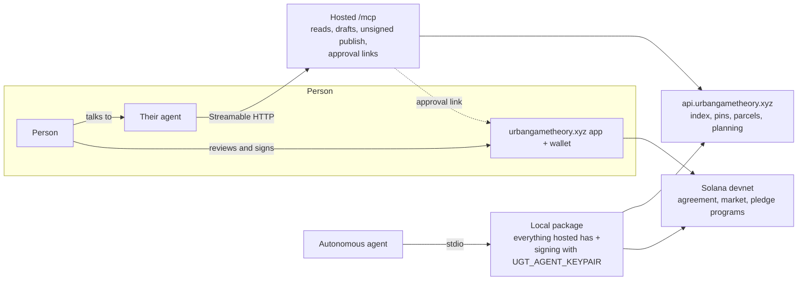
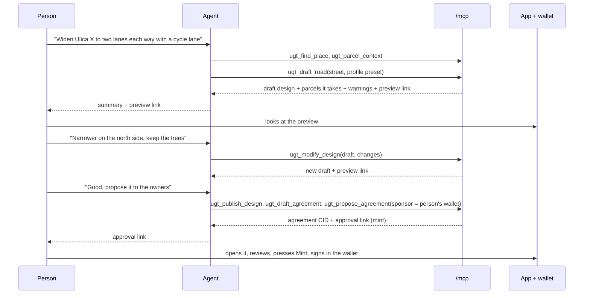

<!-- Plan of record for making Urban Game Theory usable by AI agents over MCP: a hosted server at urbangametheory.xyz/mcp, a local signing package, intent-level design tools and approval links. Living plan: decisions are appended as they are made, phases are ticked off as they land. -->

# MCP: Urban Game Theory for agents

**Status (2026-10-23): local functionality, public-source contract checks and the first paid pilot pass. Production transport is active and checked with a stock MCP client. The authorized remaining 20 paid cases are running under an additional US$3 cap; complete production tool-contract and live wallet acceptance remain pending.** Branch and worktree `colosseum-worlds-fair`.

## Implementation checkpoint (2026-10-23)

- P0: the design/agreement merge and deployed devnet program predate this implementation.
- P1: the stateless loopback HTTP service registers 25 tools; the local stdio package registers
  44. All 25 hosted tools, 11 resources and four prompts passed against current public API data.
  Both publication tools were checked with `confirm:false`. Production now runs `ugt-mcp` and
  routes `/mcp` to it. A stock public client connected, listed the exact 25-tool catalogue and read
  an explanation and design schema. This transport smoke check does not certify every production
  tool or authorize signing, funding or permanent publication.
- P2: unsigned publication requires `confirm:true` and verifies index readback. Mint, fund,
  acceptance, execute, cancel, expire and bet links preselect without auto-signing. Bet hand-over
  retains amount/side. The app removed pledge/donation wallet forms; those approval links refuse
  explicitly, while local signing tools remain available. Real sponsor mint and settlement acceptance
  have not been exercised in this session.
- P3: an isolated node runtime uses the shipped browser Turf/projection bundles, formation handlers,
  parcel arrangement, fabric validation and agreement derivation. Exact node/browser geometry,
  ground and CID parity passes for the official Borovje, urban-blocks Borovje and Pionir restatements,
  including multi-building, freeform-building and attached-station behavior on cadastral ground.
  Formation provenance now uses the shared 0.25 m² intersection threshold: dropping a real
  0.8756 m² Borovje anchor previously broke the immutable ground scope.
  Agreement drafting requires complete cadastral coverage and 1–200 input parcels; unsurveyed/open
  ground remains an explicit app-review recovery, not a fabricated cadastral input.
- P4: all five intent builders, typed modifications, comparison, private previews and prompts are
  implemented. Six worked resources cover all five kinds and an agreement. Comparison measures
  unique full/partial demolition through the app's split rules, retains unsupported evidence as
  null, and uses the shared party ledger for derived ground. Oversized previews retain the canonical
  artifact and CID and return a publication recovery with `confirm:false`. Agreement previews
  preflight the exact linked/carried design set before importing or applying anything. Binding-selected source identity is retained, including indexed binding provenance. The explicit
  Croatian `oss-wfs` database selector now works for binding and publication. Source-qualified
  inputs, author and sponsor survive app import without CID drift; new designs have an authoring time.
- P5: the self-contained npm tarball installs freshly and advertises 44 stdio tools. A road was
  drafted from an unrelated working directory. The real pilot exposed a projection dependency on
  process cwd; the isolated shared runtime now removes it. RPC-only account discovery, staking and
  claiming are covered offline; funded live settlement and public npm publication remain pending.
- P6: discovery, OpenAPI and agent documentation are present. The opt-in evaluator uses resumable
  Anthropic batches, explicit prices and a reserved cost cap, disables automatic paid retries and
  records shared usage accounting. An uncertain submission cannot be silently resubmitted.
  The authorized one-task Sonnet 5.5 street pilot passed after seven total rounds at **US$0.097633**.
  Its first four rounds cost US$0.049973 and exposed the cwd bug; the same checkpoint continued
  within the original US$1 cap. The user subsequently authorized the remaining 20 cases under an
  additional US$3 total cap. The serial job was stopped after its first case passed, preserving its second in-flight batch.
  Managed job `ugt-mcp-paid-remaining-20-parallel` resumes it with four local workers: one
  two-case checkpoint capped at US$0.30 and 18 single-case checkpoints capped at US$0.15 each.
  These caps total US$3 including prior spend. The pilot-excluded manifests/checkpoints live in
  `~/.config/ugt/mcp-evals/2026-10-23-remaining-20-cases/`. No paid batch is resubmitted when
  moving the checkpoint. The evaluation is running; no result is inferred from submission. No permanent publication, wallet signature, push, deployment or registry listing ran.

**Intentional experimental contract correction:** agreement input/output areas now use the shared
Turf-compatible spherical calculation (radius 6378137 m), deterministic sine arithmetic and rounding
to 0.000001 m². This removes native runtime rounding differences from canonical agreement CIDs.
Recreate affected experimental agreements; there is no compatibility reader or historical rewrite.
These numerical units do not assert cadastral survey accuracy. Source identity and retained author/
sponsor metadata are part of the current record contract. Outstanding acceptance work below remains
open; this checkpoint does not declare all original phase gates complete.

### Verification record for this implementation

All runs below were targeted; no full unit or browser suite was started by this session.

| Type and scope | Result |
|---|---|
| Headless unit tests: HTTP, MCP registration, shared tools (3 files, 28 tests), first run | 23 passed, 5 failed on changed expectations/fixtures and the Host test transport; corrected |
| Headless unit tests: same 3 files, 28 tests | Passed |
| Headless unit tests: intent builders (1 file, 10 tests) | Passed |
| Headless unit tests: MCP, links and imports (9 files, 103 tests) | 102 passed; expanded tool-list expectation corrected |
| Headless unit tests: MCP, sources, discovery and routes (12 files, 153 tests) | 152 passed; `/designs` route expectation corrected |
| Headless unit tests: above plus chain-only actions (13 files, 156 tests) | Passed |
| Headless unit tests: above plus eval scoring (14 files, 159 tests) | Passed |
| Headless Playwright: initial artifact-spec startup | No tests ran (test-module import error); corrected |
| Headless Playwright: invocation from repository root | Stopped before any test ran; rerun from `e2e` |
| Headless Playwright: `mcp-artifacts.spec.ts` (6 tests) | Passed |
| Headless Playwright: `mcp-preview.spec.ts` (1 test) | Passed |
| Headless Playwright: artifacts plus ground parity (9 tests), first run | 6 passed, 3 failed because the isolated browser fixture omitted lifecycle evidence; corrected. A sibling run also collided with the shared trace directory; subsequent runs use separate output directories. |
| Headless Playwright: artifacts plus ground parity (9 tests) | Passed |
| Headed Playwright: draft preview (1 test, background Chrome) | Passed; screenshot inspected: the park is applied and selected with its details panel |
| Packed npm artifact and fresh temporary install | No credential files; 44 stdio tools; vocabulary call passed. The first network-isolated npm startup timed out on registry DNS, left no process, and was retried successfully with network access. |

Follow-up headless unit tests passed for local/offline capabilities and browser draft import
(4 files, 43 tests) and the contract checker's missing-fixture/no-publication behavior (1 file,
8 tests). Source context and OpenAPI follow-ups passed (2 files, 16 tests). The explicit local-draft lifecycle also passed a further headless Playwright preview
check (1 test). An initial agreement-preview invocation recorded a startup failure without completed
test results; the final headless Playwright run passed both design and agreement previews (2 tests),
including canonical CID/ground equality and no publication requests. Live production contract checks, sponsor
wallet signing and paid model evaluation were not run.

### Continuation verification record (2026-10-23)

All runs were targeted. No full unit or full browser suite was started. Failed and startup-only runs
are retained here so that a later passing run does not erase their scope or cause.

| Type and scope | Result |
|---|---|
| Headless unit tests: comparison, ground, reads (3 files, 16 tests) | Passed |
| Headless unit tests: comparison, ground, preview, formation, HTTP (5 files, 55 tests) | Passed |
| Public-source loopback MCP: first 25-tool contract check | 24 passed; checker mistook a capabilities schema descriptor for an artifact; corrected |
| Public-source loopback MCP: 25 tools | Passed, including both publication refusals |
| Headless Playwright: initial two-spec startup attempts | Three startup-only attempts; no tests ran (static server dependency unavailable, then loopback access); corrected |
| Headless Playwright: artifacts and previews (2 specs, 14 tests) | 9 passed, 5 failed: three real-restatement parity failures and two dropped script loads from the temporary static server |
| Headless Playwright: real restatements (3 tests) | Pionir passed; two Borovje cases exposed native trigonometric rounding differences after geometry alignment |
| Headless Playwright: artifacts and previews (2 specs, 14 tests) | Passed after deterministic arithmetic and a no-cache Express static server |
| Headless unit tests: MCP and agreement regressions (13 files, 162 tests), sandboxed | 150 passed, 12 failed: seven denied loopback binds and five incorrect spherical radius expectations; radius corrected |
| Headless unit tests: same 13 files, 162 tests, loopback enabled | Passed |
| Headless unit tests: evaluator orchestration (1 file, 6 tests, fake API) | Passed |
| Headless Playwright: artifacts and previews, corrected radius/source integrity (2 specs, 14 tests) | Passed |
| Public-source loopback MCP: 25 tools, 11 resources, four prompts | All 40 checks passed; no permanent publication, model call or signature |
| Headless unit tests: MCP/records/source regressions (10 files, 152 tests) | 151 passed; one old expectation discarded source identity; corrected |
| Headed Playwright: private design and agreement previews (1 spec, 2 tests, background Chrome) | Passed; exact agreement CID, metadata, source and applied ground checked; screenshot inspected |
| Headless unit tests: runtime, evaluator, records, sync, ground, drafts and previews (7 files, 90 tests) | Passed |
| Headless unit tests: evaluator including continuation (1 file, 7 tests, fake API) | Passed |
| Headless unit tests: final MCP/agreement regressions (16 files, 209 tests), sandboxed | 198 passed; 11 HTTP/fake-API tests denied loopback binds |
| Headless unit tests: same final 16 files, 209 tests, loopback enabled | Passed |
| Fresh npm install and stock stdio client | 44 tools and a Madrid road draft passed from an unrelated directory; initial SDK import used the wrong export and stopped before connecting, then corrected |
| Headless unit tests: source selection, Croatian binding/publication and shared binding (7 files, 90 tests) | Passed |
| Headless unit tests: preview bounds, integrity, drafts and registration (4 files, 24 tests) | Passed, including the uncompressed preview limit |
| Sealed package from implementation commit `05e8d889a`: fresh temporary install, stock stdio client | Passed: 44 tools, current-source Madrid road, canonical CID, authoring time and private preview from an unrelated cwd. 514 packed files, no credentials. Initial npm pack could not write the default cache; using a temporary cache succeeded. |
| Paid street pilot, one task / seven total rounds | Passed, cumulative US$0.097633; first four rounds failed on cwd-dependent projection, corrected before continuing the same authorized task |

The final draft-authoring-time correction is covered by the final headless unit run; the paid pilot
preceded that correction. The public-source and browser acceptance checks exercise local code against
public reads, not a deployed `/mcp` server. Production and funded wallet acceptance remain pending.

## Goal

Two kinds of use, both first-class:

1. **Agents using the system directly.** An agent reads parcels, designs, agreements and markets, and
   acts on chain (mint, fund, bet, pledge, settle) with its own devnet wallet. This works with or without
   our server for everything that lives on chain.
2. **People talking to their agents.** "Widen my street and add a cycle lane", "show me the
   alternatives on these parcels", "put 0.05 on the urban-blocks plan". The agent understands the
   request, drafts the change, shows it on the map, adjusts it on feedback, publishes it, and hands the
   person a link where they review it and sign with their own wallet.

`urbangametheory.xyz/mcp` is the front door, as `zagreb.lol/mcp` is for the Croatian data catalogue.

## Decisions

- **The hosted server never signs on a user's behalf** (user, 2026-10-22). No custody, no delegated
  session keys, no spending caps held by us. A signature comes from the agent's own key (local package)
  or from the person's wallet in the app (approval link). Revisit no earlier than mainnet.
- **The endpoint is `https://urbangametheory.xyz/mcp`** (user, 2026-10-22), Streamable HTTP, public,
  no authentication: everything it does is either a public read or a public, content-addressed,
  unsigned publish.
- **Built on the design/agreement contract** of `plan-design-agreement.md` (branch
  `plan-design-agreement`, M1-M3 built 2026-10-22). Designs and agreements are the only records an
  agent writes; the proposal-era tools (proposal mint, `POST /agent/proposals`, named plans) are not
  carried over.

## Where we are (2026-10-22)

- **colosseum-worlds-fair:** `backend/agents/mcp-server.mjs`, stdio only, 27 proposal-era tools
  (`ugt_list_proposals`, `ugt_mint_proposal`, `ugt_submit_proposal`, pledges, markets, oracle facts).
  Signed and paid tools sign with a local `UGT_AGENT_KEYPAIR`.
- **plan-design-agreement (not merged, 18 commits ahead, its worktree has uncommitted edits):** the same
  server rewritten to 26 agreement-era tools (`ugt_list_agreements`, `ugt_get_agreement`,
  `ugt_publish_design`, `ugt_propose_agreement`, `ugt_mint_agreement`, `ugt_fund_agreement`,
  `ugt_bet_on_agreement`, pledges, donations, settlement, attesters, ownership, oracle facts).
  `ugt_publish_design` and `ugt_propose_agreement` take a finished `design/v1` / `agreement/v1`
  object: **the agent has to author the geometry, the inputs and the output piece hashes itself**,
  which an LLM cannot do reliably. The agreement program is built but not deployed (placeholder id).
- **Agreement land is derived in the browser.** Inputs and outputs come from `AgreementGround.derive`
  over `LiveParcelFabric`; the restatement scripts capture them by driving a browser
  (`backend/scripts/lib/restatement-publish.mjs`). The fabric already runs in node tests
  (`ground-service-fabric-adapter.test.js`), so a headless derivation is reachable.
- **Discovery:** `api.urbangametheory.xyz` serves `llms.txt`, `agents.json`, `openapi.json`,
  `/.well-known/x402`, `/docs/agents`. `openapi.json` covers 12 of about 141 routes.
  `urbangametheory.xyz/mcp` currently falls through to the app's HTML (200, not MCP).
- **Pattern to copy:** `cadastre-data/mcp` (zagreb.lol): `createMcpHandler` stateless over
  `@modelcontextprotocol/node`, Host and Origin validation, 32 KB request cap, a global budget of 8
  concurrent / 600 per minute, `/healthz`, PM2 on loopback behind nginx, protocol tests and a
  `check-contracts.js` run against the live origin.

## Architecture

One tool implementation (`ugt-agent-tools.js`), two transports, two tool sets chosen at construction.

- `createUrbanGameTheoryMcpServer({ mode: 'hosted' | 'local' })`. Hosted registers no tool that
  signs or pays; the hosted process has no `UGT_AGENT_KEYPAIR` in its environment, and a test
  asserts both.
- Hosted transport: new `backend/agents/mcp-http.mjs`, a copy of the zagreb.lol `http.js` pattern
  with `publicOrigin` `https://urbangametheory.xyz`.
- Local transport: the existing stdio entry, packaged so `npx` runs it (P5).

### The conversational loop

## Tool surface

Names keep the `ugt_` prefix. **H** = hosted, **L** = local. Every tool that returns a design or an
agreement also returns a link that shows it on the map.

### Read (H, L)

| Tool | What | Source |
|---|---|---|
| `ugt_capabilities` | Manifest: schemas, endpoints, program ids, prices, tool list, phase of each tool | exists |
| `ugt_find_place` | Free text (address, street, parcel id, place name, design or agreement title) → candidates with city, bbox, parcel ids, street ids | the app's search sources, `/streets`, `/parcels`, `/designs?q` |
| `ugt_parcel_context` | One parcel or point: area, land use, urban rules, permitted envelope, buildings, designs and agreements over it, market contests, parcel history | `/planning/*`, `/urban-rules`, `/buildings/under`, `/designs`, `/agreements?parcel=`, `/markets`, `/parcels/:uid/history` |
| `ugt_list_designs`, `ugt_get_design` | Index reads by city, bbox, text, CID | `/designs` |
| `ugt_list_agreements`, `ugt_get_agreement` | With status, decision tally, escrow, market | exists on the rework branch |
| `ugt_markets` | Contests and pools for a city | `/markets` |
| `ugt_compare` | Two or more designs or agreements → floor area, green area, road area, parcels taken, buildings removed, ledger per party | new; reuses the dividers / before-after numbers |
| `ugt_explain` | A domain term → its vocabulary entry | `vocabulary.md` |
| `ugt_activity`, `ugt_support_status`, `ugt_oracle_events`, `ugt_list_attesters`, `ugt_inspect_verified_fact` | as today | exist |

### Draft (H, L): nothing stored, nothing signed

Each returns `{ design (design/v1), cid, takes: [parcel ids], warnings, previewUrl }`. Geometry is
built on the server from intent with the app's own pure modules, so a draft has exactly the CID the
app would compute for the same design.

| Tool | Intent input | Built with |
|---|---|---|
| `ugt_draft_road` | street id or name, or a few points; a cross-section preset (`2+2`, `1+1 with cycle lanes`, …) or a lane list; optional width | OSM way geometry (`/osm-road`, `/streets`), the OSM → cross-section translator, `corridor-osm-form.js`, `corridor-profile.js` |
| `ugt_draft_building` | parcel ids; floors or height; use; coverage, or "the permitted envelope" | `/planning/envelopes` (Atlas included), building parameters as `design-record.js` stores them |
| `ugt_draft_space` | park, square or lake; parcel ids or an outline | structure payload as the app stores it |
| `ugt_draft_parcel_layout` | a block (parcel ids or painted outline); automatic plots | the M1 (a) layout editor's automatic layout (Schelling plots) |
| `ugt_draft_urban_rule` | area + rule parameters | urban-rule record |
| `ugt_modify_design` | a CID or a draft + typed changes | the same builders; result records `origin: { cid }` |
| `ugt_draft_agreement` | design CIDs or drafts; rule preset (owner deal, owner vote, community vote); optional allocations, money, deadline, sponsor wallet | `agreement-objects.js` + headless ground derivation (P3) |

Typed changes for `ugt_modify_design`, so the agent never edits coordinates:
road `widen { metres, side: north|south|east|west|both }`, `set_profile { preset | lanes }`,
`add_lane { kind, side }`, `remove_lane { index }`, `shift { metres, toward }`;
building `set_floors`, `set_height`, `set_use`, `fit_to_permitted`; space `set_kind`;
any `retitle`, `redescribe`. Sides are compass words, never left/right.

### Publish (H, L): unsigned, public, immutable

`ugt_publish_design` and `ugt_propose_agreement` (exist on the rework branch) pin and index
content-addressed objects. They sign nothing, so hosted may run them; today they demand
`UGT_AGENT_KEYPAIR`, which is relaxed to `confirm: true` for index writes. Publishing is public and
permanent; the tool description says so, and `confirm: true` is required.

### Approval links (H, L)

`ugt_approval_link { action, target, params }` → a URL into the app with the action preselected:

| action | URL | The person then |
|---|---|---|
| `mint` | `/agreements/<cid>?act=mint` | reviews, presses Mint, signs (must be the sponsor wallet) |
| `fund` | `/agreements/<cid>?act=fund&amount=…` | signs the funding |
| `decide` | `/agreements/<cid>?act=decide&decision=accept` | signs their owner decision |
| `execute`, `cancel`, `expire` | `/agreements/<cid>?act=…` | signs |
| `bet` | `/bets/<account>?act=bet&side=yes&amount=…` | signs the stake |
| `pledge`, `donate` | `/agreements/<cid>?act=pledge&amount=…` | signs |

Rules: the app only preselects; the wallet prompt opens when the person presses the button, never on
load. Links carry no secret and are safe to forward. Amounts are capped in the app as anywhere else.

### Sign (L only)

The existing chain tools: mint, fund, bet, pledge, donate, refund, void, revoke, release, fulfil,
resolve, claim, external markets, ownership requests, `ugt_buy_verified_fact` (x402).
`UGT_MCP_LIVE=1`, `confirm: true` and `UGT_MCP_MAX_USDC_PER_ACTION` stay. Hosted `ugt_buy_verified_fact`
is replaced by `ugt_inspect_verified_fact`, which returns the x402 challenge for the agent to pay itself.

## Resources and prompts

- Resources: `ugt://vocabulary` (`vocabulary.md`), `ugt://schemas/design`, `ugt://schemas/agreement`,
  `ugt://decision-rules` (the presets and what each means), `ugt://examples/<kind>` (one worked
  example per design kind and one agreement, taken from the restated demo content), `ugt://cities`.
- Prompts: `change-my-street`, `compare-alternatives`, `propose-to-owners`, `bet-on-an-agreement`.
  Each walks the loop above and ends in a preview or approval link.

## Contracts every tool keeps

- **Errors tell the agent what to do next:** `{ code, message, next }`, where `next` names a tool and
  arguments, or the user action needed. The Borovje 422 ("recreate it as a new plan revision") is the
  model. Route errors that tools pass through are audited for this in P1.
- **Untrusted content is marked.** Titles, descriptions, author names and parcel-history text come
  from anyone; results put them under `untrusted` fields and tool descriptions say they are data.
- **Results are artifacts, not claims.** A publish returns the CID read back from the index, a draft
  returns the CID recomputed from the object it returns.
- **Every result that shows something has a link.** Agents relay links; people verify on the map.

## Safety and limits

- Hosted: Host and Origin validation, 32 KB request bodies, 8 concurrent and 600 requests per minute
  overall (the zagreb.lol defaults), a tighter budget on publish tools, the routes' own 1 MB object
  cap, `no-store`. No keys or tokens in the hosted process's environment.
- Local: the existing spend cap and confirmation flags; the key is the agent operator's own, devnet
  only until mainnet.

## Discovery and documentation

- `llms.txt` on both hosts names `/mcp` first; `/docs/agents` gets an MCP section with client
  configuration for the hosted URL and the local package.
- A server card at the well-known path the MCP specification settles on (check the current spec when
  P6 starts).
- `openapi.json` grows to every route a tool calls (designs, agreements, pins, markets, parcels,
  planning, streets).
- Listing in the public MCP registry: outward-facing, needs the user's yes at the time.

## Tests and evaluation

- **Protocol tests** (`backend/test/mcp-*.test.js`), as `cadastre-data/mcp/test/protocol.test.js`:
  initialize, list tools per mode, hosted has no signing tool and no key, limits answer 429/413.
- **Builder tests:** each draft tool against fixtures, and **CID parity**: the same intent built in
  node and in the browser gives the same CID (one Playwright spec per design kind).
- **Ground parity:** headless `ugt_draft_agreement` inputs and outputs equal the browser's
  `AgreementGround.derive` for the restated demo agreements (Borovje, Pionir).
- **Contract check** `scripts/mcp-check-contracts.mjs --origin https://urbangametheory.xyz`: every
  tool once, read-only, against the live server.
- **Agent eval** `scripts/mcp-eval.mjs`: about 20 scripted requests (change a street, add a park on
  two parcels, compare the Borovje alternatives, propose to owners, bet, fork and narrow a design),
  run through a real model against the hosted server on devnet. Scored by the artifact: the design's
  content, the agreement's inputs, the link's target. Never by the agent's own account. Cost recorded
  per task and per run, small batch first. Runs draw on the shared $200/month Anthropic credit, so
  each full run needs the user's yes.
- Test discipline per AGENTS.md: targeted headless tests while building; full suites only on a yes.

## Deployment

- PM2 app `ugt-mcp` on `prod-de`, loopback port, in the backend's ecosystem file; `/healthz`.
- nginx `location = /mcp` and `location = /mcp/` in `backend/nginx/urbangametheory.xyz.nginx.conf`,
  ahead of the SPA fallback, proxying to the loopback port with buffering off for streaming.
- Deploys only on the user's request, as always.

## Phases

**P0, prerequisites.**
- `plan-design-agreement` merged into `colosseum-worlds-fair` (the rework session owns the merge). Tool
  changes start after it, because both branches rewrite `mcp-server.mjs` and `ugt-agent-tools.js`.
- The `agreement` program deployed on devnet (user), for mint and approval-link tests end to end.

**P1, hosted read-only.** May start before P0 if it touches only new files.
- `mcp-http.mjs`, mode switch, read tools (`ugt_find_place`, `ugt_parcel_context`, design and
  agreement reads, `ugt_markets`, `ugt_explain`), resources, error contract audit.
- nginx, PM2, `llms.txt`, protocol tests, contract check.
- Done when: a stock MCP client connected to `https://urbangametheory.xyz/mcp` answers "what is
  proposed on parcel X and what is it worth betting on" correctly, and the contract check passes.

**P2, approval links and unsigned publish.**
- App: `?act=` handling on `/agreements/<cid>` and `/bets/<account>` (preselect, never auto-sign).
- Tools: `ugt_approval_link`; hosted `ugt_publish_design` and `ugt_propose_agreement` with
  `confirm: true` and no key.
- Done when: an agent publishes a ready-made design and agreement through the hosted server and a person
  mints it from the link on devnet.

**P3, headless ground derivation.**
- A node service that applies designs to the parcel fabric and derives agreement inputs and outputs with
  `AgreementGround.derive` and `LiveParcelFabric`, extracting any browser-only step into pure modules.
- `ugt_draft_agreement`.
- Done when: ground parity holds for the restated demo agreements.

**P4, intent design tools.**
- The draft builders, `ugt_modify_design`, `ugt_compare`, preview links, prompts.
- Done when: CID parity holds per kind and the eval's street, park and compare tasks pass.

**P5, local package.**
- The stdio server installable with `npx` (all hosted tools plus signing), chain reads straight from
  Solana so chain-only use needs no server.
- Done when: an agent with only the package and a devnet key can find an agreement on chain, bet on it
  and claim after settlement with our API down.

**P6, discovery, documentation, eval.**
- Server card, OpenAPI coverage, `/docs/agents` MCP section, registry listing (on a yes), the eval
  harness and its first scored run (on a yes).

## Open calls

1. **Previewing an unpublished draft.** (a) The draft travels in the link's fragment
   (`/designs#draft=<compressed>`): nothing stored, nothing public, but a large layout may outgrow a
   URL. (b) Every preview is a publish: simple, but every experiment becomes a permanent public
   record. Leaning (a), with publish-first as the fallback above a size limit.
2. **Package name and npm publication** for P5 (outward-facing).
3. **Eval model and budget** per run, from the shared Anthropic credit.
4. **Publish rate limit** on the hosted server, given that design and agreement routes are open to
   anyone already.

## Out of scope

- Any signing or custody on the hosted server (decided).
- Accounts, OAuth or per-user state on the hosted server.
- Mainnet, EVM agreements, Canton.

### Paid evaluation follow-up: preview handoff (2026-10-23)

The user authorized the remaining 20 cases with an additional US$3 cap. Real runs exposed both
intermittent public-source HTTP 502s and two model responses that altered characters in otherwise
valid long fragment URLs. Artifact-only success was insufficient: the scorer now requires the final
response to deliver the exact returned preview/approval links for a qualifying artifact.
Hosted HTTP now wraps private fragments in short, cryptographically random bearer links. Only the
fragment URL is retained, in bounded process memory (256 entries; at most 24 hours). Expiration,
eviction or restart invalidates a link. A GET redirects to the unchanged fragment with no-store
and no-referrer; no pin, index write or wallet action occurs. The local stdio transport retains
direct fragments. The reviewed nginx config includes the preview route; production is unchanged.

- Headless unit tests: short links, HTTP, evaluator and registration (4 files, 25 tests): passed.
- Headless unit tests: same 4 files / 25 tests after exact-link scoring: passed.
- The serial evaluation was stopped with its in-flight batch preserved, then continued with four
  local workers. A provider connection timeout interrupted five known batches and ten uncertain
  submissions. A read-only inventory reconciled all 26 accepted batches; no unmatched submissions
  existed. Known batch IDs were resumed and confirmed unaccepted submissions cleared. Initial
  worker caps totaled US$3; completed workers release unused allowance to the same interrupted
  cases. The aggregate cap remains US$3, including all previous spend. Evaluation checkpoints
  retain the original attempts; no result is inferred from pending batches.

- Headless unit tests: exact URL-token delivery (1 file, 7 tests): passed; altered and appended URL characters fail scoring.
- Free live-source stock MCP client check: a Madrid road returned a 67-character private link;
  GET returned 302/no-store and decoded to the exact canonical design CID.

- Headless unit tests: configured preview-host routing (1 file, 9 tests): passed after review identified that an explicitly configured preview hostname also needs admission by the host/origin guard.

## Production activation verification (2026-10-23)

The user authorized committing the remaining work and deploying the colosseum branch. The
initial two uncommitted notes were included, followed by the completed GLB retry fix, parcel
Design recovery and private preview-link work. The worktree CARTO key is in its ignored `.env`;
no key was committed or printed.

Production checks exposed two deployment defects: port 3096 already belongs to the lifecycle
lens, and PM2's module loader does not satisfy the launcher's direct-CLI entry guard. MCP now
uses free loopback port 3097 and PM2 executes Node directly with the launcher as its argument.
A real subprocess test exercises that exact command. Existing lens and custom nginx routing
remain intact. The production API uses the ecosystem configuration and public release identity.

Every automated test run in this rollout was targeted and headless; none was stopped and no full
suite ran. The final passing affected scope contains 111 distinct headless unit cases in ten
files and two headless Playwright cases, accumulated across the scoped runs below.

| Run | Type and scope | Result |
| --- | --- | --- |
| Release/build checks | Headless unit, `release-artifacts.test.js` and `frontend-static-build.test.js` | 14 passed |
| Completed upload retry | Headless unit, `building-upload-callback.test.js` | 7 passed |
| Upload retry in browser | Headless Playwright, one selected `building-upload.spec.ts` case | 1 passed |
| Live-port regression baseline | Headless unit, `mcp-deployment-config.test.js` | 1 failed, 1 passed; reproduced the lens/MCP port collision |
| Corrected port and transport | Headless unit, deployment config and `mcp-http.test.js` | 10 passed |
| Actual CLI launch command | Headless unit, the same two files from the clean integration checkout | 11 passed, including a real isolated subprocess |
| Newly completed parcel/preview work | Headless unit, six explicit files | 74 passed |
| Current menu regression file | Headless Node unit, `menu-audit-regressions.node.test.js` | 16 passed |
| Current-parcel recovery action | Headless Playwright, one selected `context-actions.spec.ts` case | 1 passed |

The six-file run covers `frontend-parcel-menu`, `parcel-build-block-suggestion`, `mcp-http`,
`mcp-preview-links`, `mcp-eval` and `mcp-deployment-config`, all under `backend/test/` with
`.test.js` suffixes. The control inventory matches 858 source sites after adding the recovery
button. Whitespace and private-identity checks were run before each rollout commit.

The API's standard production parcel smoke checks passed on the rollout revisions, with 223
features returned per request. The public frontend manifest and three selected asset bodies
were checked against the exact release Git tree, rather than the concurrently edited checkout.
A first comparison against that moving checkout was discarded. Public API health, vocabulary
JSON-LD content type, MCP initialization/catalogue, explanation/schema reads and server-card
version 0.3.0 were checked. One initial client import probe used an invalid package path and
never connected; importing through the package export completed normally.

Frontend attempts missing the ignored CARTO configuration stopped before publication; the
configured retry completed, including Cloudflare purge. The first public Chrome navigation had
cold-load network failures fetching its dictionaries. Reload completed with translated controls;
the Freeform editor opened with both upload buttons present. That dedicated headed background
Chrome was closed afterward. No design was saved, model uploaded, agreement published, wallet
signed, paid provider invoked or autonomous schedule activated by these release checks.
