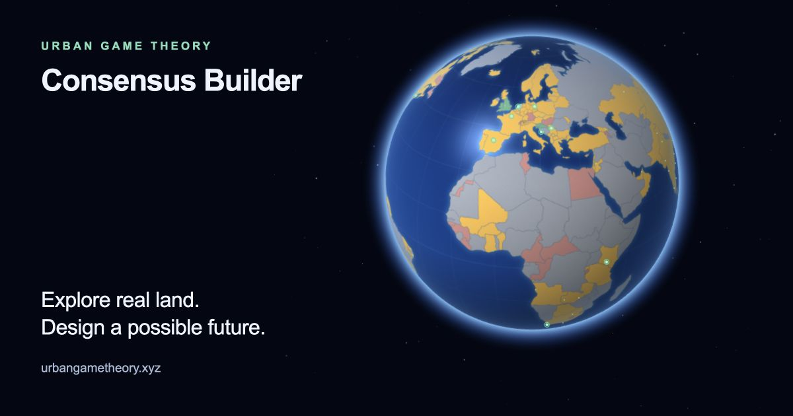

<!-- Public introduction and navigation for Consensus Builder and Urban Game Theory. -->
# Consensus Builder · Urban Game Theory

**Explore real land. Design a possible future. Build support for it.**

A free browser-based planning tool for people and agents. Start from the globe, choose a place, and design buildings, streets and public spaces on real land. Inspect alternatives in 2D and 3D, share a proposal or a whole plan, and explore how ownership, funding and forecasts shape what happens next.

**[Open the app](https://urbangametheory.xyz/)** · [Watch the walkthroughs](https://urbangametheory.xyz/how-to-use.html#videos) · [Pitch deck](https://urbangametheory.xyz/deck.html) · [Demo](https://urbangametheory.xyz/hackathon-demo.html)

## Try it

1. Pick a city on the globe, or explore a place beyond the available parcel coverage.
2. Click land and choose **Propose here**, select several parcels, or draw a site.
3. Design the change, finish it, and inspect the result in **3D**.
4. Compare alternatives, fork a counterproposal, and share the design for discussion.

Drawing and exploring need no crypto wallet. Applying a draft on your map is separate from sharing, owner consent and execution. Coverage and ownership detail depend on the local source; the globe and map show what is available.

## What you can make

- **Buildings:** blocks, row houses, detached houses and editable freeform footprints.
- **Public space:** parks with planting, paths and ponds; squares with furniture; lakes.
- **Transport:** roads with editable lane profiles, rail alignments and transit stations.
- **Land readjustment:** new plot boundaries, owner allocations, shares and cash balancing.
- **Alternatives:** local drafts, 2D/3D inspection, before/after views, parcel comparisons and forks.
- **Coordination:** owner deals, owner or community voting, shareable proposals and plans.

The experimental **Hyperstition: Markets for Possible Cities** build also connects proposals to funding, pledges, prediction markets, public-record evidence and agent APIs. Its public demo uses Solana Devnet. See the [protocol and trust assumptions](https://github.com/Poglavar/consensus-builder/blob/colosseum-worlds-fair/docs/protocol.md) before using those integrations.

## Learn more

| For | Start here |
| --- | --- |
| New users | [How to use](https://urbangametheory.xyz/how-to-use.html) · [Hrvatske upute](https://urbangametheory.xyz/kako-koristiti.html) |
| Designers and workshops | [Buildings](https://urbangametheory.xyz/how-to-use-buildings.html) · [Public space](https://urbangametheory.xyz/how-to-use-park-square.html) · [Land readjustment](https://urbangametheory.xyz/how-to-use-reparcellization.html) · [Roads, rail and stations](https://urbangametheory.xyz/how-to-use-road.html) |
| Reviewers | [Views and counterproposals](https://urbangametheory.xyz/how-to-use-views.html) · [Roadmap](https://urbangametheory.xyz/roadmap.html) |
| Developers and agents | [Documentation index](docs/README.md) · [Local development](docs/development.md) · [API and agent quickstart](https://api.urbangametheory.xyz/docs/agents) |
| Protocol contributors | [Protocol build](https://github.com/Poglavar/consensus-builder/tree/colosseum-worlds-fair) · [Architecture](https://github.com/Poglavar/consensus-builder/blob/colosseum-worlds-fair/docs/architecture.md) · [Build and verification](https://github.com/Poglavar/consensus-builder/blob/colosseum-worlds-fair/docs/hackathon-build.md) |

The walkthrough library contains twelve concise narrated demonstrations of the current map workflow, with English captions and transcripts. Written instructions are available in English and Croatian; the app also supports Serbian and Spanish.

## Code and contributions

The frontend uses JavaScript, Leaflet and Three.js. The API uses Node.js, Express and PostgreSQL/PostGIS; optional chain integrations live separately under `blockchain/`.

| Directory | Purpose |
| --- | --- |
| [`frontend/`](frontend/) | Globe, maps, proposal tools, 3D views and public guides |
| [`backend/`](backend/) | API, shared proposal records, monitoring and agent services |
| [`blockchain/`](blockchain/) | Smart contracts and chain integrations |
| [`rekonstrukcije/`](rekonstrukcije/) | Reconstructed plans with source provenance |
| [`world-parcels/`](world-parcels/) | Parcel-source research and coverage evidence |

Start with the [development guide](docs/development.md), check [test scope](TEST.md), and open a focused issue or pull request with a reproducible example. For a planning workshop, a city integration or a research collaboration, [contact the project on Telegram](https://t.me/urbangametheory).

[Follow @UrbanGameTheory](https://x.com/UrbanGameTheory) · [Telegram community](https://t.me/urbangametheory)

## License

This branch is released under the [Apache License 2.0](LICENSE). Third-party code, imagery and datasets retain their own licences and attribution requirements.
