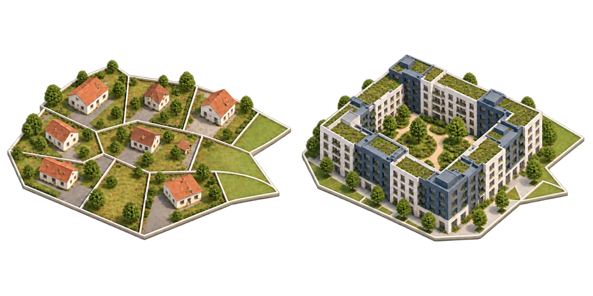

<!-- Public introduction to Consensus Builder, its live capabilities, and the developer reference. -->
# Consensus Builder · Urban Game Theory

**Explore real land. Draw a possible future. Share it with the people it affects.**

Consensus Builder is a free browser-based toolkit for exploring and sharing urban development ideas. Start with a familiar neighbourhood, design buildings, streets and public spaces, and combine your proposals into a plan others can inspect in 2D and 3D.

**[Open the website](https://urbangametheory.xyz/)** · [How to use](https://urbangametheory.xyz/how-to-use.html) · [Roadmap](https://urbangametheory.xyz/roadmap.html) · [X / @UrbanGameTheory](https://x.com/UrbanGameTheory) · [Telegram](https://t.me/urbangametheory)

[](https://urbangametheory.xyz/)

## What you can do

| Capability | What it lets you explore |
| --- | --- |
| **Real parcels and local context** | Inspect cadastral geometry, buildings, streets and available ownership information from city-specific sources. |
| **Buildings and neighbourhoods** | Create city blocks, row houses, detached houses and freeform buildings; edit their geometry and heights directly on the map. |
| **Streets and transit** | Draw roads and rail tracks, adjust corridor cross-sections, and place bus, tram and rail stations. |
| **Public space** | Propose parks, squares and lakes alongside new development. |
| **Land readjustment** | Explore new parcel boundaries and how a group of parcels could accommodate a different urban layout. |
| **Reversible alternatives** | Apply, unapply and edit designs to explore different combinations before choosing what to share. |
| **2D and 3D** | Move between the map and a spatial model. Photorealistic context and street-level walkthroughs are available where supported. |
| **Shareable proposals and plans** | Publish a single intervention or a multi-proposal plan as a link, so recipients can open and inspect the same design. |
| **Plan analysis** | Inspect plan statistics, building density and road measurements; explore ownership and acquisition context where the underlying data is available. |
| **Area monitoring** | Define areas to follow land-related changes through the monitoring tools available in supported locations. |
| **Multiple languages** | Use the interface in English, Croatian, Serbian or Spanish. |

Drawing and exploring do not require a crypto wallet. Available datasets, ownership detail, monitoring and advanced views vary by location; a city preset does not imply complete or equally detailed coverage.

## A growing world of cities

The live website has **97 city presets as of 7 October 2026**, alongside a world view for discovering places and exploring beyond the configured cities. The deployed app currently includes more city integrations than this repository's `main` branch.

Try [New York](https://urbangametheory.xyz/?city=new_york&lang=en), [Amsterdam](https://urbangametheory.xyz/?city=amsterdam&lang=en), [Tokyo](https://urbangametheory.xyz/?city=tokyo&lang=en), [São Paulo](https://urbangametheory.xyz/?city=sao_paulo&lang=en), [Cape Town](https://urbangametheory.xyz/?city=cape_town&lang=en) or [Sydney](https://urbangametheory.xyz/?city=sydney&lang=en). Choose another city from the world view.

<details>
<summary>See the full city list</summary>

| Region | Configured cities |
| --- | --- |
| Europe | Zagreb, Split, Šibenik, Belgrade, Ljubljana, Paris, Lyon, Amsterdam, Rotterdam, Antwerp, Berlin, Essen, Cologne, Dortmund, London, Manchester, Birmingham, Madrid, Barcelona |
| Asia | Shenzhen, Hong Kong, Tokyo, Nagoya, Osaka, Savar, Doha, Dubai, Amman, Muscat |
| Africa | Cape Town, Cotonou, Bamako, Luanda, Lusaka |
| Latin America | Buenos Aires, Bogotá, São Paulo, Lima |
| Canada | Toronto, Montreal |
| Australia | Melbourne, Sydney |
| United States | New York, Denver, Los Angeles, Miami, Washington, D.C., San Francisco, Montgomery, Juneau, Phoenix, Little Rock, Sacramento, Hartford, Dover, Atlanta, Honolulu, Boise, Springfield (Illinois), Baton Rouge, Augusta (Maine), Annapolis, Boston, Indianapolis, Des Moines, Lansing, Saint Paul, Jefferson City, Helena, Lincoln, Concord (New Hampshire), Trenton, Santa Fe, Albany, Raleigh, Bismarck, Columbus, Salem, Nashville, Austin, Salt Lake City, Montpelier, Richmond, Carson City, Charleston (West Virginia), Cheyenne, Columbia (South Carolina), Harrisburg, Jackson (Mississippi), Madison, Olympia, Providence, Tallahassee, Topeka, Frankfort, Oklahoma City, Pierre |

City integrations combine different public sources. Some are regional, partial or historical datasets. Consult the app's source information before using a particular area in a workshop or analysis.

</details>

## Start with a place you know

1. Open the map and choose a city or neighbourhood.
2. Select parcels, or draw a site where the live app supports planning without cadastral coverage.
3. Add a building, block, park, square, road or track and adjust the design.
4. Explore alternatives in 2D and 3D, then share a proposal or plan link.

The tool can support early design discussions, planning workshops, architecture teaching and community proposals. We welcome city planning teams, researchers and civic groups interested in trying it on one concrete local site. [Get in touch on Telegram](https://t.me/urbangametheory).

## Experimental coordination tools

Urban Game Theory also explores how humans and AI agents could propose, back and forecast changes to real land. **Hyperstition: Markets for Possible Cities** demonstrates proposal support, prediction markets and public-record evidence on **Solana Devnet**, alongside agent/API integrations. These are experimental paths with their own setup and scope.

[Explore the live demo](https://urbangametheory.xyz/hackathon-demo.html) · [Read the deck](https://urbangametheory.xyz/deck.html) · [Browse the hackathon branch](https://github.com/Poglavar/consensus-builder/tree/colosseum-worlds-fair)

## Code and local development

The planning client uses JavaScript, Leaflet and Three.js; the backend uses Node.js, Express and PostgreSQL/PostGIS. Optional blockchain integrations live under `blockchain/`.

Traffic simulation and observed junction recognition are maintained as separate domain projects. This application owns proposal and corridor editing and consumes shared data through APIs.

- [`frontend/`](frontend/) — map, editing tools, visualisations and interface.
- [`backend/`](backend/) — parcel/data services, shared proposals, monitoring and agent services.
- [`blockchain/`](blockchain/) — chain contracts and experimental integrations.
- [`rekonstrukcije/`](rekonstrukcije/) — reconstructed plans and built projects with source provenance.
- [`world-parcels/`](world-parcels/) — parcel-source research and coverage evidence.

For local development, install the backend dependencies with `npm ci` in `backend/`, configure `backend/.env` for your existing PostgreSQL/PostGIS database and required services, and make the `serve` CLI available. Run `./dev.sh` from the repository root; it selects local frontend/API ports and prints the URL. Optional datasets and provider integrations need their own configuration.

Run the fast backend checks with `npm test` in `backend/`. See [`TEST.md`](TEST.md) for the wider test setup.

<details>
<summary>Developer reference: terminology, interface elements and proposal lifecycle</summary>

This branch contains the **Hyperstition: Markets for Possible Cities** submission for the
**Colosseum Crypto World's Fair 2026**, built as an Urban Game Theory project by Consensus Builder.
Urban Game Theory predates the event; [`HACKATHON.md`](HACKATHON.md) identifies the exact baseline,
commits, and features built during the hackathon.

## Start here

- [Live pitch deck](https://urbangametheory.xyz/deck.html)
- [Five-minute demo center](https://urbangametheory.xyz/hackathon-demo.html)
- [Executed YES case](https://urbangametheory.xyz/proposals/hackathon-executed-borovje-2026) — the counterpart of the cancelled canonical case, shown beside it in the demo center with every devnet transaction linked.
- [Lens model](lens-model.md) — soulbound parcels, a list of trusted attesters per proposal, attested execution; programs upgraded on devnet, with live member-service and human-owner verification still to complete.
- [Agent/x402 quickstart](https://api.urbangametheory.xyz/docs/agents)
- [Unified human and agent activity](https://urbangametheory.xyz/actor-explorer.html)
- [Follow @UrbanGameTheory on X](https://x.com/UrbanGameTheory)
- [Hackathon diff](https://github.com/Poglavar/consensus-builder/compare/3ee1855...colosseum-worlds-fair)

## What the hackathon build adds

- x402-paid, Bazaar-discoverable proposal submission for agents;
- an eleven-tool MCP surface that reuses the same proposal, funding, forecast, activity, and
  verified-fact adapters for deterministic or LLM controllers;
- Solana devnet programs for proposal prediction markets, donations, and soft pledges;
- one activity model for people, deterministic controllers, and LLM controllers;
- a deterministic land-event oracle with hashed resolution recipes and source-linked evidence;
- a privacy-preserving bridge to parcel-level Croatian court attestations;
- a recipe-bound external market verifier for those public SAS attestations; and
- read-only proposal review plus safe Counterpropose/Fork flows.

The deployed prediction market resolves from either ProposalNFT terminal state or a recipe-bound
external evidence account. On 2026-09-21 the external verifier completed its first funded devnet
lifecycle from a real Croatian court SAS attestation: both outcomes were staked, an unrelated wallet
resolved the market permissionlessly, and the winning position claimed the pool. The public proof is
recorded in [`HACKATHON.md`](HACKATHON.md#live-external-market-proof).

## Repository guide

| Path | Purpose |
|---|---|
| [`frontend/`](frontend/) | Parcel map, proposal UI, wallet flows, pitch, demo, and actor explorer |
| [`backend/`](backend/) | Public API, x402 gate, agent runtime, activity ledger, and land-event oracle |
| [`blockchain/solana/`](blockchain/solana/) | Anchor programs, generated IDLs, clients, and lifecycle scripts |
| [`docs/architecture.md`](docs/architecture.md) | Current system diagram and implemented versus next boundaries |
| [`vocabulary.md`](vocabulary.md) | Code-grounded domain definitions, relationships, semantic audit and RDF vocabulary mappings |
| [`docs/hackathon-build.md`](docs/hackathon-build.md) | Reproducible install, test, local-view, and demo instructions |
| [`docs/protocol.md`](docs/protocol.md) | Program IDs, schemas, recipe and adapter contracts, and trust assumptions |
| [`HACKATHON.md`](HACKATHON.md) | Reviewable hackathon scope and proof links |

## Map UI

The frontend has no sidebar; the map is the whole interface:

- **Search box** (top left) with the **city chip**: cities, parcel ids, proposals, addresses and
  commands in one input. The city chip opens the world view.
- **User bubble**, **Layers** and **Settings** (top right). Layers and Settings open floating sheets;
  Settings holds data source, base map and a *Data & maintenance* section (loaded-parcel cover,
  refresh parcel data, clear local parcel/block/road/proposal data, wipe all local data).
- **Mode strip** (left edge): 2D, 3D, photo, AI, walk and the cadastre view.
- **Game pill** (bottom left): date, turn and play/pause; expands to the game sheet.
- **Proposals** (with count badge), **Tools** and **Activity** buttons (bottom right).
- **Parcel menu** on click: *Propose here*, *Select more*, *Details*, *History*, *Tools*,
  *Offer my land*, *View in 3D*, *Detect block*. Multi-select shows a **selection tray**
  (*Propose*, *Detect block*, *Clear*, *Done*).
- **Command palette**: Ctrl/Cmd-K.
- **Urban blocks · OSM** in Layers: detects enclosed blocks from OSM road centrelines worldwide,
  including Explore mode without parcels. Roads load automatically without a line overlay; click
  a coloured block for area, outer perimeter, estimated walking time at 5 km/h, compactness and,
  when available, a live count of loaded parcels. Details use a side panel on desktop and a
  collapsible bottom sheet on phones; the whole selected block fits in the unobstructed map area.
  An adjustable target size (100 × 100 m by default) estimates how many smaller blocks its area
  represents, without designing a subdivision. Selecting a block updates the URL; **Copy block
  link** shares its outline ID, bounds and target size. Opening that link loads the whole road
  enclosure, selects the block and frames it above/beside the panel on any screen size.
  The view follows the map at neighbourhood scale;
  open or clipped blocks stay unshaded. This analysis is separate from parcel-based block tools.
- **World view**: on first visit a globe coloured by parcel-data coverage; pick a city, or
  *Explore anyway* to open a place without parcel data.

Code: `frontend/js/ui/` (`commands.js` capability registry, `map-shell.js`, `map-search.js`,
`search-model.js`, `command-palette.js`, `parcel-menu.js`, `parcel-menu-model.js`,
`selection-tray.js`, `world-entry.js`), `frontend/js/world/` (`globe.js`, `globe-math.js`,
`world-coverage.js`, `world-entry-model.js`, `handoff.js`) and `frontend/js/map-controls.js` (layer,
tool and game control behaviour formerly in the sidebar). Coverage data `frontend/data/world-coverage.json` is built by
`scripts/build-world-coverage.mjs`.

</details>

## Quick verification

```sh
git clone --branch colosseum-worlds-fair https://github.com/Poglavar/consensus-builder.git
cd consensus-builder/backend
npm ci
npm test
```

The frontend uses plain HTML, CSS and JavaScript. Development serves those source files directly.
Production deployment runs [`frontend/build-static.cjs`](frontend/build-static.cjs) to copy the
frontend into a staging directory, combine marked script runs from the existing
`window.writeVersionedLocalScripts([...])` arrays, and give the bundles content-hashed filenames.
Those arrays in `frontend/index.html` are the single inventory for both development loading and
production bundling. Mark a run with `// bundle:start <name>` and `// bundle:end <name>` on separate
lines inside its array. The builder reads the paths between each marker pair in order and rejects
malformed or unsafe groups; adding a safe script inside a marked run automatically includes it.
Bundling reduces script requests and gives changed bundles new cache URLs; it does not transpile or
minify source. The deployed index points at the generated bundles, while the development index
continues loading each script separately.

Run the same packaging check locally with `node frontend/build-static.cjs <empty-output-directory>`.
The output directory must be outside `frontend/`. See [`docs/hackathon-build.md`](docs/hackathon-build.md)
for local serving, the separate optional Solana build, and database-backed API requirements.
[`TEST.md`](TEST.md) records test scope and evidence boundaries; the UI inventory describes intended
coverage, while passing headed runs verify the exercised actions.

## Security status

This is devnet software and has not received an independent security audit. Devnet SOL and USDC
have no monetary value. Program IDs prove which deployments the demo uses; they do not imply that
the programs are immutable or production-safe. Read the complete
[security and trust assumptions](docs/protocol.md#security-and-trust-assumptions) before reusing the
protocol.

## License

Except where an individual file or third-party component says otherwise, this repository is
licensed under the [Apache License 2.0](LICENSE).
