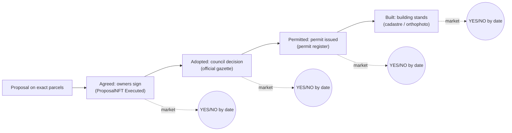

<!-- Plan of record for streamlining "Bet on cities" after two hostile reviews on 2026-10-12. Organised by workstream, each item with a verifiable "done"; the critique ledger at the end maps every finding to the workstream that answers it. -->
# Streamline: Bet on cities

Two independent reviews on 2026-10-12 judged the submission as the harshest judge would: one in
this Claude session, one in Codex session `01a12d64-9098-7891-b946-07bffa3aa802`. Both inspected
the live product, both decks, the demo center, the market program and the public API. They reached
the same verdict from different angles, so the overlap is the signal.

Direction confirmed by the user the same day: we keep **Bet on cities**, in both senses of the pun.
A wager on a city's next decision, and a bet on cities as the place humanity solves its problems.
The platform is rich and the ground is new; rough edges are accepted. The gaps below are not.
Everything in this file is to be fixed. Workstreams are ordered by dependency, not by calendar.

## The verdict, merged

> Extensive infrastructure, but the pitch jumps from on-chain activity to claims about real-world
> construction, coordination and demand, and the product has not yet demonstrated those bridges.

One question destroys the current framing: **"Could this market pay YES while the site stays
completely unchanged?"** Today the answer is yes, because the headline says "gets built" and the
contract settles on a proposal account reaching `Executed`. Everything else, from the empty pools
to the vocabulary, is downstream of that gap.

## What stays

Both reviewers conceded these, and they are the parts that are ours:

- **Canonical parcel-set identity.** Competing futures for the same land are a queryable fact.
- **Permissionless resolution from a precommitted recipe over public attestations, with strict
  chronology.** No Solana market found in the research does this. It is the prize-worthy part and
  it is currently item 22 of 35.
- **Records are immutable, edits derive.** Forks instead of mutation.
- **One activity model for people, algorithms and LLM agents**, with cost ledgers.
- **Honesty.** Every caveat is published. The fix is where the caveats sit, never whether.

## The thesis, restated so it survives a judge

A city changes through a ladder of public decisions: owners agree, the city adopts, a permit is
issued, a building stands. Each rung is a question with a date, settled by the public record of
that decision. Bet on cities lets anyone bet on the next rung. The odds show what people believe
will happen. Proposals, funding and consent, on the same parcels, are how they make it happen.

Hyperstition is the essay behind this, not the door.

## Workstreams

Order of dependency: **A** defines the question, **B** makes the contract match it, **C** and
**D** are what a judge touches, **J** is what a judge watches. **E**, **F**, **G**, **H** and **I**
make it durable. **K** keeps it fixed. A, D and J change the judge's experience; start there.

### A. One question, one rule: the milestone ladder

The question printed above the Yes/No buttons and the rule the program settles by must be the same
sentence, generated from the same data.

- **A1. Fixed question set.** Every market is one of: Agreed, Adopted, Permitted, Built. Each
  names its parcel set, its date, and its evidence source. Free-text market questions are not
  allowed. Done when: a `market question` builder (pure module, node-tested) renders the question,
  the settlement sentence, the share preview and the recipe hash input from one tuple.
- **A2. Rename today's market honestly.** The proposal-state market becomes the Agreed rung:
  "Will all owners of these N parcels sign by <date>?" Not "gets built". Done when: no bettor
  surface, deck or share preview says "built" for an Agreed market.
- **A3. Contest heading matches the mechanism.** "Which proposal gets built?" implies exclusivity
  the pools do not enforce. Until a multi-outcome market exists, the heading is "Proposals on this
  land" and each row carries its own question. Done when: the heading copy is replaced and a test
  asserts no bettable row is presented as mutually exclusive.
- **A4. Multi-outcome contest (later).** A real "which of these is agreed first?" market with one
  pool and N outcomes. Only after A1 to A3 and B.

### B. Market mechanism

The 2026-09-16 decision was "no deadline". The 2026-10-09 mainnet note already reverses that for
real money. Devnet should run the mainnet rules now, because the mainnet program will be immutable.

- **B1. Close time per market.** Decided 2026-10-12: yes. The date is part of the question. No
  stakes after close. Resolution by evidence, or NO at deadline plus grace when the rung's rule
  says absence is NO, or void when it says absence is unknown. Built 2026-10-12 (localnet tests
  pass). Still to do before deploy: market seeds include the creator (no squatting), and the
  proposal program records `executed_at` so an agreement after the deadline settles NO, not YES;
  the checked-in IDL and the two backend tests that pin it are refreshed at deploy time.
- **B2. Cancel with stakes voids.** An author who bets NO and cancels must not win. Cancellation
  of a proposal with an open market refunds every position. Done when: the localnet test
  "author-bets-no-then-cancels" shows a refund, not a payout.
- **B3. Insiders cannot bet.** The proposal author, the attested owners, the lens members and the
  attesters of a market cannot stake on it. Done when: the program reads those keys and rejects
  them, with tests.
- **B4. LMSR priced market.** Decided 2026-10-12: LMSR replaces the parimutuel, with no interim
  step. Each market is an automated market maker with cost function
  `C(q) = b * ln(exp(q_yes / b) + exp(q_no / b))`. The YES price is the probability, every bet
  moves it, and a position can be sold back before close, which gives the early exit the
  parimutuel could not. A winning share pays one USDC. The maker's worst-case loss is `b * ln 2`
  and is funded at creation: the pay-to-propose fee seeds it, so creating a proposal is what makes
  its market liquid. On-chain math is integer fixed-point, no floats: a shared pure module is the
  reference (node-tested), the Rust port is tested against the same vectors, and the UI quotes
  price and shares from that module. "Pays ×" becomes the reciprocal of the price; B7's floor
  becomes a "thin market" label on low volume instead of hiding the price. Done when: localnet
  tests cover buy, sell, close, resolve, claim and the bounded-loss invariant, and browser quotes
  match the module. Program design of record: `lmsr-market.md`.
- **B5. Caps and void path.** On-chain stake and position caps; conflicting or ambiguous evidence
  voids and refunds; a challenge window before finalisation. Done when: each has a localnet test.
- **B6. Mainnet shape.** Immutable program, verified build, binary size and rent quoted before any
  deploy. No upgrade authority. Done when: `docs/protocol.md` carries the numbers and the
  checklist from the mainnet note.
- **B7. Chance is a price, and thin markets say so.** Under LMSR the percentage is the maker's
  price and is meaningful from the first trade. Below a volume floor the card carries a "thin
  market" label and names the number of distinct bettors. "Pays ×" stays beside it because it is
  what a winning share returns. Done when: `bets-model.js` quotes from the shared LMSR module and
  has a test for the thin-market label.

### C. The first busy shop

Both reviewers said the globe opens branches before one shop is busy. One city, a few legible
questions, strangers on both sides.

- **C1. San Francisco first.** Decided 2026-10-12. The product opens on San Francisco's featured
  markets, led by Candlestick Point: a megaproject that stalled for fifteen years, got its final map
  approved in May 2026 and broke ground in September 2026, so "will it actually get built?" carries
  real public doubt and a judge already knows the place. Zagreb stays the evidence lab, where the
  court attestations and the notary lens are live, and holds the second featured market. The globe
  is "Other cities", one tap away, never the first screen. Done when: the first screen of the
  default URL shows the Candlestick market card.
- **C2. Featured questions with real public decisions pending.** Decided 2026-10-12.
  - Lead, Permitted: "Will the city issue the Candlestick Point grading permit by 31 December
    2026?" Inside the site polygon the Department of Building Inspection dataset holds one
    development permit, number 202603026735 on block 5000 lot 002, filed on 22 July 2026 for
    development-block grading at an estimated three million dollars, status "filed", not issued.
    It settles from that record's issued date. Every other permit inside the polygon is a small
    alteration in an existing building.
  - Second, Permitted: "Will a new-construction building permit be filed on the Candlestick site
    by 30 June 2027?" Same dataset, filed date, any lot inside the site. Later rungs follow the
    same source: first homes completed by 2029. Pick dates so that NO keeps real probability,
    because the first phase is funded and under way.
  - Third, Adopted: "Will the city adopt the UPU Borovje south plan by <date>?" Evidence:
    publication in Zagreb's official gazette. The plan is already reconstructed in the product.
  - Agreed: one live proposal by a person, with owners who can actually sign. Still to name.
  - The two Candlestick proposals are the "same land, competing futures" story: the approved
    FivePoint plan (7,218 homes, eleven towers) and the Courtyard alternative (about 16,400 homes,
    no towers) by an outside author. The alternative has no machine-verifiable adoption rule, so it
    gets an Adopted market with an explicit rule, a plan amendment removing the towers recorded in
    the city's legislation records and attested by a lens member, a far date, and a price near zero
    that the product shows honestly. The Courtyard author is credited on the card.
  Done when: the featured markets are open on prod, each with a thumbnail, a date and an evidence
  source named in plain words, and both Candlestick proposals are deployed.
- **C3. Outside counterparties.** Recruit bettors who are not us: the hackathon and Solana
  community and the San Francisco housing community on devnet with an in-app faucet, the Zagreb
  urbanism audience with play money once I3 ships. Targets before the demo video is cut: at least 25 distinct outside wallets holding
  positions, at least one featured market with outside bets on both sides. Done when: the demo
  page's headline number is "outside bettors", read from chain, and it is not zero.
- **C4. Personas step back.** No persona stakes on a proposal it minted. No two operator wallets
  take opposite sides of one market. Persona activity is labelled "Urban Game Theory agent" on
  every surface and counted separately from people. Done when: `backend/agents/run.mjs` no longer
  stakes YES on its own pick and a policy test fails if it does.

### D. The bettor's path

The judge's path today: pitch, evidence dashboard, globe, map, sheet, dialog, wallet, "No wallets
found". The target: question, Yes, receipt.

- **D1. Bets is a page.** `/bets` is a market-first landing: featured markets as cards with the
  proposal thumbnail (22 of 28 rows already have one), the question, the deadline, pays, pool and
  your position. The sheet over the map stays for in-map use. Done when: the share link opens the
  card page, not the map.
- **D2. The dialog shows what you bet on.** Order: question, image, one sentence of what changes,
  who proposes (display name, never a wallet), how it settles in one sentence with a "Verify"
  expander holding accounts, recipe and attesters, deadline, pool, pays, then Yes and No. One count
  of proposals, not three. Done when: a judge can say what the bet is from the dialog alone.
- **D3. No dead end at the wallet.** No wallet found: "Get a wallet" with install links, a clear
  "devnet test money" banner, an in-dialog faucet for SOL and devnet USDC, and a deep link into the
  wallet's browser on phones. If I3 ships, a no-wallet "bet with points" path. Done when: a fresh
  profile on desktop and on a 360 px phone reaches a receipt without leaving the site.
- **D4. Open proposal does not close the bet.** The proposal opens beside the dialog; the map
  centres and highlights the parcels behind both. Done when: the bet dialog survives "Open the
  plan" and back.
- **D5. Receipt, share, mine.** Receipt with explorer link, share with the OG image, a "Your bets"
  list with Collect. Mostly built; verify on a phone.
- **D6. Settled bot bets never lead.** Open markets sorted by deadline first; settled rows under
  the Settled filter. Done when: the first row of `/bets` is an open market with a date. Built
  2026-10-12: one shared order in `bets-model.js`, used by the API and the sheet, open rows first
  by deadline then pool, settled after; every row carries a nullable `closesAt`.

### E. Words

- **E1. One naming hierarchy.** Decided 2026-10-12. Urban Game Theory is the project. Consensus
  Builder is the planning workbench. Bet on cities is the market product and the pitch. "Hyperstition: markets
  for possible cities" becomes the title of an essay linked from the deck's last slide. The pitch
  switcher in the deck header is removed from the public build. Done when: the deck, the demo page,
  the readme and the app agree.
- **E2. A bettor vocabulary of twelve words.** market, bet, yes, no, pays, pool, chance, settles,
  deadline, proposal, plan, land. Banned on bettor surfaces: lens, attester, recipe, lifecycle,
  minted, applied, conditional, epoch, resolver, pool account. Those live under "Verify". "Pool"
  means the money, never the market. Done when: the vocabulary ratchet in K passes.
- **E3. Language.** The English UI shows an English question and title; the Croatian original is
  the subtitle. Plan imports carry both. Done when: no bettor surface mixes languages in one row.
- **E4. Status words.** "Settled no" in red reads as failure. Settled markets say "Settled: not
  agreed by <date>" with the rung named. Done when: every terminal state names its rung.

### F. Data hygiene

The catalogue a judge scrolls is the product.

- **F1. Duplicate persona proposals.** Decided 2026-10-12: the thirteen "Plan-led infill in
  RUDEŠ" rows are test data; cancel and delete them. Cancel each on-chain through the existing
  retirement path (cancel, resolve NO, reclaim the persona's stake), back up the rows, then delete
  them from the database and the lists. Going forward, persona proposals get distinct titles
  (address plus what: "3 floors, 12 flats on Rudeška 41"), one open persona proposal per site, and
  daily auto-minting is paused or sent to a sandbox city during judging. Done when: no two
  bettable rows in one contest share a title and the Rudeš contests are gone from `/bets`.
- **F2. Plan versions.** v1, v2 and v3 of one plan are three identical bettable rows with three
  pools. Add `supersededBy` on plan versions; the contest builder folds superseded versions under
  "Older versions" and never lists them as bettable. Only the current version gets a market. Done
  when: the Borovje contest shows one row per plan. Built 2026-10-12 and verified in a headed
  browser: two rows, each folding two older versions whose dialog offers no Yes or No and says new
  bets go to the current version. The link already existed in the plan table and importer; the
  markets query had never selected it. Loose end: the share-link preview of an older version's
  account still describes it as an open bet.
- **F3. Precise numbers from missing inputs.** A New York proposal states no zoning rule, unmeasured
  buildings and an assumed empty plot, then prints an owner offer to the euro. A derived value from
  a missing input is `null` and the UI says "Not estimated: zoning not mapped". Currency per city.
  Done when: the null-derivation guard in K passes and the New York card shows no number.
- **F4. Counts agree.** Proposals 230, bettable 28. The Bets surface counts bettable only; the
  Proposals tab gets a "bettable" filter; "Open a market" is offered to a proposal's author, not to
  everyone. Done when: both tabs explain their count.
- **F5. Thumbnails everywhere.** The six rows without a thumbnail get one from the server-side
  renderer. Done when: every bettable row has an image.

### G. Agents: from activity to service

- **G1. Reposition.** Agents are evidence collectors and attesters, analysts that explain a market
  and write its "what changes" sentence with the cost shown, market makers with bounded loss, and
  proposers only where a person asked. Done when: the pitch describes agents in one sentence and
  the MCP tool inventory lives in docs only.
- **G2. No self-dealing.** See C4. Operator wallets never both sides, never own proposals.
- **G3. Labelled.** Every operator wallet shows as "Urban Game Theory agent"; actor stats split
  people, our agents, outside agents. Done when: the actor explorer has the three-way split.
- **G4. One outside agent.** The clean-room x402 client exists; get one agent that is not ours to
  bet or buy a fact, and show it. Done when: an outside wallet appears in the agent activity feed.

### H. Evidence and trust

- **H1. x402 listing.** The discovery record says `not-listed` on the judge path. Fix the Bazaar
  listing or remove the step from the judge path. Done when: `/agent/discovery` returns a listing
  or the demo page no longer shows the step.
- **H2. A prospective market that can end.** The court market closed on 23 September and waits for
  a record that may never match. Replace it with C2's Adopted or Permitted question, whose source
  publishes on a cadence and whose deadline makes absence a result. Done when: the prospective
  market on the demo page has a date by which it settles either way.
- **H3. Evidence adapters, in this order.** Decided 2026-10-12. First the San Francisco
  Department of Building Inspection permits dataset (Socrata, now served from data.sf.gov; the old
  host only redirects), whose filed, issued and completed dates are the event times and whose fetch
  time is kept separately as the observation time, never substituted. The New York footprint
  provider already speaks Socrata. Second, San Francisco's legislation records for plan amendments
  and final maps. Third, Zagreb's official gazette (plan adoption) and the ministry's permit notice
  board. Then cadastre or orthophoto footprint change (built). Each is a lens member service
  producing attestations with `sourceObservedAt`. Done when: each adapter has a contract test with
  a byte-exact fixture and one live attestation on devnet.
- **H4. Attester plurality.** At least two independent attesters per featured recipe; the
  threshold evaluator exists. Who they are is printed under "Verify". Done when: the featured
  markets' recipes require two.
- **H5. The hard cases, written down.** Amended proposal, partial completion, conflicting records,
  appeals, a source that never publishes, and permits filed against a retired parent lot: the
  Candlestick grading permit sits on block 5000 lot 002, the pre-subdivision master lot, which is
  not among the proposal's 116 parcels, so an "any permit on these parcels" rule would miss it
  (the numbered-permit rule matches on the number alone and is unaffected). One rule each, in `docs/protocol.md`, and the void path
  of B5 covers the rest. Done when: each case has a rule and a test.
- **H6. Demo page reads outside evidence.** "Operations healthy" is replaced by outside bettors,
  settled markets and attestations from non-operator attesters. Done when: the audit's required
  checks include outside participation.

### I. Legal and money

- **I1. Legal opinion.** Commission a Croatian opinion on the gambling act and the ESMA binary
  option measures before any real stake. Until then: devnet USDC and non-transferable points, and
  "play money" on every bettor surface. Done when: the opinion exists and the wording matches it.
- **I2. Lawful real-stakes shapes.** Evaluate a forecasting tournament with prizes, points with
  prizes, and a licensed partner for jurisdictions that allow it. Done when: one shape is chosen
  per jurisdiction class and written into the pitch's GTM text.
- **I3. Points path.** Decided 2026-10-12: build. A no-wallet, no-money bet with points: a
  server-side ledger keyed by the existing account identity, the same pure LMSR module pricing a
  mirror of each market, positions public, a leaderboard, and "play money" labelled everywhere. A
  wallet can later claim its account's points history. Points never touch the chain, which stays
  the USDC source of truth. Done when: a resident can bet with points from a phone without a
  wallet and the leaderboard is public.
- **I4. Mainnet checklist.** B6 plus the mainnet note: immutable programs, caps, void, deadline,
  insider ban, rent sized, fewer programs. Done when: the checklist is green or the deploy waits.

### J. The pitch package

The form wants a 2 to 3 minute presentation video, a product demo video of at most 3 minutes, a
description, GTM and demand text, team bios, a logo and the repo. None of the videos or texts exist.

- **J1. One deck.** Base: the Bet on cities deck. Order: the question (the live Candlestick
  grading-permit market with its real date), the problem, the product (the real market card), how it settles (the ladder and
  the evidence), what is live (outside bettors, settled markets, Zagreb), why Solana (attestations,
  permissionless resolution, x402 payments), team and the ask. Out: the globe on slide one, the
  moat slide, the pitch switcher, the self-undermining footers. In: a competitors slide
  (Polymarket, Kalshi, Metaculus: curated questions and admin resolution versus our permissionless
  parcel-anchored evidence recipes), a team slide with faces. Done when: the deck has no slide a
  judge can refute from the product.
- **J2. Demo center tells a story.** First screen: the executed YES case as one person's decision
  and one result, then the live prospective market with its date, then "Verify everything" holding
  the archive. No PENDING badge above the fold; a pending step is fixed or moved below. Done when:
  the first screen has no pending badge and the audit enforces it.
- **J3. Videos.** Presentation: the restated thesis with the ladder and one real market. Demo: one
  bet on a phone from question to receipt, then one settlement with its evidence, nothing else.
  Done when: both files exist and run under the limits.
- **J4. Submission text.** Name, description, GTM and demand paragraph naming the first customer
  and the recurring decision, team bios, logo. Done when: pasted into the form.
- **J5. HACKATHON.md.** Top: the story and six features. The 35-item ledger becomes the appendix
  "Proof ledger". Done when: the first screen of the file is the story.
- **J6. First customer, stated.** Hypothesis to validate with five Zagreb conversations: people
  who put proposals on land and need a credible public signal that it can happen. Architects,
  developers, neighbourhood initiatives and NGOs. Their recurring decision: pursue this here, or
  not. Done when: the GTM text names the customer and the decision, with what the conversations
  said.
- **J7. Caveats stay, and move.** Every boundary we publish today remains published, under
  "Verify" and in the ledger, never on the first screen.

### K. Guards and ratchets

Tests that keep each fix fixed. Each must be able to go red.

- **K1. Vocabulary ratchet.** Bettor surfaces (`frontend/js/bets/`, the market strings in
  `frontend/i18n/`, the Bet on cities deck) contain no banned term from E2.
- **K2. Duplicate title guard.** No two bettable rows in one contest share a title.
- **K3. Question equals rule.** The question, the settlement sentence and the recipe input come
  from one builder; a test feeds the tuple and compares all three.
- **K4. Null derivation.** An owner offer or gain computed from a missing input is `null`; the
  test re-introduces the bug and fails.
- **K5. Persona policy.** A persona never stakes on its own proposal and operator wallets never
  take both sides; the test replays a run against a fake chain.
- **K6. Demo path.** No pending badge above the fold; the hackathon audit requires outside
  participation and fails without it.
- **K7. Program rules.** Localnet tests for late stake, cancel-with-stakes, insider stake, caps,
  void and the chosen payout rule.
- **K8. Phone path.** A headed check of D3 at 360 px that reaches a receipt, run on request only.

## Decisions made (2026-10-12)

1. **Deadline per market** (B1): yes. Reverses the 2026-09-16 "no deadline" decision.
2. **Payout rule** (B4): LMSR, no interim parimutuel step.
3. **The thirteen duplicates** (F1): test data; cancel on-chain and delete.
4. **Points path** (I3): build.
5. **Featured questions** (C2): Borovje adoption confirmed. Still to name: the permit site and the
   human proposal.
6. **Naming hierarchy** (E1): Urban Game Theory, Consensus Builder, Bet on cities, in that order.
7. **San Francisco leads** (C1, C2, H3, J1): Candlestick Point is the first screen and the first
   slide; Borovje is the second featured market; the DBI permits dataset is the first evidence
   adapter. Both Candlestick proposals are being deployed to prod.
8. **All work on the laptop.** No offloading to valhalla.

## Tracks

Five tracks that can run in parallel, by skill. The question builder (A1) and the LMSR module (B4)
are shared code that two tracks each depend on, so they come first in theirs.

| Track | Items | Skill | Depends on |
|---|---|---|---|
| 1. Program | B1 to B6, K7 | Rust, Anchor, localnet tests | the LMSR reference module, which this track writes first |
| 2. Question and path | A1 to A3, D1 to D6, E2 to E4, F2 to F5, K1 to K4 | JS front and back | A1 first; B4's module for quotes |
| 3. Evidence | C2, H1 to H6 | backend, attestations | A1 for recipes |
| 4. Points | I3, D3 | full stack | B4's module, A1 |
| 5. Pitch | J1 to J7, E1, C1, C3, C4, F1, G1 to G4, I1, I2 | content, ops | the others' first visible results |

## Appendix: critique ledger

C = this Claude session, X = Codex session `01a12d64-9098-7891-b946-07bffa3aa802`.

| # | Finding | By | Answered in |
|---|---|---|---|
| 1 | Headline says built, contract settles on proposal state; YES can pay with the site unchanged | C, X | A1, A2, K3 |
| 2 | "Which proposal gets built?" implies exclusivity the pools do not enforce | C, X | A3, A4 |
| 3 | No deadline, no early exit, pays 1.0 to 1.07; late bettors dilute early ones | C, X | B1, B4 |
| 4 | Author can bet NO and cancel; insiders can trade their own market | C | B2, B3 |
| 5 | "Chance" is a pool share of cents staked by our own personas | C, X | B7, C4 |
| 6 | Own research says real-money markets are unlicensed betting in Croatia and the EU | C | I1, I2, I3 |
| 7 | The hyperstition causal chain is asserted, not shown; prediction and advocacy conflict | X | thesis, J6, C3 |
| 8 | One city with markets, globe implies many; cold start multiplied by cities | C, X | C1, C2, J1 |
| 9 | No second party: our bots bet against our bots; 18 of 28 proposals by one wallet | C, X | C3, C4, G2, G3 |
| 10 | Executed YES case is us accepting our own proposal with our own certificates | C, X | C2 (Agreed with real owners), J2 |
| 11 | Prospective market closed 23 Sept, still awaiting evidence; zero genuine forecasts settled | C, X | H2 |
| 12 | Demo page shows PENDING and x402 not-listed on the judge path | C | H1, J2, K6 |
| 13 | Journey tours the machinery: pitch, dashboard, globe, map, sheet, dialog, wallet, dead end | C, X | D1 to D4 |
| 14 | "No wallets found" with no install link, no faucet, no "test money" | C, X | D3 |
| 15 | Dialog shows no picture of what you bet on; three different proposal counts | C | D2, F5 |
| 16 | Identifiers over reasons to care: parcel numbers, wallet addresses, Croatian titles in English UI | C, X | D2, E3 |
| 17 | Ontology tax: pool, plan, proposal, contest, lens, attester, recipe, lifecycle, minted, applied | C, X | E2, K1 |
| 18 | Thirteen identical "Plan-led infill in RUDEŠ" rows; the first contest is four settled bot losses | C | F1, D6, K2 |
| 19 | Three identical plan-version rows with identical odds look like a rendering bug | C | F2 |
| 20 | New York offer priced to the euro on explicitly missing inputs | X | F3, K4 |
| 21 | Four product names; the pitch switcher shows indecision in the header | C, X | E1 |
| 22 | Decks have no user, number, screenshot, video, competitor, GTM or team slide | C | J1, J3, J4 |
| 23 | Demo is an evidence archive with a demo badge; opens on a cancelled courtyard | C, X | J2 |
| 24 | HACKATHON.md is a 35-item audit log; the novel resolver is buried at item 22 | C | J5, J1 |
| 25 | Trust moved into attesters with vocabulary; hash is not meaning; hard cases unanswered | X | H3, H4, H5 |
| 26 | Agents manufacture activity, not relevance; 26 tools is an inventory | X | G1, G4 |
| 27 | Business model and moat before the customer; a cent per fact needs 100M reads | X | J6, B4 (fee seeds liquidity) |
| 28 | Mutable devnet programs; nothing needs Solana except attestations | C | B6, J1 (why Solana) |
| 29 | Bets is a NEW badge on tab three; Proposals 230 versus 28 bettable | C | D1, F4 |
| 30 | Honesty as self-sabotage: every surface leads with its caveat | C | J7 |
