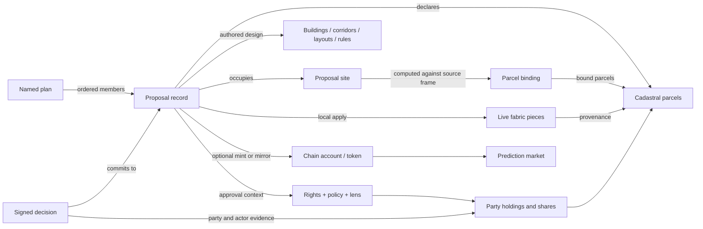

<!-- Code-grounded vocabulary and semantic audit. Keep observed behavior separate from proposed terminology and RDF mappings. -->

# Vocabulary

This is the maintained vocabulary for Consensus Builder: what its records mean, what they identify, and how they relate. It begins with **the definitions implemented by the code**, including inconvenient overlaps. The audit register records questions to resolve; it does not silently redefine the product.

**Baseline:** 2026-10-19, branch `colosseum-worlds-fair`, HEAD `83b1c31fc2facf53430e2959e2fa08347e356c4c`, plus the working-tree edits already present during the audit. Those edits included parcel, geometry, building, readjustment and rendering modules. This is a source audit, not a census of stored rows or verification of a deployed release. References identify files and symbols so they remain useful when line numbers move. The adjacent `cadastre-data` solver was inspected for comparison at HEAD `08b1e96`; it is a separate implementation.

**Status convention:** “Observed” describes code. “Proposed” describes a possible vocabulary or interoperability change. “Accepted direction” records a user decision whose runtime implementation is still pending. All findings in the audit register are open. The local term identifiers in backticks below are documentation identifiers, not a deployed RDF namespace.

**Branch integration:** imported the committed Colosseum vocabulary at `cf425a18` on 2026-10-19. The original audit baseline above is unchanged. The following obligatory-proposal direction and V19 extend that audit; they do not claim a schema migration has happened.

## Accepted direction: obligatory proposals and their representations

User decision, 2026-10-19: existing regulations, permitted massing and permits belong in the proposal system as **obligatory proposals**, primarily restated through scripts and automated imports. A manual “create proposal from permitted massing” operation is not the main workflow.

“Obligatory” describes the binding effect of an applicable, supported source instrument. A maximum still permits building **up to** the maximum; it does not require construction or occupation of every permitted volume. A permit may authorize a particular design subject to conditions without requiring it to be built. Keep **permission**, **requirement** and **prohibition** distinct. A dataset publisher's interpretation is attributed evidence of the instrument, not the issuing authority itself.

These are independent axes:

- **Decision kind:** the existing `owner-deal`, `owner-vote`, `community-vote` path.
- **Normative authority and applicability:** issuer, source instrument/version, effective period, geographic/use/project scope, conditions and supersession. Authored-schema support is pending; the read-only representation contract below carries source assertions without changing decision kind. Do not infer authority from an import timestamp.
- **Proposal lifecycle and local application:** publishing, voting, execution and applying to the browser's live fabric retain their existing meanings. An imported regulation does not fabricate a vote, signed acceptance, execution event or physical construction.
- **Representation role:** an observed building, permitted massing, example build-out and proposed design may use common geometry and renderers while making different assertions. An envelope may be an outer bound or one candidate, rather than a jointly achievable filled solid.

The source proposal, its constraints, and its derived geometry keep linked identities and versions. Changing a provider result must not silently rewrite an authored design or a historical source version. An automated importer needs repeatable source identities, retained unresolved rules and explicit source coverage. An unsupported constraint is not permission to ignore it; missing source data is not zero permitted capacity.

The implementation comparison and first shared adapter design are in [the planning-rule audit](docs/planning-rule-audit.md). This direction leaves the current `ProposalKind` enum and lifecycle behavior unchanged until their consumers and validation can be updated together.

## Observed: planning representations and comparison views

Implemented in this branch, 2026-10-19. A **planning representation** is a read-only spatial assertion linked to a provider's source record. It is neither a new `ProposalKind` nor an applied change to the live fabric. The `planning-representations.v1` response carries a representation ID, nullable source proposal ID, source record identity and revision, polygon volumes, spatial reference, source authority assertions, assessment, independent constraints and retained source evidence. A provider record need not first become an editable proposal row: `proposalId = null` means no such row is asserted. This endpoint does not establish immutable historical versions.

The Zagreb adapter reads the existing **solved-envelope cache**, `public.parcel_build_envelope`, directly, for current 2025 rows intersecting the viewport. This table is the sole stored source of those calculations. The display path runs no solver, imports no proposal records and creates no additional cache. The former adapter over imported GUP restatement proposals has been replaced. That separate scripted conversion remains a native-proposal authoring workflow; its limited coverage does not measure solver/cache coverage.

Cached floor polygons and their base/top elevations become display volumes, merging only adjacent identical outlines. Setbacks, overhangs, below-ground floors and holes retain their geometry; the native proposal editor's conversion restrictions do not gate viewing. Identity is stable by provider and parcel; `source.recordId` names the GUP/parcel cache key and `source.version` fingerprints the returned cached record. The cache's legacy `version` column is not a historical snapshot. Solver version and calculation time remain visible.

The provider's selected result can be **one calculated option** or an **existing-stock estimate**. The latter remains explicitly labelled as an estimate of existing stock, not a calculated new-build envelope. `authority.effect = obligatory` describes the underlying instrument's intended normative effect, not a validation of the result or its applicability. Independent limits remain `not-evaluated`; cached evidence and independent new-build/retained-stock quantities remain inspectable. The adapter does not join today's rule variables to an older cached calculation. Viewport summaries count all cached outcomes, including results with no geometry, separately from drawable profiles. Reads are paginated in batches of up to 200 profiles; both views load all pages for the current bounded viewport. A page limit is not a coverage limit. Incomplete or failed page loading is not reported as complete coverage. Missing or unsuccessful geometry never becomes zero capacity.

The shared **building and massing controls** expose three independent layers: **Built**, **Permitted** and **Proposed**. Each supports Solid, Transparent and Off in 2D and model 3D (`solid`, `ghost`, `off` internally). **Proposed** replaces the public label “Planned”; it currently means the browser's applied building composition, not every published proposal. **Permitted** is a presentation role, not a legal assessment result. Visibility and selection never apply, execute or change a proposal.

Content choices are separate from appearance. **Built: All / Surviving / Removed** selects original observed footprints or the portions retained/removed by applied proposals; these are simulated outcomes, not observations that demolition occurred. Alternate survey overlays are hidden for Surviving/Removed because they do not share the working buildings' carve identities. **Proposed: Massing / Build-out / Both** selects the authored rule form, a deterministic example, or both; map and model share the realization and variation seed. A display change never rewrites the authored geometry. **Permitted: Overall footprint / Height steps** chooses the joined ground projection or separate height components in 2D; the model always shows their actual heights. Two adjoining height components still belong to one source representation.

The **source inspector** refers to the same representation ID as map shapes and 3D volumes. Select a shape directly (map shapes also support keyboard focus); the former viewport-item dropdown is removed. Source boundaries are consistently solid, with selection indicated by greater line weight. Neither line style nor visibility expresses legal certainty. Selection survives display and map/model changes while the item remains loaded. Geographic coordinates use `OGC:CRS84` longitude/latitude; `baseM` and `topM` are metres relative to the model's ground reference. Unsupported frames are not rendered. The existing model's horizontal projection is Web Mercator and its vertical dimensions are raw metres; this is a visualization convention, not a globally survey-accurate local engineering frame.

Existing buildings and authored proposals retain their current stores and rendering paths; the shared policy coordinates them. Full migration of their records and selection into the representation contract, executable constraint assessment, datum-aware terrain placement, and Atlas ingestion remain pending. See [the implementation record](docs/planning-rule-audit.md#first-implemented-view-slice).

## Central terms as implemented

### Proposal — `Proposal`

A portable authored record expressing a proposed change, rule, or transaction concerning land. It combines design intent, applicable geometry, cadastral references, optional deal terms, and optional approval configuration. A proposal can describe several buildings or corridor segments; it is not necessarily one physical object. It can also change ownership or rules without supplying a new building.

The durable record is the cleaned object handled by `ProposalAuthoredRecord` and the API serializer. A browser materialization adds local state and generated land pieces; those are not part of the portable instruction. A material proposal may have **zero cadastral anchors** when it has its own site. Parcel acts require cadastral land. At publication the declared cadastral IDs must match the server's site binding, subject to the parcel-act path.

Identity has several layers: `proposal.id` is a database row key; `proposalId` / `proposal_id` is the authored/external identifier; `serverProposalId` is used by browser records to refer to the published row; a chain reference also needs chain type, network, contract/program and token/account. These must not be exported as interchangeable identifiers. [Authored boundary](frontend/js/proposals/authored-record.js), [serializer](backend/proposals/serializer.js), [DDL](backend/routes/proposals-ddl.sql), [API validation and lookup](backend/routes/proposals.js), [chain references](frontend/js/proposals/chain-ref.js).

### Named plan — `NamedPlan`

An immutable named, ordered collection of published proposal rows. `ens_plan.slug` identifies it; `proposal_ids` stores deduplicated **database row IDs as strings**. A proposal can belong to multiple named plans. A plan must have at least one member when created. It may cover several cities; its stored city is selected from member cities.

Creation stores member hashes and a plan hash; the plan hash uses stable `proposal_id` values and member hashes in order. A revision is a new slug with `supersedes`; multiple later plans can supersede one predecessor. Its site is the union of member sites only when every member has a site. Chain mint metadata can be attached separately.

“Immutable” applies to the plan record and its commitment, **not to complete historical copies of every member**: reads fetch current proposal rows and report hash drift. Older plans can lack hashes. The list's order contributes to the plan hash; geometry replay has its own order. [Plan DDL](backend/ens/ens-plan-ddl.sql), [route](backend/routes/ens-plans.js) (`validateProposalIds`, `planView`), [store](backend/plans/plan-store.js), [hashing](backend/plans/plan-hash.js) (`memberContent`, `planHash`, `changedMembers`).

### Working plan / applied composition — `WorkingComposition`

The proposals currently applied in one browser, together with their materialized effects. “Share entire plan” can turn this composition into a named plan, but an arbitrary composition has no `ens_plan` identity. Application and replay are local operations. Replay orders formations by `authoredAt || createdAt`, then numeric record ID, then record key; `epochYear` is a presentation bucket, not a dependency or replay order. [Sharing flows](frontend/js/proposals/sharing-routes.js), [proposal manager](frontend/js/proposal-manager.js), [ordering](frontend/js/proposals/plan-order.js) (`formationTime`, `compareFormationOrder`), [epoch](frontend/js/proposals/epoch.js).

Other uses of “plan” need qualification: a statutory planning document, a floor-plan drawing, and the nested `reparcellization` layout are different objects.

### Cadastral parcel / base parcel — `CadastralParcel`

A source land unit referenced by its provider's parcel identity and geometry. Within a browser session the cadastral repository preserves source facts independently of the mutable map. A source feature may have multiple disconnected polygon parts. Its identity is not its polygon, display label, owner, or a generated fabric ID.

The common Croatian identifier is `HR-<cadastral municipality>-<parcel number>`; other providers have different identifiers and sometimes geometry-derived display identities. `cadastreParcelIds` is the durable relationship on a proposal, but the field name alone does not establish the legal quality or authority of a provider. Use source and jurisdiction context when interpreting an ID. [Ground repository](frontend/js/parcels/ground-service.js), [source adapters](backend/parcels/sources.js), [source normalization](frontend/js/parcels/ground-fallback.js), [authored ID checks](frontend/js/proposals/authored-record.js).

### Live parcel / fabric piece — `FabricPiece`

A face of the currently materialized land fabric: unchanged cadastral ground, a proposed body, or a remainder created by applying formations. It has a runtime identity and provenance back to cadastral anchors and/or synthetic open ground. One base parcel can produce several pieces; a resulting piece can span several base parcels. A piece is not a newly registered cadastral parcel.

`LiveParcelFabric` is the mutable derived land representation. `ParcelPresenter` renders its revision. `ParcelMutation` coordinates atomic publication of proposal state, fabric and related local state. Neither a Leaflet layer nor its visibility determines cadastral identity. [Ground service](frontend/js/parcels/ground-service.js), [mutation transaction](frontend/js/proposals/apply/transaction.js), [claims](frontend/js/proposals/claims.js), [open-ground hosts](frontend/js/proposals/open-ground.js).

### Proposal site — `ProposalSite`

The ground occupied by a proposal, represented as a Polygon/MultiPolygon in geographic coordinates and stored in PostGIS as `MultiPolygon, 4326`. It may cross parcels, occupy parts of parcels, or include ground without available cadastral coverage. It is distinct from the set of affected parcels and from the building footprint.

Publication derives or validates the site and computes a binding against source parcels. A supplied design footprint must fit within the site. In transport, the serializer reads the site's GeoJSON from the authored record; the spatial database column supports queries. A site is currently embedded geometry, not a separately identified domain entity. [Site DDL](backend/routes/proposal-site-ddl.sql), [binding](backend/proposals/binding.js) (`checkProposalBinding`, `validateSiteGeometry`), [serializer](backend/proposals/serializer.js).

### Parcel binding — `ParcelBinding`

A computed, source-dependent statement about which parcels a site reaches into, at a stated tolerance and computation time. It includes bound parcels, touched parcels, intrusion measurements, coverage and unaccounted area. It is neither ownership evidence nor a title transfer.

For geometric binding, an intersection binds when it survives an inward buffer of half the greater of the configured tolerance and the numerical noise floor. Thus binding uses **intrusion width in metres**, not simply intersection area. A parcel merely touching the boundary need not bind. The default tolerance is zero, with a 0.001 m noise floor; uncertainty near the threshold can produce an unresolved answer. The browser computes a preview over supplied data; the server computes the publication answer.

Coverage values are `complete`, `partial`, `none`, `unknown`. `none` and `unknown` are distinct: confirmed lack of supported coverage does not mean the same thing as an unavailable or unrecognized source. A later cadastre can produce binding drift without rewriting the original publication. [Shared rule](frontend/js/proposals/site-binding.js), [server implementation](backend/proposals/binding.js), [drift](frontend/js/proposals/binding-drift.js).

### Owner / party / actor — `RightsParty`, `DecisionActor`

In the approval engine, the misleadingly named `ownerId` is an **opaque party identifier**. It can identify an ownership holder, leaseholder, or authority whose decision a policy requires. A holder has a right in a particular parcel and a share; a party is not intrinsically “an owner” everywhere.

`actorId` identifies the signing wallet acting for a party. A party ID may itself be a wallet key in a particular provider, but the two roles remain distinct. A rights declaration does not prove that the actor represents the party: the approval path separately checks rights and authority evidence against the proposal's selected lens. `proposal.author` is a descriptive field, not this relationship. Browser user/agent profiles and readjustment `ownerKey` values are further identity systems.

Rights snapshots use `parcel-rights/v1` or `v2`, with a source, per-parcel holders, completeness and optional areas; v2 adds leases and public bodies. Shares are exact positive fractions. Complete holder lists must sum to `1/1`; incomplete lists must not exceed it. This is a declared rights model, not an automatic land-registry certification. [Approval model](frontend/js/proposals/approval.js) (`normalizeRights`, `holders`, `contextContent`, `evidenceAllows`), [decision receipts](backend/db/proposal-owner-decision-ddl.sql), [browser profiles](frontend/js/user-management.js).

There is also a completely different `owner_id` in the building floor-model registry: for source `proposal` it identifies the **containing proposal**, not a landowner. [Floor-model identities](backend/buildings/floor-models.js) (`validateModelIdentity`, `attachProposalFloorModels`).

### Building / building design — `SourceBuilding`, `ProposedBuildingDesign`

A source building is an object in a particular survey or provider dataset. A proposed building is authored geometry, parameters and optional architectural evidence belonging to a proposal. Both can be rendered as buildings, but they make different assertions about existence.

One proposal may contain multiple features in `geometry.buildings`; a freeform tool named `single` does not establish a one-building cardinality. `buildingProposal` primarily carries authored settings; the canonical cleaner removes older duplicate feature containers. A building can overlap multiple parcels. Survey, cadastral and Overture identities are source-qualified rather than automatically merged.

Floor models identify a building by `(city, source, ownerId, buildingId)`, with a separate version and at most one current row. For proposal buildings the owner namespace is the proposal ID. Generated suggested interiors are expressly rejected as registry evidence. [Authored containers](frontend/js/proposals/authored-record.js) (`cleanFeatureContainers`), [building feature collection](frontend/js/proposals/geometry.js), [floor-model DDL](backend/db/building-floor-model.sql), [floor-model validation](backend/buildings/floor-models.js) (`prepareFloorModel`).

### Envelope — several implemented concepts

| Qualified term | Observed meaning and boundary | Evidence |
| --- | --- | --- |
| **Authored permitted envelope** — `PermittedMassing` | The maximum form permitted by a proposed urban rule, stored as a 2D polygon with maximum floors/height metadata and rendered as an extrusion. For detached buildings, the code insets a parcel by setback and checks minimum plot/footprint constraints. `max` permits up to the form, `range` may require configured minimum floors and/or footprint area, and `exact` requires that form. A detached minimum does not pin a particular polygon/location. This is normative **within the authored proposal**, not proof of compliance with all current planning law. | [urban-rule-variation.js](frontend/js/urban-rule-variation.js): `normalizeParcelRule`, `evaluateParcel`, `parcelEnvelope` |
| **Block/row permitted massing** | Authored footprint with height/rule metadata, split into cadastral pieces. A range can include a compulsory minimum footprint/depth. The shaded `massingStyle: 'envelope'` is a rendering choice for this maximum form. | [urban-rule-variation.js](frontend/js/urban-rule-variation.js): `normalizeBlockRule`, `massingWithRule`, `summariseBlockRule`, `plannedDrawPlan` |
| **Example build-out** — `ExampleBuildOut` | A deterministic sampled realization within the authored rule, controlled by a seed. It illustrates one outcome. Main urban-rule statistics use the envelope, so changing the sample should not change those statistics. Under `exact`, sample and envelope coincide. | [urban-rule-variation.js](frontend/js/urban-rule-variation.js): `realizeFromEnvelope` |
| **Zoning solver result** — `BuildEnvelopeResult` | The adjacent cadastre service combines parcel/rule/context inputs into floor outlines, heights, setbacks, footprint and floor-area capacity. It distinguishes envelope geometry, capacity estimate and existing buildings. This is a separate implementation; the audit found no direct `/build-envelope` call in this checkout's frontend/backend sources. Do not ascribe all of its constraints to the app's simpler envelope generator. | [adjacent API](../cadastre-data/api/src/domains/envelope/routes.js), [solver](../cadastre-data/lib/solver.mjs); app comparison: [agent planner](backend/agents/planner.js) |
| **Reconstructed building envelope** — `ReconstructedBuildingEnvelope` | `building-envelope.v1`: an estimated vertical storey stack over a supplied footprint, derived from textual storeys, elevations and survey height. It describes evidence about an existing/advertised building. It is not a permission volume. | [archive envelope](backend/floor-plans/envelope.js): `buildEnvelope`; [site model](backend/floor-plans/site-model.js) |
| **Bounding envelope** — `BoundingBox` | A rectangular spatial-query extent, for example `ST_MakeEnvelope`. It carries no planning permission or architectural meaning. | [spatial helpers](backend/utils/helpers.js) |

## Supporting vocabulary

### Intent, publication and state

| Term | De-facto definition and relationships | Evidence |
| --- | --- | --- |
| **Design / draft** | Local editable authoring state before publication. Editor adapters serialize it into a proposal. A local draft can have no decision kind; kind is selected at publication. A draft object and the server lifecycle value `draft` are different representations. | [drafts](frontend/js/proposal-drafts.js), [adapters](frontend/js/proposal-editor-adapters.js), [publish kinds](frontend/js/proposals/proposal-kind.js) |
| **Goal** | The design/tool discriminator: `as-is`, `square`, `park`, `lake`, `station`, `single`, `buildings`, `row`, `parcelBased`, `urban-rule`, `road-track`, `reparcellization`, `ownership-transfer` in the current editor registry. Other runtime/legacy goals include `decide-later`, `parcel`, and directional ownership transfers. A goal is not the approval kind. | [adapters](frontend/js/proposal-editor-adapters.js): `CREATABLE_PROPOSAL_GOALS`; [normalizer](frontend/js/proposals/urban-rules.js): `normalizeProposalGoalKey` |
| **Type / typology** | `type` is a broad storage/API classification; `goal`, `typologyType` and nested structure/corridor kinds select more specific behavior. The SQL `type` column is free text with a length limit, not an enum of the four values in its comment. There is no single exhaustive taxonomy enforced across all paths. | [proposal DDL](backend/routes/proposals-ddl.sql), [API](backend/routes/proposals.js), [adapter resolution](frontend/js/proposal-editor-adapters.js): `sourceGoal` |
| **Proposal kind** | `owner-deal`, `owner-vote`, `community-vote`: who decides and whether the proposal is binding in the app. Votes are nonbinding and cannot carry positive offer/budget or enabled deposits. Missing kind reads as `owner-deal`; unknown kind is invalid. Publication defaults to `community-vote`. This is independent of geometric goal. | [proposal-kind.js](frontend/js/proposals/proposal-kind.js): `kindOf`, `kindErrors`; [API validation](backend/routes/proposals.js) |
| **Owner sale offer** | A direction of owner deal: identified by goal `ownership-transfer-from-me`, role `owner-offer`, or transfer direction `from-me`. The owner offers land and a buyer funds it. These aliases remain in current predicates. | [proposal-kind.js](frontend/js/proposals/proposal-kind.js): `isOwnerSaleOffer`; [lifecycle](frontend/js/proposals/lifecycle.js): `isProposalOpenSaleOffer` |
| **Facets** | Additional authored dimensions such as ownership destination and parcel treatment, found as `facets` and `proposalFacets`. They describe intended effects; they no longer define the current decision-kind enum. | [adapter serialization](frontend/js/proposal-editor-adapters.js), [creation](frontend/js/proposals/create.js), [consent payload](frontend/js/proposals/sharing.js) |
| **Published / uploaded / minted** | Uploaded means a server proposal record exists. Minted means a chain account/token and its metadata exist. A published row is not necessarily minted. A chain-only record may be reconstructed or mirrored into the API. None of these means the design has been built. | [sharing routes](frontend/js/proposals/sharing-routes.js), [minting](frontend/js/proposals/publish-mint.js), [chain record](frontend/js/proposals/chain-record.js), [serializer](backend/proposals/serializer.js) |
| **Lifecycle status** | Server enum `Active`, `Executed`, `Cancelled`, `Expired`, `draft`. Effective reads can derive `Expired` from a deadline. Legacy incoming `applied`/`unapplied` status words normalize to `Active`. | [lifecycle](backend/proposals/lifecycle.js), [DDL](backend/routes/proposals-ddl.sql) |
| **Applied / unapplied** | Whether a proposal contributes to this browser's map/fabric composition. The server serializer strips this state. It is not owner approval, chain settlement, or real-world completion. | [serializer](backend/proposals/serializer.js): `stripLocalProposalState`; [local state](frontend/js/proposals/state.js) |
| **Accepted parcel / owner approval** | `acceptedParcelIds` is a parcel-level aggregate; newer signed approvals and history are party-level decisions checked against the proposal commitment and approval context. The older `ownerAcceptances` path has per-parcel owner slots and can backfill from parcel acceptance. The current upload handler strips both client-supplied acceptance fields; the serializer can still expose them from existing rows. They have different evidential strength. | [approval](frontend/js/proposals/approval.js), [relay](frontend/js/proposals/approval-relay.js), [older acceptances](frontend/js/proposals/owner-acceptance.js), [upload filtering](backend/routes/proposals.js): `dropUnprovableClaims` |
| **Execution / verdict** | Execution can mean local simulated changes, an on-chain lifecycle transition, or an attester's statement about a proposal. The same display word does not identify which evidence exists. An on-chain verdict and market settlement are separate operations; physical construction and legal registration require their own evidence. | [execution](frontend/js/proposals/execution.js), [chain status](frontend/js/proposals/chain-status.js), [verdict schema](backend/oracle/lens-schemas.js), [market model](backend/markets/contests.js) |
| **Epoch / timeline** | `epochYear` assigns a proposal to a display year; null is unbucketed. It does not promise a construction date or define precedence between proposals. | [epoch](frontend/js/proposals/epoch.js), [DDL](backend/routes/proposals-ddl.sql) |

### Land and geometry

| Term | De-facto definition and relationships | Evidence |
| --- | --- | --- |
| **Parcel set** | A canonical sorted set of parcel IDs plus jurisdiction and authority. Its `setHash` hashes those three inputs, not geometry or `referenceAt`. It identifies a declared set, not a cadastral survey version. | [parcel-set.js](backend/proposals/parcel-set.js): `buildParcelSet` |
| **Cadastre frame** | Publication-time context for cadastral-dependent stamps (`capturedAt`, and an optional geometry hash where supplied). The current object is not a full reproducible copy of the cadastre. | [DDL](backend/routes/proposals-ddl.sql), [serializer](backend/proposals/serializer.js) |
| **Open / unsurveyed ground** | Land within a modeled site not represented by supplied/bound cadastral parcels. The fabric can host it as `ground:<siteHash>` with `groundIds` provenance. Readjustment uses a special no-owner accounting entry for it. Absence of an owner in this model is not evidence of legally ownerless land. | [open-ground.js](frontend/js/proposals/open-ground.js), [subdivision.js](frontend/js/proposals/subdivision.js), [deal](frontend/js/reparcellization-deal.js) |
| **Formation** | A spatial proposal's ground-forming role: it cuts/replaces live land and produces pieces. `potential-formation` describes authored intent before materialization. Formations include corridor, structure, some building, readjustment and the `decide-later` merge goal. “Mints ground” in these modules can mean creating runtime pieces, independently of blockchain minting. | [formation-depth.js](frontend/js/proposals/formation-depth.js), [parcel apply](frontend/js/proposals/apply/parcels.js) |
| **Plot / lot / slice** | In the partition editor, an authored output polygon or multipolygon with allocation metadata (`ownerKey`, `owners`, joint-pool information). It is a planned unit of land, not a registered parcel. A multipolygon can contain several connected pieces; record count and connected-piece count can differ. “Lot” elsewhere may be a provider's tax/legal unit and needs that source qualification. | [readjustment editor](frontend/js/reparcellization.js), [ownership shaping](frontend/js/reparcellization-ownership.js), [deal projection](frontend/js/reparcellization-deal.js): `plot` |
| **Readjustment / reparcellization** | A proposal pooling input land and assigning output plots, owner contributions/entitlements and optional cash. The persistent object is `reparcellization`; its canonical deal commits to the partition, ledger, terms and approval context. Generated child parcels are apply-time results. | [deal](frontend/js/reparcellization-deal.js): `content`, `fingerprint`; [authored cleaner](frontend/js/proposals/authored-record.js) |
| **Subdivision / pool** | The site-based partition path: pool = site; cadastral contributions = site intersections with supplied parcels; the remainder is open ground in the model. The editor outputs plots, including public land as an allocated plot. It is not a separate cadastral registration process. | [subdivision.js](frontend/js/proposals/subdivision.js): `sitePool`; [readjustment editor](frontend/js/reparcellization.js) |
| **Remainder** | Live ground left after subtracting a formation body from parent land. A formation can produce body and remainder pieces; only some output pieces lie under the proposed body. | [hover-ground.js](frontend/js/proposals/hover-ground.js), [parcel apply](frontend/js/proposals/apply/parcels.js) |
| **Footprint** | A 2D outline whose subject must be stated. A building footprint is the building's ground outline. A proposal footprint is the union of selected authored geometry parts. A corridor footprint is its occupied land, distinct from the centerline. A proposal site can be larger than the footprint. | [footprint-parts.js](frontend/js/proposals/footprint-parts.js), [plan-order.js](frontend/js/proposals/plan-order.js): `footprintOf`; [binding](backend/proposals/binding.js) |
| **Ground surface / treatment** | Authored surroundings of freeform buildings, typically the ground boundary minus building footprints. `geometry.groundSurface` carries `{ treatment, polygon }`; treatments are `none`, `paved`, `green`. It is not the cadastral ground repository or the entire site by definition. | [building-ground.js](frontend/js/building-ground.js): `buildSurface`, `surfaceOf` |
| **Corridor / alignment / cross-section** | Corridor = occupied transport land and authored design. Alignment = line segments/points, with level/elevation information. Cross-section = lanes and widths describing transverse form. `roadProposal` can describe roads or tracks; a designation with a polygon but no centerline names road land without a constructed alignment. | [corridor profile](frontend/js/corridor-profile.js), [OSM form](frontend/js/corridor-osm-form.js), [corridor reconstruction](backend/proposals/corridor-reconstruction-geojson.js), [site-binding.js](frontend/js/proposals/site-binding.js): `isRoadDesignation` |
| **Road / street / planned road** | A road/track proposal is an authored change. Existing named streets and road geodata provide context/frontage. Planned-road source data describe reservations or planned streets. Shared location does not make these the same object. | [street frontage](backend/streets/near.js), [planned roads](backend/routes/planned-roads.js), [corridor reconstruction](backend/proposals/corridor-reconstruction-geojson.js) |
| **Structure** | An app category for area features such as park, square, lake, and station authoring. It is not the general engineering concept of a load-bearing structure. The specific reconstruction exporter currently only accepts park/square/lake. | [editor registry](frontend/js/proposal-editor-adapters.js), [structure exporter](backend/proposals/structure-reconstruction-geojson.js) |
| **Map claim / dossier** | A claim is selectable ground, fabric or proposal content, ranked for interaction. The bare cadastral ground is the null/no-change claim. A dossier collects proposals referencing the land. This use of “claim” is not a legal ownership claim or a signed oracle assertion. | [claims.js](frontend/js/proposals/claims.js): `CLAIM_RANKS`, `dossierFor` |
| **City / place / source** | `proposal.city` is a filing/context code resolved from location on publish. A named plan's `place` is a free-text contest/location label. A provider's geographic coverage can span cities. None of these strings alone is a globally identified administrative jurisdiction. | [publication city](backend/proposals/publication-city.js), [plan store](backend/plans/plan-store.js): `membersCity`; [source registry](backend/parcels/sources.js) |

### Architecture, rules and measurements

| Term | De-facto definition and relationships | Evidence |
| --- | --- | --- |
| **Urban rule / zoning rule** | Either imported geographic rule/text/variables with a plan vintage, or an authored proposal rule specifying allowed/required form. The point-query API can return overlapping source rules; agent intake selects one using vintage and variable availability. An authored `urbanRule` is not automatically an enacted source rule. | [rule route](backend/routes/urban-rules.js), [agent source](backend/agents/parcel-source.js), [authored rules](frontend/js/urban-rule-variation.js) |
| **Setback** | A distance in metres used to inset buildable geometry. App field `minDistance` and agent field `minSetbackM` express this parameter. The simple generator applies a uniform inset, not every contextual setback rule available in the separate solver. | [urban-rule-variation.js](frontend/js/urban-rule-variation.js): `evaluateParcel`; [planner](backend/agents/planner.js) |
| **Massing / realization** | Footprint/massing geometry with vertical metadata, rendered as a volume; a stored GeoJSON polygon is not itself a 3D solid. Depending on the caller, “massing” can denote permitted form or a sampled realization. Record the role explicitly when interpreting it. | [urban-rule-variation.js](frontend/js/urban-rule-variation.js), [planner](backend/agents/planner.js) |
| **Floor / storey / floor level** | A vertical building subdivision or its index/label. The reconstruction pipeline distinguishes below-ground, ground, upper and top storeys. A floor index, total storey count and elevation are different quantities. Local floor labels cannot be converted to a universal integer without a convention. | [envelope reconstruction](backend/floor-plans/envelope.js): `parseStoreys`, `storeyStack`; [floor models](frontend/js/building-floor-plans.js) |
| **Floor plan** | Architectural layout data or source drawing describing a floor or unit. The evidence registry uses `consensus-builder.building-floor-plans.v2`; the archive also stores source assets, readings and fitted placements. A drawing, its interpretation, and a generated default layout are distinct artifacts. | [registry DDL](backend/db/building-floor-model.sql), [archive DDL](backend/db/floor-plan-archive.sql), [site-model placements](backend/floor-plans/site-model.js), [default layouts](frontend/js/default-floor-plans.js) |
| **Unit / room** | A unit is an identified accommodation/layout within a building or floor; a room is a subdivision within a layout. Generated rooms and unit counts are design/model data, not separately registered property titles. An archive placement can have `scope: unit` or `floor` and optional `unitId`. | [unit models](backend/floor-plans/unit-models.js), [site model](backend/floor-plans/site-model.js), [floor-plan validation](frontend/js/building-floor-plans.js) |
| **Area / GFA / GBP** | Parcel/site/footprint area is horizontal area, normally m². GFA and source `max_gbp` / normalized `maxGfaM2` are floor-area amounts in m². Model GFA may be computed using floor counts and conventions; it is not necessarily a jurisdiction's exact statutory calculation. | [agent source](backend/agents/parcel-source.js), [planner](backend/agents/planner.js), [rule summaries](frontend/js/urban-rule-variation.js) |
| **Coverage / FAR** | Building coverage is footprint divided by relevant plot area; `maxCoveragePct` is percent. FAR is floor area divided by relevant plot area and is dimensionless. The adjacent solver distinguishes KIG/coverage from KIS/floor-area caps. `maxGfaM2` is an absolute limit, not FAR. “Coverage” also names binding/source completeness, an entirely separate enum. | [planner](backend/agents/planner.js), [adjacent solver](../cadastre-data/lib/solver.mjs), [binding coverage](frontend/js/proposals/site-binding.js) |
| **Height / elevation** | Height is a vertical size; elevation is position relative to a datum/reference. The simple parcel generator defaults to 3 m per floor, block massing to 3.5 m. An assumed floor height, a measured roof height, and a corridor elevation must not be exported as one unqualified number. | [urban-rule-variation.js](frontend/js/urban-rule-variation.js), [corridor levels](frontend/js/proposals/corridor-levels.js), [reconstruction envelope](backend/floor-plans/envelope.js) |
| **Source site / project site** | `floor_plan.site` identifies a crawled website by URL. A floor-plan `site_key` groups a located real-estate/project site using permit/address/parcel evidence. Neither is the embedded proposal site's geometry. | [archive DDL](backend/db/floor-plan-archive.sql), [site model](backend/floor-plans/site-model.js): `siteKey` |

### Rights, money and evidence

| Term | De-facto definition and relationships | Evidence |
| --- | --- | --- |
| **Ownership share / allocation share** | Rights snapshots use exact fractions in a parcel/right. Readjustment plot allocation uses `percentageShare`, projected to fractions of one for the deal. Contribution area/value, entitlement and assigned area/value are separate ledger quantities. They are not interchangeable ownership percentages. | [approval](frontend/js/proposals/approval.js), [readjustment ownership](frontend/js/reparcellization-ownership.js), [deal](frontend/js/reparcellization-deal.js) |
| **Ownership flow** | Publication stamp per crossed cadastral parcel: `cededM2` and destination class (`public`, `proposer`, `mapping`, `undecided`). It describes intended land effects, not the current rights holder or proof of completed transfer. | [ownership-flow.js](frontend/js/proposals/ownership-flow.js): `computeOwnershipFlow` |
| **Approval policy / regime** | Policy computes support tests and required authority decisions from a rights snapshot. Tests can count heads or area and distinguish owners/leaseholders/public bodies. A regime pins a named, versioned research template. Its modeled approval stage is not a substitute for all steps of a real legal procedure. | [approval.js](frontend/js/proposals/approval.js): `normalizePolicy`, `inspect`; [regime templates](frontend/js/proposals/approval-regimes.js) |
| **Decision receipt / withdrawal** | A signed party decision with actor, commitment, evidence and time. Current approvals and retained history distinguish active support from earlier or withdrawn support. Signature identity and proposal-content identity both matter. | [decision DDL](backend/db/proposal-owner-decision-ddl.sql), [approval](frontend/js/proposals/approval.js): `decisionContent`; [relay](frontend/js/proposals/approval-relay.js) |
| **Lens / lens member** | A proposal's selected trust set and one attester in that set. Solana members are authority public keys; directory metadata describes name, service and coverage. Membership/coverage is not an owner's vote. Display lens configuration also has EVM address entries, so keys require chain context. | [lens core](frontend/js/lens-core.js), [directory DDL](backend/routes/lenses-ddl.sql), [approval context](frontend/js/proposals/approval.js): `lensKeys` |
| **Attestation / oracle / land event** | An attributed statement and the machinery that produces or observes it. Schemas include parcel ownership, proposal verdict and market evidence. `land_event` stores source-time observations with subject, outcome, source reference/hash, attester and transaction signature. A signed assertion remains attributed to its issuer. | [lens schemas](backend/oracle/lens-schemas.js), [land-event DDL](backend/routes/land-events-ddl.sql) |
| **Agent / user / author** | Browser “agents” include the user-controlled profile and simulation actors. Backend agent runs describe automated work and cost. A paid-agent publication stamp depends on settled x402 provenance. Neither a profile name nor `author` proves a wallet identity or land right. | [profiles](frontend/js/user-management.js), [agent DDL](backend/db/agents-ddl.sql), [serializer](backend/proposals/serializer.js) |
| **Offer / budget / deposit / disbursement** | Distinct financial terms: offered consideration, separate budget, deposit settings and payout mode. Votes exclude specified money terms. In a readjustment, the proposal offer must equal the outgoing owner cash ledger; owner payments are separately represented, and cash-bearing deals currently require EUR. | [DDL](backend/routes/proposals-ddl.sql), [kind validation](frontend/js/proposals/proposal-kind.js), [deal](frontend/js/reparcellization-deal.js): `content`, `schedule` |
| **Gain / uplift** | An estimate derived from existing/proposed floor area and valuation inputs. It is neither a cash balance nor observed transaction proceeds. Record assumptions and the area basis. | [gain](frontend/js/proposals/gain.js), [planner](backend/agents/planner.js) |
| **Market / contest** | A market is a betting instrument associated with a chain proposal account, including a named plan's account. A contest groups entries transitively through shared cadastral parcel IDs. Shared IDs can group disjoint takes of one parcel; site-only overlaps do not establish membership through that algorithm. A contest is not a formal conflict or exclusivity proof. | [contests](backend/markets/contests.js): `groupByLand`, `contestId`; [market question](frontend/js/bets/market-question.js) |
| **Fingerprint / hash** | A commitment to a specified projection, not a universal identity function. Browser content/legacy consent/effect hashes, SHA-256 approval commitments, readjustment deal hashes and plan hashes cover different fields and use different algorithms. Equality is meaningful only with the scheme/version and canonicalization rules. | [sharing](frontend/js/proposals/sharing.js), [ownership effect](frontend/js/proposals/ownership-flow.js), [approval](frontend/js/proposals/approval.js), [deal](frontend/js/reparcellization-deal.js), [plan hashing](backend/plans/plan-hash.js) |

## Relationships and cardinality

These are implementation relationships, not OWL axioms. “0..n” includes missing/unavailable data; it does not assert that the real world has no such relationship.

| Subject → relationship → object | Observed cardinality / qualification |
| --- | --- |
| Named plan → member → proposal row | 1..n at creation, ordered and deduplicated. Proposal → plans is 0..n. Rows can later be missing or changed. |
| Named plan → supersedes → named plan | 0..1 predecessor; predecessor → successors is 0..n. |
| Proposal → declares → cadastral parcel | 0..n for material site proposals; parcel acts require land. Parcel → proposals is 0..n. |
| Proposal → occupies → site | At most one embedded site geometry, potentially multipolygon. Older/draft records may lack it. |
| Site + source frame + tolerance → binding → parcels | Publication binding is computed; future bindings can differ. A touched parcel is not necessarily bound. |
| Proposal → has design → building/structure/corridor/layout | Heterogeneous nested content; building/segment/plot collections can contain several objects. No universal one-proposal/one-building rule. |
| Applied formation → produces → fabric pieces | 0..n runtime results, including body and remainders; provenance may span multiple cadastral parcels. |
| Rights snapshot → parcel/right → party + share | Many-to-many through holdings; completeness and fractions are part of the statement. |
| Party → represented by → actor for a decision | Checked through scoped authority evidence; not an unconditional identity equivalence. |
| Proposal → approval context → rights + policy + lens | One normalized context per inspected record; the default lacks rights and uses unanimity. |
| Decision → refers to → party, actor, proposal commitment | A signed event; multiple historical decisions can concern the same party/proposal. |
| Building identity → floor-model version | 0..n versions; at most one current version. Source and containing-proposal namespace are part of identity. |
| Authored urban rule + land → permitted massing → example build-out | Separate normative and illustrative representations; the seed determines a sample. |
| Source rule + parcel/context → solver result | Derived evidence with constraints/provenance; not identity with the rule or the physical building. |
| Plan/proposal → chain reference → market | Optional; chain/network qualification is necessary. A market outcome is not a cadastral ownership record. |



## Audit register — open questions, not fixes

| ID | Finding and evidence | Consequence / decision to make |
| --- | --- | --- |
| V01 | **“Proposal ID” means row ID, authored ID or chain ID.** `/plans` accepts numeric row IDs but its validation message calls them “minted”; proposal lookup prioritizes row IDs over colliding numeric legacy `proposal_id` values. [routes](backend/routes/proposals.js), [plan validation](backend/routes/ens-plans.js) | Name the identifier kind at every API/export boundary. Minting must not be inferred from a numeric ID. |
| V02 | **“Plan” means a named collection, local composition, statutory source, or drawing.** Named-plan order is also different from formation replay order. [plan store](backend/plans/plan-store.js), [replay](frontend/js/proposals/plan-order.js) | Adopt qualified labels and separate relationships for membership, chronology and dependency. |
| V03 | **Named-plan immutability is partial.** Members are references plus hashes, not snapshots. Missing hashes on older plans produce no drift comparison. The API's `changed: false` therefore does not always mean “verified unchanged.” [route](backend/routes/ens-plans.js), [hashes](backend/plans/plan-hash.js) | Decide whether historical plans need immutable member snapshots or an explicit verification state. |
| V04 | **Plan/content/consent hashes have different semantic coverage.** For ordinary non-readjustment members, `memberContent` omits proposal `kind` and site, while `proposalContentPayload` includes both. The site exclusion was justified as a derived union, but site is now authored content too. [plan hashing](backend/plans/plan-hash.js), [sharing](frontend/js/proposals/sharing.js) | A read-only synthetic probe confirmed that changing only kind or site leaves that plan member hash unchanged; changing included geometry changes it. Decide what a plan commits to and version any changed hash contract. This does not claim that every consent path omits those fields. |
| V05 | **“Parcel” collapses source cadastre, tax/provider units, authored plots and runtime pieces.** Synthetic open-ground IDs are another kind. [source adapters](backend/parcels/sources.js), [authored boundary](frontend/js/proposals/authored-record.js), [open ground](frontend/js/proposals/open-ground.js) | Preserve identity kind, provider, jurisdiction and version. Geometry equality or shared display labels do not establish entity identity. |
| V06 | **“Owner” has unrelated namespaces.** Rights `ownerId` can be an authority/leaseholder; `actorId` is a signer; readjustment uses `ownerKey`; floor-model `owner_id` is the containing proposal; user profiles use agent IDs. [approval](frontend/js/proposals/approval.js), [floor registry](backend/buildings/floor-models.js), [readjustment](frontend/js/reparcellization-ownership.js) | Use party, holder, actor, allocation party and containing proposal as distinct roles. Do not generate a generic `owns` triple from every owner-shaped field. |
| V07 | **Acceptance representations disagree in granularity.** The SQL comment describes `owner_acceptances` as owner-address keyed, while the older browser helper indexes it by parcel then owner slots. Current uploads strip client acceptance claims; existing rows may still expose them. Signed approvals add a separate party/actor/evidence history. [DDL](backend/routes/proposals-ddl.sql), [helper](frontend/js/proposals/owner-acceptance.js), [upload filter](backend/routes/proposals.js): `dropUnprovableClaims`; [approval](frontend/js/proposals/approval.js) | Document the legacy shape, current write filtering and signed-decision authority. A parcel-level acceptance is not a signed decision receipt. |
| V08 | **“Executed”, “accepted”, “applied”, “published” and “built” are not one state axis.** API expiry can also precede chain settlement. [lifecycle](backend/proposals/lifecycle.js), [execution](frontend/js/proposals/execution.js), [market](backend/markets/contests.js) | Export separate state predicates with provenance and time. Determine which evidence supports real-world milestones. |
| V09 | **Classification is scattered.** `type`, `goal`, `typologyType`, several `kind` fields, and facets cover different axes. The structure exporter excludes `station` although the editor supports it. [adapters](frontend/js/proposal-editor-adapters.js), [kind](frontend/js/proposals/proposal-kind.js), [exporter](backend/proposals/structure-reconstruction-geojson.js) | Agree a concept scheme for design categories and a separate scheme for decision kinds. Record exporter coverage instead of assuming it follows the editor. |
| V10 | **“Site” names geometry, a crawled website and a located project group.** [proposal site](backend/routes/proposal-site-ddl.sql), [archive](backend/db/floor-plan-archive.sql), [site model](backend/floor-plans/site-model.js) | Use proposal site, source website and project site. Their identities and properties differ. |
| V11 | **“Envelope” and “massing” mix constraints, examples, reconstruction and bounds.** The app's simple generator does not enforce all constraints handled by the adjacent zoning solver. [variation](frontend/js/urban-rule-variation.js), [archive envelope](backend/floor-plans/envelope.js), [adjacent solver](../cadastre-data/lib/solver.mjs) | Qualify envelope by role, rule source/version and solver. Do not equate an illustrative volume with either an existing building or a complete permission. |
| V12 | **A capped floor-area statistic can disagree with geometry.** The agent planner caps `proposedGfaM2` for coverage/GFA limits after generating `massing`, and retains that massing/envelope in the candidate. [planner](backend/agents/planner.js): candidate generation | Confirm whether downstream consumers treat the value as capacity or measured design area. Decide whether geometry must be regenerated or the quantity renamed. This audit did not change or validate downstream publication behavior. |
| V13 | **“Footprint” and “coverage” need a subject.** Building footprint, proposal footprint, site, ground surface and corridor centerline are intentionally different geometries; coverage can mean area ratio, source completeness, or attester coverage. [footprint parts](frontend/js/proposals/footprint-parts.js), [binding](frontend/js/proposals/site-binding.js), [lens core](frontend/js/lens-core.js) | Give geometry/measurement roles explicit names. Do not delete distinct geometries as duplicates merely because they overlap. |
| V14 | **The durable record has duplicated projections.** Dedicated SQL columns overlap `proposal_data`; serializer precedence resolves many fields, and it emits both `onchain` and `onchainData`. Retired parcel aliases are rejected, but other parallel representations remain. [serializer](backend/proposals/serializer.js), [DDL](backend/routes/proposals-ddl.sql) | Declare the authority and derivation for every duplicated field. Export one fact with provenance, not two entities because two JSON keys exist. |
| V15 | **Open-ground accounting can read as a title assertion.** Subdivision describes uncovered land as having no owner in its ledger. Coverage `unknown`, lack of available parcel records, public ownership and legally ownerless land are different. [subdivision](frontend/js/proposals/subdivision.js), [binding](backend/proposals/binding.js) | Keep a modeled absence/unknown state; require independent evidence before asserting an ownership category. |
| V16 | **Several “shares” and financial quantities coexist.** Exact rights fractions, plot percentages, contribution ratios, assigned values, cash payouts, budgets and gains use different bases. Default proposal currency is USD, while cash readjustment is EUR and cash-free deals have no effective currency. [DDL](backend/routes/proposals-ddl.sql), [approval](frontend/js/proposals/approval.js), [deal](frontend/js/reparcellization-deal.js) | Name numerator, denominator, unit and currency. Never export an unqualified `share` or treat modeled gain as consideration paid. |
| V17 | **Contest membership is cadastral-ID connectivity, not geometric rivalry.** Transitive grouping can link disjoint proposals on one parcel and does not group site-only proposals by intersection. [contests](backend/markets/contests.js): `groupByLand` | Preserve “contest grouping” separately from “conflicts with”, “overlaps”, and “alternative to”. |
| V18 | **Comments/design notes are not uniformly current.** `proposal-kinds.md` retains an old “Today” table saying community votes do not exist, while `ProposalKind` implements the enum. The site-binding header mentions a fixed server CRS; the server uses a site-local operation frame. [kind document](proposal-kinds.md), [kind code](frontend/js/proposals/proposal-kind.js), [binding header](frontend/js/proposals/site-binding.js), [server](backend/proposals/binding.js) | Reconcile older descriptions during the corresponding fixes. This vocabulary cites the executable definitions and preserves these discrepancies as findings. |
| V19 | **Statutory authority is not a proposal decision kind.** The current enum contains only deal/vote kinds; neither lifecycle nor local application expresses an imported instrument's authority, validity or conditional applicability. Atlas estimates and cached solver candidates also differ from authoritative permissions. [kind code](frontend/js/proposals/proposal-kind.js), [planning-rule audit](docs/planning-rule-audit.md) | Accepted direction: import existing rules/permits as obligatory proposals, retaining permissions, requirements and prohibitions. Implement independent authority/applicability and source-quality fields without inventing owner consent, successful legal review or construction. This remains an implementation gap. |

## Existing machine-readable semantics

This repository already uses Schema.org JSON-LD for the website/application and instructional pages. The real-estate catalogue emits `Apartment`, `ApartmentComplex`, `PostalAddress` and quantitative floor size. The floor-plan ingestion pipeline also reads third-party JSON-LD. [Application markup](frontend/index.html), [instructional page](frontend/how-to-use-buildings.html), [catalogue generator](backend/routes/novogradnje.js), [page evidence reader](backend/floor-plans/page-evidence.js).

Those are useful existing integration points. The audited proposal/plan/parcel transport remains application JSON, GeoJSON and chain metadata; the audit did not find a shared domain RDF ontology or JSON-LD context for these core records. JSON Schema validates JSON shape; a JSON key named `schema` or a chain attestation schema does not itself supply RDF meaning.

## External vocabulary assessment

Checked against primary sources on 2026-10-19. Schema.org's live pages display a development-version banner and version 30.1/date 2026-09-16; pin a release when implementing an exporter. The recommendations below are **proposed alignments**, not equivalence assertions or already-implemented integrations.

### What Schema.org can express usefully

| Local subject | Candidate mapping | Fit and limits |
| --- | --- | --- |
| This vocabulary and its entries | [`DefinedTermSet`](https://schema.org/DefinedTermSet), [`DefinedTerm`](https://schema.org/DefinedTerm), `termCode`, `inDefinedTermSet` | Publish discoverable definitions, identifiers and labels. A glossary term is not the same resource as a proposal instance or an RDF class. |
| Proposal document | [`CreativeWork`](https://schema.org/CreativeWork), with a local proposal type | Good for title, description, creator, dates, language, subject and media. Keep local predicates for decision kind, cadastral binding and approval policy. |
| Named plan | [`Collection`](https://schema.org/Collection) plus an ordered [`ItemList`](https://schema.org/ItemList) / `ListItem`, or an RDF list | Preserve membership order and commitment/version separately. [`Project`](https://schema.org/Project) denotes an organized undertaking and is an `Organization` subtype; it is not a synonym for a plan document. |
| Physical place / source building | [`Place`](https://schema.org/Place), with applicable specialized types | Use `House`, `Apartment`, `ApartmentComplex`, `Residence`, `Park`, etc. only where their definitions fit. The reviewed [type hierarchy](https://schema.org/docs/full.html) has no general `Building`, `LandParcel` or zoning-envelope class. Use local types and domain vocabularies for those meanings. |
| Unit layout / architectural drawing | [`FloorPlan`](https://schema.org/FloorPlan), [`Drawing`](https://schema.org/Drawing), [`ImageObject`](https://schema.org/ImageObject) | `FloorPlan` is accommodation-oriented, including common layouts for similar accommodations. It is not every architectural drawing or a statutory spatial plan. Link a source drawing and its interpretation separately. |
| Building location and quantities | [`PostalAddress`](https://schema.org/PostalAddress), [`GeoCoordinates`](https://schema.org/GeoCoordinates), [`QuantitativeValue`](https://schema.org/QuantitativeValue) | Good for discoverable summaries. For `floorSize`, `MTK` denotes m². Keep statutory/model area definitions and measurement provenance explicit. |
| Simple spatial summaries | [`GeoShape`](https://schema.org/GeoShape), `geo`, spatial predicates on `Place` | Can describe simple geographic extents. Its polygon text uses latitude/longitude point convention, whereas GeoJSON positions use longitude/latitude. It is not a lossless substitute for our multipolygons, holes, elevations and role-tagged geometry. |
| People and organizations | [`Person`](https://schema.org/Person), [`Organization`](https://schema.org/Organization) | Use when the entity's nature is known. An opaque `ownerId`, wallet key or containing-proposal ID cannot safely be typed as a person. |
| Ownership and offers | [`owner`](https://schema.org/owner), [`OwnershipInfo`](https://schema.org/OwnershipInfo), [`Offer`](https://schema.org/Offer) | `owner` can summarize a supported person/organization relationship. `OwnershipInfo` is oriented to products/services and does not cover our rights, shares, representation and consent model. An actual commercial offer can use `Offer`; an arbitrary proposal or vote should not become one. |
| Listing / construction business | [`RealEstateListing`](https://schema.org/RealEstateListing), [`HomeAndConstructionBusiness`](https://schema.org/HomeAndConstructionBusiness) | A listing is a page describing real-estate offers; a construction business is a business. Neither represents a cadastral unit, construction design or envelope. |
| Structured datasets and source documents | [`Dataset`](https://schema.org/Dataset), [`Legislation`](https://schema.org/Legislation), [`3DModel`](https://schema.org/3DModel) | Useful for cadastral releases, actual legislative documents, and model assets. A proposed rule is not enacted legislation; a mesh asset is not the physical building. |

Do not use `Landform` merely because a resource is land: it describes geographic formations, not the administrative parcel concept. Do not use `sameAs` for “similar to”, “derived from”, “located on”, or “this survey probably depicts that building”. Those relationships carry different assertions. [Landform](https://schema.org/Landform), [sameAs](https://schema.org/sameAs).

### Domain vocabularies that fill the gaps

| Vocabulary / standard | Proposed use here | Scope and adoption judgment |
| --- | --- | --- |
| **BOT — Building Topology Ontology** | Physical building topology: `bot:Site`, `bot:Building`, `bot:Storey`, `bot:Space`, `bot:Element`; `hasBuilding`, `hasStorey`, `hasSpace`. | A compact way to connect buildings, storeys and rooms. A BOT site is not automatically a legal parcel. Proposed/model objects must remain distinguishable from surveyed ones. BOT is published by the W3C Linked Building Data Community Group, not a W3C Recommendation. [Ontology](https://w3c-lbd-cg.github.io/bot/), [group](https://www.w3.org/community/lbd/) |
| **IFC / ifcOWL / buildingSMART Data Dictionary (bSDD)** | Refer to established construction element/property classifications; use versioned bSDD identifiers for verified concept mappings. IFC becomes relevant for actual BIM interchange. | bSDD is a dictionary service with term/property/unit/translation relationships, including RDF/Turtle access. It is not the entire IFC schema. ifcOWL is a much larger IFC-derived ontology with documented conversion limitations; do not claim IFC conformance from attaching an IFC label to a polygon. Start with references, not a wholesale replacement of the app model. [ifcOWL and RDF access](https://technical.buildingsmart.org/standards/ifc/ifc-formats/ifcowl/), [schema versions](https://technical.buildingsmart.org/standards/ifc/ifc-schema-specifications/), [bSDD service](https://www.buildingsmart.org/users/services/buildingsmart-data-dictionary/) |
| **OGC GeoSPARQL 1.1** | Spatial entities as `geo:Feature`, separate `geo:Geometry`, `geo:hasGeometry`, and supported literals. `geo:asGeoJSON` / `geo:geoJSONLiteral` can preserve existing GeoJSON geometry; `geo:asWKT` / `geo:wktLiteral` is another option. | Best immediate RDF fit for cadastral/site geometry and spatial queries. GeoJSON literals use CRS84 longitude/latitude; declare CRS/axis order for other encodings. Keep footprint, site and centerline roles separate; geometry intersection alone is not the application's tolerance-based binding rule. [Standard](https://docs.ogc.org/is/22-047r1/22-047r1.html) |
| **LADM — ISO 19152-1:2024** | Conceptual separation of parties, rights/restrictions/responsibilities, administrative units, spatial units and versioned sources. | Better starting terminology for owner/party/right than a generic `owns` edge. It is an encoding-independent conceptual standard, not a ready-made RDF namespace to invent under `ladm:`. Select and document a concrete profile before any formal class mapping. [ISO scope](https://www.iso.org/standard/81263.html) |
| **INSPIRE Cadastral Parcels and Land Use** | Source-qualified cadastral identifiers and spatial units; distinguish planning documents, zones and prescribed land use from physical land cover. | Useful alignment for European source adapters. INSPIRE cadastral geometry does not by itself provide rights/party information. These are exchange models, not automatic semantics for every worldwide parcel feed. [Cadastral parcels](https://knowledge-base.inspire.ec.europa.eu/cadastral-parcels_en), [land use](https://knowledge-base.inspire.ec.europa.eu/land-use_en), [scope](https://knowledge-base.inspire.ec.europa.eu/document/download/63cc28c8-513e-4e53-89d6-853914c0a6f4_en?filename=d2.3_definition_of_annex_themes_and_scope_v3.0.pdf) |
| **W3C PROV-O** | Source records, derived envelopes, model versions, publishers/attesters and generating activities: `prov:Entity`, `prov:Activity`, `prov:Agent`, `wasDerivedFrom`, `wasGeneratedBy`, `wasAttributedTo`. | Gives machines the distinction between an observation, estimate, authored proposal and attributed assertion. It does not verify a signature or make an assertion true. [Recommendation](https://www.w3.org/TR/prov-o/) |
| **W3C SKOS** | Stable design/decision-kind concepts, preferred labels, aliases, definitions, broader/narrower relationships and reviewed external concept mappings. | Useful for the vocabulary and multilingual UI labels. Use `closeMatch`/`exactMatch` only between appropriately modeled concepts after review; use RDFS/OWL class relations for actual class alignment. [Recommendation](https://www.w3.org/TR/skos-reference/) |
| **W3C SHACL** | Validate an exported graph: required identifiers, ordered membership, allowed kinds, geometry roles, units and rights completeness. | RDF/OWL's open-world semantics do not enforce the application's closed-world publication checks. Shapes and existing application validation should express those checks. Spatial coverage and signature validation still need their own implementations. [Recommendation](https://www.w3.org/TR/shacl/) |

### Proposed incorporation path

1. **Resolve the meanings first.** Start with V01–V08 and V11–V12. Keep a small local vocabulary for proposals, named plans, bindings, permitted envelopes, rights snapshots and decision events. Reuse external terms only where the meanings match. A general construction vocabulary will not define this application's consent model for us.
2. **Choose durable identifiers and publication policy.** Separate vocabulary IRIs, entity IRIs, document URLs, versions and geometry resources. Use globally qualified proposal/parcel/building identities. Decide what happens to entity links when a database row is copied, a cadastre changes, or a plan is superseded. Do not publish replay-local fabric IDs as permanent cadastral identity.
3. **Add a read-only JSON-LD projection.** Begin with published proposals and named plans, extending the existing public-page metadata. Keep current application JSON, GeoJSON and validation as the implementation boundary. Link source datasets/documents and derived representations with PROV; add BOT topology when actual building/floor evidence exists. A triple store is not required to publish JSON-LD.
4. **Validate with real consumer questions.** For example: “Which proposals affect this source parcel?”, “Which exact proposal versions does this plan commit to?”, “Is this volume a permission, illustration or survey?”, and “Which party/actor/evidence supports this decision?” Validate JSON-LD expansion and shapes, then compare results with the existing APIs. Schema.org validation alone cannot establish these domain relationships.

The following is **an illustrative future export**, not a current API payload. `example.org` IRIs are deliberately fictitious; no project namespace has been allocated. The graph keeps a plan, its member, the spatial site, its geometry, and a binding to a source parcel distinct. An ordered list preserves member order. A full export would also include the content commitments, source release, measured intrusion and computation time.

```json
{
  "@context": {
    "schema": "https://schema.org/",
    "geo": "http://www.opengis.net/ont/geosparql#",
    "cb": "https://example.org/vocab/",
    "members": { "@id": "cb:members", "@type": "@id", "@container": "@list" },
    "site": { "@id": "cb:hasSite", "@type": "@id" },
    "binding": { "@id": "cb:hasBinding", "@type": "@id" },
    "boundParcel": { "@id": "cb:boundParcel", "@type": "@id" }
  },
  "@graph": [
    {
      "@id": "https://example.org/plans/harbor-v1",
      "@type": ["cb:NamedPlan", "schema:Collection"],
      "schema:name": "Harbor concept",
      "members": ["https://example.org/proposals/design-a"]
    },
    {
      "@id": "https://example.org/proposals/design-a",
      "@type": ["cb:Proposal", "schema:CreativeWork"],
      "cb:decisionKind": { "@id": "cb:community-vote" },
      "site": "https://example.org/sites/site-a",
      "binding": "https://example.org/bindings/binding-a"
    },
    {
      "@id": "https://example.org/sites/site-a",
      "@type": ["cb:ProposalSite", "geo:Feature"],
      "geo:hasGeometry": { "@id": "https://example.org/geometries/site-a-v1" }
    },
    {
      "@id": "https://example.org/geometries/site-a-v1",
      "@type": "geo:Geometry",
      "geo:asWKT": {
        "@type": "geo:wktLiteral",
        "@value": "<http://www.opengis.net/def/crs/OGC/1.3/CRS84> POLYGON ((0 0, 0.001 0, 0.001 0.001, 0 0.001, 0 0))"
      }
    },
    {
      "@id": "https://example.org/bindings/binding-a",
      "@type": "cb:ParcelBinding",
      "site": "https://example.org/sites/site-a",
      "boundParcel": "https://example.org/cadastre/provider-a/parcel-42",
      "cb:toleranceMetres": 0
    },
    {
      "@id": "https://example.org/cadastre/provider-a/parcel-42",
      "@type": ["cb:CadastralParcel", "geo:Feature"],
      "schema:identifier": "provider-a:parcel-42"
    }
  ]
}
```

Before adopting such a projection, define the local predicates and their domains/ranges. A JSON-LD context maps syntax to IRIs; it does not supply those definitions by itself. Distinguish a code-list concept such as `community-vote` from an actual voting event. Do not use `owl:sameAs` or `owl:equivalentClass` to paper over unresolved findings.

## Maintenance

Baseline verification: all 90 distinct local source-link targets existed; the illustrative JSON-LD passed JSON syntax parsing (RDF expansion/SHACL validation was not performed). Four focused headless unit-test files passed, 46 tests total: `test/ens-plans.test.js`, `test/proposal-kind.test.js`, `test/proposal-schema-contract.test.js`, `test/proposal-approval.test.js`, run from `backend/` with `npx vitest run <those four paths> --pool=threads --maxWorkers=2`. The synthetic hash probe is recorded in V04. These checks do not establish deployed behavior or resolve the audit findings.

- Update this file in the same change as a domain field, meaning, relationship, identifier, state, unit, or source-precedence change. Repository instructions link here so future changes encounter that requirement.
- Every term needs a definition, representation/identity, important exclusions, relationships and implementation evidence. Give overloaded meanings distinct qualified labels even before code is renamed.
- Preserve the distinction between observed behavior and proposed changes. Resolve an audit ID only with the decision, implementation reference and date; keep its history. Do not turn this register into an assertion that an unfixed issue is resolved.
- When a hash, schema or semantic commitment changes, record its version and which fields it covers. Published commitments and signed approvals must not silently acquire new meanings.
- Recheck external mappings against a named release before implementation. Record mapping strength, rationale and source; similarity is not equivalence. Maintain preferred labels and translations independently of stable term IDs.
- Verify changed source links and examples. For documentation-only edits, inspect the resulting document and its links; run focused headless unit tests only where a behavioral claim needs confirmation. No full suite is required for this vocabulary edit.

| Date | Change |
| --- | --- |
| 2026-10-19 | Initial code-grounded vocabulary, relationship map, 18 open audit findings, existing JSON-LD inventory and proposed standards mappings. No application behavior or schema changed. |

## Continuous parcel-source processing

A **pipeline task** owns one bounded research, review, or isolated qualification invocation; the job coordinator alone merges its result into the durable city checkpoint. Research slots continue while review and qualification consume completed city evidence. A **shared runtime generation** identifies an immutable, hashed snapshot of current runner code, adapters, application source configuration and generated browser adapters. New tasks synchronize that generation before starting a fresh interpreter. Active research packets remain owned by their original jobs. A **shared finding** is an immutable statement with scope, verification status, provenance and evidence references; later tasks retrieve relevant findings without treating failed or unverified observations as accepted sources. Only a successful, serialized import and admission publishes adapter changes to the next runtime generation. Model slots cap concurrent calls across jobs. Observed implementation: `scripts/lib/parcel_continuous_pipeline.py`, `parcel_shared_runtime.py`, `parcel_shared_learning.py`, and `parcel_model_slots.py`.
