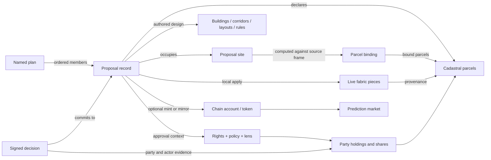

<!-- Code-grounded vocabulary and semantic audit. Keep observed behavior separate from proposed terminology and RDF mappings. -->

# Vocabulary

This is the maintained vocabulary for Consensus Builder: what its records mean, what they identify, and how they relate. It begins with **the definitions implemented by the code**, including inconvenient overlaps. The audit register records questions to resolve; it does not silently redefine the product.

**Baseline:** 2026-10-19, branch `colosseum-worlds-fair`, HEAD `83b1c31fc2facf53430e2959e2fa08347e356c4c`, plus the working-tree edits already present during the audit. Those edits included parcel, geometry, building, readjustment and rendering modules. This is a source audit, not a census of stored rows or verification of a deployed release. References identify files and symbols so they remain useful when line numbers move. The adjacent `cadastre-data` solver was inspected for comparison at HEAD `08b1e96`; it is a separate implementation.

**Status convention:** “Observed” describes code. “Proposed” describes a possible vocabulary or interoperability change. Findings remain open unless their entry records a resolution. The local term identifiers in backticks below are documentation identifiers. The first implemented RDF publication is described under “Current machine-readable publication”; repository implementation does not imply deployment.

**Change policy:** This is experimental software without customer compatibility obligations. Improve the model in small, verified changes, using one current contract. Existing data can be discarded and recreated; do not add migrations or parallel legacy/current flows solely to preserve it. Record changed meanings and commitment coverage here. Historical commitments are not rewritten or reinterpreted as proof under a new contract.

**Branch integration, 2026-10-20:** Colosseum current contracts take precedence. Planning representations and the separately numbered V20 below retain the source-projection work without reviving retired identity, lifecycle or consent contracts.

## Semantic coherence roadmap

Status tracks repository implementation and verification, not deployment. The detailed findings below
record resolved contracts, rights and approval evidence limits, and explicitly unsupported capabilities.

**Implementation checkpoint, 2026-10-20:** the remaining identity, spatial, evidence, classification
and quantity corrections in this audit are implemented and individually checked. Unsupported
capabilities and evidence limits remain explicit; no deployment or historical-record rewrite is implied.

| Work | Status | Result / next bounded step |
| --- | --- | --- |
| Code-grounded definitions, relationships and standards research | **Done** | Baseline vocabulary, 18 audit findings, Schema.org and construction/geospatial vocabulary mappings recorded. Broader external mappings remain proposals; the bounded JSON-LD view below implements the reviewed record, concept and site mappings. |
| Plan commitment coverage — V04 | **Done** | Every member hash covers authored site and decision kind, including readjustment proposals. |
| Identifier namespaces — V01 | **Resolved for audited identity paths, 2026-10-20** | Row/authored lookup namespaces, creation inputs, HEAD headers and named-plan API fields are explicit. Browser chain imports and sync match full chain references, preserving case-sensitive program/account IDs and refusing ambiguous local matches. JSON-LD proposal/plan entities use canonical publication API IRIs. Mint confirmation separates local navigation from its qualified chain reference. Publication sync preserves local keys and stamps `publicationApiBase`; row reconciliation and sharing require the row plus its API, while generic `id`, authored aliases and hashes cannot select a published copy. Edit-token keys include canonical API plus row ID; there is no unscoped-token fallback. Typed `proposalOrigin` uses a local key or qualified publication reference; missing API provenance remains local/unknown. Retired unqualified lineage fields are rejected or stripped from portable records. `getProposalPublicationLookup` is an existence-query candidate, not proof of publication. |
| Published design and named-plan immutability — V03 | **Done in code; locally verified** | Database guards protect published content and named-plan identity. Incomplete commitments are rejected; minting also checks current members and the aggregate hash. Activation requires the backend DDL deployment. |
| Qualified spatial and planning terms — V02, V05, V10, V11, V13 | **Done for audited contracts, 2026-10-20** | Local composition, named membership and statutory-plan/drawing contexts remain distinct. Source references, formed ground, authored plot pieces and runtime parcels have qualified roles. A configured `parcelSource.sourceId` identifies the catalog provider; jurisdiction and authority are metadata and do not change that ID or parcel-set fingerprint. Comparisons and binding-drift recomputation require the explicit source descriptor; missing, mixed, invalid or conflicting evidence stays unknown. An absent snapshot, dataset release or legal authority is not inferred. Proposal sites, source websites and archive project sites remain distinct. Authored rule envelopes, illustrative build-outs and reconstructed building envelopes have separate roles and provenance; archive parcel context is not reconstructed building geometry. Area and coverage displays distinguish authored sites, complete source areas, partial coverage and unknown extents. |
| Parties, rights and approvals — V06, V07, V15 | **Done for audited current contracts, 2026-10-20** | V15 site/subdivision labels state unknown ownership and explain omitted draft accounting; the open-ground accounting marker is documented without a title assertion. V07 removes parcel-to-owner acceptance inference, requires current term commitments for local tallies, and keeps seller-offer creation free of presumed owner consent. Unsigned local tallies are excluded from API/portable records and remote imports. Rights-party, signing-key, local-roster, allocation and containing-proposal namespaces are explicitly scoped. Approval presentations name configured rules rather than payment or legal completion. Comparison revalidates local consent or signed receipts in its current context. Profiles distinguish local assignments from connected-wallet parcel-NFT observations and explain their limits. This contract does not provide a registry-backed rights source or establish registered title or signing authority beyond the evidence explicitly checked. |
| Lifecycle and realization — V08 | **Done for current browser/API/chain contract, 2026-10-20** | Seller-offer funding has a separate display modifier; terminal/deadline states take priority. Purchase simulation records a browser-local result, preserves shared terms/lifecycle and is excluded from portable records. Local acceptance and signed decisions record consent only; withdrawal preserves execution and map state. Lifecycle status and `lifecycleEvidence` are sibling axes: evidence records an observed chain/event status, a deadline-derived expiry, or an unknown/unmatched claim without silently rewriting an operational status. Full serialization and proposal summaries project this evidence from chain mirrors, lifecycle events and expiry; client claims are not authoritative. EVM acceptance refreshes lifecycle from the receipt block; new verified mirrors retain the observed EVM/Solana status and its observation time. Unverified execution timestamps are excluded from portable/API records. API and browser reads preserve missing/unrecognized lifecycle as Unknown and expire only Active records; unknown status blocks new consent. The lifecycle oracle reconciles only qualified verified Solana devnet mirrors. Market lookup uses the exact devnet program and canonical account field; RPC readers check network, account program/type, market subject and stake mint. Market actions require observed chain state, and presentation describes chain settlement separately from physical construction. Browser funding and market reads verify deployment/network and account context independently of wallet preferences. The shared execution label distinguishes an observed matching execution from an unverified `Executed` status; both remain separate from payment, legal registration and construction. Older records without qualifying evidence remain evidence-unknown; proof of payment, legal registration and physical construction is unsupported by these records. |
| Classifications and quantities — V09, V12, V16 | **Done for audited authored, archive, profile and comparison paths, 2026-10-20** | V12 keeps the planner’s floor area, modeled gain and offer tied to the published geometry; samples above a stated coverage/GFA ceiling are rejected. V16 removes the seller dialog’s boolean-to-money shortfall and no-op Fund action. Structure archives cover park, square, lake and station, preserving structure category separately from decision kind and excluding local state. Market percentages are labeled as pool shares, with devnet USDC as their basis. Chain imports keep atomic balances separate from explicit authored offers and do not guess an unknown token or its decimals. Game-mode agent support requires positive amounts tagged with matching ETH currency and `simulated-agent-eth-balance` basis; the simulation does not alter authored offers or budgets. The canonical design-goal list drives editor completeness, archive structure kinds, thumbnails and plan member commitments; proposal draft schema v3 requires an explicit canonical goal and does not read v2 drafts. Goal, decision kind, `type`, typology and nested kinds remain separate axes. Rights, approval weights, allocation fractions, valuation/cash bases, strict source-price currency and explicit area-model fallback have unit/basis rules. Canton ledger prices without a currency remain currency-unknown. Profile and comparison amounts show only explicit authored full-proposal offers; inferred recipient totals and proportional entitlements are removed. |
| Named-plan scoring scope — V19 | **Resolved for current-session scoring** | Exact verified members must be the whole applied composition. Other applied proposals prevent a named score. Counts and dimensions use one captured fabric revision; changes detected before Start or Repeat require reopening the score. An isolated evaluator and historical reproducibility are not implemented. |
| Record authority, relationships and documentation — V14, V17, V18 | **Done for the audited boundaries** | The published-record authority table covers column/JSON precedence and mirror overrides; the API emits one SQL-owned chain attachment, with null clearing stale JSON claims. V18’s cited documentation matches the code. Market help distinguishes parcel-reference grouping from mutually exclusive or geometric alternatives. |
| Machine-readable publication | **First projection implemented; locally verified** | Published proposal and named-plan detail routes expose opt-in JSON-LD, with canonical publication IRIs, a versioned vocabulary, ordered commitment nodes and GeoSPARQL site geometry. JSON-LD expansion/RDF conversion and concrete consumer questions are tested. Qualified source releases, rights/decision evidence, building topology and SHACL shapes remain future extensions. |

## Accepted direction: obligatory proposals and their representations

User decision, 2026-10-19: existing regulations, permitted massing and permits belong in the proposal system as **obligatory proposals**, primarily restated through scripts and automated imports. A manual “create proposal from permitted massing” operation is not the main workflow.

“Obligatory” describes the binding effect of an applicable, supported source instrument. A maximum still permits building **up to** the maximum; it does not require construction or occupation of every permitted volume. A permit may authorize a particular design subject to conditions without requiring it to be built. Keep **permission**, **requirement** and **prohibition** distinct. A dataset publisher's interpretation is attributed evidence of the instrument, not the issuing authority itself.

These are independent axes:

- **Decision kind:** the existing `owner-deal`, `owner-vote`, `community-vote` path.
- **Normative authority and applicability:** issuer, source instrument/version, effective period, geographic/use/project scope, conditions and supersession. The `source-proposal.v1` projection below carries these independently of decision kind; unknown issuer, effective dates, conditions and supersession stay null. Authored designs may pin `sourceReferences`. Do not infer authority from an import timestamp.
- **Proposal lifecycle and local application:** publishing, voting, execution and applying to the browser's live fabric retain their existing meanings. An imported regulation does not fabricate a vote, signed acceptance, execution event or physical construction.
- **Representation role:** an observed building, permitted massing, example build-out and proposed design may use common geometry and renderers while making different assertions. An envelope may be an outer bound or one candidate, rather than a jointly achievable filled solid.

The source proposal, its constraints, and its derived geometry keep linked identities and versions. Changing a provider result must not silently rewrite an authored design or a historical source version. An automated importer needs repeatable source identities, retained unresolved rules and explicit source coverage. An unsupported constraint is not permission to ignore it; missing source data is not zero permitted capacity.

The implementation comparison and first shared adapter design are in [the planning-rule audit](docs/planning-rule-audit.md). This direction leaves the current `ProposalKind` enum and lifecycle behavior unchanged until their consumers and validation can be updated together.

## Observed: planning representations and comparison views

Implemented in this branch, 2026-10-19. A **planning representation** is an inspection/display projection of an observed building, authored proposal or provider source record. It is neither a new `ProposalKind` nor an applied change to the live fabric. The `planning-representations.v1` response carries a representation ID, linked proposal ID where applicable, source record identity and revision, polygon volumes or source areas, spatial reference, source authority assertions, assessment, independent constraints and retained source evidence. Observed buildings have no proposal ID; authored designs use their browser-local proposal key and keep API-qualified publication identity separate; provider records link to `source-proposal.v1`. This endpoint does not establish immutable historical versions.

A **source-backed obligatory proposal** (`source-proposal.v1`, `proposalClass = obligatory-source`) is a read-only projection of an existing durable provider record, with identity `source:<representation-id>`. Its decision kind is null; it is not an owner deal, vote, executed design, or new row in `consensus.proposal`. The provider record remains its persistence/source of truth, avoiding a duplicate envelope cache. Authority, applicability and source availability are separate fields. `lifecycle.availability = withdrawn` describes a cache record's availability, not legal repeal. `revisionMode = latest-only` explicitly states that an earlier revision cannot be reconstructed from this cache. See [contract](frontend/js/planning/source-proposal.js) and [provider projection](backend/planning/source-proposal.js).

An authored **source reference** pins proposal/provider/record identity, edition, scenario, city, optional parcel membership and source revision. References survive server serialization and portable chain metadata; they do not confer source authority or owner consent on the authored design. Opening a changed reference displays the current source with an explicit revision-change notice; it never rewrites the design or claims to reproduce unavailable historical source content. `sourceReferences` is an optional additive field in `proposal-chain/1`; nonempty references participate in named-plan member commitments, and records without references retain their existing commitments. The `source:` namespace is reserved from authored publication.

The Zagreb adapter reads the existing **solved-envelope cache**, `public.parcel_build_envelope`, directly, for current rows of the selected 2025 or 2016 edition intersecting the viewport. This table is the sole stored source of those calculations. The display path runs no solver, imports no authored proposal rows and creates no additional cache. A per-parcel lookup also exposes a withdrawn row's stored status/reason for the current cadastral identity, without drawing its withdrawn geometry. No row yields no invented explanation. Refresh/server-to-local synchronization is postponed by user decision. The former adapter over imported GUP restatement proposals has been replaced. That separate scripted conversion remains a native-proposal authoring workflow; its limited coverage does not measure solver/cache coverage.

A saved calculation remains available while its refresh is pending or failed. Availability (`current`) is distinct from refresh progress: `envelope_cache_error` retains per-parcel retry reasons, and the representation exposes a compact `assessment.refresh` code and timestamp. Readers show the original solver version and calculation date with an awaiting-refresh label. An accepted replacement clears the retry record atomically; a true source retirement stores an explicit withdrawal reason. Source diagnostic details stay private.

Cached floor polygons and their base/top elevations become display volumes, merging only adjacent identical outlines. Setbacks, overhangs, below-ground floors and holes retain their geometry; the native proposal editor's conversion restrictions do not gate viewing. Identity is stable by provider and parcel; `source.recordId` names the provider's parcel record and `source.version` canonically fingerprints the calculation, excluding refresh metadata and availability. The cache's legacy `version` column is not a historical snapshot. Solver version and calculation time remain visible.

The provider's selected result can be **one calculated option** or an **existing-stock estimate**. The latter remains explicitly labelled as an estimate of existing stock, not a calculated new-build envelope. `authority.effect = obligatory` describes the underlying instrument's intended normative effect, not a validation of the result or its applicability. Independent limits remain `not-evaluated`; cached evidence and independent new-build/retained-stock quantities remain inspectable. The adapter does not join today's rule variables to an older cached calculation. Viewport summaries count all cached outcomes, including results with no geometry, separately from drawable profiles. Reads are paginated in batches of up to 200 profiles; both views load all pages for the current bounded viewport. A page limit is not a coverage limit. Incomplete or failed page loading is not reported as complete coverage. Missing or unsuccessful geometry never becomes zero capacity.

The shared **building and massing controls** expose three independent layers: **Built**, **Permitted** and **Proposed**. Each supports Solid, Transparent and Off in 2D and model 3D (`solid`, `ghost`, `off` internally). **Proposed** replaces the public label “Planned”; it currently means the browser's applied building composition, not every published proposal. **Permitted** is a presentation role, not a legal assessment result. Visibility and selection never apply, execute or change a proposal.

Content choices are separate from appearance. **Built: All / Surviving / Removed** selects original observed footprints or the portions retained/removed by applied proposals; these are simulated outcomes, not observations that demolition occurred. Alternate survey overlays are hidden for Surviving/Removed because they do not share the working buildings' carve identities. **Proposed: Massing / Build-out / Both** selects the authored rule form, a deterministic example, or both; map and model share the realization and variation seed. A display change never rewrites the authored geometry. **Permitted: Overall footprint / Height steps** chooses the joined ground projection or separate height components in 2D; the model always shows their actual heights. Two adjoining height components still belong to one source representation.

The **source inspector** refers to the same representation ID as map shapes and 3D volumes. Select a shape directly (map shapes also support keyboard focus); the former viewport-item dropdown is removed. Its **Obligatory source proposal** badge follows the provider record's normative role independently of geometry; NYC public-screen evidence and Atlas zoning areas use a neutral **Source evidence** badge because neither asserts a site-specific obligatory proposal. Source boundaries are consistently solid, with selection indicated by greater line weight. Neither line style nor visibility expresses legal certainty. Selection survives display and map/model changes while the item remains loaded. Geographic coordinates use `OGC:CRS84` longitude/latitude; `baseM` and `topM` are metres relative to the model's ground reference. Unsupported frames are not rendered. The existing model's horizontal projection is Web Mercator and its vertical dimensions are raw metres; this is a visualization convention, not a globally survey-accurate local engineering frame.

Existing buildings and authored proposals retain their source stores and detailed rendering paths; pure [representation adapters](frontend/js/planning/representations.js) project them into the same inspection contract. The shared inspector owns map/model inspection and highlights; it resolves authored selections by their browser-local key, retains API-qualified publication identity separately, and reuses the lifecycle evidence labels so an unverified execution claim remains unverified; authored actions remain available through its Proposal actions button. Selection is encoded in the URL and restored when its source/building/proposal becomes available. Unknown measurements remain unknown instead of being inferred from storey counts.

The provider registry declares editions, supported scenarios, geographic scope and capabilities separately. NYC exposes its saved pilot screen, with no accepted envelope geometry. The optional Atlas adapter exposes supplied slice polygons as **zoning areas**, clipped only for viewport display, and distinguishes source numeric values from estimates and indeterminate/missing values. A zoning area is not a cadastral parcel or building envelope; its 3D display is a ground surface. Housing-type selection changes the inspected source constraints, not a solved building. Full dictionary fields remain in source evidence. Executable constraint assessment, surveyed terrain/datum placement and unavailable historical source versions remain outside this infrastructure change. See [implementation record](docs/planning-rule-audit.md#infra-and-inspection-follow-up).

An **Atlas URL source** is an operator-configured provider with an explicit city, source ID and edition, pointing to a public HTTPS Slices GeoJSON dataset (`PLANNING_ATLAS_SOURCES`). Its durable source is the remote dataset; the backend retains one validated in-memory snapshot for its process lifetime, loaded on demand. It adds no database records or refresh schedule. A restart can load changed source content, whose canonical record revision then changes without rewriting a design's pinned reference. Failed loading means unavailable, while a successfully loaded source with no intersecting slices means an empty viewport. Source bounds are known after loading; the configured city is a routing scope, not a claim that the dataset covers the whole city.

## Central terms as implemented

### Proposal — `Proposal`

A portable authored record expressing a proposed change, rule, or transaction concerning land. It combines design intent, applicable geometry, cadastral references, optional deal terms, and optional approval configuration. A proposal can describe several buildings or corridor segments; it is not necessarily one physical object. It can also change ownership or rules without supplying a new building.

The durable record is the cleaned object handled by `ProposalAuthoredRecord` and the API serializer. A browser materialization adds local state and generated land pieces; those are not part of the portable instruction. A material proposal may have **zero cadastral anchors** when it has its own site. Parcel acts require cadastral land. At publication the declared cadastral IDs must match the server's site binding, subject to the parcel-act path.

Identity has several layers: `proposal.id` is a database row key; API `proposalId` / SQL `proposal_id` is the authored/external identifier; browser publication identity is the pair `publicationApiBase` and `serverProposalId`; a chain reference also needs chain type, network, contract/program and token/account. These must not be exported as interchangeable identifiers. [Authored boundary](frontend/js/proposals/authored-record.js), [serializer](backend/proposals/serializer.js), [DDL](backend/routes/proposals-ddl.sql), [API validation and lookup](backend/routes/proposals.js), [chain references](frontend/js/proposals/chain-ref.js).

The browser's `proposalId` is a stable local record key, which is not always the published authored ID. `buildUploadReadyProposal` assigns a content fingerprint to the upload copy's `proposalId` while leaving the author's local key intact; imported copies normally use the published authored ID as their local key. `serverProposalId` together with canonical `publicationApiBase` is the explicit link from either browser copy to the published row. Exact named-plan membership uses that qualified link, never local-key equality or source ancestry.

Publication sync attaches the returned positive numeric row ID to `id` and `serverProposalId`, and
stamps `publicationApiBase` on the exact local record. It preserves the local `proposalId` and its sole storage key; a chain
token, authored ID or server-row alias cannot select a different local record for this update.
Earlier experimental copies whose `id` contains a local key require a fresh sync or reimport;
no compatibility reader or record migration is provided. [Sync boundary](frontend/js/proposals/server-sync.js).

Browser lookup first accepts an exact local key, then a unique explicit API-plus-row reference. It
never searches bare chain tokens, chain-ID aliases or generic `id` fields. Server summaries,
lifecycle reconciliation, shared-link reads and server-list navigation use the explicit row lookup directly;
equal local/authored strings do not prove that a local record is a copy of a published row. Multiple
copies declaring the same row fail as ambiguous. A server import refreshes that row's existing local
key; a colliding key with a different or absent publication reference is rejected without replacement.
Numeric local keys no longer imply publication on import. Publication badges, named-plan membership,
unsaved-work/count checks and metadata writers read the explicit positive numeric `serverProposalId`
through one shared predicate. A numeric local `proposalId` or generic `id` is insufficient, even when
this browser holds an edit token for a row with that number. `getProposalPublicationLookup` may return
an authored-content fingerprint as an existence-query candidate; it is not proof of publication.
Edit tokens are keyed by canonical API base plus row ID, and no unqualified legacy token is read.
Recreate conflicting experimental records rather than retaining the former alias rules.
[Storage](frontend/js/proposals/data.js), [server list](frontend/js/proposals/list-ui.js).

Shared publication URLs resolve numeric references only through a local record's explicit API-plus-row
reference; authored URL references first require a normalized response with row ID and API base. Local-key,
chain-token and ancestry equality cannot satisfy the route's “already applied” check. Ambiguous
row copies fail instead of selecting one. Import reuse, lifecycle reconciliation, floor-model
refresh and map focus follow that exact copy. Materialization receives local record keys only,
so an unrelated record's row number cannot make it a member of the shared composition.

**2026-10-20 shared-link contract change:** a local fork no longer substitutes for its published
source on reopening a source URL. The fork remains separate; the existing ground-holder gate
refuses a conflicting source instead of removing unrelated applied work. Share the fork's own
publication to identify it. This removes an ancestry-based alias; retired unqualified lineage fields
are rejected or stripped from portable records.
[Publication-copy matching](frontend/js/proposals/shared-link-copies.js),
[shared routes](frontend/js/proposals/sharing-routes.js).

Mint confirmation takes a separate `localProposalId` for opening browser details and a complete
`chainRef` for display. It labels the chain/network, contract/program and token/account separately;
a bare token/account is never used as the browser navigation key. [Confirmation](frontend/js/proposals/chain.js),
[creation](frontend/js/proposals/create.js).

The proposal record panel labels its copy action “Copy local ID”: it copies the browser record's
`proposalId`, not its server row or chain token/account. An imported authored ID can be the local
key, but this control does not assert those namespaces are interchangeable.

**Typed proposal origin, 2026-10-20:** a derived proposal carries `proposalOrigin` with a `relation`
of `copy`, `revision`, or `rebind`, an optional display `title`, and one `source`: a same-browser
`localProposalId`, a publication reference `{ apiBase, proposalRowId }`, or `null` when no portable
source identity is known. `apiBase` is the canonical publication API URL; the row ID is scoped to
that API. Draft editing retains `sourceLocalProposalId` for finding the source in the same browser.
When the source is published, sync records `publicationApiBase`; portable projection qualifies it
with the row ID. A publication row without a valid API stamp remains local/unknown; the current API
is never inferred as its source. An unpublished local source is omitted from portable identity rather than guessed
from its title, type, or generic ID. The API rejects local-key sources. A missing/not-found source
does not prove the source was never published or is absent from another publication store.
[Origin contract](frontend/js/proposals/origin.js), [drafts](frontend/js/proposal-drafts.js),
[sync](frontend/js/proposals/server-sync.js), [lineage route](backend/routes/proposals.js).

The fork list keeps published row references and local record keys separate when merging and
opening entries. Only an explicit `(publicationApiBase, serverProposalId)` pair deduplicates a local copy against a server
entry; equal authored/local strings do not. A published link opens the unique row-linked copy or
imports that row, while a missing local link never falls through to a server lookup. A source
resolved by the lineage API replaces any locally inferred source link. The retired unqualified
`sourceProposalId` / `replacementOfProposalId` / `copiedFromProposalId` inputs are rejected by
proposal creation and stripped from portable serialization; they are not the current lineage
contract. Draft provenance uses `sourceLocalProposalId`, while `proposalOrigin` is the typed
portable source. Sharing resolves a local key or an explicit published row in the current API;
generic `id`, `proposalId`, and hash aliases do not identify a publication copy.
[Lineage presentation](frontend/js/proposals/lineage.js), [creation validation](backend/routes/proposals.js),
[serializer](backend/proposals/serializer.js).

The lineage API names `proposalRowId` and `authoredProposalId` separately for its subject,
resolved source and derived entries. A source has `resolution: 'resolved'` with those identifiers,
or `resolution: 'not-found'` with the typed stored `reference` and optional title. A failed
lookup cannot establish that a source was never published, is a draft, or is absent from another
store. The browser describes missing sources within this publication store and shows an
unavailable notice when fetching fails; a failed request cannot produce an empty-result claim.
**2026-10-20 API contract change:** the lineage response replaces `id` / `proposalId` and its
`published` boolean with the qualified fields and resolution outcome; clients must use this one
response contract. It resolves source identity only for the typed publication reference; it does
not establish identity for remaining local or historical lineage metadata.
[Lineage route](backend/routes/proposals.js).

Browser chain imports use chain family, network, contract/program and token/account together.
EVM network/token numbers compare in decimal or hexadecimal form, and EVM contract addresses
compare without case; Solana and Canton program/account case is preserved. A shared parcel set,
bare token number or metadata's authored ID cannot select a local record to overwrite. A new
chain import receives a qualified local key; an exact existing reference keeps its local key.
Multiple local records naming that reference are rejected. EVM sync checks the wallet network
before each token read; Solana proposal sync verifies the devnet genesis before enumeration and
each account read, then checks the account's owner against the named program. Other clusters are
unsupported by this sync path until a verified deployment is configured. An unknown cluster cannot
fall through to a default devnet endpoint. A failed contract/account read is reported as incomplete,
retaining the count of earlier successful imports instead of reporting an empty successful scan.
Missing or unrecognized status from these sync reads remains Unknown. These checks do not make
unverified metadata into a server mirror or establish physical realization. Other browser Solana
loader entrypoints still have separate account-decoding and network-evidence limitations.
Existing misidentified experimental local records must be
removed and reimported; no parcel-similarity or bare-ID compatibility path remains.
[Reference comparison](frontend/js/proposals/chain-ref.js), [chain import](frontend/js/proposals/data.js),
[EVM sync](frontend/js/blockchain-sync.js), [Solana sync](frontend/js/solana/blockchain-sync.js).

Chain-import title fields use supplied names or titles. A generated goal label or
`Proposal <local key>` is only a fallback and cannot outrank a later metadata title because its
qualified identifier is longer. Description text remains a description, not an inferred title.

A proposal's optional `titleOrigin` records whether its title was `generated` or written by the
`user`. It is display/authoring metadata, carried through draft editing and portable chain records;
it is not an identifier or an ownership claim. Editing a title marks it user-authored. Converting a
rule to Freeform regenerates only an explicitly generated title; titles without provenance and
independently authored descriptions are preserved. [Draft fields](frontend/js/proposal-drafts.js),
[editor conversion](frontend/js/proposals/freeform-conversion.js),
[portable fields](frontend/js/proposals/chain-record.js).

The retired `coordinatedPlanId` marker has no application semantics. Every working composition uses
the ordinary materialization order and geometry/ground checks; a marker cannot skip building
parcel formation, owner remainders or shared-member validation. Named-plan membership and
`reconstructionPlanId` provenance remain separate concepts.

#### Proposal identifiers at API boundaries

| Term | Current representation and meaning | Boundary rule |
| --- | --- | --- |
| **Database proposal row ID** — `ProposalRowId` | `proposal.id` in SQL and API responses; browser `serverProposalId` refers to it. Assigned by a publication database and meaningful only with that API's canonical base URL. | Digit-only lookup values select this namespace exclusively inside the API handling the request. A row ID alone is not a globally qualified publication reference, proves no minting and identifies no chain token. Creating a proposal cannot supply this ID. |
| **Authored proposal ID** — `AuthoredProposalId` | API `proposalId`, stored as `proposal.proposal_id`. The browser commonly publishes a content fingerprint; agents commonly supply an operation ID. It is unique within the publication store, not automatically a global IRI or an immutable snapshot. | Creation accepts an optional nonempty string of at most 255 characters that is not all digits; absent values receive a generated authored ID. Top-level `id` and `proposal_id` are rejected creation fields, including when `proposalId` is also supplied. |
| **Chain proposal reference** — `ChainProposalRef` | `{ chainType, chainId, contract, tokenId }`: chain family, network, contract/program, token/account. For example, the nested `onchain.proposalId` is a token/account ID, unlike the root `proposalId`. | `POST /proposals/mirror` accepts only `{ chainRef }` and verifies that location. Chain token/account IDs are never searched as a third namespace by ordinary proposal lookup. A server mirror has its own row and authored IDs. |

`GET`/`HEAD`/edit/owner-decision/lineage lookup and batch lookup use the same namespace rule:
digits select the row ID; other identifiers select the authored ID. Missing numeric rows stay
missing even if another record has that value in `proposal_id`. Batch epoch edits use the same
rule before checking edit tokens. There is no numeric authored-ID fallback.
`HEAD /proposals/:id` exposes `X-Proposal-Row-Id` and `X-Proposal-Authored-Id`; the former ambiguous
headers were removed. The browser's upload projection removes read-response `id` and SQL
`proposal_id` fields from its copy while preserving the local record.
[Lookup implementation](backend/proposals/identifiers.js), [API routes](backend/routes/proposals.js),
[upload projection](frontend/js/proposals/create.js): `buildUploadReadyProposal`,
[machine-readable agent input schema](backend/routes/agent-recipe-schema.json).

The `/plans` API uses `proposalRowIds` for the ordered list of database row IDs in creation and
all plan responses; its list filter is `proposal_row_ids`. Detail members expose `proposalRowId`
and `authoredProposalId`, with only `proposalRowId` available when the row is missing. Published
members need no mint. The retired creation key `proposalIds` and filter `proposal_ids` return 400,
even alongside their replacements; responses contain no aliases. Browser consumers and the naming
script use this single contract. The stored `ens_plan.proposal_ids` column still contains row-ID
strings; this API rename changes neither membership nor content commitments. [Plan API](plans.md#api-identifiers).

### Named plan — `NamedPlan`

An immutable named, ordered collection of published proposal rows. `ens_plan.slug` identifies it; `proposal_ids` stores deduplicated **database row IDs as strings**. A proposal can belong to multiple named plans. A plan must have at least one member when created. It may cover several cities; its stored city is selected from member cities.

Creation stores member hashes and a plan hash; the plan hash uses stable `proposal_id` values and member hashes in order. A revision is a new slug with `supersedes`; multiple later plans can supersede one predecessor. Its site is the union of member sites only when every member has a site. Chain mint metadata can be attached separately.

Every member hash commits to the decision `kind` and site from `proposal_data` (absent values are `null`). Ordinary members also commit to their design, cadastral references and applicable approval context. Readjustment members include the canonical deal fingerprint as a component. All members use SHA-256 over their sorted-key JSON projection. The PostGIS site projection is excluded; authored site coordinates retain their order and precision. This is record identity, not geometric equivalence. The 2026-10-19 contract deliberately replaces the prior hashing path: old hashes report drift and affected experimental plans can be recreated. [Hash contract](plans.md#experimental-contract-changes).

Normal design edits of a published or minted proposal create a **new proposal linked to its source**; the source remains intact. A named plan continues to reference that original row, so this fork model already preserves the selected design without a second copy inside the plan. [Edit boundary](frontend/js/proposals/lineage.js): `isPublished`, `editsInPlace`; [editor save](frontend/js/proposal-editor-shell.js).

The [database publication guards](backend/db/publication-immutability.sql), applied by the backend deployment, enforce this boundary for direct operator SQL too: authored content cannot be overwritten, and a named plan's membership, commitments and descriptive fields cannot change. This retires the overwrite behavior of tools such as [structure repair](backend/scripts/set-structure-geometry.mjs) and [road-network repair](backend/scripts/repair-sibenik-road-network.mjs). Proposal names, descriptions, thumbnails, epoch labels, lifecycle/approval outcomes and chain attachment remain separate mutable metadata; response ID mirrors can be filled after insertion while actual identifiers remain fixed. Plan chain data can be attached once.

Plan reads require complete member hashes and a valid-format aggregate hash; absent, partial or malformed commitments return 422 instead of implying unchanged content. Each member is then compared with its saved hash: missing or changed content reports `changed: true`. Minting additionally requires current content and aggregate hash agreement; ENS refuses incomplete commitments. There is one current contract, with incomplete experimental plans discarded and recreated. No historical content is manufactured or restamped. The list's order contributes to the plan hash; geometry replay has its own order. [Commitment validation](backend/plans/plan-commitment.js), [plan route](backend/routes/ens-plans.js), [store](backend/plans/plan-store.js), [hashing](backend/plans/plan-hash.js).

### Published record projection and authority

The API reconstructs one proposal from a stored row. SQL columns are queryable projections of
parts of `proposal_data`, not additional proposal entities. The serializer's current precedence
is explicit below; “non-null” includes `false`, `0`, empty strings, empty arrays and empty objects.
These values never trigger a truthiness fallback. The rules describe stored facts, not evidence
that the facts are legally or physically true. [Serializer](backend/proposals/serializer.js),
[full and summary queries](backend/routes/proposals.js).

| Response facts | Source and precedence |
| --- | --- |
| `id`, `proposalId`, `city` | Present SQL `id`, `proposal_id`, `city` replace JSON values. Normal API queries select these identity columns. Row and authored IDs retain their distinct namespaces. |
| `name`, `title`, `description`, `author`, `type`; `offer`, `offerCurrency`, `budget`, `budgetCurrency` | Non-null dedicated column, otherwise the corresponding JSON field. Numeric amount columns become JavaScript numbers; this does not change their currency. |
| `createdAt`, `expiresAt`, `updatedAt` | Non-null timestamp column formatted as ISO, otherwise its JSON value. Effective lifecycle separately uses only the SQL deadline; a JSON display date cannot establish expiry. |
| `decayEnabled`, `decayPercent`, `decayDurationMs`, `depositEnabled`, `depositPercent`, `isConditional`, `disbursementMode`, `epochYear` | Non-null dedicated column, otherwise JSON; duration and epoch columns become numbers. Missing epoch becomes null. |
| `cadastreParcelIds` | Full rows require the dedicated array; it must agree with any JSON declaration. Derived references and retired declarations are rejected. |
| `ownershipFlow`, `cadastreFrame`, `binding`; `roadProposal`, `buildingProposal`, `structureProposal`, `reparcellization`, `lens`, `bounds` | Non-null dedicated column when selected, otherwise JSON. The ordinary full query does not select `binding`, so it serves that stored JSON field. |
| `site`, `geometry`, decision `kind`, `goal`, approval configuration and other authored fields without a selected column | Cleaned JSON. The PostGIS `site` column supports spatial queries and guards; the API transports the authored GeoJSON. Summary fields are their own explicit query projection, not a second authored record. |
| `acceptedParcelIds`, `ownerAcceptances` | Omitted from API responses and portable records, regardless of SQL/JSON copies. These are browser-local unsigned bookkeeping; signed decisions use the separately verified receipt endpoint. |
| `lifecycleStatus` | SQL effective/stored lifecycle and SQL deadline only; unavailable state is Unknown. Authored JSON never supplies a missing status. |
| `onchain` | SQL `onchain_data` only, including null. A query that omits it also yields null. JSON chain fields cannot restore a missing attachment. `onchainData` is no longer emitted or accepted for creation. |
| `screenshotUrl` | Dedicated screenshot URL, then SQL chain attachment image URL, then JSON screenshot URL, then null. A thumbnail is presentation, not chain identity evidence. |
| `agent` | JSON claim only if the query's selected payment ID is non-null; verified mirrors instead use the signer-verified agent stamp. An absent payment projection is not independently verified provenance. |

For a verified `proposal-chain/1` mirror, the validated `chainMirror.record` replaces the authored
fields listed in `chainRecord.FIELDS` after the ordinary projection. It preserves the minted
values rather than SQL-normalized copies. The API's authored identifier remains the server's
mirror identifier; the original identifier remains in the committed record. Row identity,
current lifecycle and chain attachment remain server projections; `mirroredAt` records server
receipt separately from the committed creation time. Browser-local state and unqualified execution
timestamps are stripped after reconstruction too. [Mirror projection](frontend/js/proposals/chain-record.js).

**Contract break, 2026-10-19:** chain identity in old JSON-only or `onchainData`-only records is no
longer exposed by the API. Recreate those experimental records through verified mirroring; no
compatibility reader, data rewrite or migration was added. The other precedence rules above are
observed existing behavior, not newly added compatibility paths. Export consumers must use this
canonical response and its qualified evidence instead of publishing every stored projection.

### Applied composition — `WorkingComposition`

The proposals currently applied in one browser, together with their materialized effects. It can combine members of several named plans and local drafts, and has no `ens_plan` identity of its own. **Share applied proposals** opens a temporary selection from this composition. Uploading the selection and copying its `/proposals/<row IDs>` link do not create a named plan. The separate **Create named plan** action records the selected published members; subsequent changes to the browser composition do not change that membership. [Sharing panel](frontend/js/proposals/dialog-share.js), [named-plan contract](plans.md#named-membership-and-local-application).

Application and replay are local operations. Replay orders formations by `authoredAt || createdAt`, then numeric record ID, then record key; `epochYear` is a presentation bucket, not a dependency or replay order. An explicit **Apply plan** action chooses named members over geometrically overlapping applied rivals in one atomic mutation; a failed member leaves the prior composition intact. Passive shared-record imports retain the non-displacing ground check. Named membership, being applied locally, selection for sharing, replay chronology and authored dependencies are separate relationships. A member's position in a named plan affects its commitment hash, not its replay order. [Sharing flows](frontend/js/proposals/sharing-routes.js), [proposal manager](frontend/js/proposal-manager.js), [ordering](frontend/js/proposals/plan-order.js) (`formationTime`, `compareFormationOrder`), [epoch](frontend/js/proposals/epoch.js).

Other uses of “plan” need qualification: a statutory planning document, a floor-plan drawing, and the nested `reparcellization` layout are different objects.

#### Measurement scope

**Applied proposal stats** counts proposals currently applied in the browser and derives their quantities from the live fabric; opening a named-plan page does not make that statistics dialog a report limited to its members. **Urban grain score** has two scopes: without a named-plan context it measures the applied composition; with a named-plan context it fetches the plan detail and requires every member to be verified unchanged and applied with the exact published row ID. Its card identifies the scope explicitly, and a named plan without a title is labeled with its slug. [Statistics](frontend/js/proposals/plan-stats.js), [grain score](frontend/js/proposals/grain-score.js).

A local edit or fork cannot substitute for a named member, even if its source/replacement ancestry reaches that member. A fork can be scored when its own published row is a member. Missing, changed, unverified, ambiguous or unapplied members prevent a named score; absent membership never falls back to the whole local composition. Both the route and the score action fetch current plan verification. The shared-proposal loader still recognizes replacements for ordinary application, but scoring separately checks exact membership. [Pure membership rules](frontend/js/proposals/grain-score-rules.js): `verifiedNamedPlanMembers`, `selectNamedPlanProposals`.

The named members must also be the **whole applied composition**. Any outside applied proposal prevents a named score, including proposals on distant parcels or open ground. This conservative rule is intentional: overlapping cadastral IDs alone do not establish independence, and there is no isolated replay evaluator. Scoring reports the restriction and leaves the applied state intact; the user can unapply outsiders and reopen the score. Local composition scoring continues to measure the whole composition.

A **grain score assessment** is a derived measurement of one current-session fabric snapshot, not an intrinsic or committed property of a named plan. Ground loading finishes before eligibility is rechecked and parcel features are captured. Counts and dimensions come from those captured features; named scores require complete measurable result geometry and never fill a missing materialized parcel from original cadastral geometry. `state.prepared` retains the fabric revision and measured features. Start and Repeat recheck eligibility; a changed fabric revision requires reopening the score. [Measurement rules](frontend/js/proposals/grain-score-rules.js): `namedPlanScoreScope`, `measureParcelRows`.

Its inputs include the verified member rows, current cadastral repository facts, runtime materialization/replay rules, and the captured fabric revision. Neither ground versions nor engine versions are committed by the named-plan hash, and assessments are not persisted as historical evidence. This resolution prevents outside proposals or mixed revisions from silently becoming a named score; it does not promise reproducibility across sessions or releases.

### Cadastral parcel / base parcel — `CadastralParcel`

A source land unit referenced by its provider's parcel identity and geometry. Within a browser session the cadastral repository preserves source facts independently of the mutable map. A source feature may have multiple disconnected polygon parts. Its identity is not its polygon, display label, owner, or a generated fabric ID.

**Ljubljana source, 2026-10-20:** the default is the official GURS WFS (`si-gurs-kn-parcele-wfs`), retaining `SI-<EID_PARCELA>` identities, with ownership unavailable. It replaces the empty imported `parcel_lj` dataset as the current source; no database fallback is added. A completed viewport query may return no source parcels. The status reports that empty answer explicitly, including when cached; it does not establish citywide absence or claim that parcel geometry was loaded.

The common Croatian identifier is `HR-<cadastral municipality>-<parcel number>`; other providers have different identifiers and sometimes geometry-derived display identities. `cadastreParcelIds` is the durable relationship on a proposal, but the field name alone does not establish the legal quality or authority of a provider. Use source and jurisdiction context when interpreting an ID. [Ground repository](frontend/js/parcels/ground-service.js), [source adapters](backend/parcels/sources.js), [source normalization](frontend/js/parcels/ground-fallback.js), [authored ID checks](frontend/js/proposals/authored-record.js).

**Provider native-key plus geometry reference, 2026-10-20:** selected ArcGIS sources use `native-key-geometry-sha256-v1` when one native key can select multiple outlines. The parcel reference combines that native key with a SHA-256 digest of the complete returned WGS84 geometry; object keys are sorted, while geometry type, coordinates, precision and ring order remain significant. `sourceNativeParcelId` preserves the provider key separately, and `sourceGeometryHash` records the digest. Exact-ID lookup returns only the requested outline reference; a changed outline is absent under the old reference. This is a source-qualified content reference, not a stable legal-unit identity or a dated dataset snapshot. It does not manufacture ownership, authority, continuity or effective-date evidence. [ArcGIS adapter](backend/parcels/arcgis-source.js), [reference behavior](backend/test/za-csg-property-viewer.node.test.js).

**Custom register identity contract, 2026-10-19:** a visitor's exact trimmed register URL is hashed with SHA-256 into `custom-url:sha256:<digest>`. Each normalized feature retains that `sourceId`; its parcel reference includes the same digest. A native ID is preserved as `sourceParcelId` with `sourceIdentityKind: native-id`, and encoded in the `URL:<digest>:native:<encoded ID>` reference. Without a native ID, `sourceParcelId` is `null`, `sourceIdentityKind` is `geometry-content`, and `URL:<digest>:geometry:<geometry digest>` identifies exact geometry type/coordinate content. These two reference kinds cannot collide with each other, and identical native IDs or geometry in different links do not name the same source feature. The source identity is preserved through viewport fetching, exact-ID lookup and tab-session restoration. [Pure identity projection](frontend/js/parcels/custom-url-identity.js), [custom-link transport](frontend/js/parcels/ground-fallback.js).

A URL identifies the selected source configuration, not a dataset release, a cadastral jurisdiction or a legal authority. URL aliases are not merged. Here a native ID means the first usable source key from the supported parcel/id fields, `OBJECTID`, `FID`, `gml_id`, or GeoJSON feature ID; it may identify a provider row rather than a cadastral unit. Its reference stays stable while that key and URL remain the same, including across geometry edits. Reused keys do not establish continuity of a parcel entity across dataset revisions. Anonymous geometry references change with the encoded geometry. No version or retrieval-time evidence is manufactured from the URL or the browser's city. This intentionally replaces the unqualified `URL:<native ID>` / short geometry-hash contract; affected experimental records must be recreated, with no compatibility lookup for old references. The tab's saved URL is still the source configuration, so restoration derives current references from fresh source data. Provider descriptors do not manufacture missing release, jurisdiction, or authority evidence; such values remain unknown unless the source supplies them.

Photo view's **cadastral parcel boundaries** layer projects immutable `CadastralParcelRepository`
source outlines vertically onto the visible Google mesh, including roofs and vegetation. It does
not render the proposal-derived live fabric or infer boundaries from imagery. Selection reports the
source reference and geometry area in m²; overlapping source outlines remain individually selectable.
The bounded overlay follows the camera's target and retains the provider's horizontal coordinates.
Mesh LOD and visual alignment do not change source geometry, legal certainty or parcel identity.
[Photo overlay](frontend/js/photoreal-parcels.js).

### Live parcel / fabric piece — `FabricPiece`

A face of the currently materialized land fabric: unchanged cadastral ground, a proposed body, or a remainder created by applying formations. It has a runtime identity and provenance back to cadastral anchors and/or synthetic open ground. One base parcel can produce several pieces; a resulting piece can span several base parcels. A piece is not a newly registered cadastral parcel.

`LiveParcelFabric` is the mutable derived land representation. `ParcelPresenter` renders its revision. `ParcelMutation` coordinates atomic publication of proposal state, fabric and related local state. Neither a Leaflet layer nor its visibility determines cadastral identity. [Ground service](frontend/js/parcels/ground-service.js), [mutation transaction](frontend/js/proposals/apply/transaction.js), [claims](frontend/js/proposals/claims.js), [open-ground hosts](frontend/js/proposals/open-ground.js).

Distinct source parcels can have overlapping outlines. Live pieces with disjoint cadastral anchors may retain only overlap already present in their immutable source outlines; an apply does not choose an owner for that source conflict. Pieces sharing a source anchor must remain disjoint, and coverage of a proposal counts overlapping source ground once.

The proposal's source-reference list distinguishes **source geometry not loaded** from **replaced in map model**. Only a currently applied formation with materialized output establishes the latter; missing repository geometry does not. Replacement may come from another proposal, so the viewed proposal's type cannot establish that the source was pooled into its plots. Neither state asserts legal cadastral removal. Loaded, unreplaced references keep their acceptance display and normal detail action; replaced references focus their source location. [Presentation state](frontend/js/proposals/panel-presentation.js), [details](frontend/js/proposals/details-panel.js).

The single-selection menu and inspector qualify identity from explicit provenance: **source parcel** for a feature whose sole source is itself; **source parcel part** for a connected component marked `cadastralPart`; **formed ground piece** for other proposal-produced/derived ground or a feature with different source anchors. A readjustment's explicit output role further distinguishes **plot piece** and **ground remainder**. An unknown kind remains the generic “Parcel”; ID punctuation and `isProposed` alone do not establish a kind. A plot piece keeps that title on open ground; other open-ground titles remain qualified by ground provenance. “Source parcel” does not certify that the provider represents legal cadastral units. Formed pieces and source parts display their own runtime reference, even when they inherit a source's cadastral-number or geometry-reference metadata. [Shared presentation rules](frontend/js/ui/parcel-menu-model.js), [menu](frontend/js/ui/parcel-menu.js), [inspector](frontend/js/parcels/ui/parcel-panel.js).

**Readjustment output contract, 2026-10-19:** producer identity alone still groups both plots and leftover ground. Live features now also carry `readjustmentPiece`: `{ role: 'plot', plotFingerprint }` for a piece of an authored plot, or `{ role: 'remainder' }` for a remainder created outside this readjustment's plots. A carried piece of another formation retains that formation's producer and plot reference. The reference is captured before later corridors cut/filter plots and survives splitting into connected pieces; modeled allocation follows each resulting plot piece. `readjustmentPiece` is derived runtime metadata, removed when a feature becomes authored geometry and recreated on replay. No authored-record migration or compatibility reader was added. [Readjustment application](frontend/js/proposals/apply/parcels.js), [authored boundary](frontend/js/proposals/authored-record.js).

### Authored readjustment plot content — `AuthoredPlotContent`

One output entry in `reparcellization.polygons`: exact Polygon/MultiPolygon coordinates plus normalized owner allocations and joint-pool status. Its `lr-plot1-sha256:` fingerprint hashes the same canonical plot payload used inside the deal, wrapped with schema `land-readjustment-plot/v1`. Owner order, display metadata and the plot's array position do not affect this fingerprint; authored coordinates and allocations do. The reference is scoped by the producing proposal (`producedByProposalId` plus `readjustmentPiece.plotFingerprint`), not globally identified by a bare hash or an array index. [Plot projection and fingerprint](frontend/js/reparcellization-deal.js): `plot`, `plotFingerprint`.

One authored plot can yield zero, one or several live pieces after other applied proposals cut its ground. Their runtime IDs and geometries can change while they retain the original plot-content reference. This is content identity for one authored version, not a continuing legal lot or a stable logical plot across edits. A geometry/allocation edit changes the reference. The new derived fingerprint does not change existing deal/plan commitment payloads, replace the complete consent fingerprint, or assert cadastral registration. The current reference is proposal-scoped rather than a globally qualified export IRI; missing provider, jurisdiction, or dataset-version evidence remains unknown.

### Proposal site — `ProposalSite`

The ground occupied by a proposal, represented as a Polygon/MultiPolygon in geographic coordinates and stored in PostGIS as `MultiPolygon, 4326`. It may cross parcels, occupy parts of parcels, or include ground without available cadastral coverage. It is distinct from the set of affected parcels and from the building footprint.

An explicit browser choice to continue without parcels permits a **local geometry-only derivation** for a material proposal with its own site or footprint. The runtime projects its ground input to an empty cadastral scope and a synthetic site host; this is a map construction while the parcel source is unavailable, not a new binding or evidence that the land is unowned. The stored proposal keeps its published `cadastreParcelIds`, binding and site unchanged. Parcel acts and records without their own ground geometry cannot use this derivation. Returning to ordinary parcel mode requires the usual cadastral checks and rederivation. [Projection](frontend/js/proposals/open-ground.js) (`geometryOnlyGroundRecord`), [application](frontend/js/proposal-manager.js).

Publication derives or validates the site and computes a binding against source parcels. A supplied design footprint must fit within the site. In transport, the serializer reads the site's GeoJSON from the authored record; the spatial database column supports queries. A site is currently embedded geometry, not a separately identified domain entity. [Site DDL](backend/routes/proposal-site-ddl.sql), [binding](backend/proposals/binding.js) (`checkProposalBinding`, `validateSiteGeometry`), [serializer](backend/proposals/serializer.js).

Proposal details show **site area** separately from the **sum of source parcel areas**. Site area measures the authored site geometry in square metres. The source sum uses positive finite calculated-area metadata or measures the retained source geometry for the declaration, with an explicit measured-count/declared-count statement; it is not the area occupied by this proposal or the union of those sources. Missing/invalid measurements display an em dash, and incomplete sums are labeled as available source area. The source sum reads all retained records without fetching or cloning geometry and does not depend on how many parcel rows have rendered. Whole-source totals used for list metrics and proportional offer estimates are null until every unique declared source has a positive finite area. Generic `area` / `parcelArea` fields with no established unit are not measurement substitutes. These are runtime measurements; no source records or commitments are rewritten. [Area measurements](frontend/js/proposals/area.js), [details](frontend/js/proposals/details-panel.js).

### Parcel binding — `ParcelBinding`

A computed, source-dependent statement about which parcels a site reaches into, at a stated tolerance and computation time. It includes bound parcels, touched parcels, intrusion measurements, coverage and unaccounted area. It is neither ownership evidence nor a title transfer.

For geometric binding, an intersection binds when it survives an inward buffer of half the greater of the configured tolerance and the numerical noise floor. Thus binding uses **intrusion width in metres**, not simply intersection area. A parcel merely touching the boundary need not bind. The default tolerance is zero, with a 0.001 m noise floor; uncertainty near the threshold can produce an unresolved answer. The browser computes a preview over supplied data; the server computes the publication answer.

Coverage values are `complete`, `partial`, `none`, `unknown`. `none` and `unknown` are distinct: confirmed lack of supported coverage does not mean the same thing as an unavailable or unrecognized source. A later cadastre can produce binding drift without rewriting the original publication. [Shared rule](frontend/js/proposals/site-binding.js), [server implementation](backend/proposals/binding.js), [drift](frontend/js/proposals/binding-drift.js).

### Owner / party / actor — `RightsParty`, `DecisionActor`

Ownership display types (`private individual`, `company`, `government`, `institution`) are
classifications, not evidence of rights or authority. An explicit canonical type from the source
is preserved by the ownership UI; name-based classification is used for untyped labels. A source's
`city` display category maps to `government` in the UI. [Shared classifier](frontend/js/parcels/ownership-type.js),
[owner rows](frontend/js/parcels/ownership-ui.js).

In the approval engine, the misleadingly named `ownerId` is an **opaque party identifier**. It can identify an ownership holder, leaseholder, or authority whose decision a policy requires. A holder has a right in a particular parcel and a share; a party is not intrinsically “an owner” everywhere.

`actorId` identifies the signing wallet acting for a party. A party ID may itself be a wallet key in a particular provider, but the two roles remain distinct. A rights declaration does not prove that the actor represents the party: the approval path separately checks rights and authority evidence against the proposal's selected lens. `proposal.author` is a descriptive field, not this relationship. Browser user/agent profiles and readjustment `ownerKey` values are further identity systems.

Rights snapshots use `parcel-rights/v1` or `v2`, with a source, per-parcel holders, completeness and optional areas; v2 adds leases and public bodies. Shares are exact positive fractions. Complete holder lists must sum to `1/1`; incomplete lists must not exceed it. This is a declared rights model, not an automatic land-registry certification. [Approval model](frontend/js/proposals/approval.js) (`normalizeRights`, `holders`, `contextContent`, `evidenceAllows`), [decision receipts](backend/db/proposal-owner-decision-ddl.sql), [browser profiles](frontend/js/user-management.js).

**Review presentation correction, 2026-10-20:** both signer and read-only owner reviews label
contributions, plot allocations and cash as proposed terms. “Cash offered” and “Allocated land
area” do not claim completed payments or transfers. Reviews show the declared rights source and
selected verification lens separately, with explicit absence states. A configured lens roster is
not described as having attested ownership or authority: that evidence is verified separately for
the particular context, party and actor. Directory names are display labels only. Other local
ownership and approval projections remain under V06/V07.
[Review presentation](frontend/js/proposals/approval-panel.js),
[source and lens labels](frontend/js/proposals/approval-text.js): `reviewBasisLines`,
[evidence verification](frontend/js/proposals/approval-lens-authority.js).

**Local roster correction, 2026-10-20:** unsigned local owner acceptance requires the current
explicit, non-placeholder parcel-owner slots. Missing ownership and game placeholders no longer
create a “Single owner” consent party, a 100% share, or an Accept action in proposal details.
The acceptance entry's current owner list is replaced from that roster; decision keys never
populate it. Previously recorded decision metadata remains local history and can count again
only when the same owner is present and the current terms match. A placeholder cannot count
even with a matching commitment. An unavailable roster is shown explicitly and blocks a wallet
or local acceptance before submission. Real local owner declarations remain unsigned model data,
separate from the signed party/actor authority path above. This changes the experimental local
bookkeeping contract without a historical-data migration or a compatibility roster.
[Roster adapter](frontend/js/proposals/storage.js): `getOwnerSlotsForParcel`,
[bookkeeping](frontend/js/proposals/owner-acceptance.js), [consent](frontend/js/proposals/execution.js).

There is also a completely different `owner_id` in the building floor-model registry: for source `proposal` it identifies the **containing proposal**, not a landowner. [Floor-model identities](backend/buildings/floor-models.js) (`validateModelIdentity`, `attachProposalFloorModels`).

#### Identity scopes for parties, signers and allocations

| Identifier | Scope and permitted interpretation |
| --- | --- |
| Rights/policy `ownerId` and `authorityId` | Opaque party keys within the committed approval context. `source.provider` and optional `source.reference` describe the rights declaration; neither guarantees a globally unique party namespace. Two proposals with the same string do not, by that string alone, identify one person or organization. A graph projection must qualify the key by its approval context until an explicit cross-context identity assertion exists. |
| Decision `actorId` | The public signing key under the receipt's proof scheme. The current abstract approval scheme is `ed25519-wallet/v1`, with base58 public keys and signed context/terms. The signature is off-chain; it does not itself assert a network transaction. Identical key text in another scheme must not be conflated. An authorized actor can represent a party only through the separately verified authority evidence. |
| Local acceptance owner key | A slot in this browser's parcel-specific owner roster. It is not automatically a rights-provider party, a wallet or a signed decision identity. Local agent/profile IDs are also separate. |
| Readjustment `ownerKey` | An allocation/ledger key within the authored readjustment deal. Its label or string equality with an `ownerId` does not establish a verified rights-party relationship. `open-ground` is the explicit unrepresented-ground accounting marker, not a party. |
| Floor-model `ownerId` / SQL `owner_id` | The containing proposal key only when `source === 'proposal'`; otherwise the field must be empty. The full building identity is `(city, source, ownerId, buildingId)`. This field establishes no land right or signing authority. |

These are qualification rules for consumers of the current fields, not new alias readers or a
claim that all storage names have been renamed. The signed statement and its proof remain the
source of decision identity. No `Person`, `Organization`, ownership edge or cross-context equality
can be inferred from a display name or an opaque key. [Signature contract](frontend/js/proposals/approval-proof.js),
[rights and context](frontend/js/proposals/approval.js), [allocation contract](frontend/js/reparcellization-deal.js),
[floor-model identity](backend/buildings/floor-models.js).

Proposal Details counts (2026-10-20): the approval snapshot's owner IDs are distinct parties
within that context; unresolved rights give no known owner count. Without that setup, the summary
counts local parcel-owner slots, so one party appearing on several parcels can count several times.
Road `ownershipAndAcquisitionStats.individualOwners` is a separate estimated entry count: its
producer can count the same listed party per parcel and assumes one individual where ownership data
is missing. `ownershipCounts` counts parcels by inferred category, not people. The read-only panel
labels these as modeled metadata and no longer substitutes them for the approval/local-entry count.
These changes do not verify a register, alter consent tallies or change the estimation producer.

The signed-decision card, hypothetical owner review and signing receipt label their result as
meeting the **configured approval rules**. This combines the configured support tests and any
required authority decision; support alone can leave the authority decision pending. It is a
tally over receipts verified for the current terms and declared approval context, not a lifecycle
transition, payment, title registration or physical realization. Further decisions may be needed
from an authority or leaseholder, so the pending review does not always ask for more owners.
[Approval presentation](frontend/js/proposals/approval-panel.js),
[rule descriptions](frontend/js/proposals/approval-text.js).

The parcel comparison takes a read-only current consent summary, never stored
`acceptedParcelIds` or a stored owner order as evidence. Local records count only current explicit
non-placeholder roster entries with matching term commitments. Signed decisions pass the same
current-term, declared-context, authority-evidence and proof checks as the approval card. The
comparison labels these bases separately. On a selected piece spanning several source references,
local owner entries stay parcel-scoped while declared owner parties are counted once. Consent
covers that selection only when every selected declared reference has consent. Missing rosters or
rights produce unknown counts; a missing selected-reference roster also leaves the whole-proposal
parcel total unknown. Reading the comparison preserves acceptance history and saved aggregates.
[Read-only summaries](frontend/js/proposals/consent-summary.js),
[comparison](frontend/js/proposals/parcel-compare-ui.js).

### Building / building design — `SourceBuilding`, `ProposedBuildingDesign`

A source building is an object in a particular survey or provider dataset. A proposed building is authored geometry, parameters and optional architectural evidence belonging to a proposal. Both can be rendered as buildings, but they make different assertions about existence.

A Block, Row or Detached urban rule specifies rules on parcels; its `geometry.buildings` may contain multiple permitted volumes or per-parcel cuts. A Freeform proposal (`goal` and `typologyType: single`) specifies one connected building footprint, including its courtyard holes. Converting a connected Block/Row massing unions the footprint and freezes the maximum permitted height; disconnected houses become separate Freeform proposals. A GeoJSON collection or MultiPolygon upload preserves every polygon and interior ring, previews the buildings in the Freeform editor, and saves one proposal per disconnected polygon. An ordinary named plan groups a supplied development layout, including the Candlestick imports; the imports have no special runtime mode. `buildingProposal` primarily carries authored settings; the canonical cleaner removes older duplicate feature containers. A building can overlap multiple cadastral parcels. Survey, cadastral and Overture identities are source-qualified rather than automatically merged.

Floor models identify a building by `(city, source, ownerId, buildingId)`, with a separate version and at most one current row. For proposal buildings the owner namespace is the proposal ID. Generated suggested interiors are expressly rejected as registry evidence. [Authored containers](frontend/js/proposals/authored-record.js) (`cleanFeatureContainers`), [building feature collection](frontend/js/proposals/geometry.js), [floor-model DDL](backend/db/building-floor-model.sql), [floor-model validation](backend/buildings/floor-models.js) (`prepareFloorModel`).

The archive uses two further, separate concepts. A **source website** is a crawled HTTP source,
stored in `floor_plan.site` by URL. A listing-derived **project site model** groups source listings by permit case,
address point, or parcel references; when location is unknown, it keeps one listing-derived group.
Its `siteKey` is that archive grouping key, not a website URL or an authored proposal-site identity.
The review tab calls these **Project sites**. A group can include several buildings or an uncertain
location; grouping alone does not establish one physical building. [Source website table](backend/db/floor-plan-archive.sql),
[grouping](backend/floor-plans/site-model.js): `siteKey`, `sourceOnlySiteKey`.

### Envelope — several implemented concepts

| Qualified term | Observed meaning and boundary | Evidence |
| --- | --- | --- |
| **Authored permitted envelope** — `PermittedMassing` | The maximum form permitted by a proposed urban rule, stored as a 2D polygon with maximum floors/height metadata and rendered as an extrusion. Its feature has `geometryRole: 'authored-rule-envelope'`, `ruleProvenance` identifying authored proposal, generator version and normalized definition, and `planningCompliance: 'not-evaluated'`. For detached buildings, the code insets a parcel by setback and checks minimum plot/footprint constraints. `max` permits up to the form, `range` may require configured minimum floors and/or footprint area, and `exact` requires that form. A detached minimum does not pin a particular polygon/location. This is normative **within the authored proposal**, not proof of compliance with all current planning law. | [urban-rule-variation.js](frontend/js/urban-rule-variation.js): `normalizeParcelRule`, `evaluateParcel`, `parcelEnvelope` |
| **Block/row permitted massing** | Authored footprint with height/rule metadata, split into cadastral pieces. A range can include a compulsory minimum footprint/depth. The shaded `massingStyle: 'envelope'` is a rendering choice for this maximum form. | [urban-rule-variation.js](frontend/js/urban-rule-variation.js): `normalizeBlockRule`, `massingWithRule`, `summariseBlockRule`, `plannedDrawPlan` |
| **Example build-out** — `ExampleBuildOut` | A deterministic sampled realization within the authored rule, controlled by a seed. Its `geometryRole` is `illustrative-buildout`; it retains the rule provenance and marks planning compliance `not-evaluated`. It illustrates one outcome. Main urban-rule statistics use the envelope, so changing the sample should not change those statistics. Under `exact`, sample and envelope coincide. | [urban-rule-variation.js](frontend/js/urban-rule-variation.js): `realizeFromEnvelope` |
| **Zoning solver result** — `BuildEnvelopeResult` | The adjacent cadastre service combines parcel/rule/context inputs into floor outlines, heights, setbacks, footprint and floor-area capacity. It distinguishes envelope geometry, capacity estimate and existing buildings. This is a separate implementation; the audit found no direct `/build-envelope` call in this checkout's frontend/backend sources. Do not ascribe all of its constraints to the app's simpler envelope generator. | [adjacent API](../cadastre-data/api/src/domains/envelope/routes.js), [solver](../cadastre-data/lib/solver.mjs); app comparison: [agent planner](backend/agents/planner.js) |
| **Reconstructed building envelope** — `ReconstructedBuildingEnvelope` | `building-envelope.v1`: an estimated vertical storey stack over a supplied footprint, derived from textual storeys, elevations and survey height. The result records a reconstructed-envelope role, the storey-stack method/version, footprint source and planning compliance `not-evaluated`. It describes evidence about an existing/advertised building. It is not a permission volume. | [archive envelope](backend/floor-plans/envelope.js): `buildEnvelope`; [site model](backend/floor-plans/site-model.js) |
| **Bounding envelope** — `BoundingBox` | A rectangular spatial-query extent, for example `ST_MakeEnvelope`. It carries no planning permission or architectural meaning. | [spatial helpers](backend/utils/helpers.js) |

An export must preserve these geometry roles explicitly. A proposed building feature is a design
representation, not a surveyed `SourceBuilding`; a permitted massing is normative only under its
identified authored rule; a sampled build-out is one illustration, not the maximum capacity.
The detached-house editor labels its aggregate footprint and volume as rule quantities, counts
rule envelopes separately from example floors, and identifies the slider settings as proposed
rules whose planning compliance has not been verified. Regenerating the example does not change
those rule quantities. This wording does not add a statutory rule source or a compliance check.
Archive project-site models keep a parcel-only extent in `parcelContext` (geometry, area in m²,
and `source: 'cadastre-parcels'`). It can locate a project and appear as dashed map context, but
cannot supply `footprint`, `envelope.footprint`, a storey prism, or a floor-plan fitting target.
The envelope can retain storey/height evidence while its building footprint remains unknown.
For the listing-derived builder, only its permit/survey building-footprint path supports these operations;
its source still does not prove current planning compliance or physical completion. Public and
shared plan projections retain the parcel context and label the approximate location point's basis
as `parcel-context` or `building-footprint`. These points summarize the source polygon, not a
surveyed entrance. **2026-10-20 contract correction:** rebuild affected derived site models and
republish their projections; older models that stored parcel geometry as a building footprint are
not valid under this contract. No alternate reader or automatic historical rewrite is provided.
[Model assembly](backend/floor-plans/site-model.js), [geometry roles](frontend/js/site-model-geometry.js),
[shared publication](backend/floor-plans/publication.js).
The planner now rejects samples above stated coverage/GFA ceilings, but does not solve for the
largest feasible design or establish complete regulatory compliance. Its published geometry is
retained; the normalized rule alone is insufficient to reproduce it because the publication does
not currently retain every sampler/source input. A floor-plan archive's reconstruction keeps its
footprint/storey evidence, estimates and conflicts, and cannot supply a permission claim. An
export without enough role or source information must omit the stronger claim rather than choose
one from the word “envelope”. No mapping equates these records with one another.

### Offline imagery-derived plot diagnostic — `VisibleDivisionProbe`, `InferredPlotCandidate`

Observed in ParcelBench only (2026-10-19): an **inferred plot candidate** is a generated polygon
feature supported by imagery/model and reconstruction inputs. It asserts no registered parcel
identity or ownership. This offline experiment does not resolve the cadastral/authored/runtime
distinctions in V05. The subsequently integrated main-map estimate source is described below.

A **visible-division probe** binds two image-pixel anchors to hashed imagery and its metric extent.
Relation `separate` records an agent-reviewed physical/use division; `same_surface` is a secondary
fragmentation check. These draft annotations are not human-verified legal boundaries. A **false
merge** in this diagnostic means both separation anchors are uniquely covered by the same output
feature, even if that feature has disconnected components. Different unique features mean separated;
missing coverage is uncovered, and multiple coverage is ambiguous. Neither is counted as successful
separation. Invalid polygon outputs remain unscored. Pair outcomes do not measure boundary-length
recall or establish general plot accuracy. [Annotation contract](world-parcels/parcel-bench/annotations/README.md),
[strict scorer](world-parcels/parcel-bench/visible_divisions.py).

The **exact-cell partition candidate** constructs one feature per positive reconstruction label,
including every occupied cell and all disconnected components. Zero-labelled ground remains
unassigned. It uses shared raster-cell edges, without contour filtering, smoothing or geometric
repair, and verifies polygon validity, area, overlap and cell-centre label preservation. This is an
offline candidate contract; frozen historical contour outputs and metrics retain their prior
meaning. [Constructor](world-parcels/parcel-bench/cell_partition.py),
[2026-10-19 evidence](world-parcels/parcel-bench/studies/visible-divisions-v1.md).

The offline **core-marker candidate** erodes the eligible learned-interior mask before component
admission, then gives each accepted core one starting label while preserving supplied OSM building
markers and barriers. It can create newly eligible components as well as shrink or split existing
ones; it is not a guaranteed subset of the native admitted markers. A **boundary flood surface**
uses learned boundary probability as watershed elevation. Neither marker nor surface choice is
physical-boundary ground truth. Their [frozen comparison](world-parcels/parcel-bench/studies/visible-boundary-v1.md)
remains diagnostic; no runtime rule was promoted. Target imagery marked `pending-human-review`
has provenance and crop geometry but no accepted division labels or evaluation role.

A **human visible-division observation** is an explicitly submitted `separate`, `same_surface`, or
`unclear` judgment about two distinct interior image-pixel anchors in an immutable, hashed review
batch. The mobile Autokatastar tool records optional traces and notes as evidence; a trace does not
assert an exhaustive boundary network or legal ownership. Unfinished edits are **drafts**, distinct
from submitted judgments. **Saved on phone** means committed to IndexedDB; **synced** means the server
has acknowledged its durable revision. Concurrent device revisions require an explicit conflict
choice, with earlier server revisions retained. The `human-visible-divisions-v1` export preserves
per-sample CRS and image hashes, keeps unclear observations outside `probes`, and leaves evaluation
roles unassigned. Reviewing all **starting tasks** describes offered pair coverage only, never
complete image annotation. This new contract does not relabel frozen agent-draft experiments as
human review. [Mobile review contract](world-parcels/parcel-bench/annotation-app/README.md),
[validation and state](world-parcels/parcel-bench/annotation-app/public/model.mjs),
[exporter](world-parcels/parcel-bench/annotation-app/export_reviews.mjs).

A browser **illustrative plot** (`browser-heuristic-v3`, 2026-10-20) is an oriented rectangle
inferred from prepared imagery, mapped features and local manual corrections. It has four straight
sides, metric right angles and an aspect ratio no greater than 4:1. It is a demonstration hypothesis
with a recomputation-local identity, not a cadastral record, human visible-division observation or
registered ownership claim. RGB gradients support candidate straight cuts; they do not classify
roads, buildings or water. Mapped road/water barriers, building-cell anchors, manual point anchors
and generated open-ground rectangles have distinct roles. A manual divider is an extended straight
line clipped to a connected ground block, rejected if it crosses a mapped building. Water conflicts
take precedence and warn.

Each block has an orthogonal frame blending nearby building and road directions. Conservative
resampling excludes rotated cells whose source-cell bounds touch another block or a barrier.
Building-safe recursive cuts use image support, child proportions and anchor-count balance, with
no seed-distance or equidistance objective. Whole anchor envelopes must fit a rectangle; overlapping
envelopes can share one plot, and non-slicing layouts reserve other envelopes while fitting each
group. Incompatible building fits and irregular road/crop edges remain unassigned and are counted.
Open-ground rectangles require 40 m² and 3 m width; a 650 m² subdivision target is a heuristic, not
a required parcel size. The displayed vector rectangles own hit testing and source-metric area;
derived raster labels measure assigned ground cells. This is not an exhaustive land partition.

The `illustrative-plots-v3` GeoJSON export preserves each rectangle as one `Polygon` with one closed
five-position ring, WGS84 longitude/latitude, source-metric area in m², all grouped building source
IDs, anchor kind/count, image and feature hashes, source attribution, controls and image-pixel edits.
All features are explicitly estimated and unvalidated. Rectangularity is measured in the source
metric CRS, not longitude/latitude angles. Local drafts are bound to recipe and source hashes;
undo history is session-local. This intentionally replaces v2 distance growth, shared-arc
straightening and draft identity without a compatibility reader. The three-example playground and the main map share this one recipe; frozen evaluation records
remain separate. The main-map **imagery estimate layer** defaults to the current viewport, with
128, 256 or 512 m squares available as explicit choices. The viewport follows pan/zoom until generation
starts; opening the tool does not reposition the map and starts one estimate automatically when the
viewport is valid and no saved source is active. Existing saved estimates restore without regeneration. Subsequent pan/zoom and control changes require explicit regeneration; reopening
an already open layer does not start another request. Areas are limited to 2 km per side, with
a 512-cell longest edge and the shorter extent rounded outward by less than one cell to preserve
square metric cells. The export retains the requested geographic bounds and actual raster frame.
MapTiler satellite pixels and bounded OSM context supply the evidence. Its working frame is spherical
Web Mercator scaled by cosine of the centre latitude; metric areas are local approximations,
not survey measurements. The export records that scale, centre, source hashes and generated
coverage. Removed plot IDs are recorded separately; coverage refers to generation before removals.

The main-map result is a **local estimated parcel source**, saved per city in browser localStorage
as `estimated-parcel-source/1`. It enters `CadastralParcelRepository`, `LiveParcelFabric` and
`ParcelPresenter` through the existing source adapter, so normal selection, site binding and local
proposal authoring use its geometry. These legacy repository/API names describe the runtime route;
they do not make an estimate surveyed cadastre or establish ownership. Every feature retains
`estimated: true`, `accuracy: unvalidated`, imagery/OSM provenance and an explicit
`estimated-local:sha256:<city-hash>` source descriptor. Its `EST:<city-hash>:<geometry-hash>` ID
commits to exact geometry encoding; it is a local source reference, not a legal parcel number.
City membership recognizes the city hash, including proposal-derived child IDs, so normal boot
replay and city-scoped tools retain proposals made on these estimates.
Menu and panel titles say **Estimated parcel**, and their short display reference is not the full ID.

Generation saves and verifies the complete source before switching it. The established source-change
reload prevents old in-flight reads mixing into the new fabric. Saved estimates restore on fresh
visits; closing the controls or changing city does not erase them. Regeneration replaces this city's
saved set. Replacing/removing an ID referenced by a local proposal is refused; cancellation, source
failure and storage failure retain the previous saved set. No proposal is published or ownership
assigned by generation. Remote catalog validation is not bypassed for this local-only source.
The site tool binds against these saved parcels locally and labels that result; it does not request
an official server binding for a source held only in this browser.
This intentionally replaces the transient overlay-only contract; no old overlay records are migrated.
[Local source](frontend/js/parcels/estimated-source.js),
[Recipe](frontend/js/parcels/estimate/core.mjs),
[rectangular subdivision](frontend/js/parcels/estimate/rectangles.mjs),
[export](frontend/js/parcels/estimate/geometry.mjs),
[usage and limits](world-parcels/parcel-bench/heuristic-demo/README.md).

## Supporting vocabulary

### Intent, publication and state

| Term | De-facto definition and relationships | Evidence |
| --- | --- | --- |
| **Design / draft** | Local editable authoring state before publication. Editor adapters serialize it into a proposal. A local draft can have no decision kind; kind is selected at publication. A draft object and the server lifecycle value `draft` are different representations. | [drafts](frontend/js/proposal-drafts.js), [adapters](frontend/js/proposal-editor-adapters.js), [publish kinds](frontend/js/proposals/proposal-kind.js) |
| **Goal** | The canonical authored `goal` selects a design/tool concept. `ProposalDesignGoals` defines the shared current scheme for editor completeness, archive structure kinds and related views; it describes authored intent, not a physical object, decision kind, or statutory land-use class. Other runtime goals can exist outside that scheme. Consumers must not infer a missing goal from `type` or generic `id`. | [design-goals.js](frontend/js/proposals/design-goals.js), [adapters](frontend/js/proposal-editor-adapters.js): `CREATABLE_PROPOSAL_GOALS` |
| **Type / typology** | `type` is a broad storage/API classification; `typologyType` and nested structure/corridor kinds express other classifications. They are not aliases for the canonical `goal`. The SQL `type` column is free text with a length limit, not an enum of the four values in its comment. | [proposal DDL](backend/routes/proposals-ddl.sql), [API](backend/routes/proposals.js), [design goals](frontend/js/proposals/design-goals.js) |
| **Proposal kind** | `owner-deal`, `owner-vote`, `community-vote`: who decides and whether the proposal is binding in the app. Votes are nonbinding and cannot carry positive offer/budget or enabled deposits. Missing kind reads as `owner-deal`; unknown kind is invalid. Publication defaults to `community-vote`. This is independent of geometric goal. | [proposal-kind.js](frontend/js/proposals/proposal-kind.js): `kindOf`, `kindErrors`; [API validation](backend/routes/proposals.js) |
| **Owner sale offer** | A direction of owner deal: identified by goal `ownership-transfer-from-me`, role `owner-offer`, or transfer direction `from-me`. A seller declares an offer concerning land; this declaration supplies no owner acceptance records. New `from-me` offers begin with `funded: false` and display “Awaiting funding.” These aliases remain in current predicates. | [proposal-kind.js](frontend/js/proposals/proposal-kind.js): `isOwnerSaleOffer`; [lifecycle](frontend/js/proposals/lifecycle.js): `isProposalOpenSaleOffer` |
| **Facets** | Additional authored dimensions such as ownership destination and parcel treatment, found as `facets` and `proposalFacets`. They describe intended effects; they no longer define the current decision-kind enum. | [adapter serialization](frontend/js/proposal-editor-adapters.js), [creation](frontend/js/proposals/create.js), [consent payload](frontend/js/proposals/sharing.js) |
| **Published / uploaded / minted** | Uploaded means a server proposal record exists. Minted means a chain account/token and its metadata exist. A published row is not necessarily minted. A chain-only record may be reconstructed or mirrored into the API. None of these means the design has been built. | [sharing routes](frontend/js/proposals/sharing-routes.js), [minting](frontend/js/proposals/publish-mint.js), [chain record](frontend/js/proposals/chain-record.js), [serializer](backend/proposals/serializer.js) |
| **Fork / counterproposal** | A new proposal identity derived from an existing proposal. Drafts locate the local source by `sourceLocalProposalId`; the portable `proposalOrigin` carries either a local key, a publication API plus row ID, or unknown. Normal design editing forks published or minted sources and preserves them; a local unpublished record can be edited in place. This creates branching lineage, not a mutable “latest version” alias or an automatic replacement in a named plan. A separate `landFork` relation describes a derived parcel declaration that differs from its source under the current parcel rules; it is not proposal lineage or a source identifier. | [origin](frontend/js/proposals/origin.js); [drafts](frontend/js/proposal-drafts.js); [parcel relations](frontend/js/proposals/parcel-set-relations.js) |
| **Lifecycle status** | Authored/server enum `Active`, `Executed`, `Cancelled`, `Expired`, `draft`; missing or unrecognized existing state reads as `Unknown`. Only `Active` expires from a deadline. The creation input resolver still accepts legacy `status: applied/unapplied` as initial `Active`; existing browser/API reads do not infer lifecycle from application state. | [lifecycle](backend/proposals/lifecycle.js), [DDL](backend/routes/proposals-ddl.sql) |
| **Lifecycle evidence** | A sibling qualification of the operational lifecycle claim, not a replacement state axis. `proposal-lifecycle-evidence/1` marks a matching chain mirror/read/event as `observed`, an elapsed deadline as `derived`, or an unmatched/missing claim as `unknown` with any observations. Local map application and purchase simulation are not lifecycle evidence. Unknown evidence does not silently erase a stored terminal lifecycle status; it limits what can be claimed about the source of that status. | [evidence projection](frontend/js/proposals/lifecycle-evidence.js), [serializer](backend/proposals/serializer.js) |
| **Lifecycle evidence** | A sibling qualification of the operational lifecycle claim, not a replacement state axis. `proposal-lifecycle-evidence/1` marks a matching chain mirror/read/event as `observed`, an elapsed deadline as `derived`, or an unmatched/missing claim as `unknown` with any observations. Local map application and purchase simulation are not lifecycle evidence. Unknown evidence does not silently erase a stored terminal lifecycle status; it limits what can be claimed about the source of that status. | [evidence projection](frontend/js/proposals/lifecycle-evidence.js), [serializer](backend/proposals/serializer.js) |
| **Applied / unapplied** | Whether a proposal contributes to this browser's map/fabric composition. The server serializer strips this state. It is not owner approval, chain settlement, or real-world completion. | [serializer](backend/proposals/serializer.js): `stripLocalProposalState`; [local state](frontend/js/proposals/state.js) |
| **Accepted parcel / owner approval** | `acceptedParcelIds` is a parcel-level aggregate, not a decision receipt. The local owner-state evaluator rebuilds it from in-scope, term-bound `ownerAcceptances` records and never infers owner decisions from aggregate flags. Signed `ownerApprovals` are separately verified party/actor decisions against the proposal commitment and approval context. Portable records, imports and API responses exclude unsigned acceptance claims; local persistence retains this browser’s bookkeeping. Their evidential strength remains different. | [approval](frontend/js/proposals/approval.js), [relay](frontend/js/proposals/approval-relay.js), [older acceptances](frontend/js/proposals/owner-acceptance.js), [upload filtering](backend/routes/proposals.js): `dropUnprovableClaims` |
| **Execution / verdict** | Execution can mean local simulated changes, an on-chain lifecycle transition, or an attester's statement about a proposal. The same display word does not identify which evidence exists. An on-chain verdict and market settlement are separate operations; physical construction and legal registration require their own evidence. | [execution](frontend/js/proposals/execution.js), [chain status](frontend/js/proposals/chain-status.js), [verdict schema](backend/oracle/lens-schemas.js), [market model](backend/markets/contests.js) |
| **Epoch / timeline** | `epochYear` assigns a proposal to a display year; null is unbucketed. It does not promise a construction date or define precedence between proposals. | [epoch](frontend/js/proposals/epoch.js), [DDL](backend/routes/proposals-ddl.sql) |

### Design-goal concepts — one current editor scheme

[ProposalDesignGoals](frontend/js/proposals/design-goals.js) defines the thirteen current editor
goals, their labels and meanings. The editor's creatable list and structure archive's supported
kinds derive from this one registry. These are concepts describing a design/tool intent, not
classes asserting that physical buildings or land uses exist. `single` means freeform building
geometry, `buildings` means the Block rule, `row` means the Row rule, and `parcelBased` means the
Detached rule. `urban-rule` is the generic rule editor; it does not select one of those specialized
solvers. `as-is` retains the ground/design while changing ownership or terms. Transfer direction
remains separate from the `ownership-transfer` goal.

The root decision `kind` still belongs to its independent three-value scheme. A park can carry
any valid decision kind; an `owner-deal` is never a design goal. The registry's exact-key lookup
returns no concept for missing or unrecognized values rather than guessing from `type` or nested
payloads. Existing editor label normalization and legacy read-only adapters remain explicitly
outside this canonical scheme. This adds no duplicate classification field to stored records and
changes no design geometry. Free-text `type`, building `typologyType`, corridor kinds and other
nested classifications retain their own scopes; they are not declared equivalent to a goal.

### Local acceptance record and signed decision — distinct evidence

`ownerAcceptances[parcelId]` holds an owner-slot roster (`owners`, `ownerOrder`), claimed accepted keys, per-key metadata (`acceptedBy`) and optional history. A local acceptance counts only when its nonempty `effectHash` matches the current commitment. A parcel enters the evaluated tally only if it belongs to `cadastreParcelIds` and every slot in its nonempty roster has a current acceptance. Reading owner state updates the roster before evaluating that tally. Missing records, missing commitments and an unavailable evaluator count no consent. The helper does not manufacture a decision, signer or timestamp from `acceptedParcelIds`, `executedAt`, `updatedAt` or the clock. The “Terms changed” hint requires a stored commitment that differs from the available current commitment; a hashless record cannot establish that comparison. These are local app records: a matching hash proves neither signer authority nor legal ownership. [Bookkeeping](frontend/js/proposals/owner-acceptance.js), [validity](frontend/js/proposals/ownership-flow.js), [browser adapter](frontend/js/proposals/execution.js).

Signed `ownerApprovals` use a different evidence contract: a party (`ownerId`, including holder/authority roles), acting signer (`actorId`), decision, terms commitment, authority/rights evidence, source decision time and signature proof. The relay re-verifies admitted receipts and appends them; readers verify them again. Neither publishing a proposal nor receiving an API parcel tally grants this authority. [Runtime](frontend/js/proposals/approval-runtime.js), [relay verification](frontend/js/proposals/approval-relay.js), [receipt storage](backend/proposals/owner-decisions.js).

**Intentional contract break, 2026-10-19:** hashless local acceptances and parcel-only flags no longer establish current consent in the owner-state evaluator; old records remain inspectable, but require a new acceptance to count. No inferred timestamps, compatibility path or preservation migration is provided. This does not retroactively change an existing execution lifecycle. The API projection was subsequently closed by the unsigned-consent boundary below. The current-roster correction above subsequently removed placeholder and previously stored owner slots from current tallies. Comparison surfaces and approval labels were subsequently corrected under V06/V07 on 2026-10-20. Authority and completeness of real local owner declarations remain unverified evidence; these declarations must not be exported as signed decision evidence.

**Consent summaries, 2026-10-20:** proposal list counts and sorting evaluate a copy against the
current owner roster and terms before counting unique declared parcel references. Opening or
sorting the list does not rewrite the stored roster, decision history or aggregate. A stored
`acceptedParcelIds` array alone cannot supply progress. Detail bars and list captions distinguish
unsigned consent recorded in this browser from receipts verified against the current terms and
declared approval context. Local owner counts are parcel-owner entries, while signed owner counts
are distinct declared owner parties. Neither tally establishes legal title, funding or payment.
Non-binding owner and community votes omit this consent summary; it is not a vote result. No decision,
signature, timestamp or chain lifecycle is created by refreshing the display.
[Current summary](frontend/js/proposals/execution.js): `getProposalConsentMetrics`,
[labels](frontend/js/proposals/approval-text.js): `consentLabels`,
[list metrics](frontend/js/proposals/geometry.js): `computeProposalMetrics`.

### Agent profile evidence

“Linked parcels” combines browser model assignments with observed parcel NFTs only for the
current user's profile. Other agents show their local model assignments; opening their profile
never queries the viewer's wallet as their own. Wallet results apply only to the dialog/list
instance that requested them, so a late response cannot populate a different profile. These
links do not establish registered land ownership. Model assignments remain available to the
valuation without a connected wallet. Session wallet observations now have an explicit `scope` (network and wallet), contract/program,
parcel IDs and fetch time. They contain only the wallet response, never local assignments.
Ownership lookup and indexing use them only for the currently user-controlled agent and matching
connected scope. EVM account casing is normalized; Solana account casing remains significant.
Successful empty responses replace earlier observations. Disconnects or wallet/network changes
remove the previous scope from visible lists and ownership queries; late results cannot repopulate it.
A completed chain fetch alone advances the profile cache timestamp. Reopening or recording a local
acceptance does not refresh chain evidence. A matching cached observation can be shown while it is
refetched after its 60-second reuse period; it is not a live proof of present possession.

**Intentional session-format break, 2026-10-20:** `agentWalletObservations` replaces the unqualified
`agentDialogTempOwnership` arrays. Old page-memory arrays are not read or migrated. Reload/reobserve
instead. Per-token qualified identity and verification of the loaders' underlying chain evidence
remain separate audit work. [Scope rules](frontend/js/agent-wallet-scope.js).

“Recorded acceptances” combines local consent records with chain-observed acceptances. This
activity list is not the current-terms consent tally and establishes neither execution nor
payment. Per-entry evidence and qualified proposal references remain audit work.
[Profile rendering and connected-wallet loader](frontend/js/agents.js).

Profile proposal lists now carry exactly one `localProposalId` or complete `chainRef` per link.
Local activity arrays are converted at the profile boundary; chain query results retain their
network, contract/program and token/account even before metadata loads. Resolution never treats a
chain token as a local key or a missing local key as a publication row. A known local copy and its
chain link can share one entry only when the full reference matches; equal bare IDs are insufficient.
Missing local records are unavailable, not asserted deleted; missing chain records remain visible
and open through the qualified chain reader. Neither receives a lifecycle badge from its ID spelling.
Displayed local keys retain their exact values, including numeric keys. This is a session-list
contract break with no reader for the former unqualified cached arrays.
[Link model](frontend/js/agent-proposal-links.js), [profile adapter](frontend/js/agents.js).

### Modeled land value and total

The agent dialog's land estimate uses USD 200 per m² and an ETH/USD conversion estimate (default
USD 2,000 per ETH). It captures and displays that rate for the dialog's calculations. These are
model assumptions, not an observed sale price or market appraisal. The estimate and modeled total
remain denominated in ETH even when another chain is selected. A simulated agent's `ethBalance`
is model money; the user's wallet balance is read separately. Both the balance and the whole
portfolio estimate must be known finite nonnegative amounts before their modeled total can be
shown. Missing parcel areas, a missing balance or a failed estimate leave the total unknown;
a known zero is still valid. Refreshing a user's parcel list clears the prior total until the
wallet refresh supplies its balance, rather than briefly adding the simulated agent balance.
[Valuation](frontend/js/financials.js), [agent dialog](frontend/js/agents.js),
[wallet display](frontend/js/user-management.js).

### Market location and account evidence

The markets API and bet-share lookup accept only `onchain_data.chainId: solana-devnet`, the configured
proposal program in `contractAddress`, and a canonical public key in `proposalId`. Token/account
aliases and bare Solana prefixes no longer select a market. The same location projection applies
to named-plan accounts. This is a declared location, not proof that the published design matches
that account's commitment.

Before reading accounts, both RPC readers verify devnet's genesis hash. Proposal status requires
an account owned by the configured proposal program, the Proposal discriminator, and a supported
status. A missing or invalid proposal account fails the read. A present market must belong to the
configured market program and decode to the requested proposal and devnet USDC mint. A missing
market means no pool has been found; it does not prove a missing proposal. These checks supply
chain/account evidence, not physical construction evidence. Unqualified experimental links must
be recreated; no alias fallback is provided. [Market reader](backend/routes/markets.js),
[location projection](backend/markets/contests.js), [share lookup](backend/routes/bets-share.js).

The browser details and parcel comparison use the complete chain reference to admit funding and
market reads: the configured Solana proposal program on devnet, with a declared proposal account.
Bare Solana labels, other networks/programs and approval setups whose decisions are outside the
contract's settlement are excluded. Read-only funding, pool and portfolio requests select devnet
independently of the connected wallet's network and verify the RPC genesis hash. Proposal reads
check the owning program and account discriminator. Funding accounts also check their program,
proposal, devnet USDC mint and, for personal positions, the expected book/escrow and owner. Market
accounts check program and proposal; the summary requires devnet USDC, and position reads check
program, market, owner and side. Invalid or incomplete evidence fails the read; it is not a zero
balance or an empty portfolio. A valid proposal with an absent funding account has no recorded
support in that account. These checks do not establish that local authored terms match the chain
commitment. [Browser network check](frontend/js/solana/chain-data-loader.js),
[funding reader](frontend/js/solana/pledge-client.js), [pool reader](frontend/js/solana/market-client.js).

Market action eligibility uses the observed chain state only: `Active` permits new bets or opening
a pool; `Executed`, `Cancelled` or `Expired` may permit settlement of an existing unresolved pool.
Missing chain status neither inherits the app lifecycle nor establishes a terminal result. A
settled market remains readable. Market close times and app-level proposal deadlines are labeled separately; neither is a promised settlement time. Named plans have no assumed Active lifecycle. The sheet, direct
bet dialog and proposal card follow this distinction; a closed existing pool remains visible.

Displayed percentages are **pool shares**: a side's staked atomic devnet USDC divided by both sides'
stakes, multiplied by 100 and rounded to one decimal. The sheet names the yes side explicitly;
two-sided details label each side's share. Empty pools have no share; these figures are not a
calibrated probability. The separate payout multiple includes the reference stake and follows the
program's integer rounding. Market questions, sides and share previews describe on-chain execution
and settlement, not verified construction. Group help states that shared parcel references form a
contest and multiple grouped proposals can execute. [Pure market view](frontend/js/bets/bets-model.js),
[card model](frontend/js/proposals/market-view.js), [market UI](frontend/js/bets/bets-sheet.js).

Parcel comparison uses the same canonical lifecycle, publication-row validation and mint evidence
as the shared proposal display. A retired `status` field, a row alias or a stale applied flag cannot
establish execution, publication or application of a withdrawn proposal. Its execution row includes
the shared evidence caveat. Comparison funding labels distinguish cumulative donations from active
pledges, and the market cell names the YES pool share separately from the total stake; all three
quantities name devnet USDC. [Comparison](frontend/js/proposals/parcel-compare.js),
[comparison presentation](frontend/js/proposals/parcel-compare-ui.js).

### Consent decisions and recorded execution — independent state

**Execution display, 2026-10-20:** the shared `Executed` lifecycle value displays as
“Execution recorded” in proposal details, list badges and other consumers of the shared label.
Its hint identifies a record status without asserting verified payment, legal registration or
physical construction. An available chain explorer link remains a separate inspection path;
the presence of a mint reference does not upgrade the status's provenance. The label does not
change the lifecycle enum, market outcome, map application or event time. A current proof of
execution is not inferred from `chainMirror.lifecycle`: that object can retain the initial
observation while later oracle updates change the current projection.
[Shared display](frontend/js/proposals/display-state.js), [UI language](docs/design-language.md).

**Parcel-history chain observations — intentional contract change, 2026-10-20:**
`proposal_chain_observed` replaces the derived `proposal_published` event. It records the
server-verified mirror's observation of a proposal under the exact current protocol, Solana
devnet network, ProposalNFT program and account reference, at `chainMirror.verifiedAt` (unknown
stays null). It links to that account, carries the full `chainRef` and takes the lens from the
verified authored record. A bare `onchain_data.proposalId`, an old projection alias or an attached
transaction does not prove minting or its time. Creation events remain visible for other proposal
records; they do not inherit those chain claims. Lifecycle/verdict associations also use only the
qualified mirror reference, and parcel land-event reads require the devnet source and configured
proposal-program attester. No historical records are rewritten and no old event alias is retained.
Other networks and unqualified experimental records require their own verified observation before
this devnet log can name them. The separate anchor `mintedAt` inference from a touched transaction
was subsequently removed by the account-observation contract below.
[History projection](backend/oracle/parcel-history.js), [history UI](frontend/js/proposals/parcel-history-card.js).

**Parcel anchor observation — intentional contract change, 2026-10-20:** the history API's
`anchor.exists` is `true` only after an RPC read on the verified devnet genesis returns the
configured parcel program's `Parcel` account with the exact requested parcel ID and complete
account layout. A missing account on that network is `false`; a failed read, wrong network or
invalid account is `null` with source `unavailable`. A parcel ID too long for the current PDA
seed is separately `unseedable`. The UI preserves these distinctions. The former `mintedAt`
field and transaction-store fallback are removed: touching an address proves neither that an
anchor was created nor when it was created. The payload's historical `owner` field supplies no
title or authority assertion. This reads current account state, not historical creation evidence,
and does not mutate an account or stored history.
[Account read](backend/routes/parcel-history.js), [validation and projection](backend/oracle/parcel-history.js).

**API lifecycle reads, 2026-10-19:** the dedicated lifecycle column is authoritative, including when missing or unrecognized; the JSON projection cannot supply a replacement claim. Such reads return `Unknown`, a read result rather than a valid authored lifecycle. SQL lists/filters and the serializer agree: only `Active` may become `Expired` from its deadline; draft, terminal and unknown states retain their meaning. `?lifecycle=Unknown` selects unavailable states. New proposal creation retains its explicit initial-state rule; this does not infer a state for an existing record. No stored record is rewritten. [Read contract](backend/proposals/lifecycle.js), [SQL projection](backend/routes/proposals.js), [serializer](backend/proposals/serializer.js).

**Browser lifecycle reads, 2026-10-19:** canonical reads, imports, reloads and recovered records retain `Unknown` when lifecycle evidence is absent or unrecognized. Chain import adapters read their decoded status without supplying Active. The creation entrypoint `addProposal` initializes an absent lifecycle to Active for a newly authored record; import/recovery paths establish their observed state first. Unknown has a visible “Status unknown” modifier, cannot expire from a deadline, and cannot start a new owner acceptance or wallet acceptance. Existing consent withdrawal and local map application remain separate concerns. This changes no chain enum, adds no compatibility reader and does not reinterpret old application words as lifecycle evidence. [Status axes](frontend/js/proposals/status.js), [storage](frontend/js/proposals/data.js), [display](frontend/js/proposals/lifecycle.js), [consent](frontend/js/proposals/execution.js).

**Oracle subject qualification, 2026-10-19:** the lifecycle materializer scans and updates only records whose server-verified `chainMirror` has the current protocol and exact `(solana, solana-devnet, configured ProposalNFT program, account)` reference. Its transaction query also selects devnet evidence. The land-event job verifies the RPC genesis before transaction collection or event writes; direct lifecycle calls check it too. Bare token/account IDs and the `onchain`/`onchainData` projections cannot supply this relationship. Unqualified experimental records must be mirrored again; they are not backfilled or automatically reinterpreted. Source transaction time, terminal recipe hashes and initial mirror observations retain their existing meanings. A chain terminal event still asserts no legal registration or physical construction. [Oracle](backend/oracle/proposal-lifecycle.js), [job](backend/oracle/land-event-job.js).

Withdrawing a local owner acceptance or recording a signed abstract-party withdrawal changes the consent records and tally. It does not rewrite `lifecycleStatus`, delete `executedAt`, change local `applied` state, reverse modeled ownership or undo a payment. A signed withdrawal retains its decision evidence/history; the plain local acceptance store still has its own unsigned bookkeeping contract. [Withdrawal handlers](frontend/js/proposals/execution.js): `rejectProposal`, `recordAbstractProposalDecision`.

**Correction, 2026-10-19:** withdrawal no longer turns an Executed record back into Active. EVM withdrawal pre-checks no longer treat map application as execution: an applied Active conditional proposal can reach the chain withdrawal call. Existing execution/non-conditional guards and the Solana final-acceptance restriction remain; the EVM contract enforces its own eligibility and signer authority. No map flag supplies chain execution evidence. [EVM withdrawal contract](blockchain/contracts/ProposalNFT.sol): `withdrawAcceptance`.

**Intentional contract change, 2026-10-19:** both `acceptProposal` and `recordAbstractProposalDecision` record consent only, including a complete tally and `funded: true`. They do not set `lifecycleStatus`/`executedAt`, apply geometry, transfer modeled ownership, settle simulated pledges/donations or report `proposalExecuted`. Human and agent activity updates the accepted-proposals list only. The unused automatic application/transfer helpers and recipient-consent execution gate are removed. Explicit map application and the separate purchase simulation remain available. No compatibility branch or migration reclassifies older Executed records; recreate affected experimental records as needed. [Local adapter](frontend/js/proposals/execution.js), [human activity](frontend/js/proposals/core.js), [agent actions](frontend/js/agents.js).

The EVM acceptance transaction remains a distinct chain action: `ProposalNFT.acceptProposal` can set its chain status to Executed and distribute funds when all chain parcels have accepted. After confirmation, the wallet adapter reads `getProposal` from the same contract/provider at the receipt block, checks the network again, and returns that lifecycle observation separately from local consent. The browser applies only a recognized enum value for the same submitted and current chain/contract/token identity; hex and decimal EVM IDs compare canonically. A failed or unknown read keeps the previous lifecycle and explicitly reports that acceptance was confirmed but status could not be refreshed. It does not retry the transaction, fabricate `executedAt`, apply geometry, transfer modeled ownership or settle simulated support. The receipt-block status is an observation, not a new execution timestamp, durable proof archive or finality guarantee. Independent loading/import still supplies other chain state. Older records without qualifying execution evidence remain evidence-unknown; legal registration and physical realization are unsupported claims in this model. [Contract](blockchain/contracts/ProposalNFT.sol), [wallet adapter](frontend/js/blockchain-proposals.js), [chain loader](frontend/js/proposals/chain-proposal-loader.js).

**Verified mirror lifecycle observation — correction, 2026-10-19:** a new server mirror initializes `lifecycle_status` and its `proposal_data.lifecycleStatus` projection from the configured chain reader's recognized status. The EVM reader decodes `getProposal.status`; the Solana reader decodes the Proposal account's status byte. Missing or unknown values refuse publication instead of defaulting to Active. Only the verified mirror middleware can supply this evidence; an ordinary upload's Executed claim is still dropped. [Chain reader](backend/proposals/chain-reader.js), [mirror](backend/proposals/chain-mirror.js), [creation](backend/routes/proposals.js).

`chainMirror.lifecycle = { status, observedAt }` records the initial observation alongside the already qualified `chainMirror.ref`. `observedAt` is the server time immediately after the chain read, before metadata retrieval; `verifiedAt` is the later metadata-verification time. Neither is an execution event time, and the mirror does not invent `executedAt` or per-owner consent. The observation is outside the immutable authored `chainMirror.record` and does not affect its content commitment. It remains the initial snapshot if the oracle later updates the current lifecycle projection. These mirror reads do not archive a block/slot proof; status can subsequently change. No backfill reinterprets old Active mirrors or adds evidence to them. The API's unknown-to-Active default and oracle identity qualification were subsequently corrected as recorded above. Older lifecycle claims without qualifying evidence remain evidence-unknown and are not upgraded by this observation.

**Execution-time boundary — intentional contract change, 2026-10-19:** the root `executedAt` field has no verified execution-event producer in the current publication contract. The shared browser publish/export projection and API input/output projection now omit it for every lifecycle state, including Executed and verified mirrors. A direct upload cannot supply it merely by claiming Active; historical stored copies are also omitted from API responses. No date is inferred from acceptance, creation, observation or metadata-verification time. Existing browser-local records and consent withdrawal retain their local history; projection copies do not mutate those records or rewrite stored database rows. Chain lifecycle observations remain in their qualified evidence record, and valid recorded lifecycle values are preserved. There is no migration or replacement event-time field. [Portable boundary](frontend/js/proposals/formation-depth.js), [API projection](backend/proposals/serializer.js).

**Unsigned consent boundary, 2026-10-19:** `acceptedParcelIds` and `ownerAcceptances` remain
browser-local bookkeeping. The API strips both SQL and JSON copies on read as well as write;
publish/export projections omit them, and import initializes an empty tally instead of inheriting
the sender's local decisions. Local save/reload retains the originating browser's records. A
same-ID remote refresh preserves the existing local owner history, then recomputes the tally
against the incoming terms; with no evaluator the tally stays empty. The projection leaves
authored `approvalConfig` intact. Signed decisions are obtained separately from
`/proposals/:id/owner-decisions` and reverified against the current terms, party, actor and authority
evidence. No unsigned tally is converted into a signed receipt or a refusal. Existing database
copies are not rewritten, migrated or served as consent. [Portable projection](frontend/js/proposals/formation-depth.js),
[import boundary](frontend/js/proposals/status.js), [API projection](backend/proposals/serializer.js),
[signed receipt relay](backend/proposals/owner-decisions.js).

### Seller offer, funding and closure

Creating a `from-me` offer leaves `acceptedParcelIds` empty and records no owner decision or nested acceptance status. Sale intent, eligibility to offer, funding and consent are distinct. The `awaiting-funding` display modifier is derived from the local `funded: false` flag and transfer direction; it neither proves consent nor measures a chain escrow. It replaces the misleading `accepted-not-funded` key and label. Binding proposals retain their executed, withdrawn or expired display state ahead of the funding modifier; a passed deadline also displays expiry. [Creation](frontend/js/proposals/create.js), [display derivation](frontend/js/proposals/lifecycle.js), [badges](frontend/js/proposals/display-state.js).

The purchase-simulation predicate requires an active, unexpired, binding offer that is not marked sold and has no local simulation result. It refuses drafts, closed offers and repeated simulations before mutation. `simulateSaleOfferPurchase` changes only browser-local modeled parcel ownership and adds `localPurchaseSimulation: { buyerAgentId, simulatedAt, cadastreParcelIds }`. The timestamp records this simulation event; the parcel list snapshots its modeled scope. This result is a historical local action, not an assertion that later model changes leave the same holder in place. The authored transfer direction/recipient, funding flag, consent, commitments and shared lifecycle remain unchanged. [Local simulation](frontend/js/proposals/execution.js), [offer predicate](frontend/js/proposals/lifecycle.js).

The result survives local save/load, appears separately from lifecycle in the list/details UI and is omitted from sharing, upload/API records and chain metadata. Imports and new proposal drafts cannot inherit it. Another browser receives the unchanged offer and may run its own simulation. The action makes no payment and verifies no signed owner consent, chain settlement, legal registration or physical realization. Modeled ownership itself remains browser-local state; other execution paths and their evidence/authority remain audit work. [Portable projection](frontend/js/proposals/formation-depth.js), [API projection](backend/proposals/serializer.js), [import state](frontend/js/proposals/status.js), [new drafts](frontend/js/proposal-drafts.js).

**Intentional contract change, 2026-10-19:** the former local Buy action is now explicitly Simulate purchase and no longer writes a synthetic sale, funding or Executed claim. No compatibility path or migration tries to reinterpret earlier executed records; recreate affected experimental offers when needed. Published source records are not rewritten.

**Intentional contract change, 2026-10-19:** newly created seller offers omit the synthetic acceptance preset and nested `accepted-not-funded` status. The display/filter key is now `awaiting-funding`; no old-key compatibility reader or data migration is added. Published source records are not rewritten.

### Funding readiness flag and monetary funding — distinct quantities

`funded` is used as a local readiness flag, not a currency amount. Seller offers explicitly start with `false`. Local acceptance no longer uses this flag to trigger execution: neither `true`, `false` nor absence changes the consent-only contract. Neither `true` nor absence establishes an escrow balance, payment receipt or verified funding sufficiency. [Creation](frontend/js/proposals/create.js), [local consent](frontend/js/proposals/execution.js).

**Presentation correction, 2026-10-20:** details and owner review describe `isConditional` /
`disbursementMode` as declared payout terms, not payment events. A badge requires a positive
offer and an explicit, recognized mode or boolean; conflicting modes, cash-free drafts and votes
have no payout badge. This display rule does not change authored terms or chain state. The owner
review labels `funded` as readiness marked in this record, without claiming verified funding or
that acceptance releases money. Local acceptance transfers no value; Solana distribution is a
separate transaction after Executed, while the EVM contract can distribute during its completing
acceptance transaction. Neither authored mode nor a local flag proves any of those payments.
[Shared terms display](frontend/js/proposals/publish-terms.js): `payoutMode`,
[review](frontend/js/proposals/approval-panel.js),
[Solana distribution](blockchain/solana/programs/proposal_nft/src/lib.rs): `distribute_funds`.

**Presentation correction, 2026-10-19:** the seller offer bar shows a funding-availability note. The former Accept ownership transfer / Fund dialog and its no-op submission are removed: it made no transaction and falsely computed a currency shortfall as `offer - Number(funded)`, turning `true` into one currency unit. No replacement funding action or synthetic balance is introduced. The deposit label now says “No deposit specified”; it describes authored settings and no longer asserts the absence of financial backing. The existing offer display and browser-local purchase simulation remain separate. [Offer bar](frontend/js/proposals/details-panel.js).

The Solana support flow reads proposal-account donation escrow totals separately; a pledge is a revocable commitment whose USDC has not yet moved, while a donation is deposited into escrow. Those records are not the seller offer's `funded` flag and cannot supply a universal seller-purchase shortfall. This correction does not change support transactions. [Support bridge](frontend/js/solana/pledge-bridge.js), [escrow reader](frontend/js/solana/pledge-client.js), [support presentation](frontend/js/proposals/support-view.js).

Game-mode agent support is a separate simulation: each donation or pledge requires a positive amount,
`currency: 'ETH'` and `basis: 'simulated-agent-eth-balance'`. The action moves only the simulated
agent balance and records a simulated donation or pledge; it does not change the proposal's authored
`offer`, `budget` or their currencies. A missing or mismatched currency/basis is rejected. This is not
chain escrow, a seller funding amount or payment evidence. [Action generation](frontend/js/agents.js),
[support transitions](frontend/js/agent-support-simulation.js).

### Open-ground accounting — `UnrepresentedGroundEntry`

The reserved `ownerKey: 'open-ground'` entry with `unrepresentedGround: true` accounts for the part of a modeled site outside the supplied parcels. This is an accounting exclusion marker, not evidence of legal ownerlessness. It has no represented ownership party or cash recipient; its modeled assigned area may be retained while cash balance is unknown. This differs from a public-land allocation, an unassigned output plot, a failed parcel fetch, and a parcel whose holder data are unavailable.

`poolShares` includes this ground's area in the denominator and chooses an area basis; `ledgerOf` retains contributed/assigned area but returns a `null` cash balance. The readjustment UI displays an em dash and explains that this draft calculates no balance or cash allocation for the ground. `land-readjustment-deal/v3` commits `unrepresentedGround`, requires zero incoming/outgoing cash, excludes the entry from payment-party lines and rejects the retired `noOwner` field. Neither representation proves that no debt, compensation claim or ownership right exists. Plot ownership shaping yields an empty modeled allocation, and materialization creates no recipient agent or ownership transfer for that placeholder. [Accounting](frontend/js/proposals/subdivision.js), [deal and money schedule](frontend/js/reparcellization-deal.js), [plot allocation](frontend/js/reparcellization-ownership.js), [application](frontend/js/proposals/apply/parcels.js).

**Contract and presentation correction, 2026-10-20:** the current `unrepresentedGround` marker replaces `noOwner`; old experimental deals using the retired field must be recreated and are not migrated. Subdivision labels and site/create help state that ownership is unknown; authority-verdict help explicitly concerns on-chain execution. The marker must never be exported as a legal ownership category. Broader ownership terminology and legal evidence remain outside this model.

### Land and geometry

| Term | De-facto definition and relationships | Evidence |
| --- | --- | --- |
| **Parcel set** | A canonical sorted set of declared parcel IDs plus optional `parcelSource: { sourceId, snapshotId }`. Its `setHash` covers sorted IDs and the normalized source descriptor only. Jurisdiction and authority are metadata, not hash inputs; the proposal API uses the record's city as its application-jurisdiction label and leaves authority unknown. It identifies a source-qualified declaration, not verified cadastral units or a survey release. | [parcel-set.js](backend/proposals/parcel-set.js): `buildParcelSet` |
| **Parcel source identity** | `binding.parcelSource` (also projected in `parcelSet.parcelSource`) is `{ sourceId, snapshotId }`; `sourceId` names a globally cataloged provider (or the built-in `hr-cadastre` source), and a null snapshot is explicitly unknown. Parcel-reference comparisons require both records to carry the same valid source and snapshot. Binding-drift recomputation resolves the provider from this descriptor; the explanatory `binding.source` string is not identity evidence. Missing, mixed, invalid, or conflicting descriptors produce no identity claim, even when raw parcel IDs match. This does not prove a jurisdiction, legal authority or source release when the producer supplies none. Jurisdiction and authority metadata do not alter the provider identifier or parcel-set hash. | [binding](frontend/js/proposals/site-binding.js), [source catalog](backend/parcels/sources.js), [drift recomputation](backend/proposals/binding-drift.js), [set relations](frontend/js/proposals/parcel-set-relations.js), [parcel comparison](frontend/js/proposals/parcel-compare.js) |
| **Declared-reference relation** | Equality, containment or intersection of normalized `cadastreParcelIds` in loaded proposal records, only after known parcel-source identity matches. Known conflicting jurisdiction or authority metadata also prevent a relation, but do not alter provider identity or the set hash. A supplied hash or stale `parcelSet.parcelIds` cannot override the current declaration. The panel counts all loaded matches and displays the first 12. This is neither geometric overlap nor an exclusivity claim. | [reference comparison](frontend/js/proposals/parcel-set-relations.js), [panel](frontend/js/proposals/details-panel.js) |
| **Cadastre frame** | Publication-time context for cadastral-dependent stamps (`capturedAt`, and an optional geometry hash where supplied). The current object is not a full reproducible copy of the cadastre. | [DDL](backend/routes/proposals-ddl.sql), [serializer](backend/proposals/serializer.js) |
| **Open / unsurveyed ground** | Land within a modeled site not represented by supplied/bound cadastral parcels. The fabric can host it as `ground:<siteHash>` with `groundIds` provenance. Readjustment uses an accounting placeholder with no represented ownership party. Absence of an owner in this model is not evidence of legally ownerless land. | [open-ground.js](frontend/js/proposals/open-ground.js), [subdivision.js](frontend/js/proposals/subdivision.js), [deal](frontend/js/reparcellization-deal.js) |
| **Formation** | A spatial proposal's ground-forming role: it cuts/replaces live land and produces pieces. `potential-formation` describes authored intent before materialization. Formations include corridor, structure, some building, readjustment and the `decide-later` merge goal. “Mints ground” in these modules can mean creating runtime pieces, independently of blockchain minting. | [formation-depth.js](frontend/js/proposals/formation-depth.js), [parcel apply](frontend/js/proposals/apply/parcels.js) |
| **Plot / lot / slice** | In the partition editor, an authored output polygon or multipolygon with allocation metadata (`ownerKey`, `owners`, joint-pool information). It is a planned unit of land, not a registered parcel. A multipolygon can contain several connected pieces; record count and connected-piece count can differ. “Lot” elsewhere may be a provider's tax/legal unit and needs that source qualification. | [readjustment editor](frontend/js/reparcellization.js), [ownership shaping](frontend/js/reparcellization-ownership.js), [deal projection](frontend/js/reparcellization-deal.js): `plot` |
| **Readjustment / reparcellization** | A proposal pooling input land and assigning output plots, owner contributions/entitlements and optional cash. The persistent object is `reparcellization`; its canonical `land-readjustment-deal/v3` commits to partition, ledger (including the `unrepresentedGround` accounting marker), terms and approval context. The `lr3-sha256:` fingerprint replaces the prior deal contract; affected experimental commitments require recreation, with no compatibility verifier. Generated child parcels are apply-time results. | [deal](frontend/js/reparcellization-deal.js): `content`, `fingerprint`; [authored cleaner](frontend/js/proposals/authored-record.js) |
| **Subdivision / pool** | The site-based partition path: pool = site; cadastral contributions = site intersections with supplied parcels; the remainder is open ground in the model. The editor outputs plots, including public land as an allocated plot. It is not a separate cadastral registration process. | [subdivision.js](frontend/js/proposals/subdivision.js): `sitePool`; [readjustment editor](frontend/js/reparcellization.js) |
| **Remainder** | Live ground left after subtracting a formation body from parent land. A formation can produce body and remainder pieces; only some output pieces lie under the proposed body. | [hover-ground.js](frontend/js/proposals/hover-ground.js), [parcel apply](frontend/js/proposals/apply/parcels.js) |
| **Footprint** | A 2D outline whose subject must be stated. A building footprint is the building's ground outline. A proposal footprint is the union of selected authored geometry parts. A corridor footprint is its occupied land, distinct from the centerline. A proposal site can be larger than the footprint. | [footprint-parts.js](frontend/js/proposals/footprint-parts.js), [plan-order.js](frontend/js/proposals/plan-order.js): `footprintOf`; [binding](backend/proposals/binding.js) |

**Parcel-set projection correction, 2026-10-20:** an ID prefix no longer supplies a guessed registering authority, and unknown authority is no longer represented by placeholder prose. The derived set no longer repeats `geometryHash` or the ambiguous `referenceAt`; actual measurement-capture metadata remains only in `cadastreFrame`. `capturedAt` records the proposal measurement/reconstruction capture, not a source's legal effective date or dataset release. Proposal creation time cannot stand in for either. The API and case-summary projection use the same rule. This intentionally changes derived set hashes that previously included guessed authority. Old hashes are not reinterpreted or matched through a second algorithm; affected experimental copies must be refreshed or recreated. This does not change proposal/plan commitments or the separate market-question subject-hash contract.
| **Ground surface / treatment** | Authored surroundings of freeform buildings, typically the ground boundary minus building footprints. `geometry.groundSurface` carries `{ treatment, polygon }`; treatments are `none`, `paved`, `green`. It is not the cadastral ground repository or the entire site by definition. | [building-ground.js](frontend/js/building-ground.js): `buildSurface`, `surfaceOf` |
| **Corridor / alignment / cross-section** | Corridor = occupied transport land and authored design. Alignment = line segments/points, with level/elevation information. Cross-section = lanes and widths describing transverse form. `roadProposal` can describe roads or tracks; a designation with a polygon but no centerline names road land without a constructed alignment. | [corridor profile](frontend/js/corridor-profile.js), [OSM form](frontend/js/corridor-osm-form.js), [corridor reconstruction](backend/proposals/corridor-reconstruction-geojson.js), [site-binding.js](frontend/js/proposals/site-binding.js): `isRoadDesignation` |
| **Road / street / planned road** | A road/track proposal is an authored change. Existing named streets and road geodata provide context/frontage. Planned-road source data describe reservations or planned streets. Shared location does not make these the same object. | [street frontage](backend/streets/near.js), [planned roads](backend/routes/planned-roads.js), [corridor reconstruction](backend/proposals/corridor-reconstruction-geojson.js) |
| **Structure** | An app category for area features such as park, square, lake, and station authoring. It is not the general engineering concept of a load-bearing structure. The specific reconstruction exporter currently only accepts park/square/lake. | [editor registry](frontend/js/proposal-editor-adapters.js), [structure exporter](backend/proposals/structure-reconstruction-geojson.js) |
| **Map claim / dossier** | A claim is selectable ground, fabric or proposal content, ranked for interaction. The bare cadastral ground is the null/no-change claim. A dossier collects proposals referencing the land. This use of “claim” is not a legal ownership claim or a signed oracle assertion. | [claims.js](frontend/js/proposals/claims.js): `CLAIM_RANKS`, `dossierFor` |
| **City / place / source** | `proposal.city` is a filing/context code resolved from location on publish. A named plan's `place` is a free-text contest/location label. A provider's geographic coverage can span cities. World navigation selects explicit cities or exact map points at street level; administrative outlines are informational coverage context, never selectable destinations. None of these strings alone is a globally identified administrative jurisdiction. | [publication city](backend/proposals/publication-city.js), [plan store](backend/plans/plan-store.js): `membersCity`; [source registry](backend/parcels/sources.js) |

### Architecture, rules and measurements

| Term | De-facto definition and relationships | Evidence |
| --- | --- | --- |
| **Urban rule / zoning rule** | Either imported geographic rule/text/variables with a plan vintage, or an authored proposal rule specifying allowed/required form. The point-query API can return overlapping source rules; agent intake selects one using vintage and variable availability. An authored `urbanRule` is not automatically an enacted source rule. | [rule route](backend/routes/urban-rules.js), [agent source](backend/agents/parcel-source.js), [authored rules](frontend/js/urban-rule-variation.js) |
| **Setback** | A distance in metres used to inset buildable geometry. App field `minDistance` and agent field `minSetbackM` express this parameter. The simple generator applies a uniform inset, not every contextual setback rule available in the separate solver. | [urban-rule-variation.js](frontend/js/urban-rule-variation.js): `evaluateParcel`; [planner](backend/agents/planner.js) |
| **Massing / realization** | Footprint/massing geometry with vertical metadata, rendered as a volume; a stored GeoJSON polygon is not itself a 3D solid. Depending on the caller, “massing” can denote permitted form or a sampled realization. Record the role explicitly when interpreting it. | [urban-rule-variation.js](frontend/js/urban-rule-variation.js), [planner](backend/agents/planner.js) |
| **Floor / storey / floor level** | A vertical building subdivision or its index/label. The reconstruction pipeline distinguishes below-ground, ground, upper and top storeys. A floor index, total storey count and elevation are different quantities. Local floor labels cannot be converted to a universal integer without a convention. | [envelope reconstruction](backend/floor-plans/envelope.js): `parseStoreys`, `storeyStack`; [floor models](frontend/js/building-floor-plans.js) |
| **Floor plan** | Architectural layout data or source drawing describing a floor or unit. The evidence registry uses `consensus-builder.building-floor-plans.v2`; the archive also stores source assets, readings and fitted placements. A drawing, its interpretation, and a generated default layout are distinct artifacts. | [registry DDL](backend/db/building-floor-model.sql), [archive DDL](backend/db/floor-plan-archive.sql), [site-model placements](backend/floor-plans/site-model.js), [default layouts](frontend/js/default-floor-plans.js) |
| **Unit / room** | A unit is an identified accommodation/layout within a building or floor; a room is a subdivision within a layout. Generated rooms and unit counts are design/model data, not separately registered property titles. An archive placement can have `scope: unit` or `floor` and optional `unitId`. | [unit models](backend/floor-plans/unit-models.js), [site model](backend/floor-plans/site-model.js), [floor-plan validation](frontend/js/building-floor-plans.js) |
| **Area / GFA / GBP** | Parcel/site/footprint area is horizontal area, normally m². GFA and source `max_gbp` / normalized `maxGfaM2` are floor-area amounts in m². Model GFA may be computed using floor counts and conventions; it is not necessarily a jurisdiction's exact statutory calculation. | [agent source](backend/agents/parcel-source.js), [planner](backend/agents/planner.js), [rule summaries](frontend/js/urban-rule-variation.js) |
| **Coverage / FAR** | Building coverage is footprint divided by relevant plot area; `maxCoveragePct` is percent. FAR is floor area divided by relevant plot area and is dimensionless. The adjacent solver distinguishes KIG/coverage from KIS/floor-area caps. `maxGfaM2` is an absolute limit, not FAR. “Coverage” also names binding/source completeness, an entirely separate enum. | [planner](backend/agents/planner.js), [adjacent solver](../cadastre-data/lib/solver.mjs), [binding coverage](frontend/js/proposals/site-binding.js) |
| **Height / elevation** | Height is a vertical size; elevation is position relative to a datum/reference. The simple parcel generator defaults to 3 m per floor, block massing to 3.5 m. An assumed floor height, a measured roof height, and a corridor elevation must not be exported as one unqualified number. | [urban-rule-variation.js](frontend/js/urban-rule-variation.js), [corridor levels](frontend/js/proposals/corridor-levels.js), [reconstruction envelope](backend/floor-plans/envelope.js) |
| **Source site / project site** | `floor_plan.site` identifies a crawled website by URL. A floor-plan `site_key` groups a located real-estate/project site using permit/address/parcel evidence. Neither is the embedded proposal site's geometry. | [archive DDL](backend/db/floor-plan-archive.sql), [site model](backend/floor-plans/site-model.js): `siteKey` |

### Chain balances and authored consideration

`ethBalance` and `tokenBalance` are chain observations in atomic units, not authored offer amounts.
The legacy-named `ethBalance` field carries native wei for EVM and lamports in the Solana import
adapter; `tokenBalance` requires the token/mint and its decimals before conversion. A balance alone
establishes neither the offer, a payment nor a currency. Import accepts an explicit finite,
nonnegative numeric `offer` and its explicit `offerCurrency`, including zero; the committed
`proposal-chain/1` record remains authoritative for its authored fields. `budget` has its own
meaning and never supplies a missing offer. Unknown values stay absent. [Importer](frontend/js/proposals/data.js).

**Contract break, 2026-10-19:** importing a balance no longer fabricates an offer, assumes 18 token
decimals or labels an unknown token USDT. Noncanonical metadata amount aliases no longer supply
these terms. Remove and reimport affected experimental records; no old inferred amount is automatically
reclassified as evidence of consideration.

Agent profile proposal rows show only this explicit authored offer and currency, labeled as the
original full-proposal offer. It is not a current decayed amount, per-agent entitlement, escrow or
payment. Missing terms stay unknown, and nonbinding votes show no offer. The profile has no
aggregate pending-money amount: summing whole-proposal offers on linked parcels does not establish
what an agent would receive. [Profile presentation](frontend/js/agents.js),
[authored offer](frontend/js/proposals/publish-terms.js): `authoredOffer`.

The parcel comparison uses the same explicit original full-proposal offer. It no longer substitutes
a budget or defaults an unknown currency to ETH, and it does not split the amount by source area.
An area ratio alone establishes no recipient entitlement; readjustment cash, for example, has its
own party ledger. A known zero remains zero and missing terms remain unknown. This presentation
does not calculate a current decayed offer or assert funding, payment or completed transfer.
[Comparison quantities](frontend/js/proposals/parcel-compare.js).

### Rights, money and evidence

| Term | De-facto definition and relationships | Evidence |
| --- | --- | --- |
| **Ownership share / allocation share** | Rights snapshots use exact fractions in a parcel/right. Readjustment plot allocation uses `percentageShare`, projected to fractions of one for the deal. Contribution area/value, entitlement and assigned area/value are separate ledger quantities. They are not interchangeable ownership percentages. | [approval](frontend/js/proposals/approval.js), [readjustment ownership](frontend/js/reparcellization-ownership.js), [deal](frontend/js/reparcellization-deal.js) |
| **Ownership flow** | Publication stamp per crossed cadastral parcel: `cededM2` and destination class (`public`, `proposer`, `mapping`, `undecided`). It describes intended land effects, not the current rights holder or proof of completed transfer. | [ownership-flow.js](frontend/js/proposals/ownership-flow.js): `computeOwnershipFlow` |
| **Approval policy / regime** | Policy computes support tests and required authority decisions from a rights snapshot. Tests can count heads or area and distinguish owners/leaseholders/public bodies. A regime pins a named, versioned research template. Its modeled approval stage is not a substitute for all steps of a real legal procedure. | [approval.js](frontend/js/proposals/approval.js): `normalizePolicy`, `inspect`; [regime templates](frontend/js/proposals/approval-regimes.js) |
| **Decision receipt / withdrawal** | A signed party decision with actor, commitment, evidence and time. Current approvals and retained history distinguish active support from earlier or withdrawn support. Signature identity and proposal-content identity both matter. | [decision DDL](backend/db/proposal-owner-decision-ddl.sql), [approval](frontend/js/proposals/approval.js): `decisionContent`; [relay](frontend/js/proposals/approval-relay.js) |
| **Lens / lens member** | A proposal's selected trust set and one attester in that set. Solana members are authority public keys; directory metadata describes name, service and coverage. Membership/coverage is not an owner's vote. Display lens configuration also has EVM address entries, so keys require chain context. | [lens core](frontend/js/lens-core.js), [directory DDL](backend/routes/lenses-ddl.sql), [approval context](frontend/js/proposals/approval.js): `lensKeys` |
| **Attestation / oracle / land event** | An attributed statement and the machinery that produces or observes it. Schemas include parcel ownership, proposal verdict and market evidence. `land_event` stores source-time observations with subject, outcome, source reference/hash, attester and transaction signature. A signed assertion remains attributed to its issuer. | [lens schemas](backend/oracle/lens-schemas.js), [land-event DDL](backend/routes/land-events-ddl.sql) |
| **Agent / user / author** | Browser “agents” include the user-controlled profile and simulation actors. Backend agent runs describe automated work and cost. A paid-agent publication stamp depends on settled x402 provenance. Neither a profile name nor `author` proves a wallet identity or land right. | [profiles](frontend/js/user-management.js), [agent DDL](backend/db/agents-ddl.sql), [serializer](backend/proposals/serializer.js) |
| **Offer / budget / deposit / disbursement** | Distinct financial terms: offered consideration, separate budget, deposit settings and payout mode. Votes exclude specified money terms. In a readjustment, the proposal offer must equal the outgoing owner cash ledger; owner payments are separately represented, and cash-bearing deals currently require EUR. | [DDL](backend/routes/proposals-ddl.sql), [kind validation](frontend/js/proposals/proposal-kind.js), [deal](frontend/js/reparcellization-deal.js): `content`, `schedule` |
| **Gain / uplift** | An estimate derived from existing/proposed floor area and valuation inputs. It is neither a cash balance nor observed transaction proceeds. Record assumptions and the area basis. | [gain](frontend/js/proposals/gain.js), [planner](backend/agents/planner.js) |
| **Market / contest** | A market is a betting instrument associated with a chain proposal account, including a named plan's account. A contest groups entries transitively through shared qualified parcel references `(sourceId, snapshotId, parcelId)` from a recognized explicit `binding.parcelSource`; missing or unrecognized source identity cannot match by raw parcel ID. Named-plan membership folds explicitly listed members into the plan contest but does not assert a parcel relation when no qualified references exist. Shared qualified references can group disjoint takes of one parcel; site-only overlaps do not establish membership through that algorithm. An unqualified contest has a proposal-scoped identity. A contest is not a formal conflict or exclusivity proof. | [contests](backend/markets/contests.js): `groupByLand`, `contestId`; [market route](backend/routes/markets.js); [market question](frontend/js/bets/market-question.js) |
| **Fingerprint / hash** | A commitment to a specified projection, not a universal identity function. Browser content/legacy consent/effect hashes, SHA-256 approval commitments, readjustment deal hashes and plan hashes cover different fields and use different algorithms. Equality is meaningful only with the scheme/version and canonicalization rules. | [sharing](frontend/js/proposals/sharing.js), [ownership effect](frontend/js/proposals/ownership-flow.js), [approval](frontend/js/proposals/approval.js), [deal](frontend/js/reparcellization-deal.js), [plan hashing](backend/plans/plan-hash.js) |

#### Quantity bases used by current records

| Quantity | Unit, numerator/denominator and evidence boundary |
| --- | --- |
| Rights `owners[].share` | Exact positive fraction of the ownership right in one parcel. A lease holder's fraction is instead of that one lease. Complete lists sum to one; ownership and lease fractions cannot be added as a single ownership share. |
| Approval headcount | Number of distinct in-scope parties supporting / number of distinct parties in the selected electorate. `of` and `scope` determine holders and public/private inclusion. The policy's numerator/denominator is a required threshold, not an ownership fraction. |
| Approval area | Square metres of selected rights weighted by holder shares. A parcel/lease unit contributes support only when all its counted holders approve. Ownership and lease units can overlap physically; the combined measure is a policy weight, not a union of unique land area. Missing required area yields unknown support/total, not zero. |
| Plot allocation | Input `owners[].share` is a fraction of one authored output plot; the editor's `percentageShare` is that fraction times 100. The deal projects it back to a fraction. This is a proposed allocation, not a current registered title. |
| Readjustment contribution and assignment | `contributedArea` and `assignedArea` are m². With a positive `poolUnitValue` (EUR/m²), contributed/entitled/assigned values are modeled EUR; area-mode accounting instead uses area-equivalent values with a unit multiplier of one. `contributionRatio` scales the entitlement basis; it is not itself the share of a particular output plot. Consumers must inspect the valuation basis rather than emit every `*Value` as currency. |
| Readjustment cash | `cashOffer` and `cashPayment` are outgoing/incoming EUR amounts converted to safe integer cents in the canonical deal. The proposal offer equals total outgoing cash, not net cash or total modeled land value. A cash-free deal has no effective cash currency. |
| Modeled gain and agent offer | `(proposed floor area − existing floor area) × priceEurPerM2` gives modeled EUR gain. Agent offer is the rounded configured fraction of that gain. Area, price and offer fraction are assumptions/measurements with distinct roles, not proof of a payment or achieved value. |
| Parcel price estimate | A present `estimatedMarketPrice` is usable only with a finite nonnegative amount and its explicit currency; a malformed or currency-less present estimate is unusable. The EUR 100/m² area model is used only when no source amount is present, and its basis/rate/currency stay explicit. Aggregation requires complete components in one currency; mixed or unknown components yield no total. |
| Deposit and decay | `depositPercent` and `decayPercent` are percentages of their defined financial basis, not currency amounts. `decayDurationMs` is milliseconds. A funding readiness boolean is not a balance. |
| Market pool share | One side's atomic devnet USDC stakes / both sides' stakes, displayed ×100. Payout multiples and physical-outcome probabilities remain separate quantities. |

[Approval weights](frontend/js/proposals/approval.js): `evaluate`; [plot fractions](frontend/js/reparcellization-ownership.js);
[deal units](frontend/js/reparcellization-deal.js); [editor ledger](frontend/js/reparcellization.js):
`ledgerUsesMoney`, `computeOwnerLedger`; [gain](frontend/js/proposals/gain.js); [planner](backend/agents/planner.js).
Missing bases stay unknown in a projection; field names alone do not supply a unit or currency.

## Relationships and cardinality

These are implementation relationships, not OWL axioms. “0..n” includes missing/unavailable data; it does not assert that the real world has no such relationship.

| Subject → relationship → object | Observed cardinality / qualification |
| --- | --- |
| Named plan → member → proposal row | 1..n at creation, ordered and deduplicated. Proposal → plans is 0..n. Rows can later be missing or changed. |
| Named plan → supersedes → named plan | 0..1 predecessor; predecessor → successors is 0..n. |
| Proposal → declares → cadastral parcel | 0..n for material site proposals; parcel acts require land. Parcel → proposals is 0..n. |
| Proposal → occupies → site | At most one embedded site geometry, potentially multipolygon. Older/draft records may lack it. |
| Site + source frame + tolerance → binding → parcels | Publication binding is computed; future bindings can differ. A touched parcel is not necessarily bound. |
| Proposal → has design → building/structure/corridor/layout | Heterogeneous nested content; building/segment/plot collections can contain several objects. No universal one-proposal/one-building rule. |
| Applied formation → produces → fabric pieces | 0..n runtime results, including body and remainders; provenance may span multiple cadastral parcels. |
| Authored readjustment plot content → materializes as → plot pieces | 0..n per applied composition. Each plot piece names the producing proposal and original plot-content fingerprint; readjustment remainders carry a separate role without that fingerprint. |
| Rights snapshot → parcel/right → party + share | Many-to-many through holdings; completeness and fractions are part of the statement. |
| Party → represented by → actor for a decision | Checked through scoped authority evidence; not an unconditional identity equivalence. |
| Proposal → approval context → rights + policy + lens | One normalized context per inspected record; the default lacks rights and uses unanimity. |
| Decision → refers to → party, actor, proposal commitment | A signed event; multiple historical decisions can concern the same party/proposal. |
| Building identity → floor-model version | 0..n versions; at most one current version. Source and containing-proposal namespace are part of identity. |
| Authored urban rule + land → permitted massing → example build-out | Separate normative and illustrative representations; the seed determines a sample. |
| Source rule + parcel/context → solver result | Derived evidence with constraints/provenance; not identity with the rule or the physical building. |
| Plan/proposal → chain reference → market | Optional; chain/network qualification is necessary. A market outcome is not a cadastral ownership record. |

## Audit register — findings and resolutions

| ID | Finding and evidence | Consequence / decision to make |
| --- | --- | --- |
| V01 | **“Proposal ID” means row ID, authored ID or chain ID. Resolved for audited identity paths, 2026-10-20.** Baseline lookup preferred row IDs but fell back to authored IDs; creation accepted three synonymous input keys; `/plans` called numeric IDs “minted”. [routes](backend/routes/proposals.js), [plan validation](backend/routes/ens-plans.js) | Lookup uses disjoint row/authored namespaces; creation accepts only `proposalId`; HEAD and named-plan API fields distinguish row, authored and chain references. JSON-LD uses API-qualified publication IRIs. Sync stamps `publicationApiBase` with the row, and reconciliation, sharing and list navigation require that pair; successful share-route reads normalize the API row at the boundary. Generic `id`, authored aliases and hashes cannot select a publication copy. Edit tokens are scoped by canonical API plus row, with no unqualified fallback. Typed `proposalOrigin` uses a local key or qualified publication reference; a missing API stamp remains local/unknown and is never inferred from the current API. Retired unqualified lineage inputs are rejected or stripped. `getProposalPublicationLookup` is an existence-query candidate, not proof of publication. |
| V02 | **“Plan” means a named collection, local composition, statutory source, or drawing. Resolved for audited contexts, 2026-10-20.** Named-plan order is also different from formation replay order. [plan store](backend/plans/plan-store.js), [replay](frontend/js/proposals/plan-order.js) | Sharing, replay, applied-proposal statistics and grain-score scope use qualified labels in all four locales. “Create named plan” fixes selected membership; untitled named plans show their slug in scoring. [The contract](plans.md#named-membership-and-local-application) separates membership, local application, sharing selection, chronology and dependency. Statutory sources and drawings remain separately identified contexts, not aliases for named plans. The separately tracked current-session scoring issue V19 is resolved below. |
| V03 | **Fork immutability enforcement and complete commitments. Resolved in code 2026-10-19; locally verified.** Baseline operator scripts could overwrite published content and plan membership; absent hashes could yield `changed: false`. The normal editor already forked published/minted designs. | [Database guards](backend/db/publication-immutability.sql) now reject authored-content and named-plan identity updates, including operator UPSERTs. [Plan validation](backend/plans/plan-commitment.js) requires complete member commitments; invalid plans are rejected/recreated, and minting checks actual content and aggregate agreement. Retained proposal rows provide history without duplicate snapshots. Mutable metadata is explicit. Database enforcement takes effect when its deployment DDL is applied; no persistent database was changed during verification. |
| V04 | **Plan hashes omitted authored decision kind and site. Resolved 2026-10-19.** The baseline probe showed that changing either field left an ordinary member hash unchanged; the readjustment deal fingerprint also omitted this proposal-level scope. The former site exclusion conflated authored geometry with its PostGIS projection. [plan hashing](backend/plans/plan-hash.js), [sharing](frontend/js/proposals/sharing.js) | Every plan member now commits to `proposal_data.kind` and `proposal_data.site`; readjustment deal fingerprints remain components of that wider commitment. One current SHA-256 path replaces the old path, with no compatibility verifier or migration. [Focused headless unit tests](backend/test/plan-hash.test.js) cover both member types; [route tests](backend/test/ens-plans.test.js) verify drift reporting without rewriting the stored hash. This resolves the missing plan scope, not every difference between plan, sharing and consent projections. |
| V05 | **“Parcel” collapses source cadastre, tax/provider units, authored plots and runtime pieces. Resolved for audited source and runtime boundaries, 2026-10-20.** Source-reference rows separate missing geometry from replacement in the map model. Selection labels distinguish source parcels, connected source parts, formed ground, readjustment plot pieces and remainders. Explicit `readjustmentPiece` roles resolve the producer-only ambiguity; plot pieces retain a proposal-scoped fingerprint of their authored geometry/allocation through cuts and replay. Custom URL sources qualify native/geometry references by the selected link and retain source identity on their features. Binding, relation, comparison and drift consumers require the explicit catalog `parcelSource` descriptor rather than labels or raw-ID equality. [Materializer](frontend/js/proposals/apply/parcels.js), [plot content](frontend/js/reparcellization-deal.js), [presentation rules](frontend/js/ui/parcel-menu-model.js), [custom source identity](frontend/js/parcels/custom-url-identity.js), [source binding](frontend/js/proposals/site-binding.js), [drift recomputation](backend/proposals/binding-drift.js) | `sourceId` identifies a catalog provider globally; jurisdiction and legal authority are metadata, not identity or parcel-set hash inputs. Optional snapshots distinguish captured source state. Missing, mixed, invalid or unrecognized provenance remains unknown; missing snapshot, dataset release, jurisdiction or legal authority is not inferred. Plot content identity changes with authored geometry/allocation edits; no continuing plot identity across edits or legal lot identity is claimed. Geometry equality or shared labels do not establish cross-proposal entity identity. No authored-record migration or alternative reader was introduced. |
| V06 | **“Owner” has unrelated namespaces. Resolved for audited display, profile and approval boundaries, 2026-10-20.** Rights `ownerId` can be an authority/leaseholder; `actorId` is a signer; readjustment uses `ownerKey`; floor-model `owner_id` is the containing proposal; user profiles use agent IDs. [approval](frontend/js/proposals/approval.js), [floor registry](backend/buildings/floor-models.js), [readjustment](frontend/js/reparcellization-ownership.js) | Terms distinguish party, holder, actor, allocation party and containing proposal. Proposal details distinguish declared owner parties from local parcel-owner entries and show unresolved rights as unknown. Road metadata labels listed owner entries and parcels classed by ownership type, with an estimate/repeated/assumed-entry caveat. Browser-local assignments and wallet-observed parcel NFTs are distinct from registered title. No registry-backed rights provider or general legal-title assertion is implemented; that is an evidence limit, not a field-identity fallback. Do not generate a generic `owns` triple from every owner-shaped field. |
| V07 | **Acceptance representations disagree in granularity. Resolved for current local and signed-receipt contracts, 2026-10-20.** Local owner-state reads do not synthesize per-owner decisions/timestamps from parcel flags. Current local tallies require matching term commitments, a nonempty roster and proposal parcel membership; hashless records and missing evaluators cannot count. Seller-offer creation does not preset parcel consent; the SQL comments describe the parcel-keyed local record shape. [Bookkeeping](frontend/js/proposals/owner-acceptance.js), [validity](frontend/js/proposals/ownership-flow.js), [DDL](backend/routes/proposals-ddl.sql) | Signed decisions are separately verified party/actor/evidence receipts. API/portable projections omit stored unsigned claims and imports cannot inherit them; local persistence retains its own history. Comparison recomputes current consent without trusting stored aggregates, distinguishes unsigned local entries from verified receipts, and preserves unknown rosters/rights. Approval results name the configured rules they evaluate. No aggregate flag or unsigned local record establishes signing authority; old hashless records require a new acceptance. A rights snapshot or verified signature is not, by itself, proof of registered title. |
| V08 | **“Executed”, “accepted”, “applied”, “published” and “built” are not one state axis. Resolved for the current browser/API/chain contract, 2026-10-20.** Seller offers display funding readiness without presumed approval; terminal/deadline states take priority. Purchase simulation has a browser-local result and cannot change shared lifecycle, funding, authored recipients or commitments; portable projections exclude it. Acceptance records consent without automatic execution, map application, ownership transfer or simulated support settlement. Withdrawal preserves lifecycle and map state, and map application no longer blocks EVM withdrawal. EVM acceptance refreshes status at the receipt block; read failure preserves the previous status and reports that result. New verified EVM/Solana mirrors retain observed status and observation time; unknown values prevent publication. `lifecycleEvidence` qualifies observed, deadline-derived and unknown claims independently of operational status. Portable/API records omit unverified root execution timestamps. Verified execution presentation requires a matching observation; an unverified `Executed` status is labeled separately. [Display lifecycle](frontend/js/proposals/lifecycle.js), [execution](frontend/js/proposals/execution.js), [evidence](frontend/js/proposals/lifecycle-evidence.js), [display state](frontend/js/proposals/display-state.js) | Older records without qualifying evidence remain evidence-unknown. Current records do not establish payment, legal registration or physical construction; proof mechanisms for those facts are unsupported capabilities, not inferred states. |
| V09 | **Classification is scattered. Resolved for audited authored and archive contracts, 2026-10-20.** `type`, canonical `goal`, `typologyType`, several `kind` fields, and facets cover different axes. Structure archives accept exactly `park`, `square`, `lake`, or `station` in `structureProposal.kind` on export and import; the root `kind` remains the independent decision kind. Station parameters survive round trips. Archives exclude local lifecycle evidence, draft keys, author-agent IDs and publication-row links while retaining authored metadata and qualified publication-origin references. Building/corridor/structure importers sanitize archive metadata. [design goals](frontend/js/proposals/design-goals.js), [archive sanitizer](backend/proposals/serializer.js), [exporter](backend/proposals/structure-reconstruction-geojson.js) | The canonical design-goal scheme is shared by editor completeness and archive structure kinds. Other free-text and nested classifications remain distinct; no equivalence to goal or decision kind is asserted. Archives retain authored geometry and metadata, not local application, simulated purchases or lifecycle-evidence claims. |
| V10 | **Qualified in definitions and archive presentation, 2026-10-20.** Proposal site, source website and project site identify authored geometry, a crawled HTTP source, and an archive listing group respectively. The archive review tab explicitly names project sites; its agency table names websites. [proposal site](backend/routes/proposal-site-ddl.sql), [archive](backend/db/floor-plan-archive.sql), [site model](backend/floor-plans/site-model.js) | The existing qualified table/module contexts retain their identifiers; a `siteKey` is not a website URL or proposal-site identity. Location certainty is separate from group identity. No cross-namespace identity mapping is asserted. |
| V11 | **“Envelope” and “massing” mix constraints, examples, reconstruction and bounds. Resolved for audited rule and reconstruction exports, 2026-10-20.** Urban-rule output distinguishes `authored-rule-envelope` from `illustrative-buildout`, records authored-rule generator/version/definition provenance, and marks planning compliance `not-evaluated`. Archive parcel geometry remains map context instead of becoming a building extrusion or fitting target; affected derived models need rebuilding. Reconstructed envelopes identify their storey-stack method and evidence source. Building reconstruction exports a `building-reconstruction` interpretation with physical status `not-established-by-archive` and planning compliance `not-evaluated`; import recomputes that interpretation instead of trusting archive claims. Feature roles select site/building geometry, not physical-state evidence. The app's simple generator does not enforce all constraints handled by the adjacent zoning solver. [variation](frontend/js/urban-rule-variation.js), [archive envelope](backend/floor-plans/envelope.js), [reconstruction archive](backend/proposals/reconstruction-geojson.js), [adjacent solver](../cadastre-data/lib/solver.mjs) | Authored provenance identifies a proposed rule, not statutory source/version or legal compliance. These exports do not establish a building's current physical state or planning permission. Do not equate an illustrative volume with either an existing building or a complete permission. |
| V12 | **Resolved for agent candidates, 2026-10-19.** `proposedGfaM2` is the measured gross floor area of the sampled building that `record-builder` publishes. It drives modeled gain, offer, score and picker descriptions. A sample above a stated footprint-coverage or GFA ceiling is rejected; a coverage ceiling requires a positive parcel area. No scalar-only cap or `scoreParts.capped` flag remains. [planner](backend/agents/planner.js), [publication](backend/agents/record-builder.js) | The permitted envelope is separate from the sampled building. The planner does not search for maximum capacity or retry smaller designs, so rejection does not prove the parcel has no feasible design. Targeted tests measure the actual published building and compare its area and offer with the candidate; older experimental proposals are not rewritten. |
| V13 | **“Footprint” and “coverage” need a subject. Resolved for audited proposal, list and road metrics, 2026-10-20.** Building footprint, proposal footprint, site, ground surface and corridor centerline are distinct geometries; coverage can mean area ratio, source completeness or attester coverage. Proposal details separate site area from source-parcel sums, label measurement coverage, avoid the lazy first-20 subtotal and preserve unknown areas. List metrics use site area when declared, otherwise a complete source-parcel sum; unknown extents sort last. Whole-source totals for proportional estimates require every unique declared source area. [footprint parts](frontend/js/proposals/footprint-parts.js), [binding](frontend/js/proposals/site-binding.js), [shared area](frontend/js/proposals/area.js), [lens core](frontend/js/lens-core.js) | A partial sum carries measurement coverage and cannot serve as a whole-proposal denominator. Invalid site geometry does not fall through to parcel area, and building/structure footprints do not substitute for proposal extent in list metrics. Overlap does not make distinct geometries duplicates. |
| V14 | **Resolved for API reconstruction, 2026-10-19.** The authority table declares the source and precedence for each duplicated field and the verified-mirror override. The API emits only `onchain`, from SQL even when null; stale JSON cannot revive a cleared attachment. Creation rejects `onchainData`. [serializer](backend/proposals/serializer.js), [DDL](backend/routes/proposals-ddl.sql) | Multiple physical storage projections remain, but do not establish multiple entities. Unsigned approvals, approximate numeric money conversion and other evidence limitations remain under their own findings; declaring precedence does not verify those claims. |
| V15 | **Open-ground accounting can read as a title assertion. Resolved for the current readjustment deal contract, 2026-10-20.** Subdivision labels and site/create help state unknown ownership, explain omitted draft accounting, and qualify the authority-verdict requirement as on-chain execution. The `unrepresentedGround` marker replaces `noOwner`; it has no represented party or cash recipient, and the v3 deal requires zero cash for that entry. [subdivision](frontend/js/proposals/subdivision.js), [deal](frontend/js/reparcellization-deal.js), [editor](frontend/js/reparcellization.js) | Coverage `unknown`, absent parcel records, public ownership and legally ownerless land remain distinct. The v3 deal hash is an intentional contract change; the marker supplies no legal ownership evidence. |
| V16 | **Several “shares” and financial quantities coexist. Resolved for audited authored, modeled and comparison quantities, 2026-10-20.** The seller dialog no longer treats the `funded` readiness flag as money or offers a no-op Fund action. Rights fractions, plot percentages, contribution ratios, assigned values, cash payouts, budgets and gains use distinct bases. Market percentages name their stake-pool basis, separately from payout multiples and probabilities. Proposal offers require explicit currency; readjustment cash is EUR-only, cash-free deals have no effective currency, and modeled parcel prices distinguish source estimates from an explicit EUR-per-area fallback. Road-corridor stats identify their area model and EUR basis. [DDL](backend/routes/proposals-ddl.sql), [approval](frontend/js/proposals/approval.js), [deal](frontend/js/reparcellization-deal.js), [price model](frontend/js/financials.js), [road stats](frontend/js/road-drawing.js) | Missing or mixed source currencies leave aggregate value unknown; invalid present estimates do not fall through to the area model. Canton ledger amounts without a declared currency remain currency-unknown. Never export an unqualified `share` or treat modeled gain as consideration paid. |
| V17 | **Resolved as a distinct, source-qualified relationship, 2026-10-20.** Contest membership is transitive connectivity through shared recognized parcel references `(sourceId, snapshotId, parcelId)` carried from explicit binding descriptors. Equal raw IDs from different sources, snapshots, or unknown sources do not join contests. Named-plan membership folds explicitly listed proposals even when source identity is unknown, while its land-reference union contains only qualified references. Contest IDs hash the qualified reference tuple; unqualified contests receive proposal-scoped IDs. This can link disjoint proposals on one qualified parcel and does not group site-only proposals by intersection. Market help states the grouping basis and that multiple proposals in a group can execute. The proposal comparison card labels declared-reference relations, qualifies its loaded-record scope and counts matches before limiting displayed rows. [contests](backend/markets/contests.js): `groupByLand`, [market route](backend/routes/markets.js), [reference comparison](frontend/js/proposals/parcel-set-relations.js), [help](frontend/index.html): Bets sheet | Preserve contest membership and declared-reference relations separately from “conflicts with”, “overlaps”, and “alternative to”. No geometric conflict relation is inferred or exported from these groupings. Current comparisons require the durable `cadastreParcelIds` declaration; derived `parcelSet` metadata alone is not an alternate record contract. |
| V18 | **Cited discrepancies resolved, 2026-10-19.** The kind document describes the implemented enum, sale-offer consent boundary and independent structure category, while marking result reporting and sponsorship as planned. Its dated milestones remain historical. The site-binding header now describes the server’s site-local operation frame. The lifecycle definition distinguishes creation defaults from Unknown reads. [kind document](proposal-kinds.md), [kind code](frontend/js/proposals/proposal-kind.js), [binding header](frontend/js/proposals/site-binding.js), [server](backend/proposals/binding.js) | Source-checked against the executable definitions; keep documentation current with each related change. This resolves the specific audited discrepancies, not every historical design note in the repository. |
| V19 | **Named-plan scoring identity and materialization were conflated. Resolved for current-session scoring, 2026-10-19.** The old filter followed replacement ancestry and then measured the whole live fabric on member anchors. [Membership rules](frontend/js/proposals/grain-score-rules.js) now require every verified unchanged member by exact published row identity, with no outside applied proposals. [Grain scoring](frontend/js/proposals/grain-score.js) measures captured features after ground loading and rejects incomplete named-result geometry or a changed revision before inspection. | **Current contract:** Apply is enabled only when every unique named member is loaded and explicitly verified unchanged; it rechecks the API-qualified plan commitment and exact ordered row IDs after fetching the records, before materialization. Missing, changed, unverified or incomplete members block the whole plan rather than applying a subset. Scoring requires the exact named members, including when outsiders appear distant, and does not unapply anything automatically. The assessment describes current ground/runtime inputs and one fabric revision. Isolated evaluation in a mixed composition and historical reproducibility remain unimplemented capabilities, not guarantees of immutable plan membership. |

| V20 | **Statutory authority is not a proposal decision kind.** The original audit found only deal/vote kinds; neither lifecycle nor local application expressed an instrument's authority, validity or conditional applicability. Atlas summaries and cached candidates also differ from authoritative permissions. [kind code](frontend/js/proposals/proposal-kind.js), [planning-rule audit](docs/planning-rule-audit.md) | Protocol separation implemented 2026-10-19: `source-proposal.v1` keeps source authority/applicability/quality independent, while authored records pin `sourceReferences`. Existing provider storage remains authoritative; no owner consent, legal review or construction is inferred. Unknown legal conditions remain explicit; their interpretation and enforcement are not resolved by this display protocol. |

## Existing machine-readable semantics

This repository already uses Schema.org JSON-LD for the website/application and instructional pages. The real-estate catalogue emits `Apartment`, `ApartmentComplex`, `PostalAddress` and quantitative floor size. The floor-plan ingestion pipeline also reads third-party JSON-LD. [Application markup](frontend/index.html), [instructional page](frontend/how-to-use-buildings.html), [catalogue generator](backend/routes/novogradnje.js), [page evidence reader](backend/floor-plans/page-evidence.js).

Those are useful existing integration points. At the audit baseline, proposal/plan/parcel transport used application JSON, GeoJSON and chain metadata without a shared domain RDF vocabulary. The first opt-in proposal/plan projection described below has since been implemented alongside the normal application transport. JSON Schema validates JSON shape; a JSON key named `schema` or a chain attestation schema does not itself supply RDF meaning.

## External vocabulary assessment

Checked against primary sources on 2026-10-19. Schema.org's live pages display a development-version banner and version 30.1/date 2026-09-16; pin a release when implementing an exporter. The recommendations below are **proposed alignments**, not equivalence assertions or already-implemented integrations.

### What Schema.org can express usefully

| Local subject | Candidate mapping | Fit and limits |
| --- | --- | --- |
| This vocabulary and its entries | [`DefinedTermSet`](https://schema.org/DefinedTermSet), [`DefinedTerm`](https://schema.org/DefinedTerm), `termCode`, `inDefinedTermSet` | Publish discoverable definitions, identifiers and labels. A glossary term is not the same resource as a proposal instance or an RDF class. |
| Proposal document | [`CreativeWork`](https://schema.org/CreativeWork), with a local proposal type | Good for title, description, creator, dates, language, subject and media. Keep local predicates for decision kind, cadastral binding and approval policy. |
| Named plan | [`Collection`](https://schema.org/Collection) plus an ordered [`ItemList`](https://schema.org/ItemList) / `ListItem`, or an RDF list | Preserve membership order and commitment/version separately. [`Project`](https://schema.org/Project) denotes an organized undertaking and is an `Organization` subtype; it is not a synonym for a plan document. |
| Physical place / source building | [`Place`](https://schema.org/Place), with applicable specialized types | Use `House`, `Apartment`, `ApartmentComplex`, `Residence`, `Park`, etc. only where their definitions fit. The reviewed [type hierarchy](https://schema.org/docs/full.html) has no general `Building`, `LandParcel` or zoning-envelope class. Use local types and domain vocabularies for those meanings. |
| Unit layout / architectural drawing | [`FloorPlan`](https://schema.org/FloorPlan), [`Drawing`](https://schema.org/Drawing), [`ImageObject`](https://schema.org/ImageObject) | `FloorPlan` is accommodation-oriented, including common layouts for similar accommodations. It is not every architectural drawing or a statutory spatial plan. Link a source drawing and its interpretation separately. |
| Building location and quantities | [`PostalAddress`](https://schema.org/PostalAddress), [`GeoCoordinates`](https://schema.org/GeoCoordinates), [`QuantitativeValue`](https://schema.org/QuantitativeValue) | Good for discoverable summaries. For `floorSize`, `MTK` denotes m². Keep statutory/model area definitions and measurement provenance explicit. |
| Simple spatial summaries | [`GeoShape`](https://schema.org/GeoShape), `geo`, spatial predicates on `Place` | Can describe simple geographic extents. Its polygon text uses latitude/longitude point convention, whereas GeoJSON positions use longitude/latitude. It is not a lossless substitute for our multipolygons, holes, elevations and role-tagged geometry. |
| People and organizations | [`Person`](https://schema.org/Person), [`Organization`](https://schema.org/Organization) | Use when the entity's nature is known. An opaque `ownerId`, wallet key or containing-proposal ID cannot safely be typed as a person. |
| Ownership and offers | [`owner`](https://schema.org/owner), [`OwnershipInfo`](https://schema.org/OwnershipInfo), [`Offer`](https://schema.org/Offer) | `owner` can summarize a supported person/organization relationship. `OwnershipInfo` is oriented to products/services and does not cover our rights, shares, representation and consent model. An actual commercial offer can use `Offer`; an arbitrary proposal or vote should not become one. |
| Listing / construction business | [`RealEstateListing`](https://schema.org/RealEstateListing), [`HomeAndConstructionBusiness`](https://schema.org/HomeAndConstructionBusiness) | A listing is a page describing real-estate offers; a construction business is a business. Neither represents a cadastral unit, construction design or envelope. |
| Structured datasets and source documents | [`Dataset`](https://schema.org/Dataset), [`Legislation`](https://schema.org/Legislation), [`3DModel`](https://schema.org/3DModel) | Useful for cadastral releases, actual legislative documents, and model assets. A proposed rule is not enacted legislation; a mesh asset is not the physical building. |

Do not use `Landform` merely because a resource is land: it describes geographic formations, not the administrative parcel concept. Do not use `sameAs` for “similar to”, “derived from”, “located on”, or “this survey probably depicts that building”. Those relationships carry different assertions. [Landform](https://schema.org/Landform), [sameAs](https://schema.org/sameAs).

### Domain vocabularies that fill the gaps

| Vocabulary / standard | Proposed use here | Scope and adoption judgment |
| --- | --- | --- |
| **BOT — Building Topology Ontology** | Physical building topology: `bot:Site`, `bot:Building`, `bot:Storey`, `bot:Space`, `bot:Element`; `hasBuilding`, `hasStorey`, `hasSpace`. | A compact way to connect buildings, storeys and rooms. A BOT site is not automatically a legal parcel. Proposed/model objects must remain distinguishable from surveyed ones. BOT is published by the W3C Linked Building Data Community Group, not a W3C Recommendation. [Ontology](https://w3c-lbd-cg.github.io/bot/), [group](https://www.w3.org/community/lbd/) |
| **IFC / ifcOWL / buildingSMART Data Dictionary (bSDD)** | Refer to established construction element/property classifications; use versioned bSDD identifiers for verified concept mappings. IFC becomes relevant for actual BIM interchange. | bSDD is a dictionary service with term/property/unit/translation relationships, including RDF/Turtle access. It is not the entire IFC schema. ifcOWL is a much larger IFC-derived ontology with documented conversion limitations; do not claim IFC conformance from attaching an IFC label to a polygon. Start with references, not a wholesale replacement of the app model. [ifcOWL and RDF access](https://technical.buildingsmart.org/standards/ifc/ifc-formats/ifcowl/), [schema versions](https://technical.buildingsmart.org/standards/ifc/ifc-schema-specifications/), [bSDD service](https://www.buildingsmart.org/users/services/buildingsmart-data-dictionary/) |
| **OGC GeoSPARQL 1.1** | Spatial entities as `geo:Feature`, separate `geo:Geometry`, `geo:hasGeometry`, and supported literals. `geo:asGeoJSON` / `geo:geoJSONLiteral` can preserve existing GeoJSON geometry; `geo:asWKT` / `geo:wktLiteral` is another option. | Best immediate RDF fit for cadastral/site geometry and spatial queries. GeoJSON literals use CRS84 longitude/latitude; declare CRS/axis order for other encodings. Keep footprint, site and centerline roles separate; geometry intersection alone is not the application's tolerance-based binding rule. [Standard](https://docs.ogc.org/is/22-047r1/22-047r1.html) |
| **LADM — ISO 19152-1:2024** | Conceptual separation of parties, rights/restrictions/responsibilities, administrative units, spatial units and versioned sources. | Better starting terminology for owner/party/right than a generic `owns` edge. It is an encoding-independent conceptual standard, not a ready-made RDF namespace to invent under `ladm:`. Select and document a concrete profile before any formal class mapping. [ISO scope](https://www.iso.org/standard/81263.html) |
| **INSPIRE Cadastral Parcels and Land Use** | Source-qualified cadastral identifiers and spatial units; distinguish planning documents, zones and prescribed land use from physical land cover. | Useful alignment for European source adapters. INSPIRE cadastral geometry does not by itself provide rights/party information. These are exchange models, not automatic semantics for every worldwide parcel feed. [Cadastral parcels](https://knowledge-base.inspire.ec.europa.eu/cadastral-parcels_en), [land use](https://knowledge-base.inspire.ec.europa.eu/land-use_en), [scope](https://knowledge-base.inspire.ec.europa.eu/document/download/63cc28c8-513e-4e53-89d6-853914c0a6f4_en?filename=d2.3_definition_of_annex_themes_and_scope_v3.0.pdf) |
| **W3C PROV-O** | Source records, derived envelopes, model versions, publishers/attesters and generating activities: `prov:Entity`, `prov:Activity`, `prov:Agent`, `wasDerivedFrom`, `wasGeneratedBy`, `wasAttributedTo`. | Gives machines the distinction between an observation, estimate, authored proposal and attributed assertion. It does not verify a signature or make an assertion true. [Recommendation](https://www.w3.org/TR/prov-o/) |
| **W3C SKOS** | Stable design/decision-kind concepts, preferred labels, aliases, definitions, broader/narrower relationships and reviewed external concept mappings. | Useful for the vocabulary and multilingual UI labels. Use `closeMatch`/`exactMatch` only between appropriately modeled concepts after review; use RDFS/OWL class relations for actual class alignment. [Recommendation](https://www.w3.org/TR/skos-reference/) |
| **W3C SHACL** | Validate an exported graph: required identifiers, ordered membership, allowed kinds, geometry roles, units and rights completeness. | RDF/OWL's open-world semantics do not enforce the application's closed-world publication checks. Shapes and existing application validation should express those checks. Spatial coverage and signature validation still need their own implementations. [Recommendation](https://www.w3.org/TR/shacl/) |

### Current machine-readable publication

The chosen vocabulary namespace is `https://urbangametheory.xyz/vocabulary/1/#`.
The human page is `/vocabulary/1/`, with definitions in `vocabulary.jsonld`; `/vocabulary/`
links to the current version. Definitions and controlled concepts have explicit RDFS/SKOS
meaning, beyond prefix aliases. The source is [semantics/vocabulary.js](backend/semantics/vocabulary.js),
which reuses the shared design-goal and decision-kind contracts. Run `npm run build:vocabulary`
from `backend/` to regenerate the checked-in human and machine documents. Published term
meanings must remain stable; a breaking meaning change requires a new vocabulary version.
`/schemas/` is reserved for validation schemas if those are published later.

`GET /proposals/:id?format=jsonld` and `GET /plans/:slug?format=jsonld` return
`application/ld+json`. Each has an inline context and requires an explicit valid
`PUBLIC_API_BASE_URL`; a missing or unsuitable base returns 503 for this representation.
Request host headers never create entity identities. Normal JSON reads keep their contract.
No content-negotiation, RDF store or automatic data migration is introduced.

- **Publication identity:** a proposal is `{canonicalApi}/proposals/{rowId}#proposal`, even
  when retrieved by authored ID. A plan is `{canonicalApi}/plans/{slug}#plan`. These identify
  records in that publication store, not immutable snapshots of every returned field. Copying a
  database to a different canonical API creates distinct publication entities; no `owl:sameAs`
  is inferred. Preserve the canonical URL across host moves when preserving publication identity.
- **Proposal meaning:** `cb:Proposal`, `schema:CreativeWork` and `prov:Entity` describe the
  authored record. Exact shared design goals and interpreted decision kinds link to separate
  SKOS schemes. Unknown goal strings remain literals. The API's `draft`, Active, terminal and
  Unknown lifecycle values use a record-state scheme; no current chain observation or physical
  realization is inferred. Author text is an attribution label, not a verified person or signer.
- **Spatial meaning:** the site is a `cb:ProposalSite` / `geo:Feature` with a separate
  `geo:Geometry`. `geo:asGeoJSON` retains the authored Polygon/MultiPolygon coordinates as a
  `geo:geoJSONLiteral` in CRS84 longitude/latitude. A malformed or differently referenced site
  returns 422; this does not validate topological correctness, regulatory compliance or binding.
  Cadastral declarations get proposal-scoped reference nodes containing their exact identifier;
  absent provider/jurisdiction/release qualification is not replaced by a guessed global parcel IRI.
- **Chain and quantities:** only a complete canonical `onchain` attachment is exported, as a
  declared location. It does not prove chain state or execution. Offer and budget are separate
  `schema:MonetaryAmount` values, only when a finite nonnegative amount and explicit currency
  are present; zero is preserved. Atomic balances never become offers. The projection is an
  allowlist over the canonical serializer and excludes local map state, unsigned consent claims,
  arbitrary embedded JSON-LD, and unverified execution timestamps.
- **Named commitments:** an RDF list preserves member order. Each `cb:PlanMembership` links
  the published row and its saved member hash, separately from the current hash. Missing members
  and current readjustment content that cannot be hashed are flagged explicitly; neither gets an
  invented current hash. Saved plan/member hashes use the existing application commitment
  contract and do not claim to hash the whole JSON-LD response. Malformed saved commitments
  retain the ordinary API's 422 response. Supersession links remain explicit named-plan relations.

Implementation: [projection](backend/semantics/published-records.js),
[proposal route](backend/routes/proposals.js), [plan route](backend/routes/ens-plans.js),
[artifact generator](backend/scripts/build-vocabulary.mjs),
[consumer checks](backend/test/semantic-publication.test.js),
[route checks](backend/test/semantic-publication-route.test.js).
The tests use the pinned JSON-LD 1.1 processor to expand, flatten and convert exports to RDF,
then ask for distinct identities, geometry roles, monetary bases and ordered saved/current plan
commitments. They verify every local emitted term is defined and generated pages match source.
This is not SHACL, whole-ontology, spatial or signature conformance testing.

Further projections should add qualified source releases/bindings, measured versus permitted
geometry roles, and decision evidence only when the underlying contracts supply that information.
Add BOT topology when actual building/floor evidence exists; use PROV activity and attribution
relations when the producer, source and observation are known. Do not assert generic ownership,
`owl:sameAs` or `owl:equivalentClass` to conceal unresolved audit findings. The earlier fictitious
example is replaced by the implemented, tested projection above.

## Maintenance

Baseline verification: all 90 distinct local source-link targets existed; the illustrative JSON-LD passed JSON syntax parsing (RDF expansion/SHACL validation was not performed). Four focused headless unit-test files passed, 46 tests total: `test/ens-plans.test.js`, `test/proposal-kind.test.js`, `test/proposal-schema-contract.test.js`, `test/proposal-approval.test.js`, run from `backend/` with `npx vitest run <those four paths> --pool=threads --maxWorkers=2`. The synthetic hash probe is recorded in V04. These checks do not establish deployed behavior or resolve the audit findings.

- Update this file in the same change as a domain field, meaning, relationship, identifier, state, unit, or source-precedence change. Repository instructions link here so future changes encounter that requirement.
- Every term needs a definition, representation/identity, important exclusions, relationships and implementation evidence. Give overloaded meanings distinct qualified labels even before code is renamed.
- Preserve the distinction between observed behavior and proposed changes. Resolve an audit ID only with the decision, implementation reference and date; keep its history. Do not turn this register into an assertion that an unfixed issue is resolved.
- When a hash, schema or semantic commitment changes, record the contract, date and field coverage. Retire obsolete experimental records rather than adding compatibility paths. Published commitments and signed approvals must not silently acquire new meanings.
- Recheck external mappings against a named release before implementation. Record mapping strength, rationale and source; similarity is not equivalence. Maintain preferred labels and translations independently of stable term IDs.
- Verify changed source links and examples. For documentation-only edits, inspect the resulting document and its links; run focused headless unit tests only where a behavioral claim needs confirmation. No full suite is required for this vocabulary edit.

| Date | Change |
| --- | --- |
| 2026-10-19 | Initial code-grounded vocabulary, relationship map, 18 open audit findings, existing JSON-LD inventory and proposed standards mappings. No application behavior or schema changed. |
| 2026-10-19 | Resolved V04: named-plan member hashes include authored site and decision kind for ordinary and readjustment proposals. One current SHA-256 contract; prior experimental hashes are unsupported. Recorded the policy of small verified changes without legacy compatibility flows. |
| 2026-10-19 | V01 checkpoint: defined row/authored/chain identifier roles; removed numeric authored-ID fallback from reads and edits; rejected creation aliases; renamed HEAD headers; aligned upload projection and agent input schema. Plan/browser field naming was still open at this checkpoint and was resolved with API-qualified publication identity on 2026-10-20. |
| 2026-10-19 | Continued V01: renamed named-plan membership fields and filter to explicit row-ID names across the API, browser and naming script; member details distinguish row IDs from authored IDs. Retired request names are rejected, with no response aliases. Storage and hashes retain their existing meaning. |
| 2026-10-19 | Defined explicit geometry-only local derivation during parcel-source unavailability: the synthetic site host is presentation ground, while authored cadastral identity and binding remain unchanged. |
| 2026-10-20 | Updated semantic descriptions for typed proposal origins, known-only parcel-source comparison, lifecycle evidence, canonical design goals, role/provenance-tagged envelopes, strict source-price currencies and the explicit area-model fallback. Documented the `unrepresentedGround` and readjustment deal v3 contract break. Archive sanitization excludes local/evidence claims and import recomputes reconstruction interpretation; summary lifecycle evidence is projected from verified sources. Focused headless unit tests passed 168 tests across five files. Unknown source/evidence and unsupported real-world proof remain explicit limits. |
| 2026-10-20 | Closed the audited identity and source-boundary findings: sync stamps publication API plus row; sharing normalizes successful HTTP reads at the API boundary and resolves/reuses/refreshes only that qualified copy; edit tokens are API-scoped; binding-drift recomputation uses the typed parcel-source descriptor and remains unknown when it is missing or unrecognized. Qualified spatial, classification, lifecycle, archive, footprint, open-ground, ownership/consent and quantity contracts now record their implemented limits without generic follow-up placeholders. Focused binding-drift, share-publish-gate, shared-plan-import, shared-link-copies and agent-support-simulation tests passed 67 tests across five files. |
| 2026-10-19 | Clarified V03 after tracing publication/edit lineage: normal design changes already fork published/minted proposals. Narrowed the finding to operator mutation paths and incomplete hash verification; documented forks and mutable labels. Documentation only; no runtime behavior changed. |
| 2026-10-19 | Implemented V03: database guards reject published-content and named-plan identity updates; complete commitments required by plan API/ENS; minting checks current members and the aggregate hash. Added the semantic coherence roadmap. No old-data compatibility or hash restamping path was added. |

V04 verification: 58 targeted headless unit tests passed across `test/plan-hash.test.js`,
`test/ens-plans.test.js`, `test/readjustment-publication.test.js` and
`test/proposal-approval-publication.test.js` (from `backend/`, `npx vitest run <those four paths>
--pool=threads --maxWorkers=2`). The run completed without being stopped. This checks the hash
contract, API drift reporting and publication/approval integration with mocked storage; it does
not verify a deployed database or chain mint.

V01 verification: 221 targeted headless unit tests across eight files:
`test/proposal-identifiers.test.js`, `test/proposal-upload-identifiers.test.js`,
`test/proposals.test.js`, `test/proposal-edit-auth.test.js`, `test/agent-proposals.test.js`,
`test/ens-plans.test.js`, `test/chain-mirror.test.js` and `test/proposal-lineage.test.js`,
run from `backend/` with `npx vitest run <those eight paths> --pool=threads --maxWorkers=2`.
The initial run had three incorrect test expectations; after correcting those, the affected
`test/proposals.test.js` rerun passed all 114 tests. The other seven files passed in the initial
run. Neither run was stopped. Storage, payment and chain boundaries were mocked; no live
database, payment or mint was changed.

V01 named-plan API verification: 79 targeted headless unit tests passed across
`test/ens-plans.test.js`, `test/proposal-plans.test.js`, `test/proposal-url-entry.test.js`,
`test/grain-score-wiring.test.js`, `test/plan-hash.test.js` and `test/backfill-plan-supersedes.test.js`.
Seven selected headless Playwright tests passed across `named-plans.spec.ts`,
`grain-score-route-controls.spec.ts`, `bets-button-controls.spec.ts` and
`proposal-button-controls-extra.spec.ts`: plan creation, discovery, opening, supersession and scoring.
The first browser attempt ended during server startup before running any tests; the successful
run used a local static server. Both completed test runs finished without being stopped. Storage
and network API boundaries were mocked; no live database or chain was changed.

V03 verification: the initial two-file headless unit run passed 39 tests, and a separate static
schema-contract run passed seven. The final targeted set was seven files: `plan-commitment`,
`ens-plans`, `ens-route`, `plan-hash`, `proposal-edit-auth`, `proposal-lifecycle-oracle` and
`proposal-schema-contract` (each `backend/test/<name>.test.js`). Its initial run passed 131/132;
one plan-name conflict request unexpectedly returned HTTP 401 instead of 409. The affected
26-test file passed on rerun; a controlled sequential run of all seven files then passed all
132 tests. The initial 401 could not be attributed to a code path and did not recur. The
headless PostgreSQL integration file `publication-immutability-postgres.test.js` first passed 23
tests, then passed 25 after adding two operator-UPSERT cases. Both runs used the real DDL in an
isolated schema within a rolled-back transaction on local `geodata`.
No run was stopped. No persistent database schema, stored proposal or chain state was changed.

## Continuous parcel-source processing

Qualification workspace preparation failures are operational blocks, not failed source qualifications. A partially prepared batch releases its owned workspaces before any model worker starts; qualification remains blocked until the infrastructure problem is resolved.

A **city knowledge record** is either `world-parcels/cities/<WUP code>/failed-urls.json` (a deduplicated list of unsuccessful parcel-source URL attempts, with optional reasons) or `settings.json` (working parcel source descriptors, adapter configuration, and explicit app-city bindings). An unsuccessful attempt never proves that a city has no cadastre. Settings rebuild parcel bindings and source configuration; shared adapter code preserves implementation knowledge. A **pipeline task** owns temporary research, review, or qualification inputs, logs and checks. Its completed result is reduced to city knowledge and small operational queue progress; its worktree and evidence are then deleted. Only active work may retain recovery files. The shared runtime keeps the current code generation and any interrupted transaction's rollback generation. **Intentional contract break, 2026-10-19:** permanent research packets, shared findings, snapshot sidecars, qualification histories and admission archives are retired; successful settings and failed URLs replace them. Existing unresolved domain audit findings elsewhere in this document remain open.

## Manual floor-plan processing

A **floor-plan reading task** retains its existing processor, source-hash and listing-context identity when run through the subscription CLI. Transport does not create a new drawing, apartment or building identity. A sole generated region name such as `plan-1` does not rename an unnamed apartment offer or change its public link when geometry is added. A manual invocation processes at most 30 eligible tasks from one stage and exits; it neither schedules future invocations nor submits API batches. Image and drawing work requires an eligible, current source owner; building location is optional for interpreting a confirmed floor plan; a location-review task instead starts with current candidate evidence.

The task result records `billing.mode: subscription`, the CLI engine, `cliAttempt`, and a durable `cliResponse` before applying the existing domain reader. `cost_usd: 0` means no metered API charge for that invocation, not zero subscription consumption; usage and the metered equivalent remain separate. A saved response is replayed without a new model call. An interrupted attempt without a response becomes an explicit error for inspection, so it cannot silently repeat or hold up the queue. Existing `paidResponse` checkpoints remain API evidence and are not sent to the CLI. Processing completion does not imply publication or resolve the audit findings above. [Worker](backend/floor-plans/cli-worker.js), [manual command](backend/scripts/floor-plan-cli.mjs).

The user's manual-pass policy is Codex CLI with `gpt-6.1-sol`, medium or high effort, and at most 30 task identities per pass. The command defaults to high effort; explicit model/effort choices override a reader's cheaper tier, including image triage. Attempt checkpoints record those choices. Retrying a rejected model request is restricted to its original task IDs and does not add another cohort.

The separately authorized one-off backlog drain uses four concurrent subscription-CLI workers without a total task cap. An empty stage is skipped until the next discovery refresh; a stage whose rows are already claimed is busy rather than empty. Discovery refreshes can admit newly unlocked floor plans. Queue selection narrows to the current processor's queued tasks before checking source ownership. These scheduling choices do not change task identity, review status or publication and do not enable recurring scheduling. [Queue picker](backend/floor-plans/cli-queue.js).

Reader `floor-plan-vision-v15` uses `floor-plan-evidence-v4`, which includes measured grey partition strokes. A slab anchor `W14:2/W8:0` combines the measured x coordinate of one selected wall corner with the measured y coordinate of another selected corner; it is a rectilinear intersection across an aperture, not a supplied freehand coordinate or evidence of an additional wall. Both references must belong to selected source strokes. Changing the reader version creates a distinct reading-task identity and counts toward the same manual-pass limit; saved readings from earlier versions remain separate.

A public project's `thumbnailUrl` is a derived SVG image of its stored building envelope, using the same local-metre footprint/storey prisms as the detailed 3D viewer. It is a schematic preview, not a photograph, additional facade evidence, or a new reconstruction. It neither establishes a building identity nor changes location, quality or publication eligibility. Missing or invalid envelope geometry produces no thumbnail; the card states that the 3D outline is unavailable. [Projection](backend/floor-plan-archive/building-thumbnail.js), [public projection](backend/floor-plan-archive/public-catalogue.js).

### Bot discovery and shared test-token funding

A minted named plan is a distinct bot policy input identified as `plan:<slug>`; its member row
IDs remain provenance and never become an ordinary proposal ID. The plan's real chain account
identifies the support/market target, and current chain state determines action eligibility.
A plan with missing or changed members is excluded explicitly. Density evidence aggregates its
member building records without changing those published records.

Shared bot USDC funding is wallet maintenance on Solana devnet, separate from betting and donation
spend limits. Only configured actor wallets about to transfer tokens are eligible. The main bot
wallet funds their shortfall to 0.5 test USDC while retaining 1 test USDC; a database-session lock
serializes balance checks, transfers and readback. Confirmed receipts are timestamped in the
existing agent-run ledger. It grants no authority to fund unknown wallets or another network.

### Imagery source

An **imagery source** is a visual map background supplied by a public XYZ tile template or WMS service. It is independent of cadastral ground and source building geometry: choosing imagery never changes parcel identity, ownership, building footprints or proposal rules. Like custom parcel/building sources, its verified portable descriptor is scoped to the chosen city and backend, retained in browser storage and carried in the `imagerySource` map parameter. Source bounds describe advertised coverage, not proof that every point contains imagery. The imagery gateway validates remote images and reprojects geographic WMS tiles onto the Web Mercator map grid.

A public **building context view** is a bounded view of the published project envelope and existing GDI survey meshes within 100 metres of that footprint (at most 100 survey objects). It uses the same mesh triangulation as Consensus Builder. Survey objects covered more than halfway by the project are replaced in this view by its highlighted envelope; this is a presentation rule, not a demolition claim. A common measured ground datum preserves neighbouring elevations; the project base is inferred from the overlapping survey object, or the nearest measured neighbour. Navigation permits rotation, tilt and zoom; panning is disabled. The 2022 survey may predate construction and does not establish current occupancy, facade details or apartment placement. [Query](backend/floor-plan-archive/building-context.js), [viewer](frontend/novogradnje/viewer.js).

The context panel's optional **Google 3D** view streams Google Photorealistic 3D Tiles through Cesium ion on demand. It uses a local east/north/up metre frame at the stored footprint, the main photo viewer's tile-frame rotation and cached-surface ground estimator, and a translucent yellow envelope with outline edges as a reference. Survey elevation provides an initial camera-height prior only; ground alignment waits for visible, settled Google tiles so coarse global triangles cannot establish the datum. Terrain seating is a visual estimate; imagery may predate construction and does not change stored geometry, location or survey evidence. Camera distance and far reach are capped; rotation, tilt and zoom are supported without panning. An official outlined Google Maps mark remains visible over a transparent background; full, unmodified tile/provider credits are available in the in-map “Izvori podataka” disclosure for this constrained preview. Streaming/render updates pause offscreen or in hidden tabs. [Attribution policy](https://developers.google.com/maps/documentation/tile/policies#display-googles-data-attributions). Model remains the default.

The apartment 3D view's two **scale figures** are simulated metre-scale people, not occupants or evidence of use. They walk and pause within the largest connected ground area that has clearance from reconstructed walls, floor holes, stairs, platforms, railings and closed glazing; authored open doorways may connect areas. Conservative clearance can exclude narrow passages or cramped plans. Figure motion pauses offscreen, in hidden tabs and for reduced motion, and does not alter the reconstruction. Clicking a figure (or its labelled view button) enters an illustrative eye-level camera that follows that simulated person; dragging adjusts the viewing direction. The selected figure is hidden from its own camera. The return button or Escape restores the prior overview, and changing views disposes the camera interaction. This view does not establish accessibility, sightlines or actual occupancy.

The apartment **sunlight simulation** repeats a selected civil calendar day in 20 seconds, using SunCalc at the published location, or an explicitly approximate fallback location when unknown. Its geographic sun vector is independent of camera rotation. Only a `placed` alignment supplies north; otherwise north starts unconfirmed and may be adjusted illustratively. Walls, frames, doors and scale figures cast shadows; glazing transmits direct light. A shadow-only closed ceiling follows the slab outline and holes at wall height. This assumed ceiling, reconstructed apertures and absence of surrounding buildings limit the simulation; it is not measured exposure. The analogue clock shows local time and toggles pause on click; the draggable compass sets north with keyboard rotation also available. Date and illustrative north adjustments do not change published geometry or placement. One illustrative warm ceiling lamp is placed at the area centre of each reconstructed room after closing apertures for segmentation; an invalid centre in a hole or concavity moves to the nearest interior point. Missing partitions remain missing, so geometric regions do not establish the room inventory. Lamps switch on only while the sun is below the horizon; up to eight cast shadows. Their positions are not evidence of actual fixtures or a lighting design. Animation suspends offscreen and in hidden tabs, and starts paused for reduced motion. [Clock and orientation](frontend/js/apartment-sun-state.js), [lighting](frontend/js/apartment-sun.js).

A public **floor layout** (`inventory.floorPlans`, `scope: floor`) is a whole-floor drawing, distinct from an apartment. Reused typical floors share one layout entry with multiple `levels` and retain source hash, page and crop; their count does not increase the apartment count. Each is deep-linked under `/tlocrti/:id/`. Older archival drawings can be included with an explicit design-state description; permit years are evidence dates, not completion years. Registered archival site models (`registered:`) belong to the building-floor registry; a listing refresh retires only its own `permit:`, `address:` and `parcels:` identities. Catalogue order uses known actual construction year, otherwise planned completion year, descending, with unknown years last; the default catalogue includes older plans. [Projection](backend/floor-plan-archive/public-catalogue.js), [ordering and filters](frontend/novogradnje/catalogue.js).

Public Novogradnje projects require a retained floor-plan drawing or reconstructed plan. A map location additionally requires a `located` or `probable` building identity and a WGS84 footprint; other projects display **Nepoznata lokacija**, with no map marker, geographic envelope, placement or surroundings. This intentionally replaces the earlier location-required publication policy. A source-only project is keyed by its source listing; unrelated unlocated projects never share an unknown-location bucket. A plan interpretation and its optional building association are separate records.

Novogradnje hides sold listings (`PRODANO`) and rental listings (`NAJAM`, including equivalent listing wording) from its public projection, including detail links and sitemap. Mixed projects retain eligible plans and disappear only when none remain. This is a site visibility policy: source records, retained drawings, reconstructions and shared API publications are preserved. Older buildings and unknown locations alone do not trigger this exclusion.

Published floor plans are a shared worldwide API domain owned by the geodata API, while collection and reconstruction remain producer jobs. A publication plan has a stable opaque ID independent of geographic association or interpretation revision, a source SHA-256/page/crop, unit or floor scope, local architecture, review status and an optional qualified native building reference. A publication building ID is a source/project grouping, not proof of one physical building. Unknown-location plans have null geographic location and footprint. Novogradnje and Consensus Builder consume this same read contract; shared API metadata never exposes storage paths.

Novogradnje human-facing collection routes use plural nouns: `/novogradnje/zgrade/:slug/`, `/stanovi/:id/` and `/tlocrti/:id/`. IDs are unchanged. Singular detail routes are intentionally removed before public adoption; they are not compatibility aliases.

Private Stanovanje.plus trial revisions retain immutable original model and LLM-response checkpoints. Source-anchored refinement and visual-review records are separate artifacts. A usable-with-limitations verdict applies only to the exact model SHA-256 reviewed; it does not establish geographic registration, publication permission or construction accuracy.

The full Stanovanje.plus archive is inventoried by archive building code and drawing variant. A characteristic variant suffix is not a storey number; floor drawings remain `scope: floor` and never create apartment inventory. Entries without drawings remain coverage gaps. Full-source PNGs used by the publication contract retain their own content hashes and the original SVG hash in the private producer manifest. Private catalogue preparation uses the shared publication projection, preserves source attribution and unknown location, and does not write the publication database. Each subscription pass remains limited to 30 task identities; saved responses are reused and interrupted attempts require explicit inspection.

The source-polygonized floor candidate uses the finest closing CAD precision from 0.01 or 0.1 source units, with a maximum theoretical horizontal displacement of 3 cm at the retained scale. This rounds only the candidate line network; measured wall solids stay unchanged. It cannot bridge independent source regions and still requires semantic and visual review. Candidate precision and displacement are recorded with the geometry.

A private **building outline stack** shows archive-declared above-ground storeys (including ground level) and underground storeys in a local drawing frame. It repeats the representative floor exterior schematically; it does not establish individual-storey extents, geographic placement or repeated interiors. Heights may be scaled from a cited section per level; unresolved heights use an explicit 3 m estimate. An archive characteristic-plan variant number is not a floor index. User-selected placement of that reconstruction is an illustrative inspection state unless an independently evidenced level association exists.

A private **floor registration** is a rigid horizontal transform from drawing coordinates (x right, y down) to a local east/north frame at the retained printed scale. It is fitted against an independently identified survey or cadastral footprint and bound to the exact reconstruction and geographic-evidence hashes. Known geographic identity does not settle rotation or which part of a building pair owns a characteristic plan. Comparable alternatives remain candidate previews, with no default assignment; geographic rotation does not establish the floor index or a per-level building envelope.
